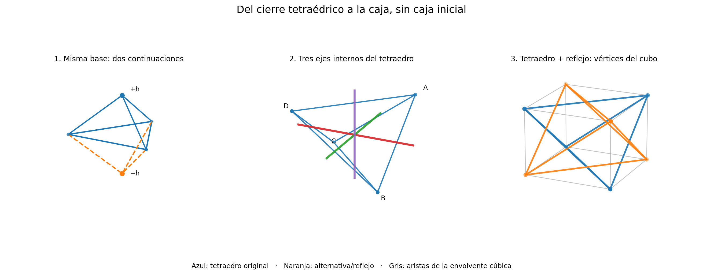

# O19 — Generación de una caja cúbica por reflexión interna de un tetraedro

**Programa de Geometría Relacional · 19 de octubre de 2026**  
**Estado:** [DEMOSTRADO — construcción euclídea] / [CONDICIONAL — interpretación relacional] / [ABIERTO — origen físico y ontológico].  
**Propuesta examinada:** desde el módulo mínimo tetraédrico repetible, conservar la indefinición de las prolongaciones y preguntar si la caja puede emerger de sus reflexiones.

## 1. Qué se toma del programa y qué se agrega

El archivo histórico `HIPOTESIS_MODULO_TETRAEDRICO.es.md` propone «tres diferencias o referencias locales» con «una referencia radial global compartida», y lo cataloga expresamente como hipótesis generativa. La nota `Nota_cierre_incertidumbre_tetraedro_R14_1.md` aclara que radio compartido no basta para producir tetraedro no degenerado ni regular, y que resolución exterior no obliga a conservación de información interior.

**Hipótesis geométricas adicionales H1–H3**: H1) cuatro puntos no coplanares en espacio euclídeo tridimensional; H2) todas las seis distancias mutuas iguales (tetraedro regular); H3) se admiten puntos medios, planos ortogonales y reflexiones especulares. No son consecuencias demostradas de la ontología, ni del grafo abstracto K4. El trabajo consiste en mostrar qué se sigue de estas hipótesis, sin confundirlo con la emergencia de un espacio desde puras relaciones.

## 2. Primera indefinición: un triángulo, dos continuaciones

Dado un triángulo equilátero de lado `a` en un plano, exigir que un nuevo punto esté a distancia `a` de sus tres vértices genera exactamente dos soluciones en R³, una a cada lado del plano. Su distancia al plano es

\[
h=\sqrt{a^2-a^2/3}=a\sqrt{2/3}.
\]

Si todavía no hay criterio de orientación, el signo `+h` o `−h` no está determinado por las seis distancias de un tetraedro regular. Esta es una **realización geométrica concreta de una indefinición de continuación**, no una prueba de que la incertidumbre ontológica sea un signo espacial. Al reflejar el tetraedro sobre esa cara se crea una bipirámide triangular: **NO** aparece directamente un cubo.

## 3. Tres ejes derivados de las relaciones del propio tetraedro

Sean

\[
 A=(1,1,1),\quad B=(1,-1,-1),\quad
 C=(-1,1,-1),\quad D=(-1,-1,1).
\]

Todos los pares de vértices distan `2√2`, de modo que forman un tetraedro regular `T`. El centro intrínseco es `o=(A+B+C+D)/4=(0,0,0)`.

El grafo completo K4 admite **tres** particiones de sus aristas en pares opuestos: `(AB|CD)`, `(AC|BD)`, `(AD|BC)`. Las rectas que unen los puntos medios de cada par de aristas opuestas son, en estas coordenadas, respectivamente los ejes `x`, `y`, `z`. Esas tres rectas son mutuamente perpendiculares. No necesitamos introducir previamente las caras de una caja para definirlas; sí necesitamos la realización métrica regular del tetraedro.

## 4. Teorema geométrico — tetraedro + imagen reflejada

Sean los tres planos por `o` ortogonales a los ejes anteriores y las reflexiones

\[
 S_x(x,y,z)=(-x,y,z),\quad
 S_y(x,y,z)=(x,-y,z),\quad
 S_z(x,y,z)=(x,y,-z).
\]

**Proposición.** Para cualquiera de las tres reflexiones, `S_x(T)=S_y(T)=S_z(T)=−T` como conjuntos de cuatro vértices. La unión de los vértices originales y reflejados es `\{(±1,±1,±1)\}`, el conjunto de ocho vértices de un cubo de lado `2`, centrado en `o`. Por tanto,

\[
 \boxed{\operatorname{conv}\big(T\cup S_x(T)\big)=[-1,1]^3}.
\]

**Prueba:** cada vértice de T tiene producto de sus tres signos `+1`. Reflejar un signo lo cambia a `−1`, produciendo los cuatro vértices que faltaban. Estos ocho puntos son exactamente las ocho ternas de signos. La envolvente convexa de las ocho ternas es el cubo. QED.

Una forma equivalente es la reflexión central `I(v)=2o−v=−v=S_xS_yS_z(v)`. Nota importante: **la inversión central no es simetría del tetraedro**, sino que lo manda a su tetraedro complementario; su composición usa tres reflexiones geométricas, todas definidas desde los ejes internos.

## 5. Repetición y distinción: dos estados exteriores, ocho posiciones

Las tres involuciones `S_x, S_y, S_z` conmutan y generan un grupo de ocho transformaciones `G ≅ (Z₂)^3`. La órbita de **un vértice marcado** contiene los ocho vértices del cubo. Pero la órbita del **tetraedro no etiquetado como conjunto** solo contiene dos configuraciones: `T` y `−T`.

- Reflexiones en un número **par** de ejes dejan el conjunto T igual; hay cuatro transformaciones de esa paridad.
- Reflexiones en un número **impar** de ejes mandan T a −T; hay otras cuatro.

Por eso distintas historias pueden tener la misma firma exterior. En particular, una reflexión en cualquiera de los tres planos internos produce el mismo tetraedro complementario sin conservar necesariamente la correspondencia vértice-a-vértice. **La pérdida de esa distinción bajo una observación externa no implica por sí sola que exista memoria física de las trayectorias.** Para llamar retenida a la indefinición hace falta un marcador dinámico o una comparación posterior capaz de recuperarla.

## 6. La diferencia entre generar un cubo y rellenarlo

Los dos tetraedros regulares **se interpenetran**. Cada uno tiene volumen `8/3` cuando el cubo tiene volumen `8`. Su intersección es un octaedro de volumen `4/3`; su unión ocupa volumen `4`, apenas la mitad del cubo. **La caja se obtiene como envolvente convexa, no mediante el relleno disjunto de dos tetraedros.** Repetir tetraedros regulares pegándolos por sus caras tampoco tesela exactamente todo R³: su ángulo diedro es `arccos(1/3)`, y no encaja un número entero de ellos alrededor de una arista.

## 7. Qué probar a continuación, sin imponer la respuesta

**O19-A [PENDIENTE] — Tetraedro sin regularidad.** Tomar cuatro puntos y solo relaciones de distancia a una referencia compartida; estudiar cuándo los ejes de aristas opuestas siguen siendo ortogonales y cuándo la envolvente reflejada forma una caja distinta o deja de ser un cubo. Falsador: igualdad radial por sí sola no garantiza cubo.

**O19-B [PENDIENTE] — Operador de reflexión de las relaciones, no del espacio.** Definir una regla combinatoria de comparación-reflexión en K4 antes de incrustarlo en R³; comprobar si determina su métrica, el centro, las tres direcciones y una estructura de ocho clases de posiciones, o si necesita agregar información no contenida en K4. Falsador: si varias métricas incongruentes satisfacen el mismo contrato, la caja geométrica no fue derivada solo del grafo.

**O19-C [PENDIENTE] — Persistencia de las rutas.** Guardar un bit o estado de recorrido antes de tomar la firma exterior, evolucionarlo y preguntar si una futura comparación puede distinguir historias que proyectan el mismo tetraedro o cubo. Registrar costos para conservarlo; sin dinámica, no hay retención demostrada.

**O19-D [PENDIENTE] — Espejo móvil, escalas.** Para cada nivel `j`, introducir una escala `r_j` determinada por una regla interna aún desconocida. Comprobar si la sucesión de módulos genera nuevas relaciones medibles; no identificar sin prueba el factor de duplicación geométrica con la ganancia disipativa `g_j` de Navier–Stokes O18.

## 8. Dictamen

**Demostrado:** bajo regularidad euclídea, K4 métrico determina tres ejes internos y tres reflexiones; un tetraedro más cualquiera de esas imágenes da los ocho vértices del cubo, cuyo sólido aparece por envolvente convexa. Una misma firma exterior puede reunir varias historias de reflexión.

**No demostrado:** que las relaciones ontológicas originen por sí mismas la métrica euclídea, la regularidad tetraédrica, la orientación, la memoria, el tiempo o la ganancia de octavas. Esta construcción es un **modelo puente geométrico comprobado** y una hipótesis estructural útil, no una nueva ley física.
