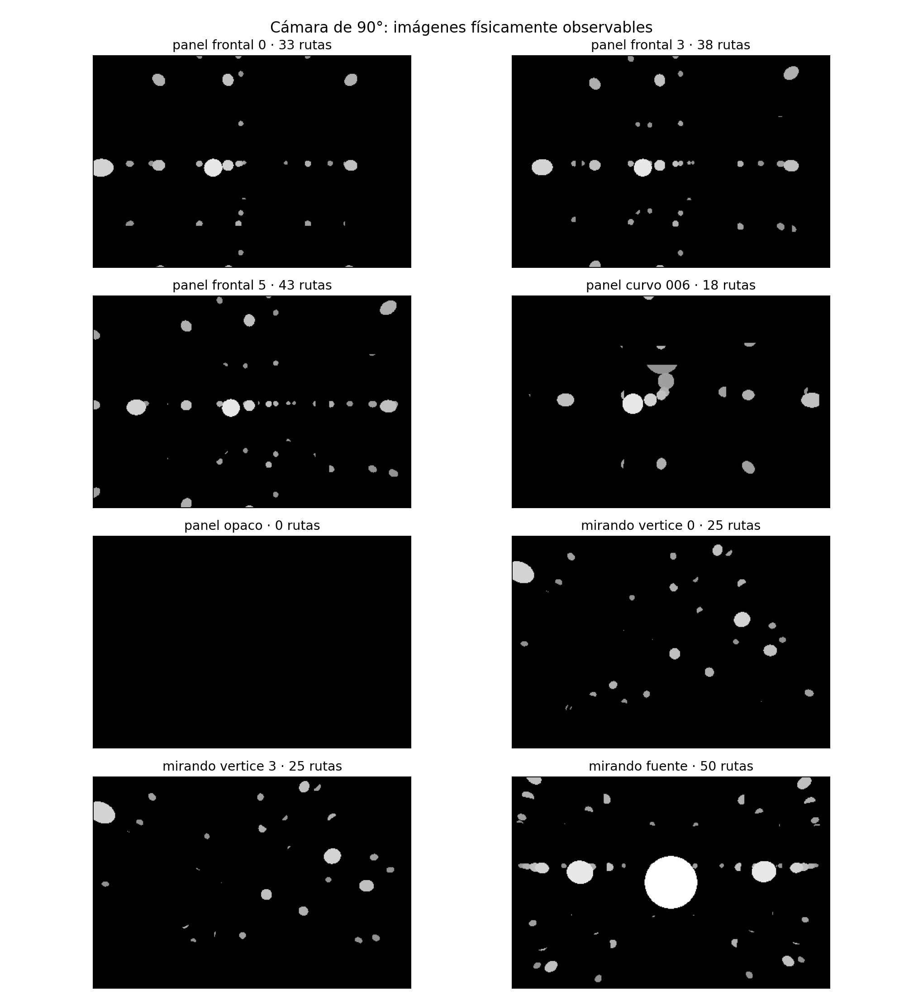
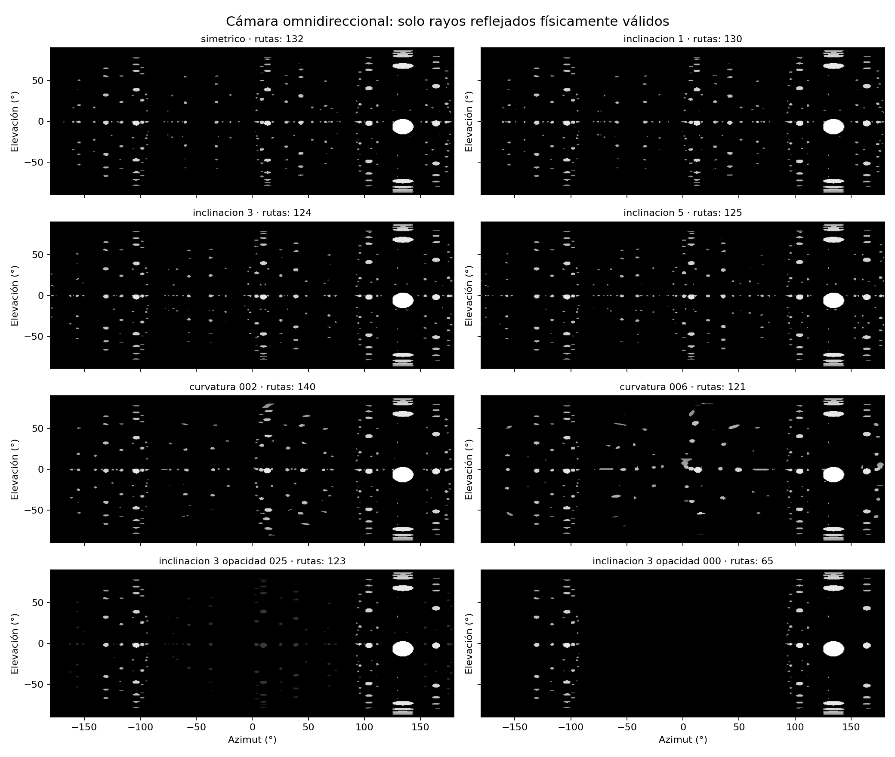
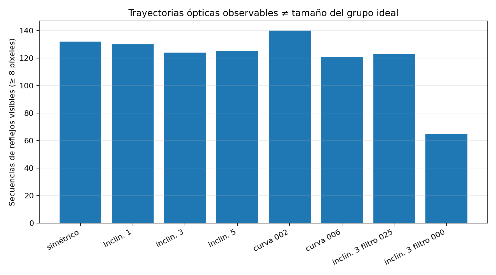

# E-MIRROR v3 — cámara, espejos finitos y accesibilidad

**Programa de Geometría Relacional · 18 de octubre de 2026**  
**Naturaleza:** laboratorio numérico independiente, continuación de E-MIRROR v1 y v2.  
**Estado epistémico:** resultados derivados del modelo de óptica geométrica y verificados por pruebas; interpretación ontológica en investigación. No es demostración de P=NP, Yang–Mills ni de un principio físico universal.

## Pregunta

> ¿Cuánto puede modificarse la geometría de un cubo reflectante antes de que un observador limitado deje de distinguir una fuente que continúa existiendo en el cubo?

### Resumen

**[DERIVADO EN EL MODELO]** La pérdida de visibilidad de una fuente no es equivalente a su desaparición, ni siquiera cuando todos los rayos que llegan a la cámara fueron trazados con espejos físicamente acotados. La geometría del espejo, su reflectividad, el campo de visión de la cámara y su orientación determinan la visibilidad. La singularidad de *procedencia* de la fuente no es un foco óptico común de los rayos.

**[DERIVADO EN EL MODELO]** Pequeñas inclinaciones pueden aumentar las secuencias de reflexión visibles en una cámara concreta; la curvatura puede disminuirlas sin impedir necesariamente una reconstrucción geométrica. No existe un ángulo universal de colapso de la unidad: la respuesta depende del montaje y del criterio observacional.

## Arquitectura del ensayo

- Cubo interior con paredes en `±1 m` en los ejes cartesianos, seis superficies reflectantes finitas de semianchura `0,90 m`, con marco opaco.
- Cinco paneles planos adosados a pared; el panel X+ es una lámina adentro del cubo con ecuación `x = 0,90 + tan(δ) y − κ (y²+z²)` dentro de su apertura. La pared posterior X+=1 m es opaca.
- El panel está en el interior incluso a 5° de inclinación; se evita que salga de la caja. Su cara posterior absorbe rayos.
- Una sola fuente luminosa esférica en `(-0,37, 0,28, 0,11) m` y radio `0,115 m`.
- Cámara puntual en `(0,12, -0,22, 0,19) m`, con panorama 360° o pinhole de campo horizontal de 90°.
- Hasta seis rebotes especulares; reflectividad uniforme por rebote `ρ=0,91`, con umbral relativo de detección `0,07`. En casos filtrados, coeficiente de intensidad del panel frontal de `0,25` o `0`. El valor 0 indica absorción de los rayos que inciden sobre la cara reflectante de ese panel, no opacidad del medio completo.
- Los rayos se trazan **desde la cámara** hacia atrás, y se consideran observables solamente cuando realmente intersectan la fuente antes de un obstáculo: equivalente por reciprocidad al recorrido físico de los rayos en óptica geométrica especular.
- Un **camino** es una secuencia ordenada de identificadores de superficies reflectantes. Un camino «robusto» requiere al menos ocho píxeles detectados con esa secuencia. No equivale necesariamente a una imagen visual desconectada: distintas secuencias pueden superponerse y una misma secuencia puede generar regiones separadas.

### Importante: sobre las imágenes y las reconstrucciones

- Un espejo finito no genera necesariamente todas las posiciones del grupo ideal de reflexiones. La v3 cuenta caminos efectivamente alcanzables bajo las reglas del montaje.
- Una cámara pinhole convencional ve **un solo** rayo por píxel, aun cuando diferentes caminos de reflexión puedan crear imágenes en píxeles distintos.
- La reconstrucción geométrica de la fuente usa trayectorias **trazadas con conocimiento exacto de la geometría calibrada** y píxeles previamente clasificados como pertenecientes a la fuente. Para cada rayo, se conoce el último segmento que incidió en la superficie luminosa; se ajusta una posición por mínimos cuadrados de distancias a líneas. Es un **control con información privilegiada del simulador**, no una inferencia automática de identidad desde una foto, y por tanto representa un límite favorable. En una cámara real, distinguir imágenes, calibrar curvatura y detectar el punto de origen puede ser ambiguo.
- La fuente tiene radio > 0, por lo que los rayos inciden en su superficie y las rectas ópticas no atraviesan todas exactamente el centro. Los errores de reconstrucción no constituyen precisión instrumental verificada.

## Resultado A — cámara orientada hacia el panel frontal

Cámara 90° mirando X+, no puede ver directamente la fuente situada detrás de ella.

| Condición | Píxeles con fuente | Caminos visibles (≥8 px) | Error de reconstrucción* |
|---|---:|---:|---:|
| Panel ideal (δ=0°, κ=0) | 3.060 | 33 | 5,90 mm |
| Inclinación δ=3° | 3.391 | 38 | 8,11 mm |
| Inclinación δ=5° | 3.757 | 43 | 10,75 mm |
| Curvatura κ=0,06 m⁻¹ | 3.362 | 18 | 5,35 mm |
| Panel X+ absorbente (transmisión efectiva 0) | **0** | **0** | No identificable |

\* Ajuste idealizado con rutas ópticas conocidas y fuente esférica de diámetro 230 mm. Los errores son una propiedad de este muestreo determinista, no la exactitud de una cámara real. La inclinación y la curvatura son alternativas, no simultáneas.

La fuente conserva la **misma posición y geometría en los cinco ensayos**. La ausencia de luz cuando se elimina la reflexión X+ no prueba que no pueda haber otro dispositivo capaz de detectar la fuente; demuestra una limitación del observador y su campo de visión.



## Resultado B — orientación de la cámara

| Vista de cámara | Píxeles detectados | Caminos ≥8 px |
|---|---:|---:|
| Frente a X+, panel sin deformar | 3.060 | 33 |
| Mirando hacia el vértice (+X,+Y,+Z) | 2.735 | 25 |
| Mirando directamente a la fuente | 8.550 | 50 |

El número de caminos y el área de fuente detectable dependen de la orientación de la cámara. **[DERIVADO]** La misma estructura contiene trayectorias accesibles e inaccesibles desde distintas posiciones. Este contraste se hace conservando la misma posición física de la cámara y girando solo el eje óptico.

## Resultado C — cámara panorámica

El observador panorámico ve también la fuente directa. Al absorberse X+, disminuyen los caminos visibles robustos de 132 a 65, pero no desaparece la fuente del panorama. Este control evita atribuir erróneamente la desaparición de imágenes a la desaparición de la fuente cuando se modifica un panel.




## Determinantes que conviene separar

1. **R: procedencia/reversibilidad local.** Bajo óptica geométrica ideal, la reflexión especular obedece `v' = v − 2 (v·n)n` y es invertible en el punto de incidencia si la normal está conocida. Esto no implica que todas las trayectorias completas sean reconstruibles desde una cámara.
2. **F: estructura focal.** Variar inclinación/curvatura modifica distribuciones y puede romper la coincidencia de ciertos haces sin multiplicar el origen.
3. **O: acceso observacional.** Exige un trayecto válido, señal sobre umbral, campo de visión y suficiente calibración. La pérdida de acceso puede ser total para una vista particular, sin pérdida de la fuente.
4. **U: unicidad inferida.** Hipótesis adicional de poder concluir una sola fuente a partir de imágenes sin disponer de la respuesta. No está demostrada por simular una única fuente conocida. El próximo ensayo deberá incluir dos fuentes y marcadores distinguibles.

**[HIPÓTESIS RELACIONAL]** Los «cubos» podrían tratarse como marcos de operaciones y observaciones con un conjunto de relaciones comunes; pasar de un cubo a otro cambia qué diferencias puede resolver el sistema. **[PENDIENTE]** Establecer si hay una ley general de conservación de unidad bajo cambios de marco que no sea simplemente la conservación, introducida por construcción, de la fuente simulada.

## Límites

- Reflexión geométrica ideal y reflectividad independiente de la incidencia, sin polarización, absorción espectral, difracción, dispersión del aire, profundidad de campo, aberraciones reales, ruido ni enfoque de lentes.
- La curvatura es una altura cuadrática sobre una lámina reflectante, no un espejo libre de aberraciones.
- No se han estudiado deformaciones destructivas fuera del rango del montaje. Las muestras δ=0–5° NO definen un umbral crítico; más inclinación exigiría desplazar el panel o ampliar la habitación.
- El seguimiento se detiene a seis reflexiones; «sin caminos visibles» significa **sin caminos detectables bajo este campo de visión, umbral y horizonte de rebotes**, no ausencia matemática o física absoluta.
- El reconocimiento humano de imágenes invertidas, simetrías y foco no se modela. La fuente simulada es una esfera luminosa, no un ser humano en el vértice.
- Las cifras dependen de la resolución de imagen y de la regla artificial «≥8 píxeles», de modo que no son constantes físicas.

## Reproducción

Requiere Python 3.10+, NumPy y Matplotlib.

```bash
python raytrace_cubo.py --salida-dir . --ancho 520 --alto 260
python -m unittest -v test_cubo.py
```

Genera `resultados_v3.json`, `resultados_camara_90grados.json`, tres gráficos y registro de 13 pruebas. El nuevo laboratorio no edita ni reempaqueta los ZIP originales de la 3.4.1.

## Siguiente obligación experimental

1. Sustituir el único origen conocido por dos fuentes independientes y marcadores con orientación para determinar si las imágenes permiten inferir realmente la identidad y la cantidad de orígenes.
2. Añadir desenfoque óptico, ruido/calibración imperfecta, paneles con rugosidad y cámara móvil; estudiar el umbral de **inferibilidad** en función de error y posición.
3. Relacionar la estructura mínima de reflexión con el pendiente **laboratorio de esferas**, manteniendo como hipótesis abiertas la coplanaridad, la bifurcación del lado y la diferencia entre tetraedro y cuadrado.
