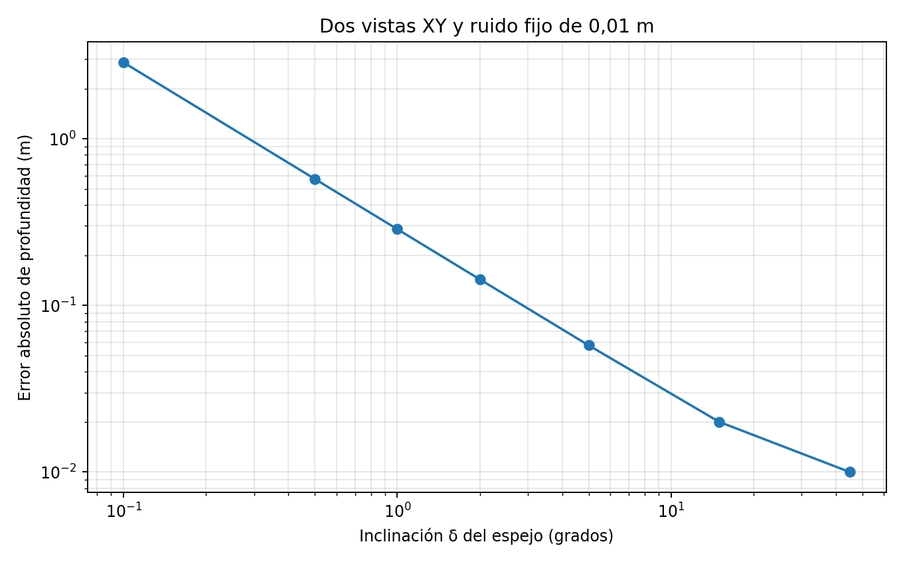
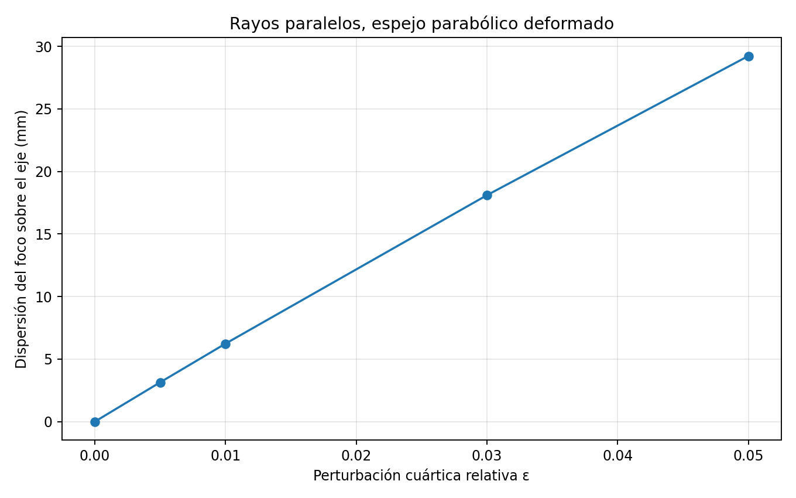

# E-MIRROR — laboratorio de deformación, foco y acceso (v2)
**Fecha:** 18 de octubre de 2026  
**Marco:** Programa de Geometría Relacional 3.4.1  
**Tipo:** extensión reproducible e independiente del laboratorio v1, sin modificación de los ZIP fuente.  
**Estado:** pruebas numéricas verificadas; la interpretación ontológica permanece como hipótesis.

## Hipótesis examinada
> ¿Qué conserva la unidad cuando la forma de los espejos cambia, las imágenes se multiplican, el foco se dispersa o el acceso a la información se pierde?

La palabra *unidad* puede aludir a cosas distintas y no se las identifica sin justificación:
1. **Fuente geométrica común**: un punto original `p` cuya imagen virtual es obtenida por una transformación reversible conocida.
2. **Foco óptico**: posición en que llegan a coincidir rayos; puede dejar de ser puntual por aberración.
3. **Unicidad identificable**: posibilidad de recuperar una fuente a partir de mediciones concretas con filtros, ruido y geometría calibrada.

## A. Estructura perturbada: una simetría rota multiplica la órbita
**Modelo:** tres espejos planos ideales infinitos que pasan por un vértice: uno normal a x, otro normal a y y un tercero cuya normal se inclina δ desde z hacia x. Fuente de prueba `p=(0.4,0.6,0.8)` metros.

La reflexión en un plano de normal unitaria n es `R_n=I−2nnᵀ`. El ángulo agudo entre los planos del par no paralelo se convierte en `θ=90°−δ`. Cuando `θ/180°=a/b` en términos irreducibles, la composición de las dos reflexiones tiene orden **b**; al incorporar el espejo y, que conmuta con las otras, el grupo tiene **4b** elementos. El caso δ=0 se reduce a ocho operaciones. Las órbitas se enumeraron y deduplicaron numéricamente con redondeo a 9 decimales.

| Inclinación δ | Orden de la rotación doble b | Transformaciones / posiciones de fuente genérica |
|---:|---:|---:|
| 0° | 2 | 8 |
| 0,5° | 360 | 1.440 |
| 1° | 180 | 720 |
| 2° | 45 | 180 |
| 5° | 36 | 144 |

**[DERIVADO]** La cantidad de transformaciones puede aumentar bruscamente con una perturbación diminuta, **sin crear fuentes nuevas**. Si `θ/180°` es irracional, la órbita matemática genérica contiene infinitas posiciones distintas. La cantidad no aumenta monótonamente con δ: está gobernada por la aritmética del ángulo y su denominador reducido.

**Límite físico:** no es una predicción del número de reflejos que una persona ve en un cubo con espejos finitos. Los planos infinitos atraviesan regiones del espacio que en una construcción real tendrían soporte material y obstrucciones. Hacen falta aperturas y trazado de rayos para estimar visibilidad.

### El circuito de cuatro reflexiones deja de ser identidad
El circuito `(R_x R_z(δ))²` es identidad para δ=0; con el espejo inclinado es una rotación de magnitud `4δ` en el rango examinado. Aplicado al punto de prueba:

| δ | Rotación residual | Distancia final respecto de la fuente |
|---:|---:|---:|
| 0° | 0° | 0 m |
| 0,5° | 2° | 0,03122 m |
| 1° | 4° | 0,06243 m |
| 5° | 20° | 0,31063 m |

**[DERIVADO]** La perturbación rompe un **cierre particular de longitud cuatro**, aunque siguen existiendo otros cierres de longitud superior para ángulos racionales. No implica colapso de la fuente ni imposibilidad de invertir una reflexión.

## B. La deformación puede **abrir** una coordenada inaccesible
**Modelo de observación:** una fuente puntual `p=(x,y,z)` es medida dos veces. La primera medida conoce `(x,y)`; la segunda conoce las coordenadas XY de la imagen virtual tras la reflexión inclinada conocida. La matriz de observación es

`A(δ) = [P_xy ; P_xy R_z(δ)]`, con `P_xy = [[1,0,0],[0,1,0]]`.

**[DERIVADO]** Para δ=0, `rango(A)=2`: la coordenada z no es identificable. Para `0<δ≤45°`, `rango(A)=3`; si las observaciones se corresponden y el ángulo está calibrado, el punto es identificable. Los valores singulares son `√2`, `√2 cos δ`, `√2 sin δ`, y el número de condición en ese intervalo es `κ₂(A)=1/sin δ`.

Pero **identificabilidad exacta** y **robustez al ruido** no son la misma cosa. Se añadió un error fijo de +0,01 m solo a la coordenada x de la imagen reflejada y se reconstruyó por mínimos cuadrados:

| δ | κ₂(A) aproximado | Error absoluto en z |
|---:|---:|---:|
| 0° | singular | z indeterminada |
| 0,1° | 572,96 | 2,865 m |
| 1° | 57,30 | 0,287 m |
| 5° | 11,47 | 0,0576 m |
| 15° | 3,86 | 0,020 m |
| 45° | 1,41 | 0,010 m |

**[DERIVADO bajo el modelo lineal]** Una asimetría angular puede hacer medible la profundidad antes inaccesible, pero un ángulo pequeño vuelve esa solución muy sensible al ruido. El resultado NO prueba que una cámara física situada ante dos espejos recupere z automáticamente: para ello se requieren rayos válidos, triangulación, calibración, correspondencias y campo de visión. Esta simulación toma como entradas las posiciones virtuales XY previamente conocidas.



## C. Un filtro puede anular la información sin alterar el espejo
Se mantuvo δ=5° y se atenuó exclusivamente el canal horizontal de la segunda observación mediante un factor τ entre cero y uno. Se fijó el mismo ruido instrumental absoluto de +0,01 m en ese canal **después** de la atenuación.

| Transmisión τ | Rango | Error absoluto de profundidad |
|---:|---:|---:|
| 1 | 3 | 0,0576 m |
| 0,2 | 3 | 0,2879 m |
| 0,05 | 3 | 1,1518 m |
| 0 | 2 | z no identificable |

**[DERIVADO/CONDICIONAL]** Opacidad total destruye la posibilidad de recuperar z en este conjunto de observaciones. Transmisiones positivas mantienen el rango matemático 3 pero pueden ofrecer una estimación prácticamente inutilizable a un nivel de ruido determinado. El filtro no cambió ninguna reflexión.

## D. Curvatura: romper el foco óptico sin perder las leyes de reflexión
**Modelo distinto del anterior:** trazado de rayos especulares bidimensional. Rayos entran verticalmente en paralelo a un espejo cóncavo `y=x²/(4f)+εx⁴/(4fa²)`, con foco nominal `f=1 m`, semianchura `a=0,6 m` y 80 rayos no centrales. El parámetro ε deforma la parábola.

Las direcciones reflejadas se calculan por `v_salida=v_entrada−2(v_entrada·n)n`. Se registran las alturas donde cada rayo reflejado corta el eje óptico. Para ε=0 todas las intersecciones coinciden en `f` dentro del redondeo; al introducir deformación se separan:

| ε | Desviación estándar de intersecciones | Máxima desviación del foco nominal |
|---:|---:|---:|
| 0 | ~0 mm | ~0 mm |
| 0,005 | 3,14 mm | 10,35 mm |
| 0,01 | 6,24 mm | 20,51 mm |
| 0,03 | 18,11 mm | 59,30 mm |
| 0,05 | 29,24 mm | 95,41 mm |

Como control, un espejo **esférico** de radio 2 m sobre la misma semianchura registra una dispersión de 14,60 mm por aberración esférica.

**[DERIVADO]** La deformación dispersa el foco geométrico de un haz paralelo sin hacer irreversibles las reflexiones ideales. Este modelo usa rayos paralelos (no una fuente puntual a distancia finita); **no debe interpretarse como ensayo de identidad de una fuente puntual**.



## E. Determinante operativo propuesto
En este laboratorio resulta útil distinguir tres condiciones independientes:

- **R — reversibilidad geométrica:** `R_n²=I`, si el espejo es ideal y su geometría está conocida. La transformación permite volver matemáticamente de una imagen virtual a su fuente.
- **F — cierre focal:** dispersión de las intersecciones de rayos; un foco puntualmente coincidente puede desaparecer bajo perturbación aun si R continúa siendo válida.
- **O — observabilidad:** `σ_min(A)>0` y, en presencia de ruido, que esa singularidad mínima sea suficientemente grande en relación con él. La información puede no ser identificable o ser demasiado inestable para recuperarla.

**Conclusión del experimento:** ni un foco óptico común es necesario para conservar procedencia, ni la reversibilidad garantiza por sí sola que el observador pueda reconstruirla. En el ejemplo, la deformación de espejos puede romper un circuito corto y simultáneamente hacer recuperable una coordenada antes oculta por simetría.

### Formulación de investigación para el programa
**[HIPÓTESIS]** El cambio de «cubo» podría representarse como un cambio en las operaciones reflexivas admisibles y en los operadores de observación que separan clases de equivalencia antes indistinguibles. **[PENDIENTE]** Convertir esto en un principio ontológico y derivar reglas de cambio de dimensión o cardinalidad. Por ahora se han construido ejemplos matemáticos donde cambia la capacidad de discriminación; no se ha probado una ley general de génesis de la unidad, P=NP ni Yang–Mills.

### El siguiente control que más falta hace
**[PENDIENTE]** Implementar cámara virtual, planos **finitos**, propagación geométrica y oclusión para distinguir transformaciones del grupo de caminos ópticos físicamente realizables. Comparar una fuente puntual y un objeto con marcadores desde centro, caras y vértices del cubo, con reflectividad y ruido realistas. Solo entonces será apropiado comparar la cantidad de imágenes observables con las órbitas ideales.

La propuesta posterior de un **laboratorio de tres y cuatro esferas** sigue documentada en `base_v1/PENDIENTE_LABORATORIO_ESFERAS.es.md`; deliberadamente no se presenta como un resultado ejecutado.

## F. Reproducción

Requisitos: Python >=3.10, NumPy y Matplotlib. Desde el directorio del laboratorio:

```bash
python laboratorio_deformaciones.py --salida resultados_v2.json --figuras-prefijo figura
python -m unittest -v test_deformaciones.py
cd base_v1
python -m unittest -v test_laboratorio.py
```

Hay **16 pruebas nuevas + 8 pruebas anteriores = 24 pruebas superadas**. El JSON muestra los valores no redondeados; las dos figuras son regenerables. Los ZIP de la 3.4.1 permanecen como fuentes separadas de solo lectura.
