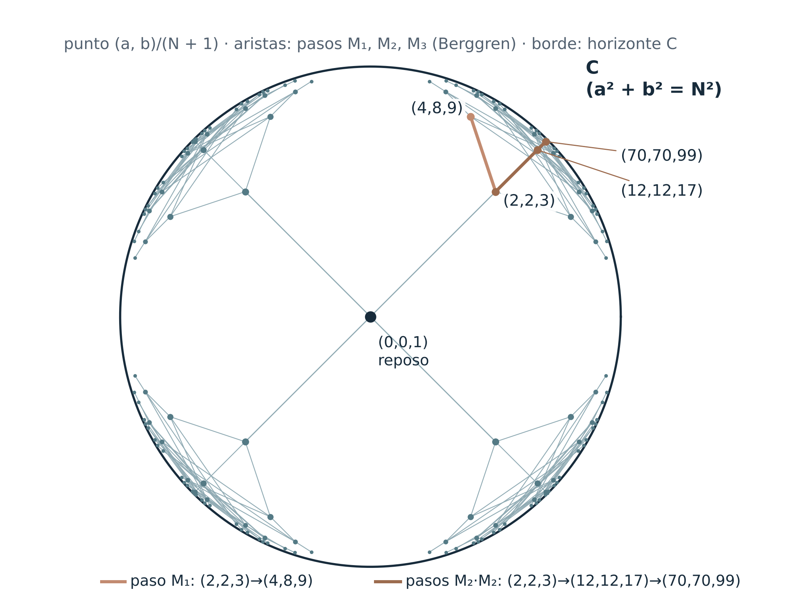
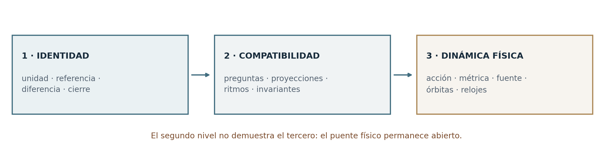
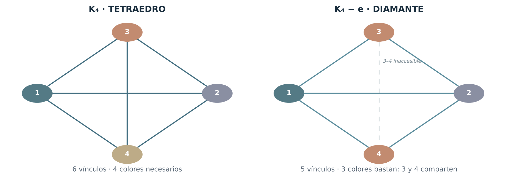
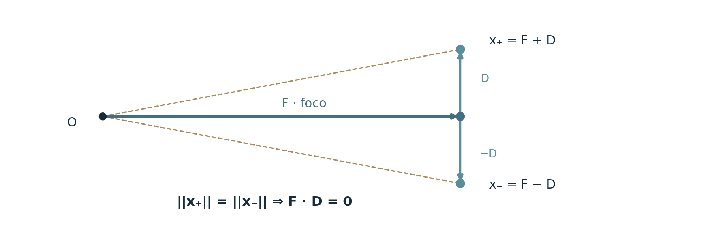

**PROGRAMA DE GEOMETRÍA RELACIONAL**

**G–01**

**EL MECANISMO DE LA GRAVEDAD**

Reconstrucción ontológica, formalización relacional y programa de pruebas

> «La escala nace de la comparación. Los múltiplos comunes integran sus referencias; C permanece como límite inalcanzable de esa comparación.»

**AUTORÍA CONCEPTUAL** Le Matt Ansatz Di Ego

**VERSIÓN** 1.3 · 1 de noviembre de 2026

**ESTADO ROSI** OPEN — hipótesis gravitatoria en construcción; normalización común exacta; realización hiperbólica de O58 demostrada (§2D)

**ÁMBITO** Documento autónomo de investigación

# Resumen ejecutivo

G–01 reconstruye el mecanismo de la gravedad desde una secuencia que ya atraviesa el Programa de Geometría Relacional: unidad, reflexión, diferencia, proyección, normalizador común, resto referenciado, cierre propio y continuación. El programa no comienza eligiendo aceleración, potencial ni fuerza. Comienza investigando qué relaciones pueden seguir siendo reconocidas cuando dos escalas se expresan en una referencia común y cómo esa referencia permite resolver una diferencia pendiente. Se integran explícitamente O40, O58, MF–86, YM–01/02, R–01, la rama de grafos y los controles O78/O81 de Navier–Stokes.

La precisión conceptual introducida en la versión 1.2 concierne a C. C representa el límite inalcanzable de comparación de la proyección: en C no habría diferencias internas ni ritmos relativos que comparar. «Sintonizado a la eternidad» es la imagen ontológica de ese horizonte, no un reloj infinito ni una perspectiva física propia de la luz. C no es un nodo, una partícula, un foco vectorial ni el múltiplo común; este último opera entre sistemas con comparaciones posibles. Cuando el programa use C como límite de propagación física, esa identificación será una hipótesis de puente que deberá ponerse a prueba.

La tesis de G–01 es: la gravedad podría ser la manifestación geométrica de la resolución de diferencias de escala entre cierres que construyen una referencia común sin perder su identidad. En el laboratorio modular el múltiplo común preserva exactamente los valores anteriores; O58 demuestra además que una nueva organización puede dejar una unidad pendiente respecto de su nuevo normalizador. Falta construir un operador intrínseco que seleccione y actualice físicamente esa organización, una métrica y un reloj, y comprobar sus consecuencias gravitatorias. Se mantienen los teoremas exactos de reflejos, tetraedro, tiempos discretos, órbitas y controles negativos de v1.1 como realizaciones o pruebas, no como premisas del mecanismo.

**Hallazgo de la versión 1.3.** El contrato de O58, a²+b²+1=N², tiene una realización exacta y conocida: sus soluciones son los puntos enteros del hiperboloide N²−a²−b²=1 del espacio de Minkowski en 2+1. Normalizado, se lee v²+(dτ/dt)²=1: la unidad pendiente 1/N² es el cuadrado del ritmo propio, y el horizonte C corresponde al cono a²+b²=N², el de las ternas pitagóricas. Todas las soluciones forman un único árbol generado por tres transformaciones de Lorentz enteras (Berggren), y cada una aparece exactamente una vez (B19). Eso da a G–02 un operador de continuación definido y a §12 una distancia entre cierres, la rapidez, y muestra que la regla de múltiplos M=qN recorre ese árbol solo en parte. Es cinemática, no gravedad: el puente gravitatorio queda como hipótesis explícita (§2D). La edición añade también un normalizador con resolución finita (§2B), porque el MCM de denominadores no es continuo en las razones.

**Palabras clave:** gravedad relacional, C como horizonte, proyección, escala, normalización común, mínimo común múltiplo, resto, cierre propio, referencia, NS, Yang–Mills, P frente a NP, espejos, tetraedro, tiempo, hiperboloide de Minkowski, rapidez, árbol de Berggren, resolución finita y ROSI.

# 1. Propósito, alcance y reglas de lectura

**Pregunta central G–01.** ¿Cómo se organiza una diferencia entre proyecciones mediante un normalizador común que conserva las referencias anteriores, y bajo qué regla esa resolución se manifiesta como geometría física entre sistemas? El límite C orienta las comparaciones como horizonte, pero no participa como un tercer estado en el cual efectuar mediciones.

El método seguirá siempre el mismo orden: definir identidades y relaciones; fijar las preguntas que acreditan una diferencia; reconstruir la referencia común; registrar el resto y la capacidad de continuación; identificar una transformación geométrica objetiva; finalmente comparar con relojes, trayectorias y observaciones físicas. No se escoge previamente una ley de aceleración para justificar la construcción.

**Contratos de lectura:** \[O\] orientación ontológica; \[D\] definición operacional; \[T\] resultado exacto bajo hipótesis declaradas; \[H\] hipótesis física; \[C\] consecuencia condicional; \[F\] falsador o ejemplo discriminante; \[P\] problema pendiente. ROSI: RESOLVED, OPEN, SUPERPOSED y PREMATURELY COLLAPSED describen el estado de una afirmación, no el valor de un autor.

Esta edición unifica la gramática de normalización usada en las ramas de complejidad, grupos gauge y fluidos. Sus realizaciones matemáticas son distintas: un MCM entero, una interfaz semántica, un transporte gauge o una referencia dinámica no se convierten automáticamente en el mismo objeto físico. La gravitación es la hipótesis nueva que debe enlazarlos cuando sea pertinente.

# 2. Unidad, referencia, proyección y resolución

\[O\] La unidad original se reconoce como totalidad que todavía no acredita diferencias internas. La primera reflexión hace posible una comparación; la proyección expresa una identidad bajo una escala sin fragmentarla. Una relación nueva puede establecer una referencia interna propia y exigir una referencia común con las anteriores. C se reservará para un límite de comparación, no para esta unidad ni para un foco geométrico.

\[O\] Referencia es la condición que permite reconocer una comparación. Diferencia es una distinción acreditable entre lecturas. Resolución nombra la integración de diferencias en una referencia que permite continuar. Cierre propio es una organización capaz de conservar su identidad, sus comparaciones pertinentes y su regla de continuación. El resto registra aquello que la referencia presente deja pendiente, sin presuponer que sea una sustancia, energía o fuerza.

Proyección, espejo y esfera designan laboratorios diferentes de esa gramática. Una proyección no requiere espacio físico previo; un reflejo óptico real sí presupone propagación; un grafo permite probar compatibilidades; un campo dinámico posee condiciones adicionales. Estas distinciones preservan el significado de cada resultado mientras permiten investigar una estructura común.

\[O\] La dirección del programa está en la resolución. Las diferencias de escala que impedían una comparación conjunta pueden quedar integradas por un normalizador común. La nueva referencia conserva lo reconocido y puede hacer visible un resto nuevo. Espacio, ritmo y masa se investigan como posibles realizaciones de esa arquitectura: capacidad de comparación, recurrencias y persistencia complementaria de una identidad. La aceleración se ubica después de construir una medida espacial y temporal, como posible lectura física de la evolución de los cierres.

# 2A. C: horizonte de comparación, no sistema comparable

\[O\] La palabra C designa en esta formulación un límite al que las comparaciones se orientan sin alcanzarlo. En C, por hipótesis ontológica, no habría diferencias internas que confrontar ni dos ritmos relativos que permitan medir un transcurso. Su imagen es una sintonía eterna e inalcanzable. «Eternidad» indica ausencia de contraste temporal interno, no una duración infinita medida desde C.

\[D\] Una comparación siempre se efectúa entre estados o referencias que pertenecen al dominio donde existen preguntas operacionales. C no pertenece a ese dominio como una identidad adicional. Un límite puede ordenar una familia de razones aunque no proporcione una nueva lectura desde sí mismo. La normalización trabaja sobre esas razones; no compara a un objeto con el supuesto reloj de C.

\[H\] Si posteriormente C se identifica con la velocidad límite física c de relatividad, debe distinguirse que un sistema con masa no alcanza c y que un rayo de luz no tiene un marco inercial propio. La frase «sin tiempo en C» no atribuye experiencia, inmovilidad o un observador a la luz. Para una partícula masiva ideal en movimiento inercial, la relación dτ/dt=√(1−v²/c²) tiende a cero cuando v→c; ese límite cinemático especial no demuestra la hipótesis gravitatoria ni incluye por sí solo gravedad.

\[D\] Convención tipada: C = horizonte ontológico de comparación; c_luz = velocidad límite medida, si el puente físico se valida; c_f = vector focal tetraédrico; K = conjunto de estados compatibles; N, m y L = normalizadores enteros cuando se use aritmética modular. v_esp = velocidad del comparador espectral de §9; v\* = escala de velocidad del potencial auxiliar de §13; η = rapidez en la realización hiperbólica de §2D; ε = resolución de un normalizador (§2B); M₁, M₂, M₃ = generadores enteros de §2D, nombrados así para no confundirlos con C. Ninguna igualdad entre estas entidades se presupone.

\[P\] El programa necesita explicar por qué ese límite es universal, cómo se aproxima mediante relaciones finitas y si restringe dinámicamente el cambio de escala. Debe evitar tomar «C es inalcanzable» como regla suficiente para obtener un potencial gravitatorio.

# 2B. El múltiplo común que conserva las relaciones

\[O\] El múltiplo interno de la novedad le permite sostener una referencia propia. El múltiplo normalizador común integra la nueva relación y las ya acreditadas. La novedad no antecede a las antiguas referencias como destino conocido: surge como diferencia que exige ampliar la familia de comparaciones. Lo resuelto permanece reconstruible desde el nuevo marco mientras se preserve la interfaz correspondiente.

L = mcm(N,m), h/N = \[h(L/N)\]/L, si N divide L.

\[T — O40\] Para dos familias racionales de fase H_N y H_m, el menor normalizador común es L=mcm(N,m). Ambas se incluyen en H_L y los valores anteriores se preservan por mapas explícitos de inclusión o reducción, según el contrato. Ejemplo: 1/2=3/6 y 1/3=2/6. La diferencia 1/6 permanece; desaparece el impedimento de expresarla conjuntamente, no la diferencia entre los dos valores.

\[T — YM–02/R–01\] En el modelo de residuos, las dos firmas x mod N y x mod m coinciden conjuntamente si y solo si coincide x mod L. Cada clase previa módulo N se subdivide en m/mcd(N,m) clases en la nueva firma; un primo p que no divide N introduce p clases por clase previa. El número de subdivisiones mide refinamiento del comparador, no nuevas dimensiones o partículas físicas.

\[D\] Una referencia común no impone automáticamente compatibilidad de pesos físicos, evolución o conservación de distinciones bajo cualquier actualización. Es esencial definir la proyección de regreso π y la regla T de continuación. La igualdad π∘T_L = T_N∘π representa la condición de continuidad para esa actualización. Si T_L colapsa estados, la conmutación sola no conserva necesariamente cada diferencia de su interior.

\[F\] **Discontinuidad del MCM.** El MCM de denominadores no es continuo en las razones. Para 1/2 y 1/3, L=6; para 1/2 y 50/99, que difieren en 0,005, L=198; para 1/2 y 501/1000, que difieren en 0,001, L=1000. Una razón irracional no tiene denominador. Una física continua no puede depender de L de ese modo: dos situaciones casi idénticas tendrían normalizadores sin relación entre sí.

\[D/T\] **Normalizador con resolución finita.** Para una razón real α y una resolución ε\>0, sea q_ε(α) el menor entero q≥1 para el que existe p con \|α−p/q\|≤ε. Está definido también para α irracional y, por el teorema de aproximación de Dirichlet \[EX-7\], cumple q_ε(α)≤⌈1/ε⌉ (B21). El normalizador de una familia a resolución ε es L_ε=mcm de los q_ε(αᵢ). Con ε=1/100, los tres pares anteriores dan L_ε=6, 2 y 2; con ε=1/1000 dan 6, 166 y 2. El normalizador queda acotado y solo cambia cuando una razón cruza un umbral de la resolución declarada.

\[H\] La resolución ε es el parámetro que faltaba para que el normalizador pueda ser físico: un cierre no compara con precisión infinita, sino hasta donde sus preguntas acreditan diferencias. Las mejores aproximaciones a cada resolución las dan las fracciones continuas. Adoptar este contrato es una hipótesis que debe ponerse a prueba (Prueba O).

# 2C. Resto, unidad pendiente y nuevo cierre

\[D/T — O58\] En el contrato más fuerte de dos canales enteros se estudia a²+b²+1=N². Normalizar da a²/N²+b²/N²+1/N²=1. La unidad pendiente es la fracción 1/N² de ese estado. El contrato no es universal: algunos N lo admiten y otros no, y no es idéntico a la identidad bilateral N²−(N−1)(N+1)=1, válida para cualquier N.

Si M=qN: 1/N² = q²/M²; 1/M² es una unidad nueva, no la anterior.

\[T — O58\] Transportar un estado del normalizador N al múltiplo M conserva el valor de sus partes. Si el nuevo estado también deja una unidad bruta pendiente, debe reorganizar al menos alguno de sus pesos. El balance exacto se escribe sobre los pesos: Δ(a²/M²)+Δ(b²/M²)+Δr=0, con Δ(a²/M²)=(a′²−q²a²)/M², lo análogo para b, y Δr=(1−q²)/M² (B15). El normalizador anterior constituye una estela reconstruible; la nueva unidad no borra su historia.

\[T/F\] O58 exhibe más de una continuación compatible desde la misma referencia: (2,2,3)→(4,8,9) y (2,2,3)→(70,70,99). La normalización común acredita continuidad, pero no selecciona por sí misma cuál cierre se realiza. En G–01 esta selección será un problema central de dinámica y no una decisión narrativa. La sección 2D muestra que estas ramas pertenecen a un único árbol y que la regla de múltiplos selecciona solo una parte de él.

\[H\] La resolución geométrica de G–01 será una realización, todavía por construir, de esa separación entre herencia de escala y reorganización del resto. El límite C ordena el espacio de comparación, mientras la transición ocurre entre cierres comparables y alcanzables. No hace falta asignar a C una cardinalidad, un denominador ni un reloj.

# 2D. O58 como hiperboloide: ritmo propio, horizonte y árbol de continuaciones

\[T\] **Identidad.** El contrato de O58, a²+b²+1=N², es la ecuación N²−a²−b²=1: sus soluciones son los puntos enteros del hiperboloide unidad del espacio de Minkowski con dos direcciones espaciales y una temporal. Dividiendo por N²:

**(a/N)² + (b/N)² + (1/N)² = 1 ⟺ v² + (dτ/dt)² = 1, con v = (a/N, b/N) y dτ/dt = 1/N = 1/γ.**

La unidad pendiente 1/N² de O58 es exactamente (dτ/dt)² = 1−v²: la fracción que no se proyecta en las dos direcciones. Para (2,2,3), \|v\|=√8/3≈0,943 y 1−v²=1/9 (B18). En lectura relativista, (a,b,N) son el momento y la energía en unidades de mc, y 1/N = m/E.

\[T\] **Horizonte.** Si se quita la unidad, a²+b²=N² son las ternas pitagóricas: el cono nulo, donde \|v\|=1 y dτ/dt=0. La unidad pendiente separa los cierres, que están en el hiperboloide, del horizonte, que es el cono. A lo largo de cualquier familia de soluciones con N→∞, \|v\|→1 y 1/N²→0: los cierres se acercan a C sin alcanzarlo, porque ninguna solución tiene resto nulo. En esta realización C deja de ser solo una imagen: es el borde del espacio de cierres, como lo pide §2A.

\[T\] **Árbol de continuaciones.** Las tres matrices de Berggren \[EX-6\], que aquí se llaman M₁=((1,−2,2),(2,−1,2),(2,−2,3)), M₂=((1,2,2),(2,1,2),(2,2,3)) y M₃=((−1,2,2),(−2,1,2),(−2,2,3)) para no confundirlas con C, conservan N²−a²−b²: son transformaciones de Lorentz con coeficientes enteros. Aplicadas a una solución, dan tres soluciones nuevas; desde (2,2,3) salen (4,8,9), (12,12,17) y (8,4,9). Recíprocamente, toda solución con N\>1 tiene un único padre, de N estrictamente menor, y el descenso termina en el reposo (0,0,1). Por tanto todas las soluciones forman un solo árbol con raíz (2,2,3), y cada par ordenado (a,b) aparece exactamente una vez (B19). La enumeración lo confirma: 754 de 754 soluciones con 1\<N≤3000.

Figura 1. Soluciones de a²+b²+1=N² en el disco de Poincaré, punto (a,b)/(N+1), con las reflexiones de signo de (a,b). El centro es el reposo (0,0,1); el borde es el horizonte C, donde a²+b²=N². Las aristas son pasos M₁, M₂, M₃ hasta tres niveles. Resaltadas: (2,2,3)→(4,8,9) y (2,2,3)→(12,12,17)→(70,70,99).

\[T\] **Distancia entre cierres y rapidez.** El hiperboloide lleva una distancia propia: para dos soluciones X=(a,b,N) y X′=(a′,b′,N′), cosh d(X,X′) = NN′−aa′−bb′. Desde el reposo, d = arccosh N = η, la rapidez. En la rama simétrica a=b la ecuación es N²−2a²=1 (Pell): sus soluciones N=3, 17, 99, 577 tienen rapidez exactamente η₁, 2η₁, 3η₁ y 4η₁, con η₁=ln(3+2√2)=2·ln(1+√2)≈1,7627 (B20). En esa rama cada paso M₂ suma la misma rapidez, como se suman las rapideces de dos impulsos en la misma dirección. En las demás ramas las aristas del árbol tienen longitudes distintas. O58 ya había encontrado esta rama como solución de Pell y había construido una cadena anidada, 3→99→3 880 899, elevando N+m√2 al cubo (O58.12) \[PR-13\]. En la lectura hiperbólica esa operación multiplica la rapidez por tres: N′=N(4N²−3) es la fórmula de cosh 3η, y la estela anidada de O58 es la subsucesión η₁, 3η₁, 9η₁…

\[F/T\] **La regla de múltiplos frente al árbol.** La continuación de O58 exige M=qN. En el árbol, (2,2,3)→(70,70,99) son dos pasos M₂ con (12,12,17) en medio, y 17 no es múltiplo de 3, como ya señalaba O58. De las 15 soluciones con 3\<N≤120 y a≤b, solo (4,8,9) y (22,46,51) tienen N múltiplo del N de su padre. La regla de múltiplos no sigue las aristas: relaciona cierres a distancias variables y salta los intermedios. En esta realización la composición natural es la de Lorentz, no la de múltiplos; cuál de las dos corresponde a la física queda SUPERPOSED.

\[H\] **Lectura física.** Bajo esta identificación, 1/N = dτ/dt = m/E es la fracción de la energía que no se proyecta como movimiento. Coincide con la lectura de §10, que investiga la masa como persistencia complementaria de una identidad. La identificación algebraica es exacta; asignarle kilogramos, una fuente o una constante de acoplamiento sigue siendo un puente abierto.

\[H/P\] **Tres canales.** El contrato de dos canales vive en 2+1. Con tres canales, a²+b²+c²+1=N², se obtienen los puntos enteros del hiperboloide en 3+1, el espacio-tiempo de la relatividad: tres referencias espaciales y una cuarta que no se proyecta. Su árbol de continuaciones y sus generadores deben construirse y verificarse (Prueba P); no se presuponen.

\[H\] **Puente gravitatorio.** Para un observador estático en el campo de una masa esférica, la relatividad general da dτ/dt=√(1−r_s/r)=√(1−v_esc²/c²), con r_s el radio de Schwarzschild y v_esc la velocidad de escape \[EX-8\]. La forma coincide con la de O58 si se lee 1/N² = 1−r_s/r: el horizonte r→r_s correspondería a N→∞, es decir, a C. Es una coincidencia de forma conocida, no una derivación.

\[F\] **Alcance.** Una lectura literal con N entero cuantizaría r_s/r = 1−1/N², lo que contradice un radio continuo; la lectura tiene que hacerse con resolución finita (§2B) o como muestreo. Todo lo anterior es cinemática de la relatividad especial en una realización entera: no contiene fuente, acoplamiento ni la regla que elija entre M₁, M₂ y M₃. Esa regla es el problema de G–02.

# 3. Cubo de espejos: proyección, escala y reconstrucción

Figura 2. La sucesión conceptual no equivale todavía a una derivación física.

\[O/D\] En el laboratorio idealizado, una totalidad y sus reflejos se confrontan desde paredes de referencia. Una pared que se corre modifica su relación con el conjunto de imágenes. El desplazamiento puede alterar escala, orientación y accesibilidad de las comparaciones, sin que la unidad de referencia pierda necesariamente su identidad respecto de sí misma. Inverso y verso pueden ser dos lecturas de una imagen en el mismo punto representado, siempre que se declare la operación que intercambia esas lecturas.

La secuencia conversacional **2–3–4–5** se conserva como protocolo narrativo que debe formalizarse, no como ley universal de espejos: con dos referencias aparece una identidad comparada; la tercera puede dejar dos sentidos de orientación; una cuarta puede reproducir el patrón de indefinición dentro de una familia homogénea; una quinta puede reabrir la distinción y volver no homogénea la familia. Aquí «tercera», «cuarta» y «quinta» deben indicar explícitamente si se cuentan imágenes, paredes, reflexiones, esferas o iteraciones. Sin esa elección son objetos diferentes y no hay teorema.

\[T/F\] El control óptico elemental de dos espejos paralelos separados una distancia L, con un punto en posición p, produce posiciones ideales de imágenes **2nL ± p** para enteros n. El conjunto de posiciones puede ser infinito aunque las orientaciones lineales posibles sean pocas. Mover una pared cambia L y, con ello, la estructura de posiciones. Por tanto, no se puede deducir un cierre físico de «cinco imágenes» solo contando orientaciones. El laboratorio precisa cuáles preguntas se hacen a las imágenes y qué equivalencias permanecen al mover la pared.

En el cubo se distinguen tres operaciones: (i) corrimiento de la pared o cambio de marco de lectura; (ii) acreditación de una nueva comparación que refina las familias de imágenes; (iii) reorganización efectiva de un cierre que modifica su continuación. El múltiplo común resuelve una relación de representabilidad; el experimento físico debe indicar qué transforma de modo objetivo. C es el horizonte de comparación, no un espejo adicional dentro de la caja.

# 4. Las esferas, el tetraedro y el diamante

Figura 3. El diamante exige retirar o volver inaccesible una relación de K4. Coloración propia: K4 necesita cuatro colores; en K4−e bastan tres porque 3 y 4 ya no se comparan.

\[O\] Cada esfera representa una identidad que conserva relaciones con otras. Cuatro centros equidistantes forman un tetraedro regular en una realización euclidiana tridimensional. Como grafo de contactos mutuos, los cuatro centros son los vértices de K4, con seis vínculos. Esa simetría proporciona un laboratorio para una referencia sin vértice privilegiado.

La figura llamada **diamante** debe distinguirse del tetraedro completo. En teoría de grafos, el grafo diamante es K4 sin una arista: dos triángulos que comparten una arista. Admite tres colores propios; K4, por el contrario, requiere cuatro colores propios. Si la propuesta interpreta el diamante como proyección de un tetraedro cuya orientación no está determinada, la operación de proyección debe explicar por qué una comparación deja de ser exigible o queda inaccesible. Omitir esa relación en la representación no equivale a que el vínculo físico desaparezca.

\[H\] El diamante puede servir como **unidad proyectada**: dos orientaciones indistinguibles para una familia de preguntas se representan por la misma figura; al repetirse las relaciones aparecen estructuras de «diamantes de diamantes». La estabilidad cromática de tres colores es un criterio **del grafo proyectado**, no una propiedad demostrada de cualquier conjunto de cuatro esferas ni de un campo gravitatorio. La quinta esfera o reflexión puede introducir una restricción nueva que rompa homogeneidad; debe verse en un protocolo finito antes de generalizarlo.

\[O/F\] La ausencia de una dirección privilegiada no elimina necesariamente la existencia de un **punto común**. Una figura puede conservar su centro bajo todas sus rotaciones sin conservar ningún vector no nulo. Esta distinción es esencial para hablar de foco y singularidad sin atribuir orientación absoluta a la totalidad.

# 5. Núcleo mínimo del lenguaje relacional y continuidad

\[D\] Un laboratorio relacional finito puede representarse como M=(V,E,Ω,K,Q,G,T): V reúne identidades; E, relaciones; Ω, estados disponibles; K⊆Ω, estados compatibles; Q, preguntas operacionales; G, transformaciones de referencia; T, continuación. C no forma parte de Ω como un estado adicional: es el límite conceptual de comparación cuya realización física sigue abierta. Un normalizador común debe especificar mapas entre firmas de dos miembros de esta familia.

\[D\] Dos estados son equivalentes para Q cuando todas las preguntas de Q dan las mismas respuestas. Una distancia de distinguibilidad ΔQ puede contar diferencias con pesos previamente declarados. Una unidad que cierra respecto de Q no necesita borrar todas las diferencias internas: necesita conservar las suficientes para responder y continuar. La diferencia mínima de un cierre depende del contrato de preguntas y de su normalizador; no equivale automáticamente a una separación en metros.

\[T\] Sea Φ: Ω→Y una representación reducida de lo observado. Existe una regla autónoma T̄:Y→Y compatible con T —esto es, **Φ∘T = T̄∘Φ**— si y solo si **Φ(x)=Φ(y)** implica **Φ(Tx)=Φ(Ty)** para todo par de estados considerados. Esta condición es el criterio de **suficiencia dinámica**: una imagen colectiva puede reemplazar a las imágenes internas solo si las diferencias omitidas no alteran las respuestas futuras de la clase de preguntas comprometida. Una fotografía común no garantiza una continuación común.

\[D/H\] Una referencia nueva es suficiente para un conjunto de preguntas y continuaciones si desde ella pueden reconstruirse las respuestas acreditadas y actualizarse sin ambigüedad. MF–86 destaca suficiencia, idempotencia y composición. La idempotencia NQ(NQ(x))=NQ(x) expresa que volver a normalizar bajo el mismo contrato no introduce otra distinción; no decide por sí sola la economía de cálculo ni la dinámica física.

# 6. Control exacto de cierre en cuatro referencias

\[T\] Para cuatro bits de vértice s_i∈{0,1} y relaciones binarias b_ij=s_i⊕s_j sobre las seis aristas de K4, la suma XOR de cualquier triángulo es cero. Hay **8 configuraciones compatibles de aristas entre 64** posibles; la inversión global de todos los bits conserva las seis relaciones. Una familia coherente puede contener diferencias no nulas: **concordancia no es identidad**.

\[F\] La consistencia de XOR no proporciona un potencial gravitatorio ni equivale a resolver la 3-coloración. Las aristas binarias de diferencia, los colores propios y las proyecciones geométricas son contratos distintos. El criterio de «diamante» para tres colores no debe importarse sin traducción al sistema XOR.

# 7. Dos reflejos: foco común, radio y desfase

\[D\] En la realización geométrica auxiliar, la identidad focal del par se escribe F (no C). Los reflejos x±=F±D tienen una parte recuperable y una componente diferencial. La amplitud aV=R0/R expresa relación de radios; no representa un cociente de velocidades respecto de C.

Figura 4. Reconstrucción auxiliar equirradial: el foco F no es una fuerza.

\[D\] En un espacio vectorial real provisto de producto interno —una realización auxiliar ya geométrica— consideremos **x+ = F + D**, **x− = F − D** y supongamos **\|\|x+\|\| = \|\|x−\|\| = R**. Restar las normas cuadráticas da **4 F·D = 0**. Por tanto **F ⟂ D**, y si **R0=\|\|F\|\|**, se obtiene:

**R² = R0² + \|\|D\|\|²; R cos(δ/2) = R0; aV(R)=R0/R; daV/dR=−R0/R².**

\[T\] δ es la separación angular entre reflejos equirradiales, cuando R≥R0\>0. Mantener F fijo mientras crece la componente D conserva la referencia y cambia el desfase. Esta es una reconstrucción geométrica exacta. En cambio, si se usa el peso cuadrático aV², **d(aV²)/dR=−2R0²/R³**. El gradiente depende del observable seleccionado.

\[F\] Nada en esas ecuaciones determina R(t), fuerza, energía, trayectoria ni masa. R es, en estas ecuaciones, radio del espacio auxiliar; identificarlo con metros físicos requiere una construcción métrica y una calibración independiente. **No se ha derivado la gravitación de la derivada geométrica.**

# 8. Cuatro perspectivas: reconstrucción de un foco, distinto de C

\[D\] Sean los cuatro vectores auxiliares v₁=(1,1,1), v₂=(1,−1,−1), v₃=(−1,1,−1), v₄=(−1,−1,1), con Σvᵢ=0 y Σvᵢvᵢᵀ=4I. Para lecturas escalares sᵢ, buscamos un foco c_f que cumpla sᵢ=vᵢ·c_f. Se trata de un vector en un espacio auxiliar de tres dimensiones; no es C, horizonte de comparación, ni c_luz, velocidad física.

\[T\] Existe el foco común c_f si y solo si Σsᵢ=0. Cuando existe es único: c_f=(1/4)Σsᵢvᵢ. Para datos arbitrarios el error cuadrático mínimo es E_min=(Σsᵢ)²/4. Si fᵢ=(sᵢ/3)vᵢ, entonces Σsᵢ²=4\|\|c_f\|\|² y Σ\|\|fᵢ\|\|²=(4/3)\|\|c_f\|\|². El foco reconstruido no es una entidad límite absoluta; depende de un contrato de lecturas ya geométrico.

\[T\] La amplitud focal isotrópica puede expresarse como A(c_f,R)=\|\|c_f\|\|/R y su derivada radial es −\|\|c_f\|\|/R². La isotropía específica de O12 requiere radios iguales en la construcción allí estudiada. El grupo rotacional completo del tetraedro conserva su centro, pero no selecciona un vector no nulo; Fix(A4)={0}. Estas relaciones constituyen un modelo de referencia común, no una ley de gravedad.

\[F\] Las cuatro proyecciones pueden ser compatibles y tener diferencias internas de evolución. La condición Σsᵢ=0 no selecciona escala de tiempo ni regla de interacción; la misma geometría admite diferentes potenciales y aceleraciones.

# 9. Tiempo y ritmo: comparación debajo del horizonte C

\[O\] Tiempo medido es comparación entre recurrencias. Cada cierre puede sostener ritmos propios y relacionarlos con otros mediante una referencia común. C se presenta como límite conceptual donde ya no habría ritmos relativos que confrontar: «sintonizado a la eternidad». En la capa operacional solo se comparan relojes que existen dentro del dominio de relaciones. Un reloj físico no se define en un marco de reposo de luz, que no existe en relatividad.

\[T\] En O45, si una representación física usa origen X(t), escala ℓ(t)\>0 y orientación A(t)∈SO(3), la transformación **x=X+ℓAy** da la velocidad relativa **dy/dt=Aᵀ(v−Ẋ)/ℓ−(ℓ̇/ℓ)y−Ωy**, con **Ω=AᵀȦ** antisimétrica. Es la regla de la cadena, no una interacción. Tres fases con origen común (flujo, referencia y partícula) dejan **dos diferencias independientes**. Para comparar razones de tasas bajo cambios de origen angular dependientes del tiempo se requiere una conexión de referencia o un marco fijado operacionalmente.

\[T\] El modelo discreto MF-43 propone **xj,n+1−2xj,n+xj,n−1 = −η(La xn)j**. Para un autovalor λ del Laplaciano, su frecuencia angular discreta cumple **Ωdiscreta=2 arcsin(√(ηλ)/2)**, con **0≤ηλ≤4**. Este resultado pertenece a una dinámica discreta declarada; una actualización no equivale a un segundo físico. El comparador continuo **Ri=λi^−1/2**, **ωi=√(Γλi)** produce **Ri ωi=√Γ** dentro de otro modelo, pero Ωdiscreta y ωi no deben confundirse. Identificar √Γ con la velocidad física de la luz necesita una demostración adicional.

\[P\] Se busca una ley que determine cómo la reorganización de un normalizador cambia razones entre ritmos y escalas efectivas. La ecuación Rω=v_esp en un comparador espectral es exacta para ese modelo, y su v_esp solo se identificará con c_luz mediante una calibración independiente. El horizonte C no recibe un reloj por decreto.

# 10. Persistencia, masa y diferencia interna

\[O/H\] Masa se investiga como la persistencia complementaria que permite a una identidad sostener su referencia interna. La normalización común puede eliminar la incompatibilidad entre dos escalas de proyección sin eliminar la diferencia interna de cada cierre. De este modo, resolver entre sistemas no equivale a destruir sus identidades.

\[D/H\] Se busca un invariante μ(M) asociado a un módulo persistente. Para ser candidato físico debe tener una regla de composición, unidades o calibración dimensional, comportamiento adecuado bajo cambios de referencia y relación demostrable con la respuesta a aceleración. Una misma cantidad debería generar la respuesta inercial y la fuente gravitatoria para que la equivalencia sea un resultado, no una premisa disfrazada.

\[F\] El invariante tetraédrico **(4/3)\|\|c\|\|²** no se convierte en kilogramos por permanecer estable. La norma **\|\|c\|\|** es positiva y rotacionalmente invariante, pero no es aditiva como función de vectores fuente. Más aún, no existe una carga escalar no nula q(c) que sea a la vez aditiva sobre vectores y no negativa: la aditividad da q(c)+q(−c)=q(0)=0 y, con ambos términos ≥0, resulta q≡0. La invariancia rotacional no hace falta para el argumento (y c↦−c no es una rotación sino la inversión, de determinante −1; para cada c sí existe un giro de ángulo π alrededor de un eje perpendicular que lo lleva a −c). La lección es directa: las fuentes no componen evaluando una carga sobre la suma de sus vectores focales. La composición necesita un objeto nuevo —por ejemplo, una cantidad definida por fuente y sumada sobre fuentes— o hipótesis expresas.

\[O/H\] Un agujero negro puede explorarse como un límite de accesibilidad de distinciones internas desde el exterior, conservando una imagen colectiva. Eso no implica que el radio físico se anule, que la información microscópica haya desaparecido ni que se haya resuelto la termodinámica de horizontes. Una singularidad relacional de referencia **no** es por definición una singularidad de curvatura.

# 11. Sintonización, común y accesibilidad de las diferencias

\[H\] La tesis V7 considera que un acoplamiento restringe grados relacionales independientemente accesibles: \|ΩAB\| puede ser menor que \|ΩA\|\|ΩB\|. La sintonización en G–01 expresa que varias relaciones quedan integradas en una comparación común. C sería la imagen límite de concordancia sin diferencias comparables; entre sistemas reales la concordancia es siempre una propiedad relativa de preguntas, escalas y ritmos definidos.

El normalizador común constituye una regla de herencia de las relaciones; no obliga a igualar todos sus valores ni a producir simultáneamente un cambio espacial. La diferencia que queda pendiente puede seguir siendo necesaria para sostener cierres distintos. La propuesta gravitatoria estudia cómo la reorganización efectiva de esas diferencias se vuelve geométrica, conservando la referencia interna de cada sistema.

\[F\] **Control de normalización.** El potencial de mero desfase **V(r,δ)=K(r)\[1−cosδ\]** satisface V(r,0)=0 y ∂V/∂r(r,0)=0: un par perfectamente sincronizado no siente fuerza radial bajo **ese único término**. Pero el resultado nulo lo produce el «1−», que asigna al estado sincronizado el mismo peso a toda distancia. El acoplamiento de fase de tipo Kuramoto con intensidad dependiente de la separación, **V(r,δ)=−K(r)cosδ**, tiene la misma dependencia en la fase y difiere en un término radial −K(r): con él, el par sincronizado siente −∂V/∂r(r,0)=K′(r), atractiva si el acoplamiento se debilita con la distancia. Suponer que el estado sintonizado pesa igual a toda distancia es una hipótesis física, no una normalización neutra. El control no refuta la sintonización: fija el criterio correcto.

\[T\] **Criterio de sintonía con fuerza.** En la familia V(r,δ)=U(r)+K(r)g(δ), la fuerza radial sobre el par sintonizado (δ=0) es **−W′(r)**, con **W(r)=V(r,0)=U(r)+K(r)g(0)** (B10). La sintonía produce fuerza radial si y solo si el peso del estado sintonizado depende de la separación. Traducido a V7: si el número de configuraciones compatibles \|ΩAB\| depende de r, su variación con r es el candidato a fuerza; si no depende, la sintonía ordena pero no acerca. Existen modelos donde fase y atracción espacial están acopladas \[PU-1\], y la forma «fuerza = variación del número de configuraciones con la separación» coincide con la de la gravedad entrópica \[PU-2\]. Ambos se registran como puentes de posicionamiento para después, no como insumos del hilo.

# 12. Hipótesis G–01: del normalizador común a la geometría

\[O/H\] El núcleo de G–01 es la normalización común. Dos cierres A y B poseen proyecciones y escalas propias. Una relación nueva exige un comparador que contenga las firmas anteriores; ese comparador transporta sus valores y deja un resto referenciado. La reorganización de ese resto puede constituir un nuevo cierre y una nueva escala de comparación. Si su evolución modifica una geometría física compartida, el fenómeno observable podría corresponder a gravedad.

\[D\] En el laboratorio modular: L=mcm(N_A,N_B). Las firmas previas Φ_NA y Φ_NB deben reconstruirse desde Φ_L mediante reducciones explícitas. En el laboratorio general se reemplaza el MCM por una interfaz común J con mapas π_A y π_B tales que Φ_A=π_A∘J y Φ_B=π_B∘J. No se presume un entero para cada frecuencia o para todo sistema físico.

\[D/T\] La continuidad de una representación exige una regla de actualización compatible: π_A∘T_J=T_A∘π_A y π_B∘T_J=T_B∘π_B, en los dominios donde esas operaciones estén definidas. Así se distingue conservar una fracción en otra escritura de conservar las respuestas durante una evolución. MF–86 añade el criterio de interfaz suficiente respecto de las preguntas futuras.

\[H\] La operación física aún por definir debe seleccionar un nuevo cierre desde datos presentes, sin conocer por anticipado el estado final. Ese operador debe determinar qué componente de la diferencia queda pendiente y cuál es la referencia heredada. C no es la entrada como un estado: figura como horizonte de las razones comparables, no como denominador que necesariamente pueda alcanzarse.

\[H\] **Candidato concreto (§2D).** En la realización hiperbólica de O58 ya existen los dos objetos que esta sección pide. El operador de continuación puede tomarse como la acción del grupo de Lorentz entero generado por M₁, M₂ y M₃: conserva la forma, compone y alcanza todos los cierres del contrato (B19). La variable de cierre puede tomarse como la distancia d(X,X′), con la rapidez η como caso desde el reposo: es una distancia verdadera entre cierres, aunque en el espacio de velocidades y no todavía en el espacio físico. Falta la regla que escoja, en cada paso, cuál de los tres generadores se realiza, y el mapa de d a una separación medible.

\[H\] La estructura geométrica candidata es un mapa desde firmas, transportes y restos de escala hacia una métrica u observables de longitud y ritmo. Una variación real de esa geometría puede ser comparada después con trayectorias o aceleraciones. Primero hay una ley de normalización y cierre; la aceleración no selecciona retrospectivamente el mecanismo.

\[F\] Tres laboratorios contrastan el modelo. (I) cambiar solo unidades, pared o etiquetas conservando toda relación adimensional; (II) construir un normalizador común sin modificar la continuación física; (III) introducir una reorganización de cierre que altere una relación física invariante entre sistemas. La hipótesis de gravedad requiere identificar un caso (III) cuya descripción efectiva se sostenga bajo observadores distintos.

\[C\] Una vez construidos reloj τ y longitud r(τ), la aceleración a=d²r/dτ² es un observable derivado para un régimen de comparación. Una formulación mecánica de segundo orden, d²q/dτ²=−M∇W, y su energía E=½q̇ᵀM⁻¹q̇+W se conservan como laboratorio condicional, no como definición de resolución. Una dinámica de primer orden sobre (q,p) también puede representar evolución de segundo orden en q.

d²r/dτ² = a_obs\[geometría y cierre\]; no se prescribe a_obs antes de derivar el mapa físico.

\[T/C\] Si la ley mecánica auxiliar usa M simétrica, constante e invertible y fuerza −M∇W, su energía declarada se conserva (B12). Eso verifica el laboratorio, no el origen físico de W. Un cambio de normalizador sin cambio dinámico de observables constituye un control nulo indispensable.

\[P\] La prioridad formal es construir el operador de actualización del cierre, su invariancia bajo cambio de referencia, la conservación de las firmas antiguas y su capacidad de anticipar qué nuevo resto aparece. Después se pedirá suficiencia de la interfaz, calibración de una métrica, relojes y predicciones físicas.

# 13. Potenciales y órbitas como controles físicos posteriores

\[C\] Tras construir un radio físico R y un reloj, puede ensayarse una familia auxiliar Φp(R)=−v\*²(R0/R)^p (p\>0), que produce aceleración radial −p v\*² R0^p/R^(p+1). Esta familia sirve para contrastar cómo una amplitud de proyección se relacionaría con una ley dinámica si se añadiese un potencial. El normalizador común no obliga por sí solo a elegir p=1.

\[T/F\] Para un potencial central puro Φp=−kR^−p, una órbita circular tiene mínimo radial estable solo si p\<2. El caso p=2 produce una órbita marginal y no una familia de órbitas circulares estables, de modo que no sirve como ley gravitatoria única. Esta conclusión no descarta términos R^−2 suplementarios dentro de potenciales más generales. El teorema de Bertrand caracteriza las dos fuerzas centrales que cierran todas las órbitas ligadas bajo sus hipótesis.

\[C\] Más generalmente, con **Φ(R)=−v\*² f(R0/R)** resulta **aR=−v\*²(R0/R²) f′(R0/R)**. Si f es suave cerca de amplitud cero y f′(0)≠0, el primer término a distancia grande es inverso cuadrático. Si se impone una simetría firmada f(−a)=f(a) con f diferenciable en cero, f′(0)=0 y desaparece ese primer término. Intercambiar reflejos no equivale necesariamente a cambiar el signo del foco; hay que fijar qué simetría es física.

\[H/P\] Para identificar **v\*²R0=GM** hacen falta una fuente M y su composición, una constante G, un criterio de distancia física y la universalidad de respuesta del cuerpo de prueba. Escribir la igualdad después de observar la ley no la deriva. La forma funcional f, la continuidad, la paridad y la dependencia de fuente deben seleccionarse antes de contrastar resultados.

\[H/P\] Una posible ruta hacia la ley inverso cuadrática combina dimensión efectiva tres, una cantidad transportada a través de superficies cerradas y una ley de flujo. Son tres construcciones físicas adicionales que deben derivarse desde los cierres; una referencia modular entera no determina por sí sola dimensión espacial, campo, conservación o composición de fuentes. La realización de §2D sugiere fijar la dimensión efectiva por el número de canales del contrato: dos canales viven en 2+1; tres canales, en 3+1.

Alternativas que el laboratorio debe discriminar: normalización de representación sin cambio físico; normalización con reorganización dinámica pero sin ley radial universal; y un cierre cuya geometría física emergente reproduce la ley de campo débil. Solo esta última, una vez probada, será un candidato gravitatorio verificable.

# 14. Qué tendría que emerger físicamente

\[H/P\] El programa pretende construir geometría a partir de relaciones. Por tanto requiere un mapa medible de Ω y sus transportes hacia un espacio efectivo (M,g), con unidades y una regla de composición entre escalas. **Dimensión efectiva de modos** y **dimensión de un espacio físico** no son sinónimos. El mapa debe decir qué experiencias corresponden a longitud, duración, ángulo, causalidad y trayectoria, y cuándo esas correspondencias son invariantes bajo cambio de referencia.

En el régimen débil y estático, una teoría gravitatoria viable debe reproducir, dentro de sus dominios de precisión, el comportamiento **a≈−GM/r²** para fuentes apropiadas. En regímenes más amplios debe explicar órbitas no circulares y precesión, caída libre independiente de composición, relojes en diferentes potenciales, propagación y desviación de luz, ondas gravitatorias y el papel gravitatorio de la radiación. La teoría estándar que compite con el modelo es la relatividad general; no basta con reproducir un solo exponente radial.

Para un puente relativista, hay que producir una métrica o estructura causal equivalente y la dinámica que la relaciona con la fuente. Si se utiliza una métrica conocida como entrada, el resultado es una interpretación relacional de una ley existente, no su derivación desde el núcleo primitivo. En particular, no se debe afirmar que la radiación carece de gravedad: su energía y momento contribuyen a la gravitación en relatividad general y la propuesta debe enfrentar ese hecho.

# 15. Pruebas y controles registrados

**Prueba A — Corrimiento sin efecto físico \[F\].** Alterar origen, escala y orientación del marco y reconstruir las mismas respuestas adimensionales; ninguna fuerza puede deducirse de esa sola reexpresión.

**Prueba B — Cierre de dos, tres y cuatro \[T/F\].** Definir Q y T de manera reproducible; comparar dos reflejos equirradiales, un ciclo triangular, el K4 tetraédrico y la proyección diamante K4−e. Registrar cuándo son compatibles, cuándo indefinidos y cuándo incompatibles. Mostrar la relación omitida al pasar de K4 al diamante.

**Prueba C — Quinta referencia \[H/F\].** Definir si se añade esfera, pared, imagen, consulta o iteración; comprobar si la nueva relación es compatible con el normalizador anterior o exige ampliarlo. Contar imágenes no determina novedad estructural.

**Prueba D — Sintonía y resto \[T/F\].** Comparar W(r)=V(r,0) para distintas normalizaciones de fase, registrando cuándo existe dependencia espacial del estado sintonizado. Distinguir concordancia de ritmos, conservación de referencias y efecto físico.

**Prueba E — Modelos de fuerza como controles \[C/F\].** Tras fijar una métrica, comparar potenciales de distinta potencia, estabilidad y cierre orbital; registrar que la respuesta p=2 falla como ley central pura de órbitas circulares estables.

**Prueba F — Composición y masa \[P\].** Juntar dos fuentes distintas y verificar cómo compone la carga sin imponer aditividad vectorial imposible. Repetir con estado simétrico sin eje y con simetría rota. Medir diferencias inerciales y gravitatorias de dos cuerpos de prueba.

**Prueba G — Interfaz suficiente \[T/F\].** Producir dos estados con igual imagen Φ pero diferentes evoluciones; si se encuentran, la imagen no está cerrada. Ampliar Q o conservar una variable residual hasta que el resultado sea estable.

**Prueba H — Contraste físico independiente \[P\].** Congelar parámetros antes de comparar con datos no empleados para escoger f, G o el radio de referencia. Comprobar primero equivalencia y campo débil, y después relojes, luz, ondas y estructura estelar.

**Prueba I — Una sola variable para espacio, ritmo y masa \[H/F\].** En un mismo modelo finito, comprobar si la variable de cierre —en la realización de §2D, la rapidez η— gobierna a la vez el ritmo propio (1/N = dτ/dt), el peso del estado sintonizado W(r) de §11 y la separación efectiva. Si hacen falta variables independientes, registrar cuántas y cuáles.

**Prueba J — Movimiento como consecuencia \[F\].** Construir primero una regla de cierre y un mapa geométrico; deducir después la ecuación de evolución de la longitud medida. Comparar el resultado con realizaciones de primer orden, segundo orden y pura reetiquetación, sin escogerlo a partir de la ley de Newton.

**Prueba K — Normalizador común y resto nuevo \[T/F\].** Reproducir O40 para N=2, m=3 y L=6; para O58 verificar una rama 3→9 y otra 3→99, transportando exactamente el resto previo al nuevo denominador. Registrar qué magnitudes se preservan, cuáles se reorganizan y por qué la elección de rama no procede del MCM.

**Prueba L — Límite C sin reloj propio \[H/F\].** Definir una familia finita de comparadores con límite C sin colocar un estado de observación en C. Demostrar en el modelo qué razones permanecen medibles para sistemas accesibles. Si C se vincula a c_luz, comprobar coherencia con el hecho de que no existe un marco inercial de reposo luminoso y separar efectos gravitatorios de dilatación cinemática especial.

**Prueba M — Contrato transversal con NS, YM y P/NP \[T/P\].** En cada rama identificar estado, comparador, normalizador, proyección de regreso, resto y actualización. Comprobar continuidad de observables y registrar el defecto si falta. No importar estabilidad de fluidos, gap cuántico ni cota polinómica desde una identidad modular sin la prueba correspondiente.

**Prueba N — Hiperboloide y árbol \[T/F\].** Verificar N²−a²−b²=1 en cada solución; reproducir el descenso de B19 hasta N≤3000 (754 soluciones, todas alcanzadas, ninguna con los dos signos negativos); comprobar arccosh N = k·η₁ en la rama Pell; listar qué aristas cumplen la regla de múltiplos. Comparar la continuación por múltiplos con la continuación por el árbol para las mismas ternas.

**Prueba O — Normalizador con resolución finita \[D/F\].** Para familias de razones perturbadas en menos de ε, comparar el MCM exacto con L_ε. Registrar la cota q_ε≤⌈1/ε⌉, los umbrales donde L_ε cambia y si alguna magnitud física propuesta depende de L de forma discontinua.

**Prueba P — Tres canales \[H/P\].** Enumerar soluciones de a²+b²+c²+1=N², buscar generadores enteros que conserven N²−a²−b²−c² y comprobar si existe un árbol análogo con descenso. Registrar la estructura encontrada o su ausencia.

# 16. Legados numéricos y regímenes extremos

\[C\] La rama anterior aplicó una prescripción G_eff(n) a las ecuaciones de Tolman–Oppenheimer–Volkoff con una ecuación de estado SLy; V7 conserva el valor reportado **Mmax=2,037 masas solares** como resultado numérico **condicionado a la prescripción**. Como referencia, la misma ecuación de estado en relatividad general da Mmax≈2,05 masas solares \[EX-3\]: la prescripción desplaza el resultado estándar en menos del 1 %. El valor 2,037 no es una predicción distinguible; muestra a lo sumo que la prescripción no rompe la estructura estelar conocida. También aparece el techo algebraico **G_eff/G≤√(16/15)≈1,033**. No hay justificación para trasladar ese límite a la naturaleza hasta obtener el acoplamiento desde la dinámica relacional y auditar la transformación entre densidad, profundidad de cierre y transición efectiva.

\[H/P\] El horizonte de un agujero negro podría interpretarse como frontera de accesibilidad a distinciones interiores, pero debe conservar la física comprobada de horizontes, termodinámica y propagación de señales. El radio de proyección de un modelo, el radio métrico y la cantidad de canales observables son variables distintas. Una hipótesis de «saturación» sin fórmula de observables y sin pruebas no reemplaza la relatividad general.

# 17. Estado ROSI: qué está resuelto y qué nuevo puente se abre

**RESOLVED — modelos declarados:** O40 prueba inclusión y transporte exacto por múltiplos comunes; O58 prueba balance de unidades pendientes y existencia de varias continuaciones aritméticas; YM–02 prueba refinamiento y reconstrucción modular; MF–86 proporciona condiciones de suficiencia e idempotencia; G–R3 prueba foco y amplitud auxiliares; el cubo, el diamante, la recurrencia y las pruebas de potencial conservan sus resultados dentro del contrato matemático de v1.1; la realización hiperbólica de O58: identidad v²+(dτ/dt)²=1, árbol completo de continuaciones por M₁, M₂ y M₃ (B19) y rapideces de la rama Pell (B20); la cota del normalizador con resolución finita (B21).

**RESOLVED — distinciones necesarias:** el foco c_f es un vector auxiliar, C es un límite conceptual, c_luz una velocidad física. Un MCM transporta información representable pero no determina una trayectoria. Una normalización de denominador no reduce por sí misma un resto físico; O81 muestra explícitamente cómo deben mantenerse las interacciones cruzadas con la referencia dinámica.

**SUPERPOSED — interpretaciones:** el límite C como horizonte de comparación y su posible correspondencia con una velocidad física universal; relaciones entre diferencia pendiente y escala geométrica; selección dinámica de normalizador; mecanismos que conservan identidad y reorganizan sus proyecciones; varias geometrías efectivas que podrían surgir de la misma arquitectura de cierre; continuación por múltiplos (MCM) frente a continuación por el árbol de Lorentz entero; lectura de la resolución ε como propiedad del cierre o del observador.

**OPEN —** ley intrínseca que seleccione y actualice una referencia común; clases de escalas físicas que admitan normalizador sin imponer conmensurabilidad entera; representación medible del resto; construcción de longitud, tiempo y causalidad; relación cuantitativa con masa, equivalencia y curvatura; observables gravitatorios que distingan la hipótesis de relatividad general y otras teorías; regla que elija entre M₁, M₂ y M₃; mapa de la distancia entre cierres a una separación física; árbol y generadores del contrato de tres canales; puente gravitatorio 1/N² ↔ 1−r_s/r.

**PREMATURELY COLLAPSED si se identifica:** C con un observador de luz o una duración física infinita; MCM con una fuerza; resto 1/N² con masa en kilogramos (la identificación 1/N = dτ/dt = m/E es exacta en §2D; la unidad física no); proyección focal con geometría espacio-temporal; estabilidad de restos de NS con regularidad general; cierre modular con P=NP; refinamiento gauge con brecha de masa cuántica; la coincidencia de forma con √(1−r_s/r) con una derivación de la gravedad. Son distinciones de dominios que protegen la construcción positiva del mecanismo.

# 18. Ruta de investigación G–01 → G–08

**G–01 \| Gramática común.** Definir C y su dominio límite, referencia, proyección, normalizador, resto, cierre y las condiciones de continuidad. Producto: definiciones tipadas y una prueba reproducible O40/O58 con interfaz suficiente. Añadido en v1.3: identidad del hiperboloide, árbol B19 y cota B21.

**G–02 \| Elección de normalizadores.** Establecer una regla intrínseca para seleccionar y actualizar cierres sin conocimiento del estado futuro; identificar preservación, ramificación e incompatibilidad. Producto: simulación finita adversarial y teorema condicional de continuidad. Candidato inicial: la acción de M₁, M₂ y M₃ sobre el hiperboloide; falta la regla que elija el generador.

**G–03 \| Persistencia y masa.** Construir composiciones de fuentes que conserven particularidad interna mientras normalizan relaciones exteriores. Producto: candidato adimensional de masa, prueba de aditividad o falsador.

**G–04 \| Escalas, tiempo y métrica.** Definir métricas y relojes operacionales desde comparaciones accesibles; investigar la correspondencia de C con límite físico de propagación sin atribuirle marco propio. Producto: mapa observable con unidades e invariancia. Explorar el contrato de tres canales en 3+1 y el mapa de la distancia entre cierres a una longitud.

**G–05 \| Dinámica y ley de campo.** Hacer emerger una geometría cambiante desde las transiciones de cierre; derivar la aceleración, la conservación y el exponente radial después de fijar fuentes y dimensiones. Producto: acción o evolución verificable, sin ajuste retrospectivo. Contrastar la coincidencia de forma 1/N² ↔ 1−r_s/r como hipótesis, no como punto de partida.

**G–06 \| Equivalencia y luz.** Resolver cuerpos de prueba, materia y radiación; contrastar equivalencia, desviación y relojes. Producto: sector experimental.

**G–07 \| Materia colectiva.** Recuperar o corregir TOV y estudiar estructuras estelares sin ajuste retroactivo del acoplamiento. Producto: cálculo reproducible y prueba externa.

**G–08 \| Saturación y campo fuerte.** Diferenciar singularidad relacional, horizonte y curvatura; confrontar termodinámica y ondas. Producto: predicciones distinguibles o rechazo.

# 19. Conclusión: la continuidad entre escalas

El hilo de G–01 puede leerse ahora desde el origen del programa. La unidad se proyecta y adquiere escala. Una diferencia nueva exige un comparador; el múltiplo normalizador común permite recuperar las relaciones anteriores y registrar el resto. Si una nueva organización satisface sus propias condiciones de continuación, nace un cierre que puede actuar de referencia para comparaciones posteriores. El cubo de espejos y las esferas ofrecen imágenes del proceso; los módulos O40, O58 y las interfaces suficientes aportan realizaciones exactas.

En C no habría dos relaciones que confrontar. Su imagen de sintonía eterna e inalcanzable describe el horizonte de la comparación, no una identidad adicional dentro del sistema. Los cierres reales habitan el ámbito de las diferencias y sus escalas. Sus relaciones son las que pueden normalizarse, persistir o reorganizarse; C orienta ese ámbito como límite sin exigir un reloj que mida desde él.

La hipótesis gravitatoria adquiere así una formulación positiva: la resolución de una diferencia entre proyecciones, al construir una referencia común y conservar los cierres que la sostienen, puede manifestarse como geometría física entre sistemas. La aceleración sería una lectura posterior, obtenida al medir cómo cambia esa geometría respecto de un reloj. El programa ya dispone de teoremas de normalización y de cierre en contratos específicos, y debe ahora construir el vínculo que los convierta en una ley gravitatoria.

La realización hiperbólica de O58 da a esa formulación un primer objeto concreto. El resto de O58 es el cuadrado del ritmo propio, el horizonte C es el cono donde ese ritmo se anula, y las continuaciones forman un árbol de transformaciones de Lorentz enteras con una distancia definida entre cierres. Nada de eso es todavía gravedad, pero ya no es solo una imagen: es una estructura con operador, distancia y borde, sobre la cual la pregunta por la gravedad puede formularse con precisión.

La siguiente investigación parte del normalizador, no de la fuerza: seleccionar desde relaciones presentes una continuación verificable, reconstruir qué diferencia queda pendiente y medir si el cierre modifica distancias, ritmos o trayectorias de forma invariante. La comparación con la gravitación conocida será entonces una prueba del mecanismo, no su punto de partida.

# Anexo A. Glosario operativo y símbolos

**Unidad:** totalidad sin diferencias internas acreditadas. **Proyección:** expresión de una identidad a una escala de referencia. **C:** horizonte ontológico inalcanzable de la comparación, imagen de sintonía sin diferencias relativas; no reloj ni nodo físico. **c_luz:** velocidad de propagación física, si se establece el puente. **c_f:** foco vectorial en reconstrucción tetraédrica, distinto de C. **Referencia:** contrato que permite comparar. **Múltiplo interno:** referencia de una diferencia nueva. **Múltiplo normalizador común:** estructura capaz de representar conjuntamente relaciones anteriores y nuevas; MCM entero en su realización aritmética. **Resto:** diferencia pendiente expresada respecto de la referencia actual. **Herencia:** capacidad de reconstruir valores o respuestas anteriores. **Cierre propio:** identidad que sostiene una interfaz suficiente y una continuación declarada. **Singularidad relacional:** identidad autorreferenciada; no divergencia analítica. **Diamante:** K4−e en el laboratorio de grafos. **Sintonización:** concordancia relativa bajo preguntas y ritmos declarados. **Tiempo:** comparación entre recurrencias operacionales. **Gravedad G–01:** hipótesis de manifestación geométrica de una resolución de diferencias de escala mediante referencia común. **Hiperboloide de O58:** conjunto de soluciones de N²−a²−b²=1; realización en la que 1/N = dτ/dt. **Rapidez η:** arccosh N, distancia hiperbólica desde el reposo (0,0,1). **Distancia entre cierres:** d(X,X′) con cosh d = NN′−aa′−bb′. **M₁, M₂, M₃:** generadores enteros de Berggren que conservan N²−a²−b². **Árbol de continuaciones:** estructura que esos generadores forman desde (2,2,3), sin repeticiones (B19). **Normalizador con resolución ε:** L_ε, mcm de los menores denominadores que aproximan cada razón dentro de ε. **v_esp:** velocidad del comparador espectral de §9, distinta de v\*.

# Anexo B. Demostraciones y controles reproducibles

**B1. Cierre binario de K4.** Sea cada etiqueta de vértice sᵢ∈{0,1}. En un triángulo i→j→k→i, las aristas valen bᵢⱼ=sᵢ⊕sⱼ, bⱼₖ=sⱼ⊕sₖ y bₖᵢ=sₖ⊕sᵢ. Su XOR es cero porque cada etiqueta aparece dos veces. Recíprocamente, si las tres relaciones independientes que cierran una base de ciclos son compatibles, fijar s₁=0 y reconstruir cada otro vértice desde la arista (1,i) determina todas las seis aristas. Hay 2⁴=16 etiquetas de vértices, pero cada patrón de aristas tiene dos representantes (s y su inversión global), por lo que hay 16/2=8 patrones compatibles entre 2⁶=64. Esta cuenta supone relaciones binarias y el grafo completo declarado; no cuenta 3-coloraciones.

**B2. El diamante no es K4.** Defínase K4−e con vértices {1,2,3,4} y arista omitida (3,4). Los triángulos (1,2,3) y (1,2,4) comparten el vínculo (1,2). Una 3-coloración propia exige c1≠c2, y tanto c3 como c4 deben usar el tercer color. Como (3,4) no es arista, c3=c4 está permitido. En K4, (3,4) sí es arista y la misma asignación queda prohibida. Por ello, la proyección del tetraedro al diamante requiere una regla de olvido o inaccesibilidad de esa comparación: no basta superponer un dibujo.

**B3. Perpendicularidad del par reflejado.** De x±=F±D se calcula \|\|x+\|\|²=\|\|F\|\|²+2F·D+\|\|D\|\|² y \|\|x−\|\|²=\|\|F\|\|²−2F·D+\|\|D\|\|². Igualar ambas normas obliga 4F·D=0. Luego R²=R0²+\|\|D\|\|². El ángulo δ entre los dos radios satisface \|\|x++x−\|\|=2\|\|F\|\|=2R cos(δ/2), por lo que R cos(δ/2)=R0. Si R0 es constante, derivar R0/R da −R0/R². Ninguno de estos pasos usa ni produce una ecuación de movimiento.

**B4. Concordancia de cuatro lecturas.** La matriz V cuyas filas son los vectores vᵢ satisface VᵀV=4I y Σvᵢ=0. Si s=Vc, necesariamente Σsᵢ=0. Recíprocamente, si Σsᵢ=0, el vector c=(1/4)Vᵀs cumple Vc=s porque VVᵀ actúa como cuatro veces el proyector sobre el hiperplano de suma cero. Para s arbitrario, la predicción es ŝᵢ=sᵢ−S/4, donde S=Σsᵢ; los cuatro errores son S/4 y la suma de cuadrados es 4(S/4)²=S²/4. Además \|\|s\|\|²=cᵀVᵀVc=4\|\|c\|\|². Como fᵢ=(sᵢ/3)vᵢ y \|\|vᵢ\|\|²=3, Σ\|\|fᵢ\|\|²=(1/3)Σsᵢ²=(4/3)\|\|c\|\|².

**B5. Por qué la simetría no escoge eje.** Toda rotación propia de un tetraedro regular conserva su centro. Si un vector c fuese fijo bajo todas esas rotaciones, en particular lo sería bajo giros alrededor de dos ejes tetraédricos no paralelos. El único vector sobre ambos ejes a la vez es cero. De ahí Fix(A4)={0} para la representación tridimensional ordinaria. El centro como punto y la norma \|\|c\|\| como escalar pueden, sin embargo, permanecer invariantes.

**B6. Criterio de suficiente continuación.** Supongamos que Φ(x)=Φ(y) pero Φ(Tx)≠Φ(Ty). Entonces ninguna función T̄ definida sobre la sola imagen Φ puede dar simultáneamente ambos sucesores: faltan relaciones en la interfaz. A la inversa, si Φ(x)=Φ(y) siempre implica Φ(Tx)=Φ(Ty), se define T̄(Φ(x)):=Φ(Tx); la condición asegura que no depende de cuál representante x se escoja. Es exactamente la condición necesaria y suficiente de autonomía en el cociente observado.

**B7. Recurrencia discreta.** Para el modo xj,n=uj eiΩn de MF-43 con La u=λu, la segunda diferencia temporal es (eiΩ+e−iΩ−2)uj eiΩn=−4sin²(Ω/2)xj,n. Igualar a −ηλxj,n da 4sin²(Ω/2)=ηλ y la rama indicada Ω=2arcsin(√(ηλ)/2). La condición 0≤ηλ≤4 mantiene el argumento del arcoseno entre cero y uno. No demuestra por sí misma una relación entre frecuencia y reloj material.

**B8. Los exponentes de respuesta.** Con a=R0/R, Φp=−v\*² a^p y da/dR=−R0/R², la regla adicional de potencial central da aR=−∂RΦp=−p v\*²R0^p/R^(p+1). Para p=1 el exponente es 2; para p=2 es 3. La identidad focal compartida por ambos casos no puede escoger el exponente: se necesita una condición física independiente (B11 y §13). Para V(r,δ)=K(r)(1−cosδ), al evaluar δ=0 se anulan V y su derivada radial a δ fijo; ése es un control negativo válido bajo la normalización declarada (véase B10).

**B9. Verificación pública futura.** Para convertir estas cuentas en un paquete reproducible conviene conservar una tabla finita de estados K4, una rutina de reconstrucción tetraédrica con casos S=0 y S≠0, pruebas del potencial para p=1,2 y δ=0 con ambas normalizaciones, la estabilidad orbital de B11 y la conservación de E de B12. La fuente debe registrar parámetros, convenciones de signos, hipótesis métricas y diferencias entre estados observables y estados internos. La reproducibilidad de las identidades no reemplaza la calibración física.

**B10. Peso del estado sintonizado.** Sea V(r,δ)=U(r)+K(r)g(δ). A fase fija δ=0, la fuerza radial es −∂rV(r,0)=−W′(r), con W(r)=U(r)+K(r)g(0). Para g=1−cosδ y U=0, W≡0 y la fuerza se anula. Para g=−cosδ y U=0, W=−K(r) y la fuerza es K′(r): atractiva si K decrece con la distancia. Las dos formas comparten ∂δV y difieren en el término radial −K(r); la primera supone que el estado sintonizado pesa igual a toda distancia. El control negativo vale bajo esa suposición, no en general.

**B11. Estabilidad orbital de Φp.** Con U(R)=ℓ²/(2R²)−kR^−p y k=v\*²R0^p\>0, la condición U′(R)=0 da ℓ²=pkR^(2−p), y en ese punto U″(R)=pkR^(−p−2)(2−p). Hay mínimo —órbita circular estable— si y solo si p\<2. Para p=2, U=(ℓ²/2−k)/R² no tiene mínimo para ningún ℓ: la órbita circular exige ℓ²=2k exacto, es marginal, y cualquier perturbación de ℓ produce caída o escape. Con la ley de flujo en n dimensiones, p=n−2, y la estabilidad exige n\<4.

**B12. Primer y segundo orden.** Si d²q/dτ²=−M∇W con M simétrica, constante e invertible, entonces E=½q̇ᵀM⁻¹q̇+W(q) cumple dE/dτ=q̇ᵀM⁻¹q̈+∇W·q̇=−q̇ᵀ∇W+∇W·q̇=0: la disminución de W se convierte en movimiento sin pérdida. En cambio, con dq/dτ=−M∇W y M definida positiva, dW/dτ=−(∇W)ᵀM∇W≤0: W solo desciende, no hay órbitas ligadas y el sistema cae amortiguado hacia un mínimo.

**B13. Teorema de normalización común O40.** Sean N,m positivos, L=mcm(N,m). Las fracciones de las familias H_N y H_m se expresan sobre L porque N\|L y m\|L: j/N=(jL/N)/L y k/m=(kL/m)/L. La minimalidad de L en el orden de divisibilidad es inmediata: todo denominador M que represente ambas familias debe ser múltiplo de N y m y, por tanto, de L. Este es un teorema de representabilidad conjunta, no una ley física de escala.

**B14. Teorema de refinamiento YM–02.** Dos residuos x mod N y x mod m son conjuntamente iguales para x e y exactamente cuando N y m dividen x−y; esto equivale a que L=mcm(N,m) divida x−y. La fibra de la reducción Z/LZ→Z/NZ tiene L/N=m/mcd(N,m) elementos. Para p primo ajeno a N, esa fibra tiene p elementos. Las inclusiones de fases racionales y las reducciones de residuos son mapas de tipos diferentes y no deben identificarse.

**B15. Balance de resto O58.** Para a²+b²+1=N² y una segunda terna a′²+b′²+1=M², con M=qN, el transporte anterior da (q²a²+q²b²+q²)/M²=1. Restando el nuevo cierre: \[(a′²−q²a²)+(b′²−q²b²)+(1−q²)\]/M²=0. La identidad conserva la suma normalizada y distingue el viejo resto q²/M² del nuevo 1/M². El múltiplo no elige a′ ni b′: las ramas de O58 son testigos de no unicidad.

**B16. Repetición sin nuevo cierre y cambio real de firma.** En el cambio puro (a,b,N)→(qa,qb,qN), las razones a/N y b/N permanecen, y el residuo bruto pasa de 1 a q². Para obtener una nueva terna con resto bruto uno se necesita reorganizar los canales: no es la misma operación. Un mapa físico debe distinguir ambas mediante observables invariantes y no solo mediante el denominador elegido.

**B17. La condición límite de C.** Sea una sucesión de comparadores Q_k definida para sistemas accesibles x_k. Definir un límite de razones o firmas no exige definir un estado x_C sobre el que se pueda evaluar Q_C. C puede representar el borde de la familia de comparaciones. «Eternidad» se interpreta como ausencia de dos ritmos disponibles en el límite, no como la afirmación de una duración medida infinita. Un puente con relatividad requerirá especificar una familia física de relojes, su relación de velocidades y la ausencia de marco de reposo de luz.

**B18. Identidad del hiperboloide.** Si a²+b²+1=N² con N≥1, dividir por N² da (a/N)²+(b/N)²+(1/N)²=1. Con v=(a/N,b/N), \|v\|²=1−1/N², y como γ=1/√(1−\|v\|²)=N, se tiene dτ/dt=1/γ=1/N. Para (2,2,3): \|v\|²=8/9 y 1/N²=1/9. Si se suprime la unidad, a²+b²=N² da \|v\|=1: el cono nulo.

**B19. Árbol de continuaciones.** Las matrices M₁, M₂ y M₃ de §2D cumplen MᵀJM=J con J=diag(1,1,−1), de modo que conservan a²+b²−N²=−1. Sea (a,b,N) solución con N\>1; entonces a,b≥1, porque a=0 daría b²+1=N², imposible para N\>1. Defínase (x,y,N_p)=M₂⁻¹(a,b,N), es decir x=a+2b−2N, y=2a+b−2N, N_p=3N−2a−2b, que también es solución. Con s=a+b, de s²=N²−1+2ab≥N²+1 se sigue s≥N+1, luego N_p\<N; de s≤√(2N²−2)\<3N/2 se sigue N_p\>0. Además x e y no son ambos negativos: eso exigiría 3s+\|b−a\|\<4N, es decir f(s)=3s+√(2N²−2−s²)\<4N; pero f es cóncava y vale al menos 4N en los extremos s=N+1 y s=√(2N²−2) cuando N≥3, y para N=2 no hay soluciones. Según los signos de (x,y) —(+,+), (+,−) o (−,+)— la solución es M₂, M₁ o M₃ aplicada al padre (\|x\|,\|y\|,N_p), porque M₁=M₂·diag(1,−1,1) y M₃=M₂·diag(−1,1,1). El descenso termina en N=1, es decir en (0,0,1), cuyo único hijo es (2,2,3). Por tanto cada solución con N\>1 se obtiene desde (2,2,3) por un único camino. Comprobación por enumeración: 754 de 754 soluciones con 1\<N≤3000.

**B20. Rama simétrica y rapidez.** Con a=b la ecuación es N²−2a²=1 (Pell). Sus soluciones cumplen N+a√2=(3+2√2)^k, k=1, 2, 3…: (3,2), (17,12), (99,70), (577,408). Como N=cosh η y a√2=sinh η, se tiene e^η=N+a√2, de donde η=k·ln(3+2√2), y 3+2√2=(1+√2)². El paso M₂ actúa sobre la rama como multiplicación por 3+2√2: (N,a)↦(3N+4a, 2N+3a). La cadena anidada de O58, N′=N(4N²−3) y m′=m(4N²−1), es la triplicación de la rapidez: cosh 3η=4cosh³η−3cosh η y sinh 3η=sinh η·(4cosh²η−1).

**B21. Normalizador con resolución finita.** Por el teorema de aproximación de Dirichlet \[EX-7\], para todo α real y todo entero Q≥1 existen enteros p y q con 1≤q≤Q y \|qα−p\|\<1/Q. Con Q=⌈1/ε⌉, \|α−p/q\|\<1/(qQ)≤ε, luego q_ε(α)≤⌈1/ε⌉. Ejemplos de §2B: con ε=1/100, 50/99 se aproxima por 1/2 y L_ε(1/2, 50/99)=2; con ε=1/1000, por 42/83 y L_ε=166. El MCM exacto del mismo par es 198.

# Anexo C. Procedencia y bibliografía de reconstrucción

**Fuentes primarias del programa** (consultadas o recuperadas para esta integración):

\[PR-1\] EndlessMonkeyProyect, *Relational Geometry — A Model of Reality*, mapa y archivo públicos: <https://github.com/EndlessMonkeyProyect/relational-geometry-Model> . Consulta: 1 noviembre 2026. El repositorio distingue intuiciones, fundamentos, predicciones, ROSI y versiones archivadas.

\[PR-2\] *Gravity as Relational Attunement*, versión HTML, 03_predictions: <https://github.com/EndlessMonkeyProyect/relational-geometry-Model/blob/main/03_predictions/gravity_as_relational_attunement.html> . Fuente histórica de sintonización; no reproduce por sí sola las formalizaciones G–R3 más recientes.

\[PR-3\] *Geometría relacional y la emergencia de la gravedad*, V7, septiembre 2026, archivo del Programa. Tesis de reducción de distinguibilidad, modos accesibles, geometría, estructura estelar y saturación; resultados TOV declarados condicionales.

\[PR-4\] *Programa G–R3: formalización total*, 19 octubre 2026, archivo del Programa. Teoremas y falsadores O1–O13, composición, foco y puente de masa/gravedad.

\[PR-5\] *G–R3/O8 — Desfase de reflexión, radio creciente y coincidencia focal*, 19 octubre 2026, archivo del Programa.

\[PR-6\] *G–R3/O9–O10 — Concordancia tetraédrica de reflejos, radio fijo y gradiente radial*, 19 octubre 2026, archivo del Programa.

\[PR-7\] *O45 — El tiempo como comparación de ritmos desde el espejo móvil*, 20 octubre 2026, archivo del Programa.

\[PR-8\] *Suplemento editorial — Ciclo base, recurrencia, tiempo relacional y posible puente de gravedad*, 24 octubre 2026, archivo del Programa.

\[PR-9\] *Imagen Total 3.9*, 23 octubre 2026, archivo del Programa. Ontología, lenguaje, laboratorios, cierre, masa, tiempo y gravedad.

\[PR-10\] *03_predictions/gravity_tov*, código y material de estructura estelar: <https://github.com/EndlessMonkeyProyect/relational-geometry-Model/tree/main/03_predictions/gravity_tov> . Reproducción y auditoría del mapeo densidad–profundidad pendientes en esta síntesis.

\[PR-11\] *02_foundations*, ontología y emergencia dimensional: <https://github.com/EndlessMonkeyProyect/relational-geometry-Model/tree/main/02_foundations> .

\[PR-12\] O40 — Normalizador heredado, resto referenciado y bifurcación del cierre, 20 octubre 2026. Teoremas de inclusión de fases, MCM y resto bajo cambios de escala.

\[PR-13\] O58 — La estela de escalas: dos cuadrados, múltiplo normalizador y unidad pendiente, 21 octubre 2026. Contratos bilaterales y cuadráticos, balance exacto y ramas múltiples.

\[PR-14\] MF–86 — Autorreferencia consolidada e idempotencia de la nueva referencia, 6 octubre 2026. Cierre semántico, suficiencia, idempotencia y composicionalidad.

\[PR-15\] YM–01 y YM–02 — Reflexión que divide y contención que se sostiene, 23 octubre 2026. Refinamiento modular y puente gauge.

\[PR-16\] R–01 — Novedad prima, múltiplo normalizado y autorreferencia, 23 octubre 2026. Distinción de múltiplo interno y común.

\[PR-17\] 01_GRAFOS_IMAGEN_TOTAL.es.md — Interfaces de frontera, diamantes, testigos y costo de acreditación, octubre 2026. Rama P frente a NP.

\[PR-18\] O81 — Cierre relativo a una referencia dinámica: de los múltiplos al resto físico, 22 octubre 2026. Ecuación del resto de Navier–Stokes y continuación condicional.

\[PR-19\] Suplemento O45 y MF-43 — comparación de ritmos y recurrencia de sistemas. El límite C de esta edición es un planteamiento ontológico nuevo, no un resultado de esos modelos.

**Controles externos sobre la gravedad física:**

\[EX-1\] Touboul et al., “MICROSCOPE Mission: Final Results of the Test of the Equivalence Principle”, *Physical Review Letters* 129, 121102 (2022), DOI <https://doi.org/10.1103/PhysRevLett.129.121102> . El parámetro de Eötvös Ti/Pt fue compatible con cero al nivel aproximado de 10⁻¹⁵.

\[EX-2\] LIGO–Virgo–Fermi–INTEGRAL, “Gravitational Waves and Gamma-rays from a Binary Neutron Star Merger: GW170817 and GRB 170817A”, <https://dcc.ligo.org/P1700308/public> . La observación conjunta impone límites estrictos a la diferencia entre velocidades de propagación de ondas gravitatorias y luz.

\[EX-3\] F. Douchin y P. Haensel, “A unified equation of state of dense matter and neutron star structure”, *Astronomy & Astrophysics* 380, 151–167 (2001), DOI <https://doi.org/10.1051/0004-6361:20011402> . Masas mínima y máxima de estrellas de neutrones estáticas con SLy en relatividad general: 0,094 y 2,05 masas solares.

\[EX-4\] J. Bertrand, “Théorème relatif au mouvement d’un point attiré vers un centre fixe”, *Comptes Rendus de l’Académie des Sciences* 77, 849–853 (1873). Solo las fuerzas centrales inverso cuadrática y armónica cierran todas las órbitas ligadas.

\[EX-5\] P. Ehrenfest, “In what way does it become manifest in the fundamental laws of physics that space has three dimensions?”, *Proceedings of the Royal Netherlands Academy of Arts and Sciences (KNAW)* 20, 200–209 (1917). Estabilidad orbital y número de dimensiones espaciales.

**Referencias de la realización hiperbólica (§2D) y del normalizador (§2B):**

\[EX-6\] B. Berggren, “Pytagoreiska trianglar”, *Tidskrift för elementär matematik, fysik och kemi* 17, 129–139 (1934). Árbol ternario de ternas pitagóricas generado por las matrices llamadas aquí M₁, M₂ y M₃.

\[EX-7\] G. H. Hardy y E. M. Wright, *An Introduction to the Theory of Numbers*, Oxford University Press, cap. XI. Teorema de aproximación de Dirichlet y fracciones continuas.

\[EX-8\] S. M. Carroll, *Spacetime and Geometry: An Introduction to General Relativity*, Addison-Wesley (2004), cap. 5. Métrica de Schwarzschild y ritmo de relojes estáticos.

\[EX-9\] B. Cha, E. Nguyen y B. Tauber, “Quadratic forms and their Berggren trees”, *Journal of Number Theory* 185, 218–256 (2018), DOI <https://doi.org/10.1016/j.jnt.2017.09.003> . Árboles de Berggren para otras formas cuadráticas.

**Puentes de posicionamiento** (para alinear después; no son insumos del hilo):

\[PU-1\] K. P. O’Keeffe, H. Hong y S. H. Strogatz, “Oscillators that sync and swarm”, *Nature Communications* 8, 1504 (2017), DOI <https://doi.org/10.1038/s41467-017-01190-3> . Osciladores cuya fase y posición están acopladas.

\[PU-2\] E. Verlinde, “On the origin of gravity and the laws of Newton”, *Journal of High Energy Physics* 2011(4), 029 (2011), DOI <https://doi.org/10.1007/JHEP04(2011)029> . Fuerza como variación del número de configuraciones con la separación.

**Control de versiones y alcance:** Esta edición integra material público y documentos del archivo interno del programa, junto con la reflexión ontológica desarrollada hasta el 1 de noviembre de 2026. Las secciones marcadas «propuesta nueva» o «candidato del programa» son formulaciones de trabajo de G–01, no resultados ya publicados en las fuentes originales. Las referencias por archivo son trazas de procedencia, no sustituyen la entrega de los originales para una auditoría formal completa.

**Cambios de la versión 1.1** (1 de noviembre de 2026): corrige la coloración de la figura 2 (en K4 los cuatro vértices llevan colores distintos; en el diamante, 1 y 2 difieren y 3 y 4 comparten); precisa el argumento de §10 (c↦−c es inversión, no rotación; bastan aditividad y no negatividad); reformula el control de sintonía como criterio sobre el peso W(r) (§11, B10); descarta la respuesta cuadrática por estabilidad orbital (§13, B11); propone el selector del exponente por conservación en tres referencias; incorpora la tesis de resolución como candidato declarado a KAB, con dinámica de segundo orden (§2, §12, B12); añade la referencia SLy en relatividad general (§16); agrega las Pruebas I y J y las referencias EX-3 a EX-5, PU-1 y PU-2.

**Cambios de la versión 1.2** (1 de noviembre de 2026): la portada expresa la tesis en positivo; se distinguen C (horizonte de comparación), c_luz y c_f (foco vectorial); se integra el múltiplo normalizador común de O40, O58, YM–02 y R–01 como mecanismo generador; la aceleración pasa a consecuencia observacional; se añade la separación entre conservación de fracciones y reorganización del resto, la continuidad de interfaces de MF–86 y los controles de Navier–Stokes O81; se amplían pruebas, anexos, bibliografía y agenda. Se conserva íntegro el núcleo experimental exacto de G–R3 y los controles de la versión anterior, con el alcance de sus contratos.

**Cambios de la versión 1.3** (1 de noviembre de 2026): añade la sección 2D, que identifica el contrato de O58 con los puntos enteros del hiperboloide de Minkowski en 2+1 (unidad pendiente = (dτ/dt)², C = cono nulo), demuestra que todas sus soluciones forman un único árbol de transformaciones de Lorentz enteras (B19), mide la rapidez de la rama Pell (B20) y declara como hipótesis la lectura física, el contrato de tres canales y la coincidencia de forma con la dilatación gravitatoria; añade al §2B el normalizador con resolución finita y su cota (B21); propone en §12 un operador y una distancia candidatos; reescribe la Prueba I, que citaba elementos retirados en 1.2, y añade las Pruebas N, O y P; reinserta el dibujo de la figura de dos reflejos, que había quedado sin imagen, y renumera las figuras; llama v_esp a la velocidad del comparador espectral para no confundirla con la v\* del potencial; nombra (I), (II) y (III) los laboratorios de §12; escribe el balance de O58 sobre pesos, Δ(a²/M²); restaura la negrita de las etiquetas; actualiza ROSI, ruta, conclusión, glosario y bibliografía; reconoce que la rama Pell, el ejemplo 3∤17 y la cadena anidada 3→99→3 880 899 ya estaban en O58, y lee esa cadena como triplicación de la rapidez. Deja constancia de lo que la 1.2 retiró sin anotarlo: la resolución como K_AB con «un solo funcional» y la dinámica de segundo orden como tesis, que pasaron a laboratorio condicional en §12.
