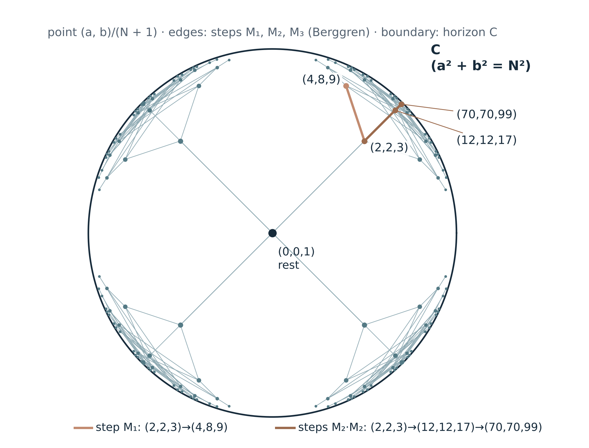
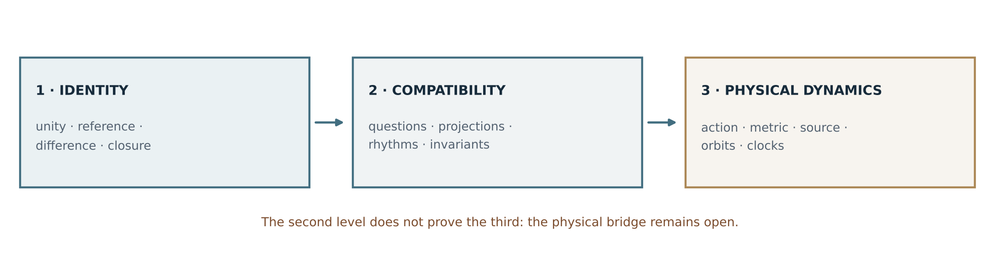
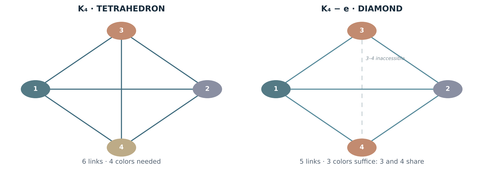
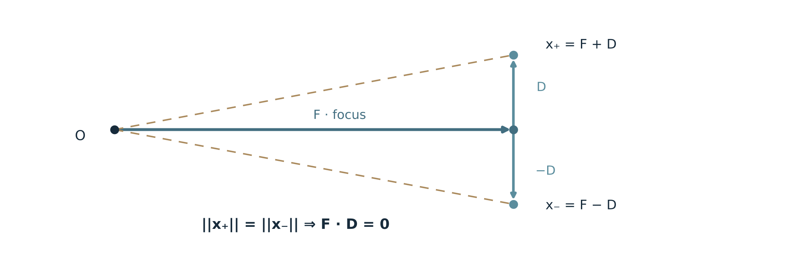

**RELATIONAL GEOMETRY PROGRAM**

**G–01**

**THE MECHANISM OF GRAVITY**

Ontological reconstruction, relational formalization and test program

> “Scale is born from comparison. Common multiples integrate their references; C remains the unreachable limit of that comparison.”

**CONCEPTUAL AUTHORSHIP** Le Matt Ansatz Di Ego

**VERSION** 1.3 · November 1, 2026

**ROSI STATUS** OPEN — gravitational hypothesis under construction; exact common normalization; hyperbolic realization of O58 proven (§2D)

**SCOPE** Self-contained research document · English translation; the Spanish text is the reference

# Executive summary

G–01 reconstructs the mechanism of gravity from a sequence that already runs through the Relational Geometry Program: unity, reflection, difference, projection, common normalizer, referenced remainder, own closure and continuation. The program does not begin by choosing an acceleration, a potential or a force. It begins by investigating which relations can still be recognized when two scales are expressed in a common reference, and how that reference allows a pending difference to be resolved. O40, O58, MF–86, YM–01/02, R–01, the graph branch and the Navier–Stokes controls O78/O81 are explicitly integrated.

The conceptual refinement introduced in version 1.2 concerns C. C stands for the unreachable limit of comparison of the projection: in C there would be no internal differences and no relative rhythms to compare. “Attuned to eternity” is the ontological image of that horizon, not an infinite clock nor a physical perspective proper to light. C is not a node, a particle, a vector focus or the common multiple; the latter operates between systems that admit comparisons. When the program uses C as a limit of physical propagation, that identification will be a bridge hypothesis that must be tested.

The thesis of G–01 is: gravity could be the geometric manifestation of the resolution of scale differences between closures that build a common reference without losing their identity. In the modular laboratory the common multiple preserves the previous values exactly; O58 further shows that a new organization can leave a pending unit with respect to its new normalizer. What is missing is an intrinsic operator that physically selects and updates that organization, a metric and a clock, and a test of their gravitational consequences. The exact theorems on reflections, the tetrahedron, discrete times, orbits and the negative controls of v1.1 are kept as realizations or tests, not as premises of the mechanism.

**Finding of version 1.3.** The O58 contract, a²+b²+1=N², has an exact and well-known realization: its solutions are the integer points of the hyperboloid N²−a²−b²=1 of Minkowski space in 2+1 dimensions. Normalized, it reads v²+(dτ/dt)²=1: the pending unit 1/N² is the square of the proper rhythm, and the horizon C corresponds to the cone a²+b²=N², the cone of Pythagorean triples. All solutions form a single tree generated by three integer Lorentz transformations (Berggren), and each appears exactly once (B19). This gives G–02 a well-defined continuation operator and §12 a distance between closures, the rapidity, and it shows that the multiples rule M=qN covers that tree only in part. This is kinematics, not gravity: the gravitational bridge remains an explicit hypothesis (§2D). The edition also adds a finite-resolution normalizer (§2B), because the LCM of denominators is not continuous in the ratios.

**Keywords:** relational gravity, C as horizon, projection, scale, common normalization, least common multiple, remainder, own closure, reference, NS, Yang–Mills, P versus NP, mirrors, tetrahedron, time, Minkowski hyperboloid, rapidity, Berggren tree, finite resolution and ROSI.

# 1. Purpose, scope and reading rules

**Central question of G–01.** How is a difference between projections organized by means of a common normalizer that preserves the previous references, and under what rule does that resolution manifest itself as physical geometry between systems? The limit C orients comparisons as a horizon, but does not take part as a third state in which measurements are made.

The method always follows the same order: define identities and relations; fix the questions that accredit a difference; reconstruct the common reference; record the remainder and the capacity to continue; identify an objective geometric transformation; finally, compare with clocks, trajectories and physical observations. No acceleration law is chosen beforehand to justify the construction.

**Reading contracts:** \[O\] ontological orientation; \[D\] operational definition; \[T\] exact result under declared hypotheses; \[H\] physical hypothesis; \[C\] conditional consequence; \[F\] falsifier or discriminating example; \[P\] open problem. ROSI: RESOLVED, OPEN, SUPERPOSED and PREMATURELY COLLAPSED describe the state of a claim, not the worth of an author.

This edition unifies the normalization grammar used in the complexity, gauge-group and fluid branches. Their mathematical realizations are different: an integer LCM, a semantic interface, a gauge transport or a dynamical reference do not automatically become the same physical object. Gravitation is the new hypothesis that must link them where appropriate.

# 2. Unity, reference, projection and resolution

\[O\] The original unity is recognized as a totality that does not yet accredit internal differences. The first reflection makes a comparison possible; projection expresses an identity under a scale without fragmenting it. A new relation can establish an internal reference of its own and demand a common reference with the previous ones. C will be reserved for a limit of comparison, not for this unity nor for a geometric focus.

\[O\] Reference is the condition that allows a comparison to be recognized. Difference is an accreditable distinction between readings. Resolution names the integration of differences into a reference that allows continuation. Own closure is an organization able to preserve its identity, its relevant comparisons and its continuation rule. The remainder records what the present reference leaves pending, without presupposing that it is a substance, an energy or a force.

Projection, mirror and sphere designate different laboratories of that grammar. A projection does not require a prior physical space; a real optical reflection does presuppose propagation; a graph allows compatibilities to be tested; a dynamical field carries additional conditions. These distinctions preserve the meaning of each result while allowing a common structure to be investigated.

\[O\] The direction of the program lies in resolution. Scale differences that prevented a joint comparison can become integrated by a common normalizer. The new reference preserves what was recognized and may reveal a new remainder. Space, rhythm and mass are investigated as possible realizations of that architecture: capacity for comparison, recurrences and complementary persistence of an identity. Acceleration comes after a spatial and temporal measure has been built, as a possible physical reading of the evolution of closures.

# 2A. C: horizon of comparison, not a comparable system

\[O\] In this formulation the word C designates a limit toward which comparisons are oriented without reaching it. In C, by ontological hypothesis, there would be no internal differences to confront and no two relative rhythms with which to measure a passage. Its image is an eternal and unreachable attunement. “Eternity” indicates the absence of internal temporal contrast, not an infinite duration measured from C.

\[D\] A comparison is always made between states or references that belong to the domain where operational questions exist. C does not belong to that domain as an additional identity. A limit can order a family of ratios even though it provides no new reading from itself. Normalization works on those ratios; it does not compare an object with a supposed clock of C.

\[H\] If C is later identified with the physical limiting speed c of relativity, it must be kept in mind that a massive system does not reach c and that a light ray has no inertial frame of its own. The phrase “no time in C” attributes no experience, immobility or observer to light. For an ideal massive particle in inertial motion, dτ/dt=√(1−v²/c²) tends to zero as v→c; that special-relativistic kinematic limit neither proves the gravitational hypothesis nor contains gravity by itself.

\[D\] Typed convention: C = ontological horizon of comparison; c_light = measured limiting speed, if the physical bridge is validated; c_f = tetrahedral focal vector; K = set of compatible states; N, m and L = integer normalizers when modular arithmetic is used. v_spec = speed of the spectral comparator of §9; v\* = velocity scale of the auxiliary potential of §13; η = rapidity in the hyperbolic realization of §2D; ε = resolution of a normalizer (§2B); M₁, M₂, M₃ = integer generators of §2D, so named to avoid confusion with C. (The Spanish reference text writes c_luz for c_light and v_esp for v_spec.) No equality between these entities is presupposed.

\[P\] The program needs to explain why that limit is universal, how it is approached through finite relations and whether it dynamically constrains changes of scale. It must avoid taking “C is unreachable” as a sufficient rule for obtaining a gravitational potential.

# 2B. The common multiple that preserves relations

\[O\] The internal multiple of the novelty allows it to sustain a reference of its own. The common normalizing multiple integrates the new relation and those already accredited. Novelty does not precede the old references as a known destination: it arises as a difference that demands enlarging the family of comparisons. What has been resolved remains reconstructible from the new frame as long as the corresponding interface is preserved.

L = lcm(N,m), h/N = \[h(L/N)\]/L, if N divides L.

\[T — O40\] For two rational phase families H_N and H_m, the least common normalizer is L=lcm(N,m). Both are included in H_L and the previous values are preserved by explicit inclusion or reduction maps, according to the contract. Example: 1/2=3/6 and 1/3=2/6. The difference 1/6 remains; what disappears is the obstacle to expressing it jointly, not the difference between the two values.

\[T — YM–02/R–01\] In the residue model, the two signatures x mod N and x mod m coincide jointly if and only if x mod L coincides. Each previous class modulo N splits into m/gcd(N,m) classes in the new signature; a prime p that does not divide N introduces p classes per previous class. The number of subdivisions measures refinement of the comparator, not new dimensions or physical particles.

\[D\] A common reference does not automatically impose compatibility of physical weights, evolution or preservation of distinctions under every update. It is essential to define the return projection π and the continuation rule T. The equality π∘T_L = T_N∘π expresses the continuity condition for that update. If T_L collapses states, commutation alone does not necessarily preserve every difference inside it.

\[F\] **Discontinuity of the LCM.** The LCM of denominators is not continuous in the ratios. For 1/2 and 1/3, L=6; for 1/2 and 50/99, which differ by 0.005, L=198; for 1/2 and 501/1000, which differ by 0.001, L=1000. An irrational ratio has no denominator. A continuous physics cannot depend on L in that way: two almost identical situations would have unrelated normalizers.

\[D/T\] **Finite-resolution normalizer.** For a real ratio α and a resolution ε\>0, let q_ε(α) be the smallest integer q≥1 for which there is p with \|α−p/q\|≤ε. It is also defined for irrational α and, by Dirichlet’s approximation theorem \[EX-7\], satisfies q_ε(α)≤⌈1/ε⌉ (B21). The normalizer of a family at resolution ε is L_ε = lcm of the q_ε(αᵢ). With ε=1/100, the three previous pairs give L_ε=6, 2 and 2; with ε=1/1000 they give 6, 166 and 2. The normalizer stays bounded and only changes when a ratio crosses a threshold of the declared resolution.

\[H\] The resolution ε is the missing parameter for the normalizer to be physical: a closure does not compare with infinite precision, only as far as its questions accredit differences. The best approximations at each resolution are given by continued fractions. Adopting this contract is a hypothesis that must be tested (Test O).

# 2C. Remainder, pending unit and new closure

\[D/T — O58\] The strongest contract with two integer channels studies a²+b²+1=N². Normalizing gives a²/N²+b²/N²+1/N²=1. The pending unit is the fraction 1/N² of that state. The contract is not universal: some N admit it and others do not, and it is not identical to the bilateral identity N²−(N−1)(N+1)=1, valid for every N.

If M=qN: 1/N² = q²/M²; 1/M² is a new unit, not the previous one.

\[T — O58\] Transporting a state from the normalizer N to the multiple M preserves the value of its parts. If the new state also leaves a raw pending unit, it must reorganize at least one of its weights. The exact balance is written on the weights: Δ(a²/M²)+Δ(b²/M²)+Δr=0, with Δ(a²/M²)=(a′²−q²a²)/M², the analogue for b, and Δr=(1−q²)/M² (B15). The previous normalizer is a reconstructible wake; the new unit does not erase its history.

\[T/F\] O58 exhibits more than one compatible continuation from the same reference: (2,2,3)→(4,8,9) and (2,2,3)→(70,70,99). Common normalization accredits continuity, but does not by itself select which closure is realized. In G–01 this selection will be a central problem of dynamics, not a narrative decision. Section 2D shows that these branches belong to a single tree and that the multiples rule selects only part of it.

\[H\] The geometric resolution of G–01 will be a realization, still to be built, of that separation between inheritance of scale and reorganization of the remainder. The limit C orders the space of comparison, while the transition takes place between comparable and reachable closures. There is no need to assign C a cardinality, a denominator or a clock.

# 2D. O58 as a hyperboloid: proper rhythm, horizon and tree of continuations

\[T\] **Identity.** The O58 contract, a²+b²+1=N², is the equation N²−a²−b²=1: its solutions are the integer points of the unit hyperboloid of Minkowski space with two spatial directions and one temporal direction. Dividing by N²:

**(a/N)² + (b/N)² + (1/N)² = 1 ⟺ v² + (dτ/dt)² = 1, with v = (a/N, b/N) and dτ/dt = 1/N = 1/γ.**

The pending unit 1/N² of O58 is exactly (dτ/dt)² = 1−v²: the fraction that is not projected onto the two directions. For (2,2,3), \|v\|=√8/3≈0.943 and 1−v²=1/9 (B18). In the relativistic reading, (a,b,N) are momentum and energy in units of mc, and 1/N = m/E.

\[T\] **Horizon.** If the unit is removed, a²+b²=N² are the Pythagorean triples: the null cone, where \|v\|=1 and dτ/dt=0. The pending unit separates the closures, which lie on the hyperboloid, from the horizon, which is the cone. Along any family of solutions with N→∞, \|v\|→1 and 1/N²→0: closures approach C without reaching it, because no solution has a zero remainder. In this realization C is no longer only an image: it is the boundary of the space of closures, as §2A requires.

\[T\] **Tree of continuations.** The three Berggren matrices \[EX-6\], called here M₁=((1,−2,2),(2,−1,2),(2,−2,3)), M₂=((1,2,2),(2,1,2),(2,2,3)) and M₃=((−1,2,2),(−2,1,2),(−2,2,3)) to avoid confusion with C, preserve N²−a²−b²: they are Lorentz transformations with integer coefficients. Applied to a solution, they give three new solutions; from (2,2,3) come (4,8,9), (12,12,17) and (8,4,9). Conversely, every solution with N\>1 has a unique parent, with strictly smaller N, and the descent ends at rest, (0,0,1). Hence all solutions form a single tree rooted at (2,2,3), and each ordered pair (a,b) appears exactly once (B19). Enumeration confirms it: 754 of 754 solutions with 1\<N≤3000.

Figure 1. Solutions of a²+b²+1=N² in the Poincaré disk, point (a,b)/(N+1), with the sign reflections of (a,b). The center is rest, (0,0,1); the boundary is the horizon C, where a²+b²=N². Edges are steps M₁, M₂, M₃ up to three levels. Highlighted: (2,2,3)→(4,8,9) and (2,2,3)→(12,12,17)→(70,70,99).

\[T\] **Distance between closures and rapidity.** The hyperboloid carries its own distance: for two solutions X=(a,b,N) and X′=(a′,b′,N′), cosh d(X,X′) = NN′−aa′−bb′. From rest, d = arccosh N = η, the rapidity. On the symmetric branch a=b the equation is N²−2a²=1 (Pell): its solutions N=3, 17, 99, 577 have rapidity exactly η₁, 2η₁, 3η₁ and 4η₁, with η₁=ln(3+2√2)=2·ln(1+√2)≈1.7627 (B20). On that branch each step M₂ adds the same rapidity, just as the rapidities of two boosts in the same direction add. On the other branches the edges of the tree have different lengths. O58 had already found this branch as a Pell solution and had built a nested chain, 3→99→3,880,899, by cubing N+m√2 (O58.12) \[PR-13\]. In the hyperbolic reading that operation multiplies the rapidity by three: N′=N(4N²−3) is the formula for cosh 3η, and the nested wake of O58 is the subsequence η₁, 3η₁, 9η₁…

\[F/T\] **The multiples rule versus the tree.** The O58 continuation requires M=qN. In the tree, (2,2,3)→(70,70,99) is two M₂ steps with (12,12,17) in between, and 17 is not a multiple of 3, as O58 already noted. Of the 15 solutions with 3\<N≤120 and a≤b, only (4,8,9) and (22,46,51) have N a multiple of their parent’s N. The multiples rule does not follow the edges: it relates closures at varying distances and skips the intermediate ones. In this realization the natural composition is the Lorentz one, not the multiples one; which of the two corresponds to physics remains SUPERPOSED.

\[H\] **Physical reading.** Under this identification, 1/N = dτ/dt = m/E is the fraction of the energy that is not projected as motion. It matches the reading of §10, which investigates mass as the complementary persistence of an identity. The algebraic identification is exact; assigning it kilograms, a source or a coupling constant remains an open bridge.

\[H/P\] **Three channels.** The two-channel contract lives in 2+1. With three channels, a²+b²+c²+1=N², one obtains the integer points of the hyperboloid in 3+1, the spacetime of relativity: three spatial references and a fourth that is not projected. Its tree of continuations and its generators must be built and verified (Test P); they are not presupposed.

\[H\] **Gravitational bridge.** For a static observer in the field of a spherical mass, general relativity gives dτ/dt=√(1−r_s/r)=√(1−v_esc²/c²), where r_s is the Schwarzschild radius and v_esc the escape velocity \[EX-8\]. The form coincides with that of O58 if one reads 1/N² = 1−r_s/r: the horizon r→r_s would correspond to N→∞, that is, to C. This is a known coincidence of form, not a derivation.

\[F\] **Scope.** A literal reading with integer N would quantize r_s/r = 1−1/N², contradicting a continuous radius; the reading has to be made with finite resolution (§2B) or as sampling. Everything above is special-relativistic kinematics in an integer realization: it contains no source, no coupling and no rule choosing between M₁, M₂ and M₃. That rule is the problem of G–02.

# 3. Mirror cube: projection, scale and reconstruction

Figure 2. The conceptual sequence is not yet a physical derivation.

\[O/D\] In the idealized laboratory, a totality and its reflections confront each other from reference walls. A moving wall changes its relation to the set of images. The displacement can alter the scale, orientation and accessibility of comparisons, without the reference unity necessarily losing its identity with respect to itself. Obverse and reverse can be two readings of one image at the same represented point, provided the operation that exchanges those readings is declared.

The conversational sequence **2–3–4–5** is kept as a narrative protocol to be formalized, not as a universal law of mirrors: with two references a compared identity appears; the third may leave two senses of orientation; a fourth may reproduce the pattern of indefiniteness within a homogeneous family; a fifth may reopen the distinction and make the family inhomogeneous. Here “third”, “fourth” and “fifth” must state explicitly whether images, walls, reflections, spheres or iterations are being counted. Without that choice they are different objects and there is no theorem.

\[T/F\] The elementary optical control of two parallel mirrors at distance L, with a point at position p, produces ideal image positions **2nL ± p** for integers n. The set of positions can be infinite even though the possible linear orientations are few. Moving a wall changes L and with it the structure of positions. Therefore a physical closure of “five images” cannot be deduced just by counting orientations. The laboratory specifies which questions are asked of the images and which equivalences remain when the wall moves.

Three operations are distinguished in the cube: (i) displacement of the wall or change of reading frame; (ii) accreditation of a new comparison that refines the families of images; (iii) effective reorganization of a closure that modifies its continuation. The common multiple resolves a relation of representability; the physical experiment must indicate what it transforms objectively. C is the horizon of comparison, not an additional mirror inside the box.

# 4. The spheres, the tetrahedron and the diamond

Figure 3. The diamond requires removing, or making inaccessible, one relation of K4. Proper coloring: K4 needs four colors; in K4−e three suffice because 3 and 4 are no longer compared.

\[O\] Each sphere represents an identity that keeps relations with others. Four equidistant centers form a regular tetrahedron in a three-dimensional Euclidean realization. As a graph of mutual contacts, the four centers are the vertices of K4, with six links. That symmetry provides a laboratory for a reference without a privileged vertex.

The figure called the **diamond** must be distinguished from the complete tetrahedron. In graph theory, the diamond graph is K4 minus one edge: two triangles sharing an edge. It admits three proper colors; K4, by contrast, requires four proper colors. If the proposal interprets the diamond as the projection of a tetrahedron whose orientation is undetermined, the projection operation must explain why a comparison is no longer required or becomes inaccessible. Omitting that relation in the representation does not mean that the physical link disappears.

\[H\] The diamond can serve as a **projected unit**: two orientations that are indistinguishable for a family of questions are represented by the same figure; as relations repeat, structures of “diamonds of diamonds” appear. Three-color chromatic stability is a criterion **of the projected graph**, not a proven property of any set of four spheres or of a gravitational field. The fifth sphere or reflection may introduce a new constraint that breaks homogeneity; this must be seen in a finite protocol before being generalized.

\[O/F\] The absence of a privileged direction does not necessarily eliminate the existence of a **common point**. A figure can keep its center under all its rotations without keeping any nonzero vector. This distinction is essential for speaking of focus and singularity without attributing an absolute orientation to the totality.

# 5. Minimal core of the relational language and continuity

\[D\] A finite relational laboratory can be represented as M=(V,E,Ω,K,Q,G,T): V gathers identities; E, relations; Ω, available states; K⊆Ω, compatible states; Q, operational questions; G, reference transformations; T, continuation. C is not part of Ω as an additional state: it is the conceptual limit of comparison whose physical realization remains open. A common normalizer must specify maps between signatures of two members of this family.

\[D\] Two states are equivalent for Q when all questions in Q give the same answers. A distinguishability distance ΔQ can count differences with previously declared weights. A unit that closes with respect to Q need not erase all internal differences: it needs to keep enough of them to answer and continue. The minimal difference of a closure depends on the question contract and on its normalizer; it is not automatically a separation in meters.

\[T\] Let Φ: Ω→Y be a reduced representation of what is observed. There is an autonomous rule T̄:Y→Y compatible with T —that is, **Φ∘T = T̄∘Φ**— if and only if **Φ(x)=Φ(y)** implies **Φ(Tx)=Φ(Ty)** for every pair of states considered. This condition is the criterion of **dynamical sufficiency**: a collective image can replace the internal images only if the omitted differences do not alter the future answers of the committed class of questions. A common snapshot does not guarantee a common continuation.

\[D/H\] A new reference is sufficient for a set of questions and continuations if the accredited answers can be reconstructed from it and updated without ambiguity. MF–86 highlights sufficiency, idempotence and composition. Idempotence, NQ(NQ(x))=NQ(x), expresses that normalizing again under the same contract introduces no further distinction; by itself it decides neither computational economy nor physical dynamics.

# 6. Exact closure control with four references

\[T\] For four vertex bits s_i∈{0,1} and binary relations b_ij=s_i⊕s_j on the six edges of K4, the XOR sum around any triangle is zero. There are **8 compatible edge configurations out of 64** possible; the global inversion of all bits preserves the six relations. A coherent family can contain nonzero differences: **agreement is not identity**.

\[F\] XOR consistency provides no gravitational potential and is not equivalent to solving 3-coloring. Binary difference edges, proper colors and geometric projections are different contracts. The “diamond” three-color criterion must not be imported into the XOR system without translation.

# 7. Two reflections: common focus, radius and phase offset

\[D\] In the auxiliary geometric realization, the focal identity of the pair is written F (not C). The reflections x±=F±D have a recoverable part and a differential component. The amplitude aV=R0/R expresses a ratio of radii; it does not represent a ratio of speeds with respect to C.

Figure 4. Auxiliary equiradial reconstruction: the focus F is not a force.

\[D\] In a real vector space with an inner product —an auxiliary realization that is already geometric— consider **x+ = F + D**, **x− = F − D** and assume **\|\|x+\|\| = \|\|x−\|\| = R**. Subtracting the squared norms gives **4 F·D = 0**. Hence **F ⟂ D**, and if **R0=\|\|F\|\|**, one obtains:

**R² = R0² + \|\|D\|\|²; R cos(δ/2) = R0; aV(R)=R0/R; daV/dR=−R0/R².**

\[T\] δ is the angular separation between equiradial reflections, when R≥R0\>0. Keeping F fixed while the component D grows preserves the reference and changes the phase offset. This is an exact geometric reconstruction. On the other hand, if the quadratic weight aV² is used, **d(aV²)/dR=−2R0²/R³**. The gradient depends on the selected observable.

\[F\] Nothing in these equations determines R(t), force, energy, trajectory or mass. In these equations R is the radius of the auxiliary space; identifying it with physical meters requires a metric construction and an independent calibration. **Gravitation has not been derived from the geometric derivative.**

# 8. Four perspectives: reconstruction of a focus, distinct from C

\[D\] Let the four auxiliary vectors be v₁=(1,1,1), v₂=(1,−1,−1), v₃=(−1,1,−1), v₄=(−1,−1,1), with Σvᵢ=0 and Σvᵢvᵢᵀ=4I. For scalar readings sᵢ, we look for a focus c_f satisfying sᵢ=vᵢ·c_f. It is a vector in a three-dimensional auxiliary space; it is neither C, the horizon of comparison, nor c_light, a physical speed.

\[T\] The common focus c_f exists if and only if Σsᵢ=0. When it exists it is unique: c_f=(1/4)Σsᵢvᵢ. For arbitrary data the minimal squared error is E_min=(Σsᵢ)²/4. If fᵢ=(sᵢ/3)vᵢ, then Σsᵢ²=4\|\|c_f\|\|² and Σ\|\|fᵢ\|\|²=(4/3)\|\|c_f\|\|². The reconstructed focus is not an absolute limiting entity; it depends on a contract of readings that is already geometric.

\[T\] The isotropic focal amplitude can be written A(c_f,R)=\|\|c_f\|\|/R and its radial derivative is −\|\|c_f\|\|/R². The specific isotropy of O12 requires equal radii in the construction studied there. The full rotation group of the tetrahedron preserves its center but selects no nonzero vector; Fix(A4)={0}. These relations constitute a model of common reference, not a law of gravity.

\[F\] The four projections can be compatible and still have internal differences in evolution. The condition Σsᵢ=0 selects neither a time scale nor an interaction rule; the same geometry admits different potentials and accelerations.

# 9. Time and rhythm: comparison below the horizon C

\[O\] Measured time is comparison between recurrences. Each closure can sustain rhythms of its own and relate them to others through a common reference. C appears as the conceptual limit where there would no longer be relative rhythms to confront: “attuned to eternity”. In the operational layer only clocks that exist inside the domain of relations are compared. A physical clock is not defined in a rest frame of light, which does not exist in relativity.

\[T\] In O45, if a physical representation uses origin X(t), scale ℓ(t)\>0 and orientation A(t)∈SO(3), the transformation **x=X+ℓAy** gives the relative velocity **dy/dt=Aᵀ(v−Ẋ)/ℓ−(ℓ̇/ℓ)y−Ωy**, with **Ω=AᵀȦ** antisymmetric. This is the chain rule, not an interaction. Three phases with a common origin (flow, reference and particle) leave **two independent differences**. Comparing ratios of rates under time-dependent changes of angular origin requires a reference connection or an operationally fixed frame.

\[T\] The discrete model MF-43 proposes **xj,n+1−2xj,n+xj,n−1 = −η(La xn)j**. For an eigenvalue λ of the Laplacian, its discrete angular frequency satisfies **Ωdiscrete=2 arcsin(√(ηλ)/2)**, with **0≤ηλ≤4**. This result belongs to a declared discrete dynamics; one update is not a physical second. The continuous comparator **Ri=λi^−1/2**, **ωi=√(Γλi)** gives **Ri ωi=√Γ** within another model, but Ωdiscrete and ωi must not be confused. Identifying √Γ with the physical speed of light requires an additional proof.

\[P\] A law is sought that determines how the reorganization of a normalizer changes ratios between rhythms and effective scales. The equation Rω=v_spec in a spectral comparator is exact for that model, and its v_spec will be identified with c_light only through an independent calibration. The horizon C is not given a clock by decree.

# 10. Persistence, mass and internal difference

\[O/H\] Mass is investigated as the complementary persistence that allows an identity to sustain its internal reference. Common normalization can remove the incompatibility between two projection scales without removing the internal difference of each closure. In this way, resolving between systems is not the same as destroying their identities.

\[D/H\] An invariant μ(M) associated with a persistent module is sought. To be a physical candidate it must have a composition rule, units or a dimensional calibration, appropriate behavior under changes of reference and a demonstrable relation to the response to acceleration. One and the same quantity should generate both the inertial response and the gravitational source, so that equivalence is a result, not a disguised premise.

\[F\] The tetrahedral invariant **(4/3)\|\|c\|\|²** does not turn into kilograms by remaining stable. The norm **\|\|c\|\|** is positive and rotationally invariant, but it is not additive as a function of source vectors. Moreover, there is no nonzero scalar charge q(c) that is both additive over vectors and nonnegative: additivity gives q(c)+q(−c)=q(0)=0 and, with both terms ≥0, q≡0. Rotational invariance is not needed for the argument (and c↦−c is not a rotation but the inversion, with determinant −1; for each c there is, however, a rotation by π about a perpendicular axis that takes it to −c). The lesson is direct: sources do not compose by evaluating a charge on the sum of their focal vectors. Composition needs a new object —for example, a quantity defined per source and summed over sources— or explicit hypotheses.

\[O/H\] A black hole can be explored as a limit of accessibility of internal distinctions from the outside, preserving a collective image. This does not imply that the physical radius vanishes, that microscopic information has disappeared or that horizon thermodynamics has been resolved. A relational reference singularity is **not**, by definition, a curvature singularity.

# 11. Attunement, commonality and accessibility of differences

\[H\] The V7 thesis holds that a coupling restricts independently accessible relational degrees: \|ΩAB\| can be smaller than \|ΩA\|\|ΩB\|. Attunement in G–01 expresses that several relations become integrated in a common comparison. C would be the limiting image of agreement without comparable differences; between real systems agreement is always a relative property of defined questions, scales and rhythms.

The common normalizer is a rule of inheritance of relations; it does not force all their values to be equalized, nor does it simultaneously produce a spatial change. The difference that remains pending may still be needed to sustain distinct closures. The gravitational proposal studies how the effective reorganization of those differences becomes geometric while preserving the internal reference of each system.

\[F\] **Normalization control.** The pure phase-offset potential **V(r,δ)=K(r)\[1−cosδ\]** satisfies V(r,0)=0 and ∂V/∂r(r,0)=0: a perfectly synchronized pair feels no radial force under **that single term**. But the null result is produced by the “1−”, which assigns the synchronized state the same weight at every distance. The Kuramoto-type phase coupling with a separation-dependent strength, **V(r,δ)=−K(r)cosδ**, has the same phase dependence and differs by a radial term −K(r): with it, the synchronized pair feels −∂V/∂r(r,0)=K′(r), attractive if the coupling weakens with distance. Assuming that the attuned state weighs the same at every distance is a physical hypothesis, not a neutral normalization. The control does not refute attunement: it fixes the correct criterion.

\[T\] **Criterion for attunement with force.** In the family V(r,δ)=U(r)+K(r)g(δ), the radial force on the attuned pair (δ=0) is **−W′(r)**, with **W(r)=V(r,0)=U(r)+K(r)g(0)** (B10). Attunement produces a radial force if and only if the weight of the attuned state depends on the separation. Translated to V7: if the number of compatible configurations \|ΩAB\| depends on r, its variation with r is the force candidate; if it does not, attunement orders but does not bring closer. There are models in which phase and spatial attraction are coupled \[PU-1\], and the form “force = variation of the number of configurations with separation” coincides with that of entropic gravity \[PU-2\]. Both are recorded as positioning bridges for later, not as inputs to the thread.

# 12. Hypothesis G–01: from the common normalizer to geometry

\[O/H\] The core of G–01 is common normalization. Two closures A and B have projections and scales of their own. A new relation demands a comparator that contains the previous signatures; that comparator transports their values and leaves a referenced remainder. The reorganization of that remainder can constitute a new closure and a new scale of comparison. If its evolution modifies a shared physical geometry, the observable phenomenon could correspond to gravity.

\[D\] In the modular laboratory: L=lcm(N_A,N_B). The previous signatures Φ_NA and Φ_NB must be reconstructed from Φ_L by explicit reductions. In the general laboratory the LCM is replaced by a common interface J with maps π_A and π_B such that Φ_A=π_A∘J and Φ_B=π_B∘J. No integer is presumed for each frequency or for every physical system.

\[D/T\] Continuity of a representation requires a compatible update rule: π_A∘T_J=T_A∘π_A and π_B∘T_J=T_B∘π_B, on the domains where those operations are defined. This distinguishes preserving a fraction in another notation from preserving the answers during an evolution. MF–86 adds the criterion of an interface that is sufficient for future questions.

\[H\] The physical operation still to be defined must select a new closure from present data, without knowing the final state in advance. That operator must determine which component of the difference remains pending and which is the inherited reference. C does not enter as a state: it appears as the horizon of comparable ratios, not as a denominator that can necessarily be reached.

\[H\] **Concrete candidate (§2D).** In the hyperbolic realization of O58 the two objects this section asks for already exist. The continuation operator can be taken as the action of the integer Lorentz group generated by M₁, M₂ and M₃: it preserves the form, composes and reaches every closure of the contract (B19). The closure variable can be taken as the distance d(X,X′), with the rapidity η as the case measured from rest: it is a true distance between closures, although in velocity space and not yet in physical space. What is missing is the rule that chooses, at each step, which of the three generators is realized, and the map from d to a measurable separation.

\[H\] The candidate geometric structure is a map from signatures, transports and scale remainders to a metric or to observables of length and rhythm. A real variation of that geometry can then be compared with trajectories or accelerations. First there is a law of normalization and closure; acceleration does not retrospectively select the mechanism.

\[F\] Three laboratories test the model. (I) change only units, wall or labels while keeping every dimensionless relation; (II) build a common normalizer without modifying the physical continuation; (III) introduce a closure reorganization that alters an invariant physical relation between systems. The gravity hypothesis requires identifying a case (III) whose effective description holds for different observers.

\[C\] Once a clock τ and a length r(τ) have been built, the acceleration a=d²r/dτ² is a derived observable for a regime of comparison. A second-order mechanical formulation, d²q/dτ²=−M∇W, and its energy E=½q̇ᵀM⁻¹q̇+W are kept as a conditional laboratory, not as a definition of resolution. A first-order dynamics on (q,p) can also represent second-order evolution in q.

d²r/dτ² = a_obs\[geometry and closure\]; a_obs is not prescribed before the physical map is derived.

\[T/C\] If the auxiliary mechanical law uses a symmetric, constant and invertible M and force −M∇W, its declared energy is conserved (B12). This verifies the laboratory, not the physical origin of W. A change of normalizer without a dynamical change of observables is an indispensable null control.

\[P\] The formal priority is to build the closure update operator, its invariance under change of reference, the preservation of the old signatures and its ability to anticipate which new remainder appears. Interface sufficiency, calibration of a metric, clocks and physical predictions will be required afterwards.

# 13. Potentials and orbits as later physical controls

\[C\] After a physical radius R and a clock have been built, an auxiliary family Φp(R)=−v\*²(R0/R)^p (p\>0) can be tried, which produces the radial acceleration −p v\*² R0^p/R^(p+1). This family serves to test how a projection amplitude would relate to a dynamical law if a potential were added. The common normalizer does not by itself force the choice p=1.

\[T/F\] For a pure central potential Φp=−kR^−p, a circular orbit has a stable radial minimum only if p\<2. The case p=2 produces a marginal orbit and not a family of stable circular orbits, so it cannot serve as a single gravitational law. This conclusion does not rule out supplementary R^−2 terms within more general potentials. Bertrand’s theorem characterizes the two central forces that close all bound orbits under its hypotheses.

\[C\] More generally, with **Φ(R)=−v\*² f(R0/R)** one gets **aR=−v\*²(R0/R²) f′(R0/R)**. If f is smooth near zero amplitude and f′(0)≠0, the leading term at large distance is inverse-square. If a signed symmetry f(−a)=f(a) is imposed with f differentiable at zero, then f′(0)=0 and that leading term disappears. Exchanging reflections is not necessarily the same as changing the sign of the focus; one must fix which symmetry is physical.

\[H/P\] To identify **v\*²R0=GM** one needs a source M and its composition, a constant G, a criterion of physical distance and the universality of the test body’s response. Writing the equality after observing the law does not derive it. The functional form f, continuity, parity and source dependence must be selected before results are compared.

\[H/P\] A possible route to the inverse-square law combines effective dimension three, a quantity transported across closed surfaces and a flux law. These are three additional physical constructions that must be derived from the closures; an integer modular reference does not by itself determine spatial dimension, field, conservation or the composition of sources. The realization of §2D suggests fixing the effective dimension by the number of channels in the contract: two channels live in 2+1; three channels, in 3+1.

Alternatives the laboratory must discriminate: normalization of representation without physical change; normalization with dynamical reorganization but no universal radial law; and a closure whose emergent physical geometry reproduces the weak-field law. Only the last, once proven, will be a verifiable gravitational candidate.

# 14. What would have to emerge physically

\[H/P\] The program aims to build geometry from relations. It therefore requires a measurable map from Ω and its transports to an effective space (M,g), with units and a rule of composition between scales. **Effective dimension of modes** and **dimension of a physical space** are not synonyms. The map must say which experiences correspond to length, duration, angle, causality and trajectory, and when those correspondences are invariant under change of reference.

In the weak and static regime, a viable gravitational theory must reproduce, within its domains of precision, the behavior **a≈−GM/r²** for appropriate sources. In broader regimes it must explain non-circular orbits and precession, composition-independent free fall, clocks at different potentials, propagation and deflection of light, gravitational waves and the gravitational role of radiation. The standard theory competing with the model is general relativity; reproducing a single radial exponent is not enough.

For a relativistic bridge, one must produce a metric or an equivalent causal structure and the dynamics that relates it to the source. If a known metric is used as input, the result is a relational interpretation of an existing law, not its derivation from the primitive core. In particular, it must not be claimed that radiation lacks gravity: its energy and momentum contribute to gravitation in general relativity and the proposal must face that fact.

# 15. Registered tests and controls

**Test A — Displacement without physical effect \[F\].** Alter the origin, scale and orientation of the frame and reconstruct the same dimensionless answers; no force can be deduced from that re-expression alone.

**Test B — Closure of two, three and four \[T/F\].** Define Q and T reproducibly; compare two equiradial reflections, a triangular cycle, the tetrahedral K4 and the diamond projection K4−e. Record when they are compatible, when undefined and when incompatible. Show the relation omitted when passing from K4 to the diamond.

**Test C — Fifth reference \[H/F\].** Define whether a sphere, wall, image, query or iteration is added; check whether the new relation is compatible with the previous normalizer or requires enlarging it. Counting images does not determine structural novelty.

**Test D — Attunement and remainder \[T/F\].** Compare W(r)=V(r,0) for different phase normalizations, recording when the attuned state depends on space. Distinguish agreement of rhythms, preservation of references and physical effect.

**Test E — Force models as controls \[C/F\].** After fixing a metric, compare potentials of different power, stability and orbital closure; record that the p=2 response fails as a pure central law with stable circular orbits.

**Test F — Composition and mass \[P\].** Combine two different sources and check how the charge composes without imposing impossible vector additivity. Repeat with an axis-free symmetric state and with broken symmetry. Measure inertial and gravitational differences of two test bodies.

**Test G — Sufficient interface \[T/F\].** Produce two states with the same image Φ but different evolutions; if they are found, the image is not closed. Enlarge Q or keep a residual variable until the result is stable.

**Test H — Independent physical contrast \[P\].** Freeze parameters before comparing with data not used to choose f, G or the reference radius. Check equivalence and the weak field first, then clocks, light, waves and stellar structure.

**Test I — A single variable for space, rhythm and mass \[H/F\].** In one finite model, check whether the closure variable —in the realization of §2D, the rapidity η— simultaneously governs the proper rhythm (1/N = dτ/dt), the weight W(r) of the attuned state of §11 and the effective separation. If independent variables are needed, record how many and which.

**Test J — Motion as a consequence \[F\].** First build a closure rule and a geometric map; then deduce the evolution equation of the measured length. Compare the result with first-order, second-order and pure-relabeling realizations, without choosing it from Newton’s law.

**Test K — Common normalizer and new remainder \[T/F\].** Reproduce O40 for N=2, m=3 and L=6; for O58 check one branch 3→9 and another 3→99, transporting the previous remainder exactly to the new denominator. Record which magnitudes are preserved, which are reorganized and why the choice of branch does not come from the LCM.

**Test L — Limit C without a clock of its own \[H/F\].** Define a finite family of comparators with limit C without placing an observation state at C. Show within the model which ratios remain measurable for accessible systems. If C is linked to c_light, check consistency with the fact that there is no inertial rest frame of light, and separate gravitational effects from special-relativistic kinematic dilation.

**Test M — Cross-branch contract with NS, YM and P/NP \[T/P\].** In each branch identify state, comparator, normalizer, return projection, remainder and update. Check continuity of observables and record the defect if it is missing. Do not import fluid stability, a quantum gap or a polynomial bound from a modular identity without the corresponding proof.

**Test N — Hyperboloid and tree \[T/F\].** Verify N²−a²−b²=1 for every solution; reproduce the descent of B19 up to N≤3000 (754 solutions, all reached, none with both signs negative); check arccosh N = k·η₁ on the Pell branch; list which edges satisfy the multiples rule. Compare continuation by multiples with continuation along the tree for the same triples.

**Test O — Finite-resolution normalizer \[D/F\].** For families of ratios perturbed by less than ε, compare the exact LCM with L_ε. Record the bound q_ε≤⌈1/ε⌉, the thresholds where L_ε changes and whether any proposed physical magnitude depends discontinuously on L.

**Test P — Three channels \[H/P\].** Enumerate solutions of a²+b²+c²+1=N², look for integer generators preserving N²−a²−b²−c² and check whether an analogous tree with descent exists. Record the structure found or its absence.

# 16. Numerical legacies and extreme regimes

\[C\] The earlier branch applied a prescription G_eff(n) to the Tolman–Oppenheimer–Volkoff equations with an SLy equation of state; V7 keeps the reported value **Mmax=2.037 solar masses** as a numerical result **conditional on the prescription**. For reference, the same equation of state in general relativity gives Mmax≈2.05 solar masses \[EX-3\]: the prescription shifts the standard result by less than 1 %. The value 2.037 is not a distinguishable prediction; at most it shows that the prescription does not break known stellar structure. The algebraic ceiling **G_eff/G≤√(16/15)≈1.033** also appears. There is no justification for carrying that limit over to nature until the coupling is obtained from the relational dynamics and the transformation between density, closure depth and effective transition is audited.

\[H/P\] The horizon of a black hole could be interpreted as a boundary of accessibility to interior distinctions, but it must preserve the tested physics of horizons, thermodynamics and signal propagation. The projection radius of a model, the metric radius and the number of observable channels are different variables. A “saturation” hypothesis without an observable formula and without tests does not replace general relativity.

# 17. ROSI status: what is resolved and which new bridge opens

**RESOLVED — declared models:** O40 proves inclusion and exact transport by common multiples; O58 proves the balance of pending units and the existence of several arithmetic continuations; YM–02 proves modular refinement and reconstruction; MF–86 provides sufficiency and idempotence conditions; G–R3 proves the auxiliary focus and amplitude; the cube, the diamond, the recurrence and the potential tests keep their results within the mathematical contract of v1.1; the hyperbolic realization of O58: identity v²+(dτ/dt)²=1, complete tree of continuations by M₁, M₂ and M₃ (B19) and rapidities of the Pell branch (B20); the bound on the finite-resolution normalizer (B21).

**RESOLVED — necessary distinctions:** the focus c_f is an auxiliary vector, C is a conceptual limit, c_light a physical speed. An LCM transports representable information but does not determine a trajectory. A normalization of denominators does not by itself reduce a physical remainder; O81 shows explicitly how cross interactions with the dynamical reference must be kept.

**SUPERPOSED — interpretations:** the limit C as a horizon of comparison and its possible correspondence with a universal physical speed; relations between pending difference and geometric scale; dynamical selection of the normalizer; mechanisms that preserve identity and reorganize their projections; several effective geometries that could arise from the same closure architecture; continuation by multiples (LCM) versus continuation along the integer Lorentz tree; reading the resolution ε as a property of the closure or of the observer.

**OPEN —** an intrinsic law that selects and updates a common reference; classes of physical scales that admit a normalizer without imposing integer commensurability; a measurable representation of the remainder; construction of length, time and causality; quantitative relation to mass, equivalence and curvature; gravitational observables that distinguish the hypothesis from general relativity and other theories; a rule choosing between M₁, M₂ and M₃; a map from the distance between closures to a physical separation; tree and generators of the three-channel contract; the gravitational bridge 1/N² ↔ 1−r_s/r.

**PREMATURELY COLLAPSED if one identifies:** C with an observer of light or an infinite physical duration; the LCM with a force; the remainder 1/N² with mass in kilograms (the identification 1/N = dτ/dt = m/E is exact in §2D; the physical unit is not); focal projection with spacetime geometry; stability of NS remainders with general regularity; modular closure with P=NP; gauge refinement with a quantum mass gap; the coincidence of form with √(1−r_s/r) with a derivation of gravity. These are distinctions between domains that protect the positive construction of the mechanism.

# 18. Research route G–01 → G–08

**G–01 \| Common grammar.** Define C and its limiting domain, reference, projection, normalizer, remainder, closure and the continuity conditions. Product: typed definitions and a reproducible O40/O58 test with a sufficient interface. Added in v1.3: the hyperboloid identity, the B19 tree and the B21 bound.

**G–02 \| Choice of normalizers.** Establish an intrinsic rule for selecting and updating closures without knowledge of the future state; identify preservation, branching and incompatibility. Product: an adversarial finite simulation and a conditional continuity theorem. Initial candidate: the action of M₁, M₂ and M₃ on the hyperboloid; the rule choosing the generator is missing.

**G–03 \| Persistence and mass.** Build compositions of sources that preserve internal particularity while normalizing external relations. Product: a dimensionless mass candidate, an additivity proof or a falsifier.

**G–04 \| Scales, time and metric.** Define metrics and operational clocks from accessible comparisons; investigate the correspondence of C with a physical limit of propagation without attributing a frame of its own to it. Product: an observable map with units and invariance. Explore the three-channel contract in 3+1 and the map from the distance between closures to a length.

**G–05 \| Dynamics and field law.** Make a changing geometry emerge from closure transitions; derive the acceleration, conservation and radial exponent after fixing sources and dimensions. Product: a verifiable action or evolution, without retrospective fitting. Test the coincidence of form 1/N² ↔ 1−r_s/r as a hypothesis, not as a starting point.

**G–06 \| Equivalence and light.** Resolve test bodies, matter and radiation; test equivalence, deflection and clocks. Product: experimental sector.

**G–07 \| Collective matter.** Recover or correct TOV and study stellar structures without retroactive fitting of the coupling. Product: reproducible calculation and external test.

**G–08 \| Saturation and strong field.** Distinguish relational singularity, horizon and curvature; confront thermodynamics and waves. Product: distinguishable predictions or rejection.

# 19. Conclusion: continuity between scales

The thread of G–01 can now be read from the origin of the program. Unity projects itself and acquires scale. A new difference demands a comparator; the common normalizing multiple allows the previous relations to be recovered and the remainder to be recorded. If a new organization satisfies its own continuation conditions, a closure is born that can act as a reference for later comparisons. The mirror cube and the spheres offer images of the process; the modules O40, O58 and the sufficient interfaces provide exact realizations.

In C there would be no two relations to confront. Its image of eternal, unreachable attunement describes the horizon of comparison, not an additional identity inside the system. Real closures inhabit the realm of differences and their scales. Their relations are the ones that can be normalized, persist or reorganize; C orients that realm as a limit without requiring a clock that measures from it.

The gravitational hypothesis thus acquires a positive formulation: the resolution of a difference between projections, by building a common reference and preserving the closures that sustain it, can manifest itself as physical geometry between systems. Acceleration would be a later reading, obtained by measuring how that geometry changes with respect to a clock. The program already has normalization and closure theorems in specific contracts, and must now build the link that turns them into a gravitational law.

The hyperbolic realization of O58 gives that formulation a first concrete object. The remainder of O58 is the square of the proper rhythm, the horizon C is the cone where that rhythm vanishes, and the continuations form a tree of integer Lorentz transformations with a well-defined distance between closures. None of this is gravity yet, but it is no longer only an image: it is a structure with an operator, a distance and a boundary, on which the question of gravity can be formulated precisely.

The next investigation starts from the normalizer, not from the force: select from present relations a verifiable continuation, reconstruct which difference remains pending and measure whether the closure modifies distances, rhythms or trajectories invariantly. The comparison with known gravitation will then be a test of the mechanism, not its starting point.

# Appendix A. Operational glossary and symbols

**Unity:** totality without accredited internal differences. **Projection:** expression of an identity at a reference scale. **C:** unreachable ontological horizon of comparison, image of attunement without relative differences; neither a clock nor a physical node. **c_light:** physical propagation speed, if the bridge is established. **c_f:** vector focus in the tetrahedral reconstruction, distinct from C. **Reference:** contract that allows comparison. **Internal multiple:** reference of a new difference. **Common normalizing multiple:** structure able to represent previous and new relations jointly; an integer LCM in its arithmetic realization. **Remainder:** pending difference expressed with respect to the current reference. **Inheritance:** ability to reconstruct previous values or answers. **Own closure:** identity that sustains a sufficient interface and a declared continuation. **Relational singularity:** self-referenced identity; not an analytic divergence. **Diamond:** K4−e in the graph laboratory. **Attunement:** relative agreement under declared questions and rhythms. **Time:** comparison between operational recurrences. **Gravity G–01:** hypothesis of the geometric manifestation of a resolution of scale differences through a common reference. **O58 hyperboloid:** set of solutions of N²−a²−b²=1; realization in which 1/N = dτ/dt. **Rapidity η:** arccosh N, hyperbolic distance from rest (0,0,1). **Distance between closures:** d(X,X′) with cosh d = NN′−aa′−bb′. **M₁, M₂, M₃:** integer Berggren generators preserving N²−a²−b². **Tree of continuations:** structure those generators form from (2,2,3), without repetitions (B19). **Normalizer at resolution ε:** L_ε, lcm of the smallest denominators approximating each ratio within ε. **v_spec:** speed of the spectral comparator of §9, distinct from v\*.

# Appendix B. Proofs and reproducible controls

**B1. Binary closure of K4.** Let each vertex label be sᵢ∈{0,1}. On a triangle i→j→k→i, the edges are bᵢⱼ=sᵢ⊕sⱼ, bⱼₖ=sⱼ⊕sₖ and bₖᵢ=sₖ⊕sᵢ. Their XOR is zero because each label appears twice. Conversely, if the three independent relations that close a cycle basis are compatible, fixing s₁=0 and reconstructing every other vertex from edge (1,i) determines all six edges. There are 2⁴=16 vertex labelings, but each edge pattern has two representatives (s and its global inversion), so there are 16/2=8 compatible patterns out of 2⁶=64. This count assumes binary relations and the declared complete graph; it does not count 3-colorings.

**B2. The diamond is not K4.** Define K4−e with vertices {1,2,3,4} and omitted edge (3,4). The triangles (1,2,3) and (1,2,4) share the link (1,2). A proper 3-coloring requires c1≠c2, and both c3 and c4 must use the third color. Since (3,4) is not an edge, c3=c4 is allowed. In K4, (3,4) is an edge and the same assignment is forbidden. Hence the projection from the tetrahedron to the diamond requires a rule of forgetting or inaccessibility of that comparison: superimposing a drawing is not enough.

**B3. Perpendicularity of the reflected pair.** From x±=F±D one computes \|\|x+\|\|²=\|\|F\|\|²+2F·D+\|\|D\|\|² and \|\|x−\|\|²=\|\|F\|\|²−2F·D+\|\|D\|\|². Equating both norms forces 4F·D=0. Hence R²=R0²+\|\|D\|\|². The angle δ between the two radii satisfies \|\|x++x−\|\|=2\|\|F\|\|=2R cos(δ/2), so R cos(δ/2)=R0. If R0 is constant, differentiating R0/R gives −R0/R². None of these steps uses or produces an equation of motion.

**B4. Agreement of four readings.** The matrix V whose rows are the vectors vᵢ satisfies VᵀV=4I and Σvᵢ=0. If s=Vc, then necessarily Σsᵢ=0. Conversely, if Σsᵢ=0, the vector c=(1/4)Vᵀs satisfies Vc=s because VVᵀ acts as four times the projector onto the zero-sum hyperplane. For arbitrary s, the prediction is ŝᵢ=sᵢ−S/4, where S=Σsᵢ; the four errors are S/4 and the sum of squares is 4(S/4)²=S²/4. Moreover \|\|s\|\|²=cᵀVᵀVc=4\|\|c\|\|². Since fᵢ=(sᵢ/3)vᵢ and \|\|vᵢ\|\|²=3, Σ\|\|fᵢ\|\|²=(1/3)Σsᵢ²=(4/3)\|\|c\|\|².

**B5. Why symmetry selects no axis.** Every proper rotation of a regular tetrahedron preserves its center. If a vector c were fixed under all those rotations, it would in particular be fixed under rotations about two non-parallel tetrahedral axes. The only vector lying on both axes at once is zero. Hence Fix(A4)={0} for the ordinary three-dimensional representation. The center as a point and the norm \|\|c\|\| as a scalar can nevertheless remain invariant.

**B6. Criterion of sufficient continuation.** Suppose that Φ(x)=Φ(y) but Φ(Tx)≠Φ(Ty). Then no function T̄ defined on the image Φ alone can give both successors at once: relations are missing from the interface. Conversely, if Φ(x)=Φ(y) always implies Φ(Tx)=Φ(Ty), define T̄(Φ(x)):=Φ(Tx); the condition ensures that this does not depend on which representative x is chosen. It is exactly the necessary and sufficient condition for autonomy on the observed quotient.

**B7. Discrete recurrence.** For the mode xj,n=uj e^(iΩn) of MF-43 with La u=λu, the second time difference is (e^(iΩ)+e^(−iΩ)−2)uj e^(iΩn)=−4sin²(Ω/2)xj,n. Equating it to −ηλxj,n gives 4sin²(Ω/2)=ηλ and the indicated branch Ω=2arcsin(√(ηλ)/2). The condition 0≤ηλ≤4 keeps the argument of the arcsine between zero and one. It does not by itself prove a relation between frequency and a material clock.

**B8. The response exponents.** With a=R0/R, Φp=−v\*² a^p and da/dR=−R0/R², the additional central-potential rule gives aR=−∂RΦp=−p v\*²R0^p/R^(p+1). For p=1 the exponent is 2; for p=2 it is 3. The focal identity shared by both cases cannot choose the exponent: an independent physical condition is needed (B11 and §13). For V(r,δ)=K(r)(1−cosδ), evaluating at δ=0 makes V and its radial derivative at fixed δ vanish; this is a negative control valid under the declared normalization (see B10).

**B9. Future public verification.** To turn these calculations into a reproducible package one should keep a finite table of K4 states, a tetrahedral reconstruction routine with cases S=0 and S≠0, tests of the potential for p=1,2 and δ=0 with both normalizations, the orbital stability of B11 and the conservation of E of B12. The source must record parameters, sign conventions, metric hypotheses and the differences between observable and internal states. Reproducibility of the identities does not replace physical calibration.

**B10. Weight of the attuned state.** Let V(r,δ)=U(r)+K(r)g(δ). At fixed phase δ=0, the radial force is −∂rV(r,0)=−W′(r), with W(r)=U(r)+K(r)g(0). For g=1−cosδ and U=0, W≡0 and the force vanishes. For g=−cosδ and U=0, W=−K(r) and the force is K′(r): attractive if K decreases with distance. The two forms share ∂δV and differ by the radial term −K(r); the first assumes that the attuned state weighs the same at every distance. The negative control holds under that assumption, not in general.

**B11. Orbital stability of Φp.** With U(R)=ℓ²/(2R²)−kR^−p and k=v\*²R0^p\>0, the condition U′(R)=0 gives ℓ²=pkR^(2−p), and at that point U″(R)=pkR^(−p−2)(2−p). There is a minimum —a stable circular orbit— if and only if p\<2. For p=2, U=(ℓ²/2−k)/R² has no minimum for any ℓ: the circular orbit requires exactly ℓ²=2k, is marginal, and any perturbation of ℓ produces a fall or an escape. With the flux law in n dimensions, p=n−2, and stability requires n\<4.

**B12. First and second order.** If d²q/dτ²=−M∇W with M symmetric, constant and invertible, then E=½q̇ᵀM⁻¹q̇+W(q) satisfies dE/dτ=q̇ᵀM⁻¹q̈+∇W·q̇=−q̇ᵀ∇W+∇W·q̇=0: the decrease of W is converted into motion without loss. By contrast, with dq/dτ=−M∇W and M positive definite, dW/dτ=−(∇W)ᵀM∇W≤0: W only decreases, there are no bound orbits and the system falls in a damped way toward a minimum.

**B13. O40 common normalization theorem.** Let N,m be positive and L=lcm(N,m). The fractions of the families H_N and H_m are expressed over L because N\|L and m\|L: j/N=(jL/N)/L and k/m=(kL/m)/L. Minimality of L in the divisibility order is immediate: every denominator M that represents both families must be a multiple of N and m and therefore of L. This is a theorem of joint representability, not a physical law of scale.

**B14. YM–02 refinement theorem.** Two residues x mod N and x mod m are jointly equal for x and y exactly when N and m divide x−y; this is equivalent to L=lcm(N,m) dividing x−y. The fiber of the reduction Z/LZ→Z/NZ has L/N=m/gcd(N,m) elements. For a prime p not dividing N, that fiber has p elements. Inclusions of rational phases and reductions of residues are maps of different types and must not be identified.

**B15. O58 remainder balance.** For a²+b²+1=N² and a second triple a′²+b′²+1=M², with M=qN, the previous transport gives (q²a²+q²b²+q²)/M²=1. Subtracting the new closure: \[(a′²−q²a²)+(b′²−q²b²)+(1−q²)\]/M²=0. The identity preserves the normalized sum and distinguishes the old remainder q²/M² from the new one 1/M². The multiple does not choose a′ or b′: the O58 branches are witnesses of non-uniqueness.

**B16. Repetition without a new closure and a real change of signature.** In the pure change (a,b,N)→(qa,qb,qN), the ratios a/N and b/N remain, and the raw residual goes from 1 to q². To obtain a new triple with raw remainder one, the channels must be reorganized: it is not the same operation. A physical map must distinguish both through invariant observables and not only through the chosen denominator.

**B17. The limiting condition of C.** Let a sequence of comparators Q_k be defined for accessible systems x_k. Defining a limit of ratios or signatures does not require defining a state x_C on which Q_C could be evaluated. C can represent the boundary of the family of comparisons. “Eternity” is read as the absence of two available rhythms in the limit, not as the claim of an infinite measured duration. A bridge to relativity will require specifying a physical family of clocks, their relation of velocities and the absence of a rest frame of light.

**B18. Hyperboloid identity.** If a²+b²+1=N² with N≥1, dividing by N² gives (a/N)²+(b/N)²+(1/N)²=1. With v=(a/N,b/N), \|v\|²=1−1/N², and since γ=1/√(1−\|v\|²)=N, one has dτ/dt=1/γ=1/N. For (2,2,3): \|v\|²=8/9 and 1/N²=1/9. If the unit is removed, a²+b²=N² gives \|v\|=1: the null cone.

**B19. Tree of continuations.** The matrices M₁, M₂ and M₃ of §2D satisfy MᵀJM=J with J=diag(1,1,−1), so they preserve a²+b²−N²=−1. Let (a,b,N) be a solution with N\>1; then a,b≥1, because a=0 would give b²+1=N², impossible for N\>1. Define (x,y,N_p)=M₂⁻¹(a,b,N), that is, x=a+2b−2N, y=2a+b−2N, N_p=3N−2a−2b, which is also a solution. With s=a+b, from s²=N²−1+2ab≥N²+1 it follows that s≥N+1, hence N_p\<N; from s≤√(2N²−2)\<3N/2 it follows that N_p\>0. Moreover x and y are not both negative: that would require 3s+\|b−a\|\<4N, that is, f(s)=3s+√(2N²−2−s²)\<4N; but f is concave and is at least 4N at the endpoints s=N+1 and s=√(2N²−2) when N≥3, and for N=2 there are no solutions. Depending on the signs of (x,y) —(+,+), (+,−) or (−,+)— the solution is M₂, M₁ or M₃ applied to the parent (\|x\|,\|y\|,N_p), because M₁=M₂·diag(1,−1,1) and M₃=M₂·diag(−1,1,1). The descent ends at N=1, that is, at (0,0,1), whose only child is (2,2,3). Hence every solution with N\>1 is obtained from (2,2,3) along a unique path. Check by enumeration: 754 of 754 solutions with 1\<N≤3000.

**B20. Symmetric branch and rapidity.** With a=b the equation is N²−2a²=1 (Pell). Its solutions satisfy N+a√2=(3+2√2)^k, k=1, 2, 3…: (3,2), (17,12), (99,70), (577,408). Since N=cosh η and a√2=sinh η, one has e^η=N+a√2, hence η=k·ln(3+2√2), and 3+2√2=(1+√2)². The step M₂ acts on the branch as multiplication by 3+2√2: (N,a)↦(3N+4a, 2N+3a). The nested chain of O58, N′=N(4N²−3) and m′=m(4N²−1), is the tripling of the rapidity: cosh 3η=4cosh³η−3cosh η and sinh 3η=sinh η·(4cosh²η−1).

**B21. Finite-resolution normalizer.** By Dirichlet’s approximation theorem \[EX-7\], for every real α and every integer Q≥1 there are integers p and q with 1≤q≤Q and \|qα−p\|\<1/Q. With Q=⌈1/ε⌉, \|α−p/q\|\<1/(qQ)≤ε, hence q_ε(α)≤⌈1/ε⌉. Examples from §2B: with ε=1/100, 50/99 is approximated by 1/2 and L_ε(1/2, 50/99)=2; with ε=1/1000, by 42/83 and L_ε=166. The exact LCM of the same pair is 198.

# Appendix C. Provenance and reconstruction bibliography

**Primary sources of the program** (consulted or recovered for this integration):

\[PR-1\] EndlessMonkeyProyect, *Relational Geometry — A Model of Reality*, public map and archive: <https://github.com/EndlessMonkeyProyect/relational-geometry-Model> . Accessed November 1, 2026. The repository distinguishes intuitions, foundations, predictions, ROSI and archived versions.

\[PR-2\] *Gravity as Relational Attunement*, HTML version, 03_predictions: <https://github.com/EndlessMonkeyProyect/relational-geometry-Model/blob/main/03_predictions/gravity_as_relational_attunement.html> . Historical source on attunement; it does not by itself reproduce the more recent G–R3 formalizations.

\[PR-3\] *Geometría relacional y la emergencia de la gravedad* (Relational geometry and the emergence of gravity), V7, September 2026, program archive. Thesis of reduction of distinguishability, accessible modes, geometry, stellar structure and saturation; TOV results declared conditional.

\[PR-4\] *Programa G–R3: formalización total* (G–R3 program: full formalization), October 19, 2026, program archive. Theorems and falsifiers O1–O13, composition, focus and mass/gravity bridge.

\[PR-5\] *G–R3/O8 — Desfase de reflexión, radio creciente y coincidencia focal* (Reflection offset, growing radius and focal coincidence), October 19, 2026, program archive.

\[PR-6\] *G–R3/O9–O10 — Concordancia tetraédrica de reflejos, radio fijo y gradiente radial* (Tetrahedral agreement of reflections, fixed radius and radial gradient), October 19, 2026, program archive.

\[PR-7\] *O45 — El tiempo como comparación de ritmos desde el espejo móvil* (Time as a comparison of rhythms from the moving mirror), October 20, 2026, program archive.

\[PR-8\] *Suplemento editorial — Ciclo base, recurrencia, tiempo relacional y posible puente de gravedad* (Editorial supplement — base cycle, recurrence, relational time and possible gravity bridge), October 24, 2026, program archive.

\[PR-9\] *Imagen Total 3.9* (Total Image 3.9), October 23, 2026, program archive. Ontology, language, laboratories, closure, mass, time and gravity.

\[PR-10\] *03_predictions/gravity_tov*, code and stellar-structure material: <https://github.com/EndlessMonkeyProyect/relational-geometry-Model/tree/main/03_predictions/gravity_tov> . Reproduction and audit of the density–depth mapping are pending in this synthesis.

\[PR-11\] *02_foundations*, ontology and dimensional emergence: <https://github.com/EndlessMonkeyProyect/relational-geometry-Model/tree/main/02_foundations> .

\[PR-12\] O40 — Normalizador heredado, resto referenciado y bifurcación del cierre (Inherited normalizer, referenced remainder and bifurcation of closure), October 20, 2026. Theorems on phase inclusion, LCM and remainder under changes of scale.

\[PR-13\] O58 — La estela de escalas: dos cuadrados, múltiplo normalizador y unidad pendiente (The wake of scales: two squares, normalizing multiple and pending unit), October 21, 2026. Bilateral and quadratic contracts, exact balance and multiple branches.

\[PR-14\] MF–86 — Autorreferencia consolidada e idempotencia de la nueva referencia (Consolidated self-reference and idempotence of the new reference), October 6, 2026. Semantic closure, sufficiency, idempotence and compositionality.

\[PR-15\] YM–01 and YM–02 — Reflexión que divide y contención que se sostiene (Reflection that divides and containment that holds), October 23, 2026. Modular refinement and gauge bridge.

\[PR-16\] R–01 — Novedad prima, múltiplo normalizado y autorreferencia (Prime novelty, normalized multiple and self-reference), October 23, 2026. Distinction between internal and common multiple.

\[PR-17\] 01_GRAFOS_IMAGEN_TOTAL.es.md — Boundary interfaces, diamonds, witnesses and cost of accreditation, October 2026. P versus NP branch.

\[PR-18\] O81 — Cierre relativo a una referencia dinámica: de los múltiplos al resto físico (Closure relative to a dynamical reference: from multiples to the physical remainder), October 22, 2026. Navier–Stokes remainder equation and conditional continuation.

\[PR-19\] O45 and MF-43 supplement — comparison of rhythms and recurrence of systems. The limit C of this edition is a new ontological proposal, not a result of those models.

**External controls on physical gravity:**

\[EX-1\] Touboul et al., “MICROSCOPE Mission: Final Results of the Test of the Equivalence Principle”, *Physical Review Letters* 129, 121102 (2022), DOI <https://doi.org/10.1103/PhysRevLett.129.121102> . The Eötvös parameter for Ti/Pt was compatible with zero at the level of about 10⁻¹⁵.

\[EX-2\] LIGO–Virgo–Fermi–INTEGRAL, “Gravitational Waves and Gamma-rays from a Binary Neutron Star Merger: GW170817 and GRB 170817A”, <https://dcc.ligo.org/P1700308/public> . The joint observation places strict limits on the difference between the propagation speeds of gravitational waves and light.

\[EX-3\] F. Douchin and P. Haensel, “A unified equation of state of dense matter and neutron star structure”, *Astronomy & Astrophysics* 380, 151–167 (2001), DOI <https://doi.org/10.1051/0004-6361:20011402> . Minimum and maximum masses of static neutron stars with SLy in general relativity: 0.094 and 2.05 solar masses.

\[EX-4\] J. Bertrand, “Théorème relatif au mouvement d’un point attiré vers un centre fixe”, *Comptes Rendus de l’Académie des Sciences* 77, 849–853 (1873). Only the inverse-square and harmonic central forces close all bound orbits.

\[EX-5\] P. Ehrenfest, “In what way does it become manifest in the fundamental laws of physics that space has three dimensions?”, *Proceedings of the Royal Netherlands Academy of Arts and Sciences (KNAW)* 20, 200–209 (1917). Orbital stability and the number of spatial dimensions.

**References for the hyperbolic realization (§2D) and the normalizer (§2B):**

\[EX-6\] B. Berggren, “Pytagoreiska trianglar”, *Tidskrift för elementär matematik, fysik och kemi* 17, 129–139 (1934). Ternary tree of Pythagorean triples generated by the matrices called here M₁, M₂ and M₃.

\[EX-7\] G. H. Hardy and E. M. Wright, *An Introduction to the Theory of Numbers*, Oxford University Press, ch. XI. Dirichlet’s approximation theorem and continued fractions.

\[EX-8\] S. M. Carroll, *Spacetime and Geometry: An Introduction to General Relativity*, Addison-Wesley (2004), ch. 5. Schwarzschild metric and the rate of static clocks.

\[EX-9\] B. Cha, E. Nguyen and B. Tauber, “Quadratic forms and their Berggren trees”, *Journal of Number Theory* 185, 218–256 (2018), DOI <https://doi.org/10.1016/j.jnt.2017.09.003> . Berggren trees for other quadratic forms.

**Positioning bridges** (to align with later; not inputs to the thread):

\[PU-1\] K. P. O’Keeffe, H. Hong and S. H. Strogatz, “Oscillators that sync and swarm”, *Nature Communications* 8, 1504 (2017), DOI <https://doi.org/10.1038/s41467-017-01190-3> . Oscillators whose phase and position are coupled.

\[PU-2\] E. Verlinde, “On the origin of gravity and the laws of Newton”, *Journal of High Energy Physics* 2011(4), 029 (2011), DOI <https://doi.org/10.1007/JHEP04(2011)029> . Force as the variation of the number of configurations with separation.

**Version control and scope:** This edition integrates public material and documents from the program’s internal archive, together with the ontological reflection developed up to November 1, 2026. Sections marked “new proposal” or “program candidate” are working formulations of G–01, not results already published in the original sources. Archive references are provenance traces; they do not replace delivery of the originals for a complete formal audit. This English text is a translation; the Spanish version is the reference text.

**Changes in version 1.1** (November 1, 2026): corrects the coloring of figure 2 (in K4 the four vertices get distinct colors; in the diamond, 1 and 2 differ and 3 and 4 share); sharpens the argument of §10 (c↦−c is an inversion, not a rotation; additivity and nonnegativity suffice); recasts the attunement control as a criterion on the weight W(r) (§11, B10); rules out the quadratic response by orbital stability (§13, B11); proposes selecting the exponent by conservation in three references; incorporates the resolution thesis as a declared candidate for K_AB, with second-order dynamics (§2, §12, B12); adds the SLy reference in general relativity (§16); adds Tests I and J and references EX-3 to EX-5, PU-1 and PU-2.

**Changes in version 1.2** (November 1, 2026): the cover states the thesis positively; C (horizon of comparison), c_light and c_f (vector focus) are distinguished; the common normalizing multiple of O40, O58, YM–02 and R–01 is integrated as the generating mechanism; acceleration becomes an observational consequence; the separation between preservation of fractions and reorganization of the remainder, the interface continuity of MF–86 and the Navier–Stokes O81 controls are added; tests, appendices, bibliography and agenda are expanded. The exact experimental core of G–R3 and the controls of the previous version are kept intact, within the scope of their contracts.

**Changes in version 1.3** (November 1, 2026): adds section 2D, which identifies the O58 contract with the integer points of the Minkowski hyperboloid in 2+1 (pending unit = (dτ/dt)², C = null cone), proves that all its solutions form a single tree of integer Lorentz transformations (B19), measures the rapidity of the Pell branch (B20) and declares as hypotheses the physical reading, the three-channel contract and the coincidence of form with gravitational time dilation; adds to §2B the finite-resolution normalizer and its bound (B21); proposes a candidate operator and distance in §12; rewrites Test I, which cited elements withdrawn in 1.2, and adds Tests N, O and P; reinserts the drawing of the two-reflection figure, which had been left without an image, and renumbers the figures; calls the spectral comparator speed v_esp (v_spec in English) so as not to confuse it with the v\* of the potential; names the laboratories of §12 (I), (II) and (III); writes the O58 balance on weights, Δ(a²/M²); restores the bold labels; updates ROSI, route, conclusion, glossary and bibliography; acknowledges that the Pell branch, the example 3∤17 and the nested chain 3→99→3,880,899 were already in O58, and reads that chain as a tripling of the rapidity. It records what 1.2 withdrew without noting it: resolution as K_AB with “a single functional” and second-order dynamics as a thesis, which became a conditional laboratory in §12.
