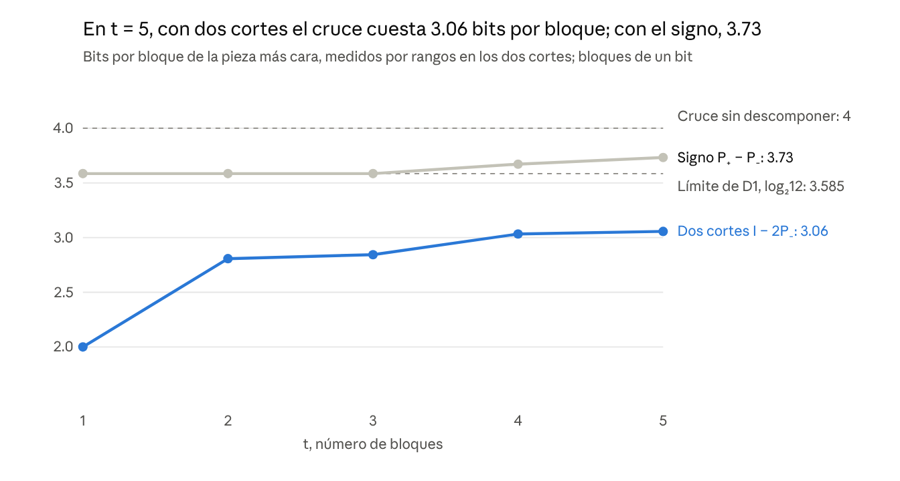

# El cruce como reflejo central

**Tetraedro, cubo y costo de composición en el Programa de Geometría Relacional frente a los algoritmos subexponenciales de 3-SAT**

Le Matt Ansatz Di Ego · Programa de Geometría Relacional · 3 de noviembre de 2026

**Clasificación MSC 2020 (sugerida).** 68Q25 (Análisis de algoritmos y complejidad de problemas), 68R07 (Aspectos computacionales de la satisfacibilidad), 68Q17 (Dificultad computacional de problemas), 17A75 (Álgebras de composición), 11P82 (Teoría analítica de particiones), 15A69 (Álgebra multilineal y productos tensoriales).

**Declaración de contribución.** Este artículo no presenta un algoritmo de satisfacibilidad ni reclama prioridad sobre las técnicas de OpenAI o Anthropic. Su contribución reconocible es un análisis, medido y reproducible, de la pieza que esos algoritmos descomponen —el cruce— leída desde el lenguaje del Programa de Geometría Relacional, con tres correspondencias exactas (niveles I–III) y una separación explícita de lo que permanece abierto (nivel IV).

**Premisa externa no verificada aquí.** Este documento *toma como premisa* los anuncios de octubre de 2026 de OpenAI y Anthropic. No los demuestra ni los audita: verificar la validez de esas demostraciones es una tarea de revisión independiente, ajena a lo que este artículo establece.

## Resumen

El cruce [x=v][y=u] es la pieza que el algoritmo de Claude (2026) descompone para refutar la Hipótesis del Tiempo Exponencial. Cuesta 4 bits por bloque en sus dos cortes. Medimos por rangos qué descomposiciones lo abaratan.

La identidad SWAP = I − 2P₋ lo baja a log₂12 ≈ 3.585 bits por bloque (ρ ≈ 0.896), porque I es barata en un corte y P₋ en el otro. La descomposición por signo, SWAP = P₊ − P₋, nunca baja de 3.585 bits y sube con el tamaño: 3.73 en t = 5.

Partimos del tetraedro del programa, la clase par {000, 011, 101, 110} del cubo de espejos. Como alfabeto de bloque da una identidad de cuatro cuadrados (cuaterniones, ρ → 0.948), idéntica a la de cualquier cara del cubo. Como geometría de los dos cortes, los cuatro cruces ocupan exactamente la clase par del cubo de correlaciones: cada cruce es el reflejo central de un estado de Bell.

La regla de duplicación por reflexión del programa da, en el nivel 8, exactamente la identidad del Lema 2 de Claude. Dentro de esa cadena, el 8 es el único nivel que abarata el cruce con el conteo implementable, y abaratarlo exige perder la asociatividad.

No establecemos un algoritmo ni prioridad. El rango mide el potencial de una descomposición; con el conteo que el paper de Claude implementa, solo el cubo (octoniones, ρ = 11/12) gana, y la cota subexponencial requiere los operadores de Heisenberg de su Apéndice B.

## 1. Introducción y alcance

El punto de contacto verificable entre el programa y los algoritmos de octubre no es el recierre, sino la geometría de la pieza que esos algoritmos descomponen. Este paper mide esa pieza, el cruce, y la lee desde el cubo de espejos y su tetraedro.

El programa formalizó el recierre de compatibilidad en MF-63B, fechado el 3 de octubre de 2026, y demostró el piso de su propio motor en N1, el 14 de octubre. El 26 de octubre, OpenAI y Anthropic publicaron algoritmos deterministas que cuentan las soluciones de una k-CNF en tiempo 2^O(n log log n / √log n). Ambos traen formalización en Lean y están en revisión externa.

Si sus demostraciones son correctas, esos algoritmos refutan la ETH y, con ella, la SETH. No deciden P frente a NP: la cota sigue siendo superpolinómica.

**Convención de estados.** Cada afirmación lleva su estado, como en la solicitud de revisión del 30 de octubre:

- [O] formulación ontológica
- [T] proposición con prueba
- [C] resultado clásico identificado
- [E] verificación computacional reproducible
- [I] correspondencia interpretativa
- [A] pregunta abierta

Una relación entre laboratorios no es una implicación hasta declarar un mapa que conserve operaciones y observables.

Los puntos tratados el 3 de noviembre sobre particiones y autorreferencia se resumen en las notas que acompañan este paper en el paquete de reproducibilidad.

## 2. El recierre y su piso

El recierre de MF-63B es eliminación de variables clásica, y N1 ya demostró que el motor del programa construido sobre él cuesta 2^Ω(n) en grafos aleatorios. Los algoritmos de octubre están necesariamente fuera de ese motor.

**Recierre [T][C].** Para dos regiones F_A(X,S) y F_B(S,Y) con interiores disjuntos, la compatibilidad sobre la frontera es:

$$
K_{AB}(S) = \exists X\, F_A(X,S) \wedge \exists Y\, F_B(S,Y) = \exists X,Y\, [F_A \wedge F_B]
$$

Proyectar de nuevo una parte de S coincide con proyectar el todo, y la composición es asociativa. Es la eliminación de variables de Davis y Putnam (1960) y de Dechter (1999), como ya lo atribuye el hilo ontológico del 24 de octubre. MF-63B separaba la exactitud semántica del costo y probó que un DAG compacto de referencias no decide la vaciedad.

**Piso del motor, N1 [T][C].** La nota `PISO_DEL_CAMINO_v2_7` (14 de octubre) prueba dos cosas:

- Ningún orden baja el motor de tablas de 3^(tw+1), donde tw es el ancho de árbol.
- Con poda, toda corrida que concluye «no hay coloración» es una refutación por resolución. Por Beame, Culberson, Mitchell y Moore (2005), cuesta 2^Ω(n) en grafos aleatorios, con cualquier selector.

**Consecuencia [T].** Una 3-coloración de n vértices se codifica como 3-CNF con 3n variables y O(n + m) cláusulas. Un algoritmo de tiempo 2^o(n) no puede tener corridas convertibles en refutaciones por resolución de tamaño polinómico en su tiempo: contradiría esa cota. Los algoritmos de octubre quedan fuera del motor que N1 acota.

El paper de Claude dice lo mismo desde otro lado. Contraer una sola red por un solo árbol tiene una cota inferior incondicional (Austrin, Kaski y Kubjas, 2022); según su cálculo, ningún algoritmo de ese modelo baja de cerca del 49 % del exponente de fuerza bruta. El algoritmo sale del modelo al expandir la suma en una suma con signos de redes contraídas en órdenes distintos.

**Nota sobre SETH.** El hilo ontológico (‹P3›) y la revisión de P frente a NP afirman que, bajo SETH, ningún refinamiento exacto de las tablas baja la base 3 (Lokshtanov, Marx y Saurabh, 2011). Si los resultados de octubre se sostienen, esa frase pierde su hipótesis: no queda refutada, queda sin respaldo. N1-A y N1-B no dependen de SETH y siguen en pie.

## 3. El cubo de espejos: lo que se pierde al correr la pared

Cuando la pared pasa de L = 1 a L = 2, la firma pierde cuántas veces se usó el espejo que se movió, no el signo. Esta sección corrige la versión anterior del artículo, que identificaba ese dato con la parte antisimétrica.

**Firma de órbita [T].** Con espejos en 0 y L, las reflexiones s₀(x) = −x y s_L(x) = 2L − x generan el grupo G_L de las transformaciones x ↦ εx + 2kL, con ε = ±1 y k entero. La firma es un invariante completo de sus órbitas (O59, T2):

$$
\rho_L(x) = \operatorname{dist}(x, 2L\mathbb{Z}) = L - \lvert (x \bmod 2L) - L \rvert
$$

**Criterio de actualización, MF-97 [T].** Existe una regla f con f ∘ Φ = Φ ∘ F si y solo si Φ(x) = Φ(y) implica Φ(Fx) = Φ(Fy). Saber que existe no dice cuánto cuesta construirla.

**Testigo [T][E].** Con L = 1, los puntos x = 1/4 e y = 9/4 comparten firma 1/4. Con L = 2, sus firmas son 1/4 y 7/4. La firma de G₁ no determina la de G₂.

**Qué dato se pierde [T].** El punto y = 9/4 es s₁ ∘ s₀(x) = x + 2: una traslación, con el mismo signo ε = +1. G₂ es el subgrupo de índice 2 de G₁ formado por los elementos con k par. El grupo de dos espejos tiene dos caracteres ±1 independientes, la paridad de uso de cada espejo, y el signo ε es su producto. Lo que G₁ olvida y G₂ necesita es la paridad de k: cuántas veces se usó el espejo que se corre.

**Lectura [I].** El cociente por G₁ olvida el uso del espejo que se mueve; el cociente siguiente lo necesita. Es la forma precisa de «una representación puede ser exacta para las relaciones actuales y dejar de ser suficiente cuando cambian las condiciones admitidas».

## 4. Existencia, conteo y signo

Lo que separa existencia de conteo es el semianillo en que se suma, no el signo de una reflexión. El piloto lo muestra en una fórmula de 21 soluciones.

**Dos interfaces [C].** Para una subestructura H(i, b) con interior i y frontera b, la existencia conserva Γ_H(b) = ∃i H(i, b) y el conteo conserva Q_H(b) = Σᵢ H(i, b) (Imagen Total 3.9, §6.3). El soporte que va de (ℕ, +, ×) a (𝔹, ∨, ∧) es un homomorfismo de semianillos: el soporte de la contracción de conteo es el recierre booleano. De ℤ a 𝔹 no lo es, porque 1 + (−1) = 0 mientras V ∨ V = V. Una suma con cancelaciones no se puede seguir con el recierre booleano.

**Piloto [E].** La 3-CNF C₁ = (x₁ ∨ x₂ ∨ ¬x₃), C₂ = (¬x₂ ∨ x₃ ∨ x₄), C₃ = (¬x₃ ∨ ¬x₄ ∨ x₅) tiene 21 soluciones. En el corte S = {x₂, x₃}:

- Existencia: B₁ = B₂ = 1 en las cuatro fronteras; no distingue ninguna.
- Conteo: N₁ = [2, 1, 2, 2] y N₂ = [4, 3, 2, 3] en el orden 00, 01, 10, 11; Σ N₁·N₂ = 21.

**El signo no es el mecanismo [T].** Separar N₁ y N₂ en partes simétrica y antisimétrica da 21.5 + (−0.5) = 21. Pero la igualdad ⟨A, B⟩ = ⟨Sym A, Sym B⟩ + ⟨Anti A, Anti B⟩ vale para cualquier par de matrices, y cualquier partición ortogonal suma igual: diagonal y fuera de diagonal dan 14 + 7. Omitir cualquier parte da un conteo erróneo. Además, transponer intercambia x₂ con x₃, que no es una simetría de la fórmula.

Lo que abarata el conteo hay que buscarlo en la forma de la pieza que se descompone. Esa pieza es el cruce.

## 5. El cruce y sus dos cortes

Repartir el cruce entre dos cortes lo abarata; separarlo por signo, no. Con t = 5 bloques, la pieza más cara cuesta 3.06 bits por bloque con dos cortes y 3.73 con el signo, frente a 4 del cruce.

**La pieza [C].** Para cadenas x, y, u, v de λ bits, el cruce [x=v][y=u] tiene rango completo 2^(2λ) en el corte por filas, (x,y)|(u,v), y en el corte por columnas, (x,u)|(y,v): cuesta 4λ bits. El algoritmo de Claude escribe un múltiplo del cruce como suma de piezas Aᵢ, los coeficientes de T^i en ∏ₛ (Rₛ + T·Cₛ), con R barata por filas y C por columnas (Definición 5). Gana si la pieza más cara cuesta ρ·4λ con ρ < 1 y las piezas son polinómicas en número: ρ = 11/12 con ocho cuadrados (Lema 2) y ρ = 1/√2 con los operadores del Apéndice B.

**La medida [E].** El costo de una pieza es log₂(rango por filas) + log₂(rango por columnas). El rango es una cota inferior de los bits de cualquier factorización.

**Dos descomposiciones del cruce de un bit**, que es el SWAP de ℂ² ⊗ ℂ²:

| Descomposición | Identidad | Rangos por filas | Rangos por columnas |
| --- | --- | --- | --- |
| D1, dos cortes | SWAP = I − 2P₋ | I: 4 · P₋: 1 | I: 1 · P₋: 4 |
| D2, signo propio | SWAP = P₊ − P₋ | P₊: 3 · P₋: 1 | P₊: 4 · P₋: 4 |

D1 es la identidad del Apéndice H de Claude: [x=v][y=u] = [x=u][y=v] − \[x≠y\](−1)^x \[u≠v\](−1)^u.

**Fórmulas [T], verificadas hasta t = 5 [E].** En D1, la pieza con i bloques en C tiene rangos:

$$
\text{filas}(A_i) = \sum_{z \ge t-i} \binom{t}{z} 3^{t-z}, \qquad \text{columnas}(A_i) = \sum_{z \ge i} \binom{t}{z} 3^{t-z}
$$

La peor pieza es i = t/2, y su costo tiende a log₂12 ≈ 3.585 bits por bloque (ρ ≈ 0.896): 3.26 en t = 10, 3.52 en t = 100 y 3.584 en t = 10 000. En D2, la pieza puramente simétrica tiene rangos 3^t y 4^t: cuesta log₂3 + 2 = 3.585 bits por bloque para todo t, así que D2 nunca baja de ahí.

D2 empieza donde D1 termina y sube; D1 se acerca a su límite desde abajo. La ganancia viene de emparejar una pieza barata en un corte con otra barata en el otro, no del signo.

**Límite [T].** Con el conteo simple del Lema 2 (bits de factorización explícita más bits de nombre), D1 da 4 de 4 bits: sin ganancia. Por eso el paper usa ocho cuadrados.

## 6. El tetraedro como base

El tetraedro del programa es la clase par del cubo de espejos, {000, 011, 101, 110}, donde x ⊕ y ⊕ z = 0: un torsor de F₂² (Imagen Total 3.4.1). Entra al mecanismo de dos maneras. Como alfabeto de bloque no aporta más que su grupo; como geometría de los dos cortes ubica exactamente los cruces.

### 6.1 Como alfabeto de bloque

- **Identidad exacta [T].** Los signos σ(p, q) de la identidad de ocho cuadrados (la tabla de los octoniones sobre F₂³, ec. 27 del paper de Claude) restringidos al tetraedro dan R + C = 2·cruce. La identidad (28) vale en todo F₂³ y el tetraedro es cerrado bajo ⊕.
- **Cuaterniones [E][C].** Esos signos generan Q8: cada elemento no nulo cuadra a −1 y dos distintos anticonmutan. Q8 es F₂² extendido por ±1, la forma exacta de la lectura «dos sobre dos, con ±1» [I].
- **Costo [T][E].** Con un bloque, R tiene rangos 4 y 16 y C, 16 y 4; con dos bloques los rangos coinciden con la fórmula del Apéndice H. Por rangos, ρ → 0.948. Con el conteo simple del Lema 2, 2 + 4 + 1 + 1 = 8 de 8 bits: sin ganancia.
- **La geometría no entra [E].** Los 7 subgrupos de orden 4 del cubo (3 caras, 3 rectángulos diagonales y el tetraedro) dan identidad, signos y rangos idénticos. Como alfabeto, el tetraedro vale lo mismo que una cara.

### 6.2 Como geometría de los dos cortes

En el cubo de correlaciones (⟨XX⟩, ⟨YY⟩, ⟨ZZ⟩) de dos bits, cada pieza de la descomposición D1 tiene un lugar exacto [C][E]. Los estados de Bell forman un tetraedro regular de arista 2√2 (Horodecki y Horodecki, 1996). La palabra traduce +1 ↦ 0 y −1 ↦ 1.

| Pieza | Lugar en el cubo | Palabras | Rango por filas | Rango por columnas |
| --- | --- | --- | --- | --- |
| Estados de Bell Πᵥ | tetraedro impar (c₁c₂c₃ = −1) | 111, 010, 100, 001 | 1 | 4 |
| Identidad I = Σ Πᵥ | centro | — | 4 | 1 |
| Cruces I − 2Πᵥ | tetraedro par (c₁c₂c₃ = +1) | 000, 011, 101, 110 | 4 | 4 |

- **Reflejo central [E].** Cada cruce tiene la correlación opuesta a la de su estado: c(I − 2Πᵥ) = −c(Πᵥ). El SWAP queda en 000, frente al singlete en 111.
- **Cuatro elecciones, un costo [E].** Los cuatro cruces son el mismo SWAP corregido por un Pauli local sobre un índice (I, X, Z o XZ). Su descomposición D1 cuesta lo mismo: ρ = 0.50, 0.70, 0.71 y 0.76 para t = 1 a 4, con límite 0.896.
- **Lectura [I].** Elegir el vértice es elegir el marco: el «uno» del torsor. Es una realización exacta de «tres y uno sin distinguir cuál».

**Tesis [T][E], con lectura [I].** El cruce es un vértice del tetraedro par y es caro en los dos cortes. Se abarata como reflejo central: el centro, barato por columnas, menos dos veces el estado opuesto, barato por filas.

### 6.3 Comparación

| Base | ρ por rangos | ρ con el conteo del Lema 2 |
| --- | --- | --- |
| Tetraedro de los dos cortes (I − 2Πᵥ, un bit) | 0.896 | 1 (sin ganancia) |
| Tetraedro como alfabeto (cuaterniones, N = 4) | 0.948 | 1 (sin ganancia) |
| Cubo como alfabeto (octoniones, N = 8) | 0.901 | 11/12 ≈ 0.917 |
| Operadores de Heisenberg (Apéndice B de Claude) | — | 1/√2 ≈ 0.707 |

El tetraedro da el mejor valor por rangos, pero solo el cubo gana con el conteo que el paper sabe implementar.

## 7. La cadena de duplicación: por qué el 8

La regla de duplicación por reflexión del programa produce en el nivel 8 exactamente la identidad del Lema 2, y el 8 es el único nivel de la cadena que abarata el cruce con el conteo implementable. Son teoremas clásicos escritos en el lenguaje del programa. No mejoran el algoritmo, pero dan contenido exacto a dos lecturas: «la novedad está en el orden» y «el 8 crece con un nodo abierto».

**La regla [C].** La nota v2.2 del programa (13 de octubre) formaliza la duplicación de Cayley–Dickson, en la que el conjugado hace de espejo:

$$
(a,b)\,(c,d) = (ac - \bar d\, b,\; d\,a + b\,\bar c), \qquad \overline{(a,b)} = (\bar a, -b)
$$

Desde los reales da los niveles N = 1, 2, 4, 8 y 16. En la base de unidades, e_p e_q = σ(p,q) e_(p⊕q), con p y q en F₂^k: la suma en F₂^k fija el destino y la tabla σ = ±1 fija el signo [E]. Con ψ_k(p,q) = [p⊕q = k] σ(p,q) definimos:

$$
R(x,y,u,v) = \sum_k \psi_k(x,y)\,\psi_k(v,u), \qquad C(x,y,u,v) = \sum_k \psi_k(x,u)\,\psi_k(v,y)
$$

Y Lₓ es la matriz N × N de entradas ψ_k(x, y): la multiplicación a la izquierda por eₓ.

**Proposición 1. La duplicación da la identidad del cruce [T].** En los niveles 2, 4 y 8, R + C = 2·[x=v][y=u].

*Prueba.* En esos niveles la norma es multiplicativa: |ab|² = |a|²|b|² (Hurwitz, 1898). Con a = Σ a_p e_p y b = Σ b_q e_q, el coeficiente de e_k en ab es Σ_{p⊕q=k} σ(p,q) a_p b_q, así que:

$$
\Big(\sum_p a_p^2\Big)\Big(\sum_q b_q^2\Big) = \sum_k \Big(\sum_{p \oplus q = k} \sigma(p,q)\, a_p b_q\Big)^2
$$

Si p⊕q = p'⊕q' con q ≠ q', el monomio a_p a_p' b_q b_q' sale de los pares {(p,q), (p',q')} y {(p,q'), (p',q)}, y no aparece a la izquierda. Su coeficiente, 2[σ(p,q)σ(p',q') + σ(p,q')σ(p',q)], debe anularse: es la identidad (28) del paper. Ahora R = [x⊕y = v⊕u] σ(x,y)σ(v,u) y C = [x⊕u = v⊕y] σ(x,u)σ(v,y), y ambos corchetes dicen x⊕y⊕u⊕v = 0. Si y = u, entonces x = v y R = C = 1; si y ≠ u, R + C = 0 por (28) con (p, q, p', q') = (x, y, v, u). □

**Proposición 2. Las direcciones son órdenes [T].** R(x,y,u,v) = (Lᵥᵀ Lₓ)ᵤ,ᵧ y C(x,y,u,v) = (Lₓᵀ Lᵥ)ᵤ,ᵧ, y además:

$$
L_v^{\top} L_x + L_x^{\top} L_v = 2\,[x=v]\,\mathrm{Id}
$$

*Prueba.* (Lᵥᵀ Lₓ)ᵤ,ᵧ = Σ_k ψ_k(v,u) ψ_k(x,y) = R, y lo mismo para C. La suma es la Proposición 1 escrita por entradas: son las relaciones de Hurwitz–Radon (ec. 74 del paper). □

En R actúa primero la referencia x y en C primero v. Cada producto pasa por un espacio de dimensión N, así que R se factoriza por log₂N bits en el corte por filas y C en el corte por columnas.

**Lectura [I].** El cruce es la suma de los dos órdenes de componer dos referencias, y cada orden es barato en un corte distinto. Es el contenido computacional exacto de «la novedad está en el orden», que el programa ya tenía en el esqueleto Q₈ de la rama Yang–Mills y en el bit abierto del 8.

**Proposición 3. Solo el 8 abarata [T].** Con el conteo del Lema 2 (log₂ del rango por filas, log₂ del rango por columnas y 2 bits de nombre), un bloque de cada nivel cuesta:

| Nivel N | Rangos de R (filas, columnas) | Costo del bloque (bits) | Costo del cruce (bits) |
| --- | --- | --- | --- |
| 2 | 2, 2 | 4 | 4 |
| 4 | 4, 16 | 8 | 8 |
| 8 | 8, 64 | 11 | 12 |

En el nivel 16 la identidad (28) falla en 672 casos, y R + C deja de ser múltiplo del cruce.

*Prueba.* Sea Φ la matriz N × N² de filas ψ_k. Cada par (x, y) cae en un solo k, así que ΦΦᵀ = N·Id. Con columnas indexadas por (v, u) —distinto del corte por filas habitual (u, v)—, R = ΦᵀΦ y el cruce es la identidad. Por tanto R² = N·R, R tiene rango N por filas, y C = 2·Id − R tiene autovalores 2 − N (multiplicidad N) y 2 (multiplicidad N² − N). El rango de R por columnas es el de C por filas, porque C(x,y,u,v) = R(x,u,y,v): vale N² si N ≠ 2 y vale 2 si N = 2. Para N = 4 y 8 el costo es log₂N + 2·log₂N + 2 frente a 4·log₂N, y gana solo si log₂N > 2, es decir, si N = 8. En el 16 no existe identidad de 16 cuadrados con 16 términos (Hurwitz), y el verificador lo confirma. □

**Corolario 4. Dentro de la cadena, abaratar exige el nodo abierto [T].** Si un nivel de la duplicación abarata el cruce con el conteo del Lema 2, ese nivel es el 8, y el 8 no es asociativo.

*Prueba.* Por la Proposición 3, la ganancia exige N > 4 y que valga (28). En la cadena, (28) vale hasta el 8 y falla en el 16. Todo nivel posterior contiene al 16 como subálgebra, con la misma tabla de signos, así que también falla. Queda N = 8. Las álgebras de división reales asociativas tienen dimensión 1, 2 o 4 (Frobenius, 1878), así que el 8 no es asociativo: la nota del 13 de octubre cuenta 168 de 210 tríos con signo dependiente del camino. □

**Alcance.** El corolario vale con el conteo implementable y con identidades exactas, de tantos cuadrados como elementos. Por rangos (§5), D1 gana con un solo bit y sin nada no asociativo. Las identidades con más cuadrados que elementos (Hrubeš, 2024) van más allá del 8. El nodo abierto es necesario dentro de la cadena, no en general.

**Lectura [I].** «El 8 es la estructura sobre la que crece, con un nodo abierto» tiene una contraparte computacional exacta: el 8 es el único nivel de la duplicación que abarata el cruce, y abaratarlo cuesta la asociatividad. «En el 16 se rompe» es la razón por la que el paper de Claude sale de la cadena hacia los operadores del Apéndice B.

**Lo que no se demuestra.** Que la ontología obligue a duplicar: en el programa es una lectura marcada como postulado. Tampoco la concavidad del Apéndice B, ni un ρ mejor que 11/12.

**Verificación [E].** `verificar_cadena_duplicacion.py` comprueba las cuatro proposiciones con enteros exactos en los niveles 2, 4, 8 y 16, en menos de un segundo.

## 8. Lo establecido y lo no establecido

El paper establece dónde está la ganancia de la descomposición y dónde se ubica en el cubo; no establece un algoritmo propio ni prioridad sobre las técnicas de octubre.

**Establecido**

- El recierre de MF-63B es eliminación de variables; N1 acota el motor del programa, y los algoritmos de octubre quedan fuera de él [T][C].
- Al correr la pared de L = 1 a L = 2 se pierde la paridad de uso del espejo movido, no el signo [T].
- Existencia y conteo se separan por el semianillo; cualquier partición ortogonal suma igual [T].
- En el cruce, SWAP = I − 2P₋ tiende a ρ ≈ 0.896 por rangos; P₊ − P₋ nunca baja de 3.585 bits por bloque y sube con t [T][E].
- El tetraedro como alfabeto da cuaterniones (ρ → 0.948) y su geometría no entra en el costo; como geometría, los cruces ocupan la clase par y cada uno es el reflejo central de un estado [T][E][C].
- La duplicación por reflexión da en el 8 la identidad del Lema 2; el 8 es el único nivel de la cadena que abarata el cruce con el conteo implementable, y dentro de la cadena eso exige perder la asociatividad [T][E].

**No establecido**

- Un algoritmo. El rango es una cota inferior de los bits de factorización, no una factorización explícita y eficiente. Con el conteo implementable, solo el cubo gana (11/12), y la cota subexponencial necesita el Apéndice B.
- Que la ontología obligue a duplicar. En el programa, la duplicación por reflexión es una lectura marcada como postulado; sin derivarla, la §7 son teoremas clásicos en otro lenguaje.
- Que el algoritmo de OpenAI use esta geometría. No pudimos leer su preprint; las fuentes secundarias describen resúmenes lineales, reemplazo espectral, interpolación y contracción tensorial.
- Prioridad. El programa publicó antes un sustrato composicional clásico y el piso de su propio motor; no publicó las técnicas que producen las cotas.
- Correspondencias físicas: quedan como [I].

**Correcciones a la versión anterior del artículo.** La identidad SWAP = I − 2P₋ aparece en el Apéndice H de Claude, que el propio paper declara fuera de toda prueba; no es «usada por Claude». «El signo es la reflexión» no distingue nada: toda involución tiene esa forma. Burnside cuenta órbitas, y #SAT no hace cociente por ningún grupo.

## 9. Preguntas abiertas y falsadores

La pregunta que decide si el programa explica el mecanismo es si puede predecir ρ, no solo describir las piezas.

1. **Predecir ρ [A].** La §7 obtiene 11/12 dentro de la cadena, tomando la duplicación como postulado. ¿Puede el programa derivar 1/√2, o algún ρ < 11/12, desde su propio lenguaje?
2. **Más allá de la cadena [A].** Según el paper de Claude, las identidades de Hrubeš, con más cuadrados que elementos, darían ρ ≈ 0.905 si sus factorizaciones fueran explícitas y eficientes. ¿Puede el programa construirlas?
3. **El cubo como geometría [A].** Hacer para el cubo lo que §6.2 hace para el tetraedro: ubicar R y C de ocho cuadrados en la geometría de correlaciones de dos sistemas de 8 niveles.
4. **Concavidad [A].** El Apéndice B gana porque log dim V_E crece de forma cóncava en E (número de particiones); con crecimiento lineal no habría ganancia. ¿Qué estructura del programa produce crecimiento cóncavo de la dimensión, y con qué exponente?
5. **La pared que se corre [A].** ¿Hay un mapa que lleve la paridad del espejo movido (§3) a un corte en el sentido del §5 y conserve rangos? Sin ese mapa, el vínculo queda como [I].
6. **Mantenimiento.** Actualizar la referencia ‹P3› del hilo ontológico y la revisión de P frente a NP: la cota de Lokshtanov, Marx y Saurabh depende de SETH.

## Reproducibilidad

Cada número [E] se regenera con cuatro verificadores en Python 3 con numpy. Se distribuyen en el paquete de reproducibilidad `2026-11-03_cruce_reflejo_central`, en el [repositorio público](https://github.com/EndlessMonkeyProyect/programa-geometria-relacional) del programa (DOI de Zenodo por agregar al depositarlo). El comando `bash reproducir_todo.sh` los corre todos, en unos 40 segundos, y compara sus archivos `resultados_*.json` con los resultados de referencia guardados.

| Verificador | Qué comprueba |
| --- | --- |
| `experimento_cruce_dos_cortes.py` | D1 y D2 para t = 1 a 5; fórmulas cerradas; límite de D1 hasta t = 10 000; control de ocho cuadrados (R + C = 2·cruce, rangos 8 y 64) |
| `experimento_tetraedro.py` | Los 7 subgrupos de orden 4; signos Q8; rangos para t = 1 y 2; estados de Bell, centro, cuatro cruces y su costo |
| `verificar_cadena_duplicacion.py` | Niveles 2, 4, 8 y 16 de la duplicación: identidad (28), R + C = 2·cruce, dos órdenes, rangos, costo con el conteo del Lema 2 y asociatividad |
| `verificar_particiones.py` | Particiones, log-concavidad, relación de Heisenberg hasta peso 8 y tabla de familias de partes |

**Entorno de referencia.** Python 3.13.18, numpy 2.5.3, Linux. Los hashes SHA256 de todos los archivos están en `MANIFIESTO_SHA256.txt`.

**Reproducción multiplataforma (2026-11-03).** DeepSeek, un modelo de IA, repitió la ejecución en Windows con Python 3.12.14 y numpy 2.3.5. Los cuatro verificadores regeneraron sus JSON, `comparar_resultados.py` los dio por idénticos a la referencia (enteros exactos; decimales con tolerancia relativa 1e-9) y cada archivo coincidió con su hash SHA256. Los números [E] no dependen, por tanto, del sistema operativo ni de estas versiones de numpy. Esa ejecución mostró también que dos verificadores no podían imprimir su JSON en una consola de Windows con codificación cp1252, aunque escribían bien los archivos; ahora los verificadores fuerzan la salida en UTF-8, un cambio que no afecta ningún resultado.

**Revisión de las pruebas de la §7.** DeepSeek re-derivó las Proposiciones 1–3 y el Corolario 4 con una implementación propia de la duplicación, sin usar los verificadores del paquete, y no encontró errores. La revisión confirmó además que 168 de los 210 tríos ordenados de unidades imaginarias distintas de los octoniones son no asociativos. Es una comprobación hecha por un segundo modelo de IA, no una revisión humana. El informe y su script están en el repositorio público del programa, en `review_requests/2026-11-03_cruce_reflejo_central/`.

**Fuentes del programa usadas, con commit.** MF-63B, Imagen Total 3.9, O59, hilo ontológico y `PISO_DEL_CAMINO_v2_7` están en el commit `0fd5315` (24 de octubre). La solicitud de revisión del 30 de octubre está en `a1d3f16`. MF-63B está fechado internamente el 3 de octubre; su núcleo es público ese mismo día en el commit `c44cfb8` de `relational-geometry-program` (archivo `02_formal_core/compatible_reclosure.es.md`), y el documento completo aparece en `0fd5315`. El paper de Claude se leyó del commit `16a5ce4` de `anthropics/formal-math`.

*Commit de este paquete:* **completar por el autor al subir** (hash del commit que contenga los verificadores y este paper).

## Uso de herramientas de IA

Este trabajo se preparó con asistencia sustancial de dos modelos de IA generativa, usados como asistentes de investigación; ninguno es autor. Claude (Anthropic) redactó la versión en español de este paper y de sus documentos acompañantes, escribió y ejecutó los cuatro verificadores del paquete de reproducibilidad, buscó literatura, leyó el paper de octubre de 2026 atribuido a Claude, contrastó la cronología documental con el historial git de los repositorios del programa y revisó el paquete de envío. DeepSeek armó el paquete de envío (las versiones en inglés y en LaTeX de este paper, la solicitud de verificación y el README), ejecutó los verificadores por segunda vez en Windows y re-derivó las pruebas de la §7 con una implementación propia; esa comprobación es obra de un modelo de IA, no una revisión humana. Las preguntas de investigación, el marco del Programa de Geometría Relacional y las decisiones de alcance son del autor. El autor revisó todo el contenido y asume la responsabilidad por él. Conviene que el lector sepa que uno de los asistentes y uno de los algoritmos analizados provienen de la misma empresa.

## Referencias

**Algoritmos de octubre de 2026**

- Claude (Anthropic). [A 2^o(n) Time Algorithm for 3-SAT](https://github.com/anthropics/formal-math/blob/16a5ce41304fcdaea4e0be7c132e1c361dc26da5/eth/paper.pdf), 26 de octubre de 2026; también en [Hexagon 2610.00577](https://hexagonmath.org/2610.00577). Leído completo; §4, Lema 2, Definición 5 y Apéndices B y H.
- OpenAI. [The Exponential Time Hypothesis is False](https://github.com/openai/math/tree/main/preprints/The-Exponential-Time-Hypothesis-is-False-October-25-2026), 17 de octubre de 2026, revisado el 25. No leído directamente.

**Literatura clásica citada**

- Austrin, Kaski y Kubjas (2022): cota inferior para la contracción por un solo árbol, según la cita del paper de Claude.
- Baez. [The octonions](https://arxiv.org/abs/math/0105155). *Bulletin of the AMS* 39 (2002): Cayley–Dickson, Hurwitz y plano de Fano.
- Beame, Culberson, Mitchell y Moore. The resolution complexity of random graph k-colorability. *Discrete Applied Mathematics* 153 (2005).
- Davis y Putnam. A computing procedure for quantification theory. *Journal of the ACM* 7 (1960).
- Dechter. Bucket elimination: a unifying framework for reasoning. *Artificial Intelligence* 113 (1999).
- Frobenius (1878): las álgebras de división reales asociativas tienen dimensión 1, 2 o 4.
- Horodecki y Horodecki. Information-theoretic aspects of inseparability of mixed states. *Physical Review A* 54 (1996).
- Hrubeš (2024): identidades con más cuadrados que elementos, según la cita del paper de Claude.
- Hurwitz (1898); Degen (1818) y Graves (1843) para la identidad de ocho cuadrados, según Baez (2002) citado por Claude.
- Lokshtanov, Marx y Saurabh. Known algorithms on graphs of bounded treewidth are probably optimal. SODA (2011).
- Nerode. Linear automaton transformations. *Proceedings of the AMS* 9 (1958).

**Fuentes del programa** ([repositorio público](https://github.com/EndlessMonkeyProyect/programa-geometria-relacional))

- MF-63B, *Recierre acreditado de compatibilidad*, v1.0, 3 de octubre de 2026.
- Esqueleto finito Q₈ de la rama Yang–Mills, octubre de 2026: el orden como única distinción de los contextos compuestos.
- *El 8: la estructura sobre la que crece, con un nodo abierto*, nota v2.2, 13 de octubre de 2026 (`EL_OCHO_NODO_ABIERTO_v2_2.md`).
- `PISO_DEL_CAMINO_v2_7` (N1), 14 de octubre de 2026.
- O59, *Autorreferencia de la unidad y sectores no habitados*, 21 de octubre de 2026.
- Imagen Total 3.9, 23 de octubre de 2026; hilo ontológico integrado, 24 de octubre de 2026.
- *El cubo de espejos, la unidad autorreferenciada y P frente a NP*, solicitud de revisión, 30 de octubre de 2026 (MF-97, MF-106, R5, T-EXT-01).
- [Publicación del 3 de octubre de 2026 en Reddit](https://www.reddit.com/r/u_Endless-monkey/comments/1wwk0xh/p_vs_np_and_yangmills_two_problems_one_structural/).
