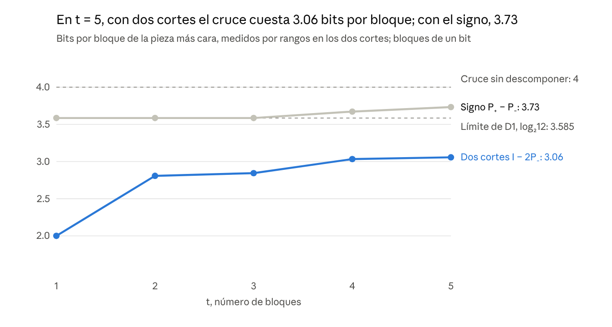

# The Cross as Central Reflection

**Tetrahedron, cube, and composition cost in the Relational Geometry Program against the subexponential 3-SAT algorithms**

Le Matt Ansatz Di Ego · Relational Geometry Program · November 3, 2026

**MSC 2020 classification (suggested).** 68Q25 (Analysis of algorithms and problem complexity), 68R07 (Computational aspects of satisfiability), 68Q17 (Computational difficulty of problems), 17A75 (Composition algebras), 11P82 (Analytic theory of partitions), 15A69 (Multilinear algebra and tensor products).

**Contribution statement.** This paper presents no satisfiability algorithm and claims no priority over the techniques of OpenAI or Anthropic. Its recognizable contribution is a measured and reproducible analysis of the piece those algorithms decompose — the cross — read in the language of the Relational Geometry Program, with three exact correspondences (levels I–III) and an explicit separation of what remains open (level IV).

**External premise, not verified here.** This document *takes as a premise* the October 2026 announcements of OpenAI and Anthropic. It neither proves nor audits them: verifying the validity of those proofs is an independent-review task, external to what this paper establishes.

## Abstract

The cross [x=v][y=u] is the piece that Claude's algorithm (2026) decomposes to refute the Exponential Time Hypothesis. It costs 4 bits per block in its two cuts. We measure by ranks which decompositions make it cheaper.

The identity SWAP = I − 2P₋ lowers it to log₂12 ≈ 3.585 bits per block (ρ ≈ 0.896), because I is cheap in one cut and P₋ in the other. The sign decomposition, SWAP = P₊ − P₋, never drops below 3.585 bits and grows with size: 3.73 at t = 5.

We start from the program's tetrahedron, the even class {000, 011, 101, 110} of the mirror cube. As a block alphabet it yields a four-squares identity (quaternions, ρ → 0.948), identical to that of any face of the cube. As the geometry of the two cuts, the four crosses occupy exactly the even class of the correlation cube: each cross is the central reflection of a Bell state.

The program's doubling-by-reflection rule yields, at level 8, exactly the identity of Claude's Lemma 2. Within that chain, the 8 is the only level that makes the cross cheaper under the implementable count, and making it cheaper requires losing associativity.

We establish no algorithm and no priority. Rank measures the potential of a decomposition; under the count that Claude's paper implements, only the cube (octonions, ρ = 11/12) wins, and the subexponential bound requires the Heisenberg operators of its Appendix B.

## 1. Introduction and scope

The verifiable point of contact between the program and the October algorithms is not the reclosure, but the geometry of the piece those algorithms decompose. This paper measures that piece, the cross, and reads it from the mirror cube and its tetrahedron.

The program formalized the compatibility reclosure in MF-63B, dated October 3, 2026, and proved the floor of its own engine in N1, on October 14. On October 26, OpenAI and Anthropic published deterministic algorithms that count the solutions of a k-CNF in time 2^O(n log log n / √log n). Both come with a Lean formalization and are under external review.

If their proofs are correct, those algorithms refute the ETH and, with it, the SETH. They do not decide P versus NP: the bound remains superpolynomial.

**State convention.** Each assertion carries its state, as in the review request of October 30:

- [O] ontological formulation
- [T] proposition with proof
- [C] identified classical result
- [E] reproducible computational verification
- [I] interpretative correspondence
- [A] open question

A relation between laboratories is not an implication until a map is declared that preserves operations and observables.

The points discussed on November 3 about partitions and self-reference are summarized in the notes that accompany this paper in the reproducibility package.

## 2. The reclosure and its floor

The reclosure of MF-63B is classical variable elimination, and N1 already proved that the program's engine built on it costs 2^Ω(n) on random graphs. The October algorithms are necessarily outside that engine.

**Reclosure [T][C].** For two regions F_A(X,S) and F_B(S,Y) with disjoint interiors, the compatibility over the frontier is:

$$
K_{AB}(S) = \exists X\, F_A(X,S) \wedge \exists Y\, F_B(S,Y) = \exists X,Y\, [F_A \wedge F_B]
$$

Projecting a part of S again coincides with projecting the whole, and composition is associative. It is the variable elimination of Davis and Putnam (1960) and of Dechter (1999), as the ontological thread of October 24 already attributes. MF-63B separated semantic exactness from cost and proved that a compact DAG of references does not decide emptiness.

**Floor of the engine, N1 [T][C].** The note `PISO_DEL_CAMINO_v2_7` (October 14) proves two things:

- No order lowers the table engine below 3^(tw+1), where tw is the treewidth.
- With pruning, every run concluding «no coloring» is a resolution refutation. By Beame, Culberson, Mitchell and Moore (2005), it costs 2^Ω(n) on random graphs, with any selector.

**Consequence [T].** A 3-coloring of n vertices is encoded as a 3-CNF with 3n variables and O(n + m) clauses. An algorithm of time 2^o(n) cannot have runs convertible into resolution refutations of polynomial size in its time: it would contradict that bound. The October algorithms lie outside the engine that N1 bounds.

Claude's paper says the same from another side. Contracting a single network along a single tree has an unconditional lower bound (Austrin, Kaski and Kubjas, 2022); by its computation, no algorithm in that model gets below roughly 49 % of the brute-force exponent. The algorithm leaves the model by expanding the sum into a signed sum of networks contracted in different orders.

**Note on SETH.** The ontological thread (‹P3›) and the P-versus-NP review assert that, under SETH, no exact refinement of the tables lowers the base 3 (Lokshtanov, Marx and Saurabh, 2011). If the October results hold, that sentence loses its hypothesis: it is not refuted, it is left unsupported. N1-A and N1-B do not depend on SETH and still stand.

## 3. The mirror cube: what is lost when the wall moves

When the wall moves from L = 1 to L = 2, the signature loses how many times the moved mirror was used, not the sign. This section corrects the previous version of the article, which identified that datum with the antisymmetric part.

**Orbit signature [T].** With mirrors at 0 and L, the reflections s₀(x) = −x and s_L(x) = 2L − x generate the group G_L of transformations x ↦ εx + 2kL, with ε = ±1 and k integer. The signature is a complete invariant of its orbits (O59, T2):

$$
\rho_L(x) = \operatorname{dist}(x, 2L\mathbb{Z}) = L - \lvert (x \bmod 2L) - L \rvert
$$

**Update criterion, MF-97 [T].** A rule f with f ∘ Φ = Φ ∘ F exists if and only if Φ(x) = Φ(y) implies Φ(Fx) = Φ(Fy). Knowing it exists says nothing about how much it costs to build it.

**Witness [T][E].** With L = 1, the points x = 1/4 and y = 9/4 share signature 1/4. With L = 2, their signatures are 1/4 and 7/4. The signature of G₁ does not determine that of G₂.

**What datum is lost [T].** The point y = 9/4 is s₁ ∘ s₀(x) = x + 2: a translation, with the same sign ε = +1. G₂ is the index-2 subgroup of G₁ formed by the elements with even k. The two-mirror group has two independent ±1 characters, the use-parity of each mirror, and the sign ε is their product. What G₁ forgets and G₂ needs is the parity of k: how many times the moved mirror was used.

**Reading [I].** The quotient by G₁ forgets the use of the mirror that moves; the next quotient needs it. This is the precise form of «a representation can be exact for the current relations and cease to suffice when the admissible conditions change».

## 4. Existence, counting and sign

What separates existence from counting is the semiring in which one sums, not the sign of a reflection. The pilot shows it on a formula with 21 solutions.

**Two interfaces [C].** For a substructure H(i, b) with interior i and frontier b, existence preserves Γ_H(b) = ∃i H(i, b) and counting preserves Q_H(b) = Σᵢ H(i, b) (Imagen Total 3.9, §6.3). The support map from (ℕ, +, ×) to (𝔹, ∨, ∧) is a semiring homomorphism: the support of the counting contraction is the Boolean reclosure. From ℤ to 𝔹 it is not, because 1 + (−1) = 0 whereas V ∨ V = V. A sum with cancellations cannot be followed by the Boolean reclosure.

**Pilot [E].** The 3-CNF C₁ = (x₁ ∨ x₂ ∨ ¬x₃), C₂ = (¬x₂ ∨ x₃ ∨ x₄), C₃ = (¬x₃ ∨ ¬x₄ ∨ x₅) has 21 solutions. On the cut S = {x₂, x₃}:

- Existence: B₁ = B₂ = 1 on all four frontiers; it distinguishes none.
- Counting: N₁ = [2, 1, 2, 2] and N₂ = [4, 3, 2, 3] in the order 00, 01, 10, 11; Σ N₁·N₂ = 21.

**The sign is not the mechanism [T].** Splitting N₁ and N₂ into symmetric and antisymmetric parts gives 21.5 + (−0.5) = 21. But the identity ⟨A, B⟩ = ⟨Sym A, Sym B⟩ + ⟨Anti A, Anti B⟩ holds for any pair of matrices, and any orthogonal partition sums the same: diagonal and off-diagonal give 14 + 7. Omitting any part gives a wrong count. Moreover, transposing swaps x₂ with x₃, which is not a symmetry of the formula.

What makes counting cheaper must be sought in the shape of the piece being decomposed. That piece is the cross.

## 5. The cross and its two cuts

Splitting the cross across two cuts makes it cheaper; splitting it by sign does not. With t = 5 blocks, the most expensive piece costs 3.06 bits per block with two cuts and 3.73 with the sign, versus 4 for the cross.

**The piece [C].** For strings x, y, u, v of λ bits, the cross [x=v][y=u] has full rank 2^(2λ) in the row cut, (x,y)|(u,v), and in the column cut, (x,u)|(y,v): it costs 4λ bits. Claude's algorithm writes a multiple of the cross as a sum of pieces Aᵢ, the coefficients of T^i in ∏ₛ (Rₛ + T·Cₛ), with R cheap by rows and C by columns (Definition 5). It wins if the most expensive piece costs ρ·4λ with ρ < 1 and the pieces are polynomial in number: ρ = 11/12 with eight squares (Lemma 2) and ρ = 1/√2 with the operators of Appendix B.

**The measure [E].** The cost of a piece is log₂(rank by rows) + log₂(rank by columns). Rank is a lower bound on the bits of any factorization.

**Two decompositions of the one-bit cross**, which is the SWAP of ℂ² ⊗ ℂ²:

| Decomposition | Identity | Ranks by rows | Ranks by columns |
| --- | --- | --- | --- |
| D1, two cuts | SWAP = I − 2P₋ | I: 4 · P₋: 1 | I: 1 · P₋: 4 |
| D2, proper sign | SWAP = P₊ − P₋ | P₊: 3 · P₋: 1 | P₊: 4 · P₋: 4 |

D1 is the identity of Claude's Appendix H: [x=v][y=u] = [x=u][y=v] − \[x≠y\](−1)^x \[u≠v\](−1)^u.

**Formulas [T], verified up to t = 5 [E].** In D1, the piece with i blocks in C has ranks:

$$
\text{rows}(A_i) = \sum_{z \ge t-i} \binom{t}{z} 3^{t-z}, \qquad \text{columns}(A_i) = \sum_{z \ge i} \binom{t}{z} 3^{t-z}
$$

The worst piece is i = t/2, and its cost tends to log₂12 ≈ 3.585 bits per block (ρ ≈ 0.896): 3.26 at t = 10, 3.52 at t = 100 and 3.584 at t = 10 000. In D2, the purely symmetric piece has ranks 3^t and 4^t: it costs log₂3 + 2 = 3.585 bits per block for all t, so D2 never drops below that.

D2 starts where D1 ends and rises; D1 approaches its limit from below. The gain comes from pairing a piece cheap in one cut with another cheap in the other, not from the sign.

**Limit [T].** With the simple count of Lemma 2 (bits of explicit factorization plus bits of name), D1 gives 4 of 4 bits: no gain. That is why the paper uses eight squares.

## 6. The tetrahedron as a base

The program's tetrahedron is the even class of the mirror cube, {000, 011, 101, 110}, where x ⊕ y ⊕ z = 0: a torsor of F₂² (Imagen Total 3.4.1). It enters the mechanism in two ways. As a block alphabet it contributes no more than its group; as the geometry of the two cuts it locates exactly the crosses.

### 6.1 As a block alphabet

- **Exact identity [T].** The signs σ(p, q) of the eight-squares identity (the octonion table over F₂³, eq. 27 of Claude's paper) restricted to the tetrahedron give R + C = 2·cross. Identity (28) holds in all of F₂³ and the tetrahedron is closed under ⊕.
- **Quaternions [E][C].** Those signs generate Q8: every nonzero element squares to −1 and two distinct ones anticommute. Q8 is F₂² extended by ±1, the exact form of the reading «two over two, with ±1» [I].
- **Cost [T][E].** With one block, R has ranks 4 and 16 and C, 16 and 4; with two blocks the ranks match the Appendix H formula. By ranks, ρ → 0.948. With the simple count of Lemma 2, 2 + 4 + 1 + 1 = 8 of 8 bits: no gain.
- **The geometry does not enter [E].** The 7 order-4 subgroups of the cube (3 faces, 3 diagonal rectangles and the tetrahedron) give identical identity, signs and ranks. As an alphabet, the tetrahedron is worth the same as a face.

### 6.2 As the geometry of the two cuts

In the correlation cube (⟨XX⟩, ⟨YY⟩, ⟨ZZ⟩) of two bits, each piece of the decomposition D1 has an exact place [C][E]. The Bell states form a regular tetrahedron of edge 2√2 (Horodecki and Horodecki, 1996). The word translates +1 ↦ 0 and −1 ↦ 1.

| Piece | Place in the cube | Words | Rank by rows | Rank by columns |
| --- | --- | --- | --- | --- |
| Bell states Πᵥ | odd tetrahedron (c₁c₂c₃ = −1) | 111, 010, 100, 001 | 1 | 4 |
| Identity I = Σ Πᵥ | center | — | 4 | 1 |
| Crosses I − 2Πᵥ | even tetrahedron (c₁c₂c₃ = +1) | 000, 011, 101, 110 | 4 | 4 |

- **Central reflection [E].** Each cross has the opposite correlation to that of its state: c(I − 2Πᵥ) = −c(Πᵥ). SWAP sits at 000, opposite the singlet at 111.
- **Four choices, one cost [E].** The four crosses are the same SWAP corrected by a local Pauli on one index (I, X, Z or XZ). Its D1 decomposition costs the same: ρ = 0.50, 0.70, 0.71 and 0.76 for t = 1 to 4, with limit 0.896.
- **Reading [I].** Choosing the vertex is choosing the frame: the «one» of the torsor. It is an exact realization of «three and one without distinguishing which».

**Thesis [T][E], with reading [I].** The cross is a vertex of the even tetrahedron and is expensive in both cuts. It is made cheaper as a central reflection: the center, cheap by columns, minus twice the opposite state, cheap by rows.

### 6.3 Comparison

| Base | ρ by ranks | ρ with the Lemma 2 count |
| --- | --- | --- |
| Tetrahedron of the two cuts (I − 2Πᵥ, one bit) | 0.896 | 1 (no gain) |
| Tetrahedron as alphabet (quaternions, N = 4) | 0.948 | 1 (no gain) |
| Cube as alphabet (octonions, N = 8) | 0.901 | 11/12 ≈ 0.917 |
| Heisenberg operators (Appendix B of Claude) | — | 1/√2 ≈ 0.707 |

The tetrahedron gives the best value by ranks, but only the cube wins with the count the paper knows how to implement.

## 7. The doubling chain: why the 8

The program's doubling-by-reflection rule produces at level 8 exactly the identity of Lemma 2, and the 8 is the only level of the chain that makes the cross cheaper under the implementable count. These are classical theorems written in the program's language. They do not improve the algorithm, but they give exact content to two readings: «the novelty is in the order» and «the 8 grows with an open node».

**The rule [C].** Note v2.2 of the program (October 13) formalizes the Cayley–Dickson doubling, in which the conjugate acts as mirror:

$$
(a,b)\,(c,d) = (ac - \bar d\, b,\; d\,a + b\,\bar c), \qquad \overline{(a,b)} = (\bar a, -b)
$$

From the reals it yields the levels N = 1, 2, 4, 8 and 16. In the basis of units, e_p e_q = σ(p,q) e_(p⊕q), with p and q in F₂^k: the sum in F₂^k fixes the destination and the table σ = ±1 fixes the sign [E]. With ψ_k(p,q) = [p⊕q = k] σ(p,q) we define:

$$
R(x,y,u,v) = \sum_k \psi_k(x,y)\,\psi_k(v,u), \qquad C(x,y,u,v) = \sum_k \psi_k(x,u)\,\psi_k(v,y)
$$

And Lₓ is the N × N matrix with entries ψ_k(x, y): left multiplication by eₓ.

**Proposition 1. The doubling gives the cross identity [T].** At levels 2, 4 and 8, R + C = 2·[x=v][y=u].

*Proof.* At those levels the norm is multiplicative: |ab|² = |a|²|b|² (Hurwitz, 1898). With a = Σ a_p e_p and b = Σ b_q e_q, the coefficient of e_k in ab is Σ_{p⊕q=k} σ(p,q) a_p b_q, so:

$$
\Big(\sum_p a_p^2\Big)\Big(\sum_q b_q^2\Big) = \sum_k \Big(\sum_{p \oplus q = k} \sigma(p,q)\, a_p b_q\Big)^2
$$

If p⊕q = p'⊕q' with q ≠ q', the monomial a_p a_p' b_q b_q' comes from the pairs {(p,q), (p',q')} and {(p,q'), (p',q)}, and does not appear on the left. Its coefficient, 2[σ(p,q)σ(p',q') + σ(p,q')σ(p',q)], must vanish: that is identity (28) of the paper. Now R = [x⊕y = v⊕u] σ(x,y)σ(v,u) and C = [x⊕u = v⊕y] σ(x,u)σ(v,y), and both brackets say x⊕y⊕u⊕v = 0. If y = u, then x = v and R = C = 1; if y ≠ u, R + C = 0 by (28) with (p, q, p', q') = (x, y, v, u). □

**Proposition 2. The directions are orders [T].** R(x,y,u,v) = (Lᵥᵀ Lₓ)ᵤ,ᵧ and C(x,y,u,v) = (Lₓᵀ Lᵥ)ᵤ,ᵧ, and moreover:

$$
L_v^{\top} L_x + L_x^{\top} L_v = 2\,[x=v]\,\mathrm{Id}
$$

*Proof.* (Lᵥᵀ Lₓ)ᵤ,ᵧ = Σ_k ψ_k(v,u) ψ_k(x,y) = R, and likewise for C. The sum is Proposition 1 written entrywise: these are the Hurwitz–Radon relations (eq. 74 of the paper). □

In R the reference x acts first and in C, v first. Each product passes through a space of dimension N, so R factorizes through log₂N bits in the row cut and C in the column cut.

**Reading [I].** The cross is the sum of the two orders of composing two references, and each order is cheap in a different cut. This is the exact computational content of «the novelty is in the order», which the program already had in the Q₈ skeleton of the Yang–Mills branch and in the open bit of the 8.

**Proposition 3. Only the 8 makes it cheaper [T].** With the Lemma 2 count (log₂ of the rank by rows, log₂ of the rank by columns and 2 bits of name), one block of each level costs:

| Level N | Ranks of R (rows, columns) | Block cost (bits) | Cross cost (bits) |
| --- | --- | --- | --- |
| 2 | 2, 2 | 4 | 4 |
| 4 | 4, 16 | 8 | 8 |
| 8 | 8, 64 | 11 | 12 |

At level 16 identity (28) fails in 672 cases, and R + C ceases to be a multiple of the cross.

*Proof.* Let Φ be the N × N² matrix with rows ψ_k. Each pair (x, y) falls into a single k, so ΦΦᵀ = N·Id. With columns indexed by (v, u) —different from the usual row cut (u, v)—, R = ΦᵀΦ and the cross is the identity. Hence R² = N·R, R has rank N by rows, and C = 2·Id − R has eigenvalues 2 − N (multiplicity N) and 2 (multiplicity N² − N). The rank of R by columns is that of C by rows, because C(x,y,u,v) = R(x,u,y,v): it is N² if N ≠ 2 and 2 if N = 2. For N = 4 and 8 the cost is log₂N + 2·log₂N + 2 versus 4·log₂N, and it wins only if log₂N > 2, i.e., if N = 8. In the 16 there is no 16-squares identity with 16 terms (Hurwitz), and the verifier confirms it. □

**Corollary 4. Within the chain, making it cheaper requires the open node [T].** If a level of the doubling makes the cross cheaper under the Lemma 2 count, that level is the 8, and the 8 is not associative.

*Proof.* By Proposition 3, the gain requires N > 4 and that (28) holds. In the chain, (28) holds up to the 8 and fails at the 16. Every later level contains the 16 as a subalgebra, with the same sign table, so it also fails. That leaves N = 8. Associative real division algebras have dimension 1, 2 or 4 (Frobenius, 1878), so the 8 is not associative: the note of October 13 counts 168 of 210 triples with path-dependent sign. □

**Scope.** The corollary holds with the implementable count and with exact identities, of as many squares as elements. By ranks (§5), D1 wins with a single bit and nothing non-associative. Identities with more squares than elements (Hrubeš, 2024) go beyond the 8. The open node is necessary within the chain, not in general.

**Reading [I].** «The 8 is the structure on which it grows, with an open node» has an exact computational counterpart: the 8 is the only level of the doubling that makes the cross cheaper, and making it cheaper costs associativity. «In the 16 it breaks» is the reason Claude's paper leaves the chain toward the operators of Appendix B.

**What is not proved.** That the ontology forces doubling: in the program it is a reading marked as a postulate. Nor the concavity of Appendix B, nor a ρ better than 11/12.

**Verification [E].** `verificar_cadena_duplicacion.py` checks the four propositions with exact integers at levels 2, 4, 8 and 16, in under a second.

## 8. What is established and what is not

The paper establishes where the gain of the decomposition lies and where it sits in the cube; it establishes no algorithm of its own and no priority over the October techniques.

**Established**

- The reclosure of MF-63B is variable elimination; N1 bounds the program's engine, and the October algorithms lie outside it [T][C].
- Moving the wall from L = 1 to L = 2 loses the use-parity of the moved mirror, not the sign [T].
- Existence and counting are separated by the semiring; any orthogonal partition sums the same [T].
- In the cross, SWAP = I − 2P₋ tends to ρ ≈ 0.896 by ranks; P₊ − P₋ never drops below 3.585 bits per block and grows with t [T][E].
- The tetrahedron as alphabet gives quaternions (ρ → 0.948) and its geometry does not enter the cost; as geometry, the crosses occupy the even class and each is the central reflection of a state [T][E][C].
- The doubling-by-reflection gives at the 8 the identity of Lemma 2; the 8 is the only level of the chain that makes the cross cheaper under the implementable count, and within the chain that requires losing associativity [T][E].

**Not established**

- An algorithm. Rank is a lower bound on the bits of a factorization, not an explicit, efficient factorization. With the implementable count, only the cube wins (11/12), and the subexponential bound needs Appendix B.
- That the ontology forces doubling. In the program, doubling-by-reflection is a reading marked as a postulate; without deriving it, §7 are classical theorems in another language.
- That OpenAI's algorithm uses this geometry. We could not read its preprint; secondary sources describe linear summaries, spectral replacement, interpolation and tensor contraction.
- Priority. The program published earlier a classical compositional substrate and the floor of its own engine; it did not publish the techniques that produce the bounds.
- Physical correspondences: they remain as [I].

**Corrections to the previous version of the article.** The identity SWAP = I − 2P₋ appears in Claude's Appendix H, which the paper itself declares outside any proof; it is not «used by Claude». «The sign is the reflection» distinguishes nothing: every involution has that form. Burnside counts orbits, and #SAT does not quotient by any group.

## 9. Open questions and falsifiers

The question that decides whether the program explains the mechanism is whether it can predict ρ, not merely describe the pieces.

1. **Predict ρ [A].** §7 obtains 11/12 within the chain, taking doubling as a postulate. Can the program derive 1/√2, or some ρ < 11/12, from its own language?
2. **Beyond the chain [A].** According to Claude's paper, Hrubeš identities, with more squares than elements, would give ρ ≈ 0.905 if their factorizations were explicit and efficient. Can the program build them?
3. **The cube as geometry [A].** Do for the cube what §6.2 does for the tetrahedron: locate the R and C of eight squares in the correlation geometry of two 8-level systems.
4. **Concavity [A].** Appendix B wins because log dim V_E grows concavely in E (number of partitions); with linear growth there would be no gain. What structure of the program produces concave growth of the dimension, and with what exponent?
5. **The wall that moves [A].** Is there a map carrying the parity of the moved mirror (§3) to a cut in the sense of §5 that preserves ranks? Without such a map, the link remains as [I].
6. **Maintenance.** Update the reference ‹P3› of the ontological thread and the P-versus-NP review: the bound of Lokshtanov, Marx and Saurabh depends on SETH.

## Reproducibility

Every [E] number is regenerated with four Python 3 verifiers using numpy. They are distributed in the reproducibility package `2026-11-03_cruce_reflejo_central`, in the program's [public repository](https://github.com/EndlessMonkeyProyect/programa-geometria-relacional) (Zenodo DOI to be added on deposit). The command `bash reproducir_todo.sh` runs them all, in about 40 seconds, and compares their `resultados_*.json` files with the stored reference results.

| Verifier | What it checks |
| --- | --- |
| `experimento_cruce_dos_cortes.py` | D1 and D2 for t = 1 to 5; closed formulas; D1 limit up to t = 10 000; eight-squares control (R + C = 2·cross, ranks 8 and 64) |
| `experimento_tetraedro.py` | The 7 order-4 subgroups; Q8 signs; ranks for t = 1 and 2; Bell states, center, four crosses and their cost |
| `verificar_cadena_duplicacion.py` | Levels 2, 4, 8 and 16 of the doubling: identity (28), R + C = 2·cross, two orders, ranks, cost with the Lemma 2 count and associativity |
| `verificar_particiones.py` | Partitions, log-concavity, Heisenberg relation up to weight 8 and the table of part families |

**Reference environment.** Python 3.13.18, numpy 2.5.3, Linux. The SHA256 hashes of all files are in `MANIFIESTO_SHA256.txt`.

**Cross-platform reproduction (2026-11-03).** DeepSeek, an AI model, repeated the run on Windows with Python 3.12.14 and numpy 2.3.5. The four verifiers regenerated their JSON files, `comparar_resultados.py` judged them identical to the reference (exact integers; decimals with relative tolerance 1e-9), and every file matched its SHA256 hash. The [E] numbers therefore do not depend on the operating system or on these numpy versions. That run also showed that two verifiers could not print their JSON on a Windows console using the cp1252 encoding, although they wrote the files correctly; the verifiers now force UTF-8 output, a change that affects no result.

**Review of the proofs of §7.** DeepSeek re-derived Propositions 1–3 and Corollary 4 with a separate implementation of the doubling, without using the package's verifiers, and found no errors. The review also confirmed that 168 of the 210 ordered triples of distinct imaginary octonion units are non-associative. It is a check by a second AI model, not a human review. The report and its script are in the program's public repository, in `review_requests/2026-11-03_cruce_reflejo_central/`.

**Program sources used, with commit.** MF-63B, Imagen Total 3.9, O59, the ontological thread and `PISO_DEL_CAMINO_v2_7` are in commit `0fd5315` (October 24). The review request of October 30 is in `a1d3f16`. MF-63B is internally dated October 3; its core is public that same day in commit `c44cfb8` of `relational-geometry-program` (file `02_formal_core/compatible_reclosure.es.md`), and the full document appears in `0fd5315`. Claude's paper was read from commit `16a5ce4` of `anthropics/formal-math`.

*Commit of this package:* **to be completed by the author on upload** (hash of the commit containing the verifiers and this paper).

## Use of AI tools

This work was prepared with substantial assistance from two generative AI models, used as research assistants; neither is an author. Claude (Anthropic) drafted the Spanish version of this paper and its companion documents, wrote and ran the four verifiers of the reproducibility package, searched the literature, read the October 2026 paper attributed to Claude, checked the documentary chronology against the git history of the program's repositories, and reviewed the submission package. DeepSeek assembled the submission package (the English and LaTeX versions of this paper, the verification request and the README), ran the verifiers a second time on Windows, and re-derived the proofs of §7 with a separate implementation; that check is the work of an AI model, not a human review. The research questions, the framework of the Relational Geometry Program and the decisions on scope are the author's. The author reviewed the full content and takes responsibility for it. Readers should note that one of the assistants and one of the algorithms analyzed here come from the same company.

## References

**October 2026 algorithms**

- Claude (Anthropic). [A 2^o(n) Time Algorithm for 3-SAT](https://github.com/anthropics/formal-math/blob/16a5ce41304fcdaea4e0be7c132e1c361dc26da5/eth/paper.pdf), October 26, 2026; also at [Hexagon 2610.00577](https://hexagonmath.org/2610.00577). Read in full; §4, Lemma 2, Definition 5 and Appendices B and H.
- OpenAI. [The Exponential Time Hypothesis is False](https://github.com/openai/math/tree/main/preprints/The-Exponential-Time-Hypothesis-is-False-October-25-2026), October 17, 2026, revised on the 25th. Not read directly.

**Classical literature cited**

- Austrin, Kaski and Kubjas (2022): lower bound for single-tree contraction, per the citation in Claude's paper.
- Baez. [The octonions](https://arxiv.org/abs/math/0105155). *Bulletin of the AMS* 39 (2002): Cayley–Dickson, Hurwitz and the Fano plane.
- Beame, Culberson, Mitchell and Moore. The resolution complexity of random graph k-colorability. *Discrete Applied Mathematics* 153 (2005).
- Davis and Putnam. A computing procedure for quantification theory. *Journal of the ACM* 7 (1960).
- Dechter. Bucket elimination: a unifying framework for reasoning. *Artificial Intelligence* 113 (1999).
- Frobenius (1878): associative real division algebras have dimension 1, 2 or 4.
- Horodecki and Horodecki. Information-theoretic aspects of inseparability of mixed states. *Physical Review A* 54 (1996).
- Hrubeš (2024): identities with more squares than elements, per the citation in Claude's paper.
- Hurwitz (1898); Degen (1818) and Graves (1843) for the eight-squares identity, per Baez (2002) cited by Claude.
- Lokshtanov, Marx and Saurabh. Known algorithms on graphs of bounded treewidth are probably optimal. SODA (2011).
- Nerode. Linear automaton transformations. *Proceedings of the AMS* 9 (1958).

**Program sources** ([public repository](https://github.com/EndlessMonkeyProyect/programa-geometria-relacional))

- MF-63B, *Recierre acreditado de compatibilidad*, v1.0, October 3, 2026.
- Finite Q₈ skeleton of the Yang–Mills branch, October 2026: order as the only distinction of composite contexts.
- *El 8: la estructura sobre la que crece, con un nodo abierto*, note v2.2, October 13, 2026 (`EL_OCHO_NODO_ABIERTO_v2_2.md`).
- `PISO_DEL_CAMINO_v2_7` (N1), October 14, 2026.
- O59, *Autorreferencia de la unidad y sectores no habitados*, October 21, 2026.
- Imagen Total 3.9, October 23, 2026; integrated ontological thread, October 24, 2026.
- *El cubo de espejos, la unidad autorreferenciada y P frente a NP*, review request, October 30, 2026 (MF-97, MF-106, R5, T-EXT-01).
- [Reddit publication of October 3, 2026](https://www.reddit.com/r/u_Endless-monkey/comments/1wwk0xh/p_vs_np_and_yangmills_two_problems_one_structural/).
