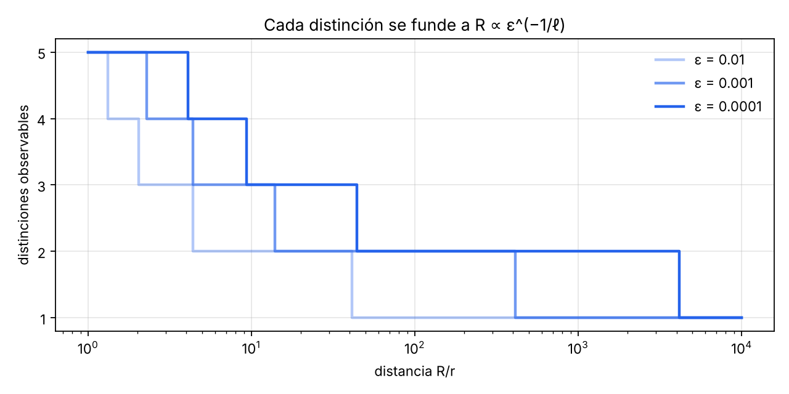

# La economía del cálculo desde las relaciones entre referencias

Endless Monkey Project · Relational Geometry Program · 8 de noviembre de 2026 · Le Matt Ansatz Di Ego

*Versión en inglés: `report.md`.*

## Resumen

Este informe busca dónde está la economía del cálculo y si la lectura relacional apunta hacia ella. No compite con nadie: observa qué coincide y qué difiere con los trabajos de octubre de 2026 sobre 3-SAT. La respuesta corta es que apunta al lugar correcto, y que reunir distinciones no basta para llegar.

1. **La economía existe y tiene medida exacta.** Las distinciones que deben quedar activas son el rango de la relación entre lo decidido y lo pendiente. Las fija la frontera, no el tamaño: la misma forma que la física encontró al acotar la información de una región por su borde (§3).
2. **Lo común y lo pendiente es el teorema chino del resto.** La ley mcm/mcd es exacta cuando las dos referencias permutan, es decir, cuando hay reflexión x − y + z. Fuera de ahí falla, con un contraejemplo de cuatro elementos (§2).
3. **Reunir configuraciones tiene un límite demostrado.** Una referencia válida para cualquier futuro no puede reunir nada. En grafos expansores, ningún orden baja de 2^Ω(n) distinciones (§4, §6).
4. **Hay familias con economía exacta.** Separadores pequeños, relaciones cerradas bajo reflexión y simetrías grandes. En el hipercubo, 2^n estados se reducen a n + 1 clases; en la rejilla de tres colores de ancho 10, 1536 estados → 136 órbitas → 51, el mínimo exacto para contar (§5).
5. **La óptica tiene la misma estructura.** La distinción ℓ-ésima se funde a una distancia R ∝ ε^(−1/ℓ), con pendientes medidas 0,998 · 0,499 · 0,333 · 0,253. De una galaxia lejana, la referencia angular se reúne en un punto y lo pendiente llega como frecuencia (§7).
6. **Los trabajos de octubre coinciden en dónde está la economía y difieren en cómo.** OpenAI cambia la referencia hasta que casi nada cruza entre las partes y vuelve exacto con el teorema chino del resto. Anthropic ahorra con una reflexión con signo, SWAP = I − 2·singlete. Ninguno reúne configuraciones (§8).
7. **La coincidencia no es una prueba.** Muestra que las preguntas de la ontología apuntan donde está la economía real. Esa ventaja, además, solo aparece en escalas muy superiores a los \~10^80 átomos del universo observable (§8).

La ruta abierta con más futuro es formalizar el «±1» como una descomposición con signo que baje el rango de una operación (§10).

Dos investigaciones independientes sobre el mismo encargo llegan al mismo núcleo. El contraste y sus correcciones están en el §12.

## 1. La ontología como objetos matemáticos

Casi todo el lenguaje del programa tiene ya un objeto preciso. Faltaba uno: la consulta. Una equivalencia sirve o no sirve solo respecto de lo que se pregunta y de lo que vendrá después.

| Término del programa | Objeto matemático | Estado |
| --- | --- | --- |
| Configuración | Un elemento x de un conjunto X: asignación, coloración, distribución de fuentes | Definido |
| Referencia | Una aplicación ρ: X → O. Induce la partición «x y x′ se ven iguales desde ρ» | Definido |
| Relación entre radios | Una familia ρ\_d que depende de la distancia; la partición engruesa al crecer d | Definido (§7) |
| Herencia | Refinamiento: lo heredado H se combina con lo nuevo, H ∧ ρ | Definido (§2) |
| Novedad | Cuántos bloques de H ∧ ρ caben dentro de cada bloque de H | Definido; uniforme solo en el caso de grupo (§2) |
| Lo común | La partición más gruesa que ambas determinan, H ∨ ρ. En enteros: el mcd | Definido (§2) |
| Singularidad relacional | Un bloque con muchos elementos: reunidos, no destruidos. Visto de lejos, todo sistema es singular salvo por las referencias que sobreviven | Definido |
| Reapertura | Volver a una referencia más fina. Posible porque ρ\_d no altera X | Definido. Recuperar desde la observación reducida es otra cosa (§7) |
| Incompatibilidad | Pares que coinciden en lo común y no corresponden a ninguna configuración | Definido (§2, §6) |
| Reflexión | La operación m(x, y, z) = x − y + z: reflejar y por el punto medio de x y z | Identificación propuesta (§5). Segunda lectura: una involución I − 2P (§8) |
| Cierre | Dos niveles. Cierre observable: reunir bajo una observación común. Cierre operativo: además, lo que viene respeta esa reunión; el primero no implica el segundo. Un conjunto cerrado bajo una operación es compacto si un marco pequeño lo genera | Definido (§5) |
| Consulta | Lo que se quiere saber, Q: X → Y (existe, cuántas, cuál) | Añadido aquí |
| Economía | El tamaño mínimo de una referencia que todavía responde Q y se puede seguir componiendo | Definido (§3) |
| Frontera | Lo ya decidido que todavía comparte una relación con lo pendiente. Fija cuántas distinciones cruzan | Definido (§3) |

Las cinco magnitudes que el encargo pide separar quedan así: decidir es Q = «¿existe?»; contar es Q = «¿cuántas?»; representar es dar la referencia mínima; reducir observables es engrosar ρ; reducir operaciones es el costo de calcular. La sección 6 muestra una familia donde las cinco se separan.

## 2. La ley de herencia es el teorema chino del resto

La regla mcm(H, m)/H = m/mcd(H, m) es el teorema chino del resto para dos referencias. Es exacta por dos propiedades de las clases de residuo: permutan y son homogéneas. Sin ellas la regla falla.

**Marco.** P y Q son dos particiones de un conjunto finito X. P ∧ Q reúne lo que ambas reúnen (herencia más novedad). P ∨ Q es la partición más fina que ambas engruesan (lo común). Para cada bloque J de P ∨ Q, p\_J y q\_J cuentan los bloques de P y de Q dentro de J.

**Proposición 2.1 (desigualdad de herencia).** Siempre vale la desigualdad siguiente, con igualdad si y solo si P y Q permutan: P∘Q = Q∘P, es decir, «x P y Q z para algún y» equivale a «x Q y′ P z para algún y′».

```math
|P \wedge Q| \;\le\; \sum_{J \in P \vee Q} p_J\, q_J
```

*Prueba.* Cada bloque de P ∧ Q es la intersección no vacía de un bloque de P y uno de Q, ambos dentro del mismo J. Hay a lo sumo p\_J·q\_J por cada J. La igualdad dice que todo bloque de P corta a todo bloque de Q dentro de su J. Eso significa que si x y z están en el mismo J, existe y con x P y Q z: P∘Q contiene a P ∨ Q. Como P∘Q siempre está contenida en P ∨ Q, son iguales; lo mismo vale para Q∘P. Recíprocamente, si permutan, P∘Q es una equivalencia, coincide con P ∨ Q y todos los pares de bloques se cortan. ∎

**Corolario 2.2 (ley del producto).** Si P y Q permutan y son homogéneas (p\_J y q\_J iguales en todos los J), entonces |P ∧ Q|·|P ∨ Q| = |P|·|Q|. La novedad dentro de cada bloque heredado es constante e igual a |Q|/|P ∨ Q|.

Para residuos módulo H y m: P ∧ Q es el residuo módulo mcm y P ∨ Q el residuo módulo mcd. Permutan porque son clases laterales de subgrupos, y son homogéneas por traslación. El corolario da mcm·mcd = H·m y novedad m/mcd. En lenguaje de grupos es el segundo teorema de isomorfía, \[K : K∩K′\] = \[K+K′ : K′\].

**Corolario 2.3 (forma china).** Cada clase de P ∧ Q queda siempre determinada por su clase en P y su clase en Q. P y Q permutan si y solo si, además, todo par de clases que coincide en lo común existe. En símbolos, la aplicación natural es biyectiva:

```math
X/(P\wedge Q) \;\longrightarrow\; X/P \times_{X/(P\vee Q)} X/Q
```

En palabras del programa: lo común no se paga dos veces, y lo pendiente es exactamente lo que falta. Cuando no permutan aparecen pares que coinciden en lo común y no corresponden a ninguna configuración. Esa es la forma matemática de la incompatibilidad.

**Contraejemplo.** En X = {1, 2, 3, 4}, sea P = {123 | 4} y Q = {1 | 234}. Entonces |P ∧ Q| = 3 y |P ∨ Q| = 1, pero |P|·|Q| = 4. El par (bloque {4} de P, bloque {1} de Q) coincide en lo común y su intersección es vacía.

**Un ejemplo que encaja.** Una galaxia lejana se distingue con dos referencias independientes: su posición en el cielo y la frecuencia de su luz. La distancia engruesa solo la primera, hasta reunir todo en un punto; la segunda no depende de la distancia. Lo que sigue distinguible es lo que la frecuencia separa. Es un ejemplo de la estructura del corolario 2.3, no una prueba; la versión con números está en el §7.

**Laboratorio (E1).** La ley del producto y la novedad uniforme se cumplen para todos los H, m < 60. En 3000 pares aleatorios de particiones de 7 elementos, la desigualdad nunca falla y la igualdad coincide con la permutación en los 3000 casos (334 pares permutaban). En GF(2)^10, una ecuación XOR nueva elimina siempre 0, 1/2 o todas las soluciones heredadas. Una cláusula nueva elimina fracciones que van de 0,035 a 0,146 según lo heredado: la novedad de una cláusula no es homogénea.

**Dónde entra la reflexión.** Un teorema de Mal’tsev (1954) dice que todas las congruencias de una estructura permutan si y solo si la estructura tiene una operación m con m(x, x, z) = z y m(x, z, z) = x. En un grupo es m = x − y + z. La reflexión del programa, leída así, es la condición que hace exacta la ley de herencia (§5).

## 3. Cuántas distinciones manifiesta el pasado al futuro

Las distinciones que deben quedar activas en un paso son el rango de la matriz que relaciona lo ya decidido con lo que falta. Es el mínimo exacto: ninguna representación que lea el problema en ese orden usa menos, y siempre se alcanza.

**Marco.** Sea f: Σ^n → K una función de configuraciones, con K un campo (los racionales para contar; GF(p) para los rangos modulares). Fijado un orden, en el paso i se separa pasado α = (x\_1 … x\_i) y futuro β = (x\_{i+1} … x\_n). La matriz de corte es M\_i\[α, β\] = f(αβ). Una representación secuencial lineal escribe f(x) = A\_1(x\_1)·A\_2(x\_2)·…·A\_n(x\_n) con matrices de anchos d\_i.

**Teorema 3.1 (representación mínima).** El ancho mínimo posible en el paso i es exactamente rank\_K(M\_i), y los n mínimos se alcanzan a la vez. Es el teorema de Fliess (1974) y Carlyle–Paz (1971) para autómatas con pesos; en tensores es el de los rangos TT (Oseledets, 2011).

*Prueba.* Cota inferior: la representación factoriza M\_i = L\_i·R\_i con dimensión interna d\_i, así que rank(M\_i) ≤ d\_i. Cota superior: se toma una base del espacio de filas de M\_i como estados del paso i; cada fila nueva es combinación de la base y esos coeficientes son las matrices A\_i. ∎

**Corolario 3.2 (contar).** Con la representación en mano, la suma de f sobre todas las configuraciones cuesta Σ\_i |Σ|·d\_{i−1}·d\_i operaciones. El costo de contar lo fija el perfil de rangos, no 2^n.

**Versión booleana 3.3 (Myhill–Nerode).** Dos pasados α y α′ son equivalentes si tienen exactamente el mismo futuro: f(α·) = f(α′·). El número de clases en el paso i es el número de filas distintas de M\_i, que es el ancho del diagrama de decisión mínimo en ese nivel. Esta equivalencia es la más gruesa que (a) no pierde la consulta y (b) se puede seguir componiendo con cualquier extensión. Es la respuesta exacta a la primera pregunta del encargo.

La jerarquía es siempre: rango ≤ clases de Nerode ≤ configuraciones del pasado. Contar puede usar el rango; decidir de forma determinista necesita las clases.

**Cierre observable y cierre operativo.** En el lenguaje del programa, reunir bajo una observación común es un cierre observable. Seguir calculando sobre lo reunido exige un cierre operativo: que toda operación posterior respete la reunión. La equivalencia de Nerode es el cierre operativo más grueso. El cierre observable no implica el operativo, y ahí está la reapertura: una clase reunida debe separarse en cuanto aparece una operación o una consulta que distingue a sus integrantes.

**Proposición 3.4 (cota por frontera).** Sea ∂A el conjunto de variables del pasado que comparten una restricción con el futuro. Entonces rank(M\_i) ≤ 2^|∂A| + 1. *Prueba:* la fila de α depende solo de α en ∂A y de si α cumple las restricciones internas del pasado. ∎

**La frontera, no el volumen.** La proposición 3.4 dice que el logaritmo de las distinciones activas no supera el tamaño de la frontera, sin importar cuántas variables haya detrás. La física llegó a una forma parecida por otro camino. La cota de Bekenstein y el principio holográfico acotan la información de una región por el área de su borde. En sistemas cuánticos de una dimensión con brecha, la entropía de entrelazamiento cumple una «ley de área» (Hastings, 2007).

Con esta última la conexión es exacta: el rango de corte es el rango de Schmidt de un estado, y las redes tensoriales que describen esos estados son las mismas que usa el algoritmo de Anthropic (§8). Con la holografía es una coincidencia de forma, no una equivalencia demostrada.

**Proposición 3.5 (la novedad está acotada por la relación nueva).** Añadir una restricción C multiplica la matriz de corte entrada por entrada: M → M ∘ M\_C. Como rank(M ∘ N) ≤ rank(M)·rank(N), la novedad que introduce C es a lo sumo rank(M\_C). Una restricción que no cruza el corte tiene rango 1 y no añade nada; una cláusula que lo cruza tiene rango ≤ 2 y a lo sumo duplica. Es el análogo de m/mcd(H, m) ≤ m: la novedad nunca supera a la relación que la trae.

**Proposición 3.6 (cota inferior por emparejamiento inducido).** Sea φ\_G la 2-CNF monótona de un grafo G: una cláusula (x\_u ∨ x\_v) por arista. Si a través del corte hay un emparejamiento inducido de tamaño μ, entonces rank\_K(M) ≥ 2^μ en todo campo K, y todo cubrimiento de los unos de M por rectángulos necesita al menos 2^μ piezas.

*Prueba.* Sean a\_1b\_1, …, a\_μb\_μ las aristas del emparejamiento, con a\_j en el pasado. Para S ⊆ {1..μ} se toma α\_S con a\_j = 0 si j ∈ S y el resto del pasado en 1; igual β\_T en el futuro. Como el emparejamiento es inducido, la única cláusula que puede fallar es la de una arista a\_jb\_j con j ∈ S ∩ T. La submatriz es M\[S, T\] = \[S ∩ T = ∅\], el producto tensorial de μ copias de \[\[1,1\],\[1,0\]\], cuyo determinante es −1 en cualquier campo. Para los rectángulos, los pares (S, complemento de S) forman un conjunto engañoso de tamaño 2^μ. ∎

**Laboratorio.** E2b comprueba 2^μ ≤ rango ≤ 2^frontera + 1 en los 126 cortes balanceados con n = 10 y en los 462 con n = 12. E9 toma la misma estructura, F(s, t) = ∏(¬s\_i ∨ ¬t\_i) con k = 8, y cambia solo el orden. Con s\_1…s\_8 | t\_1…t\_8 el rango máximo es 256 = 2^8; intercalando s\_1 t\_1 s\_2 t\_2 … es 2. La cuenta es 6561 = 3^8 en ambos casos. No cambió la estructura; cambió la referencia, y con ella el costo.

**Proposición 3.7 (simetrías).** Una simetría del pasado que fija la frontera solo reúne pasados con el mismo futuro: sus fusiones ya están dentro de Nerode. Ninguna simetría baja del rango. Un grupo global G ahorra a lo sumo un factor |G|, porque cada órbita tiene a lo sumo |G| elementos. En E10, las 30 fórmulas 3-CNF aleatorias con n = 16 y m = 68 tienen grupo de automorfismos trivial: el ahorro por simetría global es un factor 1. Las simetrías locales sirven para encontrar fusiones, no para superar el rango.

## 4. Límites de la referencia

Una referencia que sirva para cualquier futuro no puede reunir nada: solo puede olvidar. Y encontrar la referencia mínima de una instancia puede costar tanto como resolverla.

**Teorema 4.1 (no-ir).** Sea X un conjunto finito de configuraciones y K^X las funciones sobre X. Combinar restricciones con «y» es multiplicar sus indicadores punto a punto. Sea L: K^X → K^r lineal y diga f \~ g si L(f) = L(g). Si esta equivalencia es compatible con toda conjunción (f \~ g implica f·h \~ g·h para todo h), entonces existe S ⊆ X tal que L(f) depende exactamente de f restringida a S, y r ≥ |S|. Si además la cuenta Σ f(x) se lee en L(f), entonces S = X y r ≥ |X| = 2^n.

*Prueba.* La compatibilidad dice que el núcleo de L es un ideal del álgebra K^X. Esa álgebra es un producto de |X| copias de K, y sus ideales son exactamente los conjuntos {f : f = 0 en S}. Entonces L(f) determina f en S y nada más, lo que exige r ≥ |S|. Si S ≠ X, el indicador de un punto fuera de S tiene L = 0 igual que la función nula, pero su cuenta es 1: no se puede leer la cuenta. ∎

Lectura: reunir configuraciones (la singularidad relacional) es incompatible con una clase de futuros sin restricción. La economía existe siempre relativa a una familia de futuros, y hay tres familias útiles. Los futuros de una instancia dan el rango de corte (§3). Los de un tipo de restricción dan los polimorfismos (§5). Los de una clase de estructuras dan los separadores (§5).

La óptica no choca con este teorema porque la luz compone por suma. El núcleo de un operador lineal es cerrado bajo superposición, así que reunir fuentes es consistente. Las restricciones componen por producto, y ahí el teorema 4.1 prohíbe reunir sin perder exactitud.

**Proposición 4.2 (decidir la equivalencia es coNP-completo).** Decidir si dos pasados α y α′ de una 3-CNF tienen el mismo futuro es coNP-completo. *Prueba:* dada una 3-CNF G(y), sea F(x, y) = (x) ∧ G(y). El pasado x = 0 tiene futuro vacío y x = 1 tiene futuro G. Son equivalentes si y solo si G es insatisfacible. ∎

**Proposición 4.3 (detectar novedad es coNP-completo).** «La cláusula C no añade ninguna distinción a lo heredado F» significa que F implica C, y eso es coNP-completo. En un grupo cíclico la misma pregunta es divisibilidad (9 divide a 315, así que mcm(315, 9) = 315). En GF(2) es una prueba de rango. La regla modular es barata porque en un grupo la herencia se decide por divisibilidad.

Esto responde la segunda pregunta. En general la equivalencia no se puede leer en lo heredado sin resolver un problema tan difícil como el original. Sí hay condiciones suficientes y baratas: mismos valores en la frontera (prop. 3.4), misma órbita bajo una simetría que fija la frontera (prop. 3.7) o misma clase lateral en el caso afín (§5).

## 5. Familias con economía exacta

Hay cuatro mecanismos probados en que muchas relaciones se expresan con pocas referencias sin perder exactitud. Cada uno tiene su condición y su límite.

**5.1 Separadores (distancia entre relaciones).** Si a lo largo de un orden la frontera nunca supera w variables, contar cuesta del orden de n·2^w operaciones (prop. 3.4 y cor. 3.2). Para clases de estructuras esto es exactamente la frontera de lo tratable: con aridad acotada, contar es polinómico si y solo si el ancho de árbol está acotado (Dalmau–Jonsson, 2004), y para decidir vale lo análogo módulo núcleos (Grohe, 2007), ambos bajo hipótesis estándar de complejidad parametrizada. En E2, el ciclo tiene rango mínimo 4 en el mejor corte balanceado para todo n entre 8 y 16.

**5.2 Reflexión (operación de Mal’tsev).** Sea Sol el conjunto de soluciones y supongamos que es cerrado bajo m(x, y, z) = x − y + z; en booleanos, x ⊕ y ⊕ z.

- *Todo corte es rectangular.* Si (a, c), (a, d) y (b, c) son soluciones, m((b, c), (a, c), (a, d)) = (b, d) también lo es. Las filas de la matriz de corte son iguales o disjuntas.
- *El teorema chino del resto vale en cada corte.* Las referencias «mismo pasado» y «mismo futuro» permutan, y |Sol| = Σ\_J p\_J·q\_J exactamente (§2).
- *Hay un marco compacto.* Todo el conjunto se genera por reflexiones a partir de pocos puntos (Bulatov–Dalmau, 2006). En el caso afín booleano, d + 1 puntos generan las 2^d soluciones.

Laboratorio (E3/E4): un sistema XOR con n = 16 y 10 ecuaciones tiene 64 soluciones por fuerza bruta y 64 = 2^(16−10) por eliminación de Gauss. Es cerrado bajo reflexión en 20 000 ternas, sus 400 cortes probados son rectangulares y 7 puntos generan las 64 soluciones. En una 2-CNF monótona sobre un grafo 3-regular, el 91,3 % de las ternas rompe la reflexión y el corte no es rectangular.

**Teorema 5.3 (conocido: Creignou–Hermann, 1996).** Para un tipo de restricciones booleanas Γ, contar soluciones de todas sus instancias es polinómico si toda relación de Γ es afín, es decir, cerrada bajo reflexión. Si no, es #P-completo. En dominios generales la reflexión sigue siendo necesaria y hace falta una condición de balance (Bulatov, 2013; Dyer–Richerby, 2013). Para decidir, la frontera es la existencia de un polimorfismo de casi-unanimidad débil en el núcleo de la estructura (Schaefer, 1978, en booleanos; Bulatov, 2017, y Zhuk, 2020, en general).

Este es el enunciado con condiciones necesarias y suficientes que pide el encargo, en el caso booleano. La economía del conteo que surge solo de las relaciones, para toda instancia de un tipo, existe exactamente cuando las relaciones son cerradas bajo reflexión. Las cláusulas de 3-SAT no lo son.

Una precisión importante: la reflexión da economía global, no local. Las fórmulas de Tseitin son cerradas bajo reflexión y aun así los cierres locales de tamaño fijo fallan con ellas. Que bastan los cierres locales es otra propiedad, el ancho acotado (Barto–Kozik, 2014). La 3-coloración no tiene ni una ni otra: el fallo observado con las familias de Mycielski es la firma que la teoría predice.

**5.4 Simetría.** Si el operador de transferencia y la consulta son invariantes bajo un grupo G, el cálculo se puede hacer en el subespacio invariante, de dimensión igual al número de órbitas. Es exacto, y el ahorro es a lo sumo |G|.

**Ejemplo: el hipercubo.** Hay n posiciones binarias y en cada paso cambia exactamente una. La referencia no registra qué posiciones están activas, solo cuántas: el peso. Así, 2^n estados quedan en n + 1 clases. La reducción es exacta porque todo estado de peso w tiene n − w cambios que suben y w que bajan, los mismos para toda su clase. La cuenta de recorridos por peso cumple:

```math
A_{t+1}(w) = (n-w+1)\,A_t(w-1) + (w+1)\,A_t(w+1)
```

Con n = 6 y t = 6 da (2256, 0, 25 680, 0, 18 000, 0, 720), que suma 6^6 = 46 656. Coincide con la dinámica completa para n = 2…8 (E11). La recurrencia cuesta del orden de n·t operaciones; la dinámica completa, t·n·2^n. Lo explica el grupo de las n! permutaciones de posiciones (prop. 3.7).

Si las posiciones cambian con tasas distintas, la economía desaparece. Con tasas 1 y 2, los estados 01 y 10 tienen el mismo peso pero pasan al peso 0 con tasas 1 y 2. La referencia sigue siendo un cierre observable, pero deja de ser operativo, y la clase debe reabrirse (E11). El ejemplo viene de una de las investigaciones independientes del §12.

**5.5 La rejilla de tres colores, reconstruida (E5).** Las 3-coloraciones de una columna de 10 celdas son 3·2^9 = 1536. El grupo es S3 (permutar colores) × Z2 (invertir la columna), de orden 12. Burnside da 136 órbitas, por encima de la cota 1536/12 = 128. Ese es el resultado B del programa, y ahora tiene su explicación exacta.

Pero 136 no es el mínimo para contar. La dimensión de Krylov del espacio generado por T^k·1, calculada exactamente sobre los racionales, es 51. Coincide con el rango módulo dos primos y con el rango de Hankel de la sucesión. Como T es simétrica, el rango de Hankel es exactamente esa dimensión.

Por el teorema de realización mínima (Kronecker), ninguna representación lineal de la sucesión a\_m = 1ᵀ·T^(m−1)·1 tiene menos de 51 estados, y la sucesión cumple una recurrencia lineal de orden 51. Las cuentas por cociente coinciden con las completas: 1536 · 118 098 · 10 107 954 · 896 895 828 · 80 796 885 414 para m = 1…5.

La jerarquía es 1536 (la estructura) → 136 (lo que la simetría reúne) → 51 (lo que la consulta necesita). La economía natural la fija la consulta, no la simetría. Queda por revisar si el 51 ya figura en la literatura de matrices de transferencia.

## 6. Familias donde la reducción es imposible

En grafos expansores ningún orden y ninguna álgebra de pesos reduce las distinciones de corte por debajo de 2^Ω(n). Aun así, decidir puede ser trivial y contar puede ser barato por otra vía: las magnitudes se separan.

**Teorema 6.1.** Sea G\_n una familia de grafos de grado ≤ d en la que toda partición con ambos lados de al menos n/3 vértices es cruzada por al menos h·n aristas (expansores). Sea φ\_n su 2-CNF monótona.

1. *Decidir* cuesta O(1): poner todo en 1 la satisface.
2. *Contar* es #P-completo para 2-CNF monótonas de grado ≤ 3, porque equivale a contar conjuntos independientes (Greenhill, 2000). Queda abierto si sigue siéndolo restringido a expansores.
3. *Representar* cuesta 2^Ω(n) para todo orden de variables y todo campo K. Lo mismo vale para el cubrimiento por rectángulos (versión no determinista) y para representaciones con árbol de variables.

*Prueba de 3.* El corte del medio de cualquier orden es una partición con ambos lados de tamaño n/2, así que lo cruzan al menos h·n aristas. Cada arista elegida excluye a lo sumo 2d² aristas vecinas, de modo que se extrae un emparejamiento inducido de tamaño μ ≥ h·n/(2d²). Por la proposición 3.6, el rango es al menos 2^μ. En un árbol de variables siempre hay un nodo que separa entre n/3 y 2n/3 variables, y el mismo argumento se aplica allí. ∎ La técnica de rectángulos es la conocida de compilación de conocimiento (Bova, Capelli, Mengel y Slivovsky, 2016).

En n pequeño los grafos 3-regulares aleatorios aún no son buenos expansores, y eso también enseña. Con n = 14, el grafo de E2 tiene un corte balanceado con solo 3 aristas y su rango mínimo es 4, el mismo que el ciclo. Con n = 16 el rango mínimo sube a 10. Lo que decide no es cuántas relaciones hay, sino cuántas relaciones independientes cruzan el mejor corte.

**Teorema 6.2 (Tseitin: representación cara, conteo barato).** Una fórmula de Tseitin pone una variable en cada arista de un grafo G y exige en cada vértice que la paridad de sus aristas valga una carga dada. Para el caso homogéneo sobre G conexo y un corte de aristas (A, B), vale una fórmula exacta para el rango de corte:

```math
\log_2 \operatorname{rank} M_{A,B} \;=\; \beta + 1 - c_A - c_B
```

Aquí β cuenta los vértices que tocan aristas de ambos lados, y c\_A, c\_B las componentes conexas de cada lado. *Prueba:* las soluciones forman el espacio de ciclos, de dimensión |E| − |V| + 1; las filas distintas son 2^(dim − dim(ciclos dentro de A) − dim(ciclos dentro de B)), y cada término es la fórmula de Euler de su subgrafo. ∎ Se comprobó en los 3003 cortes balanceados de un grafo con 10 vértices (E3b).

Sobre expansores, todo diagrama ordenado para una fórmula de Tseitin satisfacible tiene tamaño 2^Ω(n) (Itsykson y coautores, 2017), y también todo programa de lectura única no determinista (Glinskih–Itsykson, 2017). Sin embargo la eliminación de Gauss cuenta sus soluciones en tiempo polinómico. Cambiar de referencia, del corte secuencial al álgebra lineal sobre GF(2), hace colapsar el costo. Reducir operaciones no requiere reducir distinciones.

| Familia | Decidir | Contar | Representación por orden |
| --- | --- | --- | --- |
| 2-CNF monótona, expansor | O(1) | #P-completo en grado ≤ 3; 2^o(n) según los trabajos de octubre | 2^Ω(n) en todo orden y campo |
| Tseitin, expansor | Polinómico | Polinómico (Gauss) | 2^Ω(n) en todo orden |
| Ciclo | Lineal | Lineal | 4 estados |
| Rejilla 3 colores, 10 × m | — | Lineal en m | 51 estados |
| 3-coloración general | NP-completo | #P-completo | Sin cierre local acotado (Mycielski) |

## 7. Óptica y cálculo

La correspondencia rigurosa existe: las distinciones visibles desde una distancia son los valores singulares del operador fuente → observación que superan el nivel de ruido ε. Es el mismo objeto que el rango de corte del §3. Hay dos diferencias decisivas: en óptica basta un rango aproximado, y la luz compone por suma.

**Proposición 7.1 (ley de fusión).** Cinco fuentes dentro de un radio r se observan a distancia R. En la expansión multipolar, el momento de orden ℓ entra con peso (r/R)^ℓ, así que σ\_{ℓ+1}/σ\_1 ≈ c\_ℓ·(r/R)^ℓ. La distinción ℓ + 1 se funde cuando ese cociente cruza ε:

```math
R_\ell \;\approx\; r\,\left(\frac{c_\ell}{\varepsilon}\right)^{1/\ell}
```

De ahí salen tres predicciones comprobables. El orden de fusión está fijado: 5 → 4 → 3 → 2 → 1. La pendiente de log R\_ℓ frente a log(1/ε) es 1/ℓ. Y la última fusión, de 2 a 1, exige una distancia desproporcionada.



*Laboratorio E6 · núcleo 1/|y − x|, 600 puntos de observación en la esfera de radio R, 300 distancias entre 1,05 r y 10⁴ r*

El laboratorio confirma las tres. Con ε = 10^−3 las fusiones ocurren en R/r = 2,26 · 4,30 · 13,4 · 401. En el caso ondulatorio (Fraunhofer, apertura de 20 longitudes de onda) aparece la misma escalera 5 → 1.

**El último bit antes de la singularidad.** La última distinción que se funde, la de dos a uno, es el dipolo: el patrón que pesa cada fuente por su posición: las de un lado con signo más, las del otro con signo menos y la del centro con cero. Las fuentes y la esfera de observación son simétricas respecto del centro, así que cada combinación es par o impar; la primera, el total, es par, y la segunda es impar: un ±. Es la que más distancia necesita para fundirse (R/r ≈ 401 frente a 13 con ε = 10^−3), y cuando se funde solo queda el total: la estructura se singulariza. En el lenguaje del programa, el ± es el último bit antes de la singularidad. Se deduce de la simetría y de la expansión multipolar, y E6 lo comprueba: con R entre 20 r y 400 r, el segundo vector singular es (−0,63 · −0,32 · 0 · 0,32 · 0,63), impar hasta 10^−6 y proporcional a la posición. Que ese bit sea un signo es lo que lo conecta con la ruta del §10.

**Proposición 7.2 (reabrir no es recuperar).** Para todo R finito el operador sigue teniendo rango exacto 5: la estructura no se pierde. Su valor singular menor cae como (r/R)^4, y en R = 10^4 r vale 1,3×10^−16 del mayor, al nivel de la precisión de máquina. Dos distribuciones que difieren en esa dirección dan diferencias relativas de 7,4×10^−13 en R = 300 r y de 1,3×10^−3 en R = 1,5 r. Reabrir es exacto porque la estructura no cambió; recuperar desde la observación reducida exige una relación señal-ruido mejor que (r/R)^ℓ.

**Dónde se rompe la correspondencia con el conteo.**

- *Aproximado frente a exacto.* La economía óptica viene de la suavidad del núcleo: los valores singulares caen como potencias. Contar exacto necesita rango exacto, y las matrices booleanas no son suaves; la de disyunción tiene rango completo.
- *Suma frente a producto.* La luz se superpone y las restricciones se combinan con «y». El teorema 4.1 deja reunir en el primer caso y lo prohíbe en el segundo.

**Dónde sí se transfiere.** El criterio «radio/distancia menor que un umbral» es exactamente el criterio de admisibilidad del método multipolar rápido (Greengard–Rokhlin, 1987) y de las matrices jerárquicas. Allí la relación entre radios produce economía real: de n² a n operaciones para núcleos suaves, con error controlado. Es la contraparte computacional más fiel del laboratorio óptico, pero es aproximada y sirve para sumas, no para conteo exacto con restricciones.

**La galaxia: lo que se funde y lo que llega.** Sean A\_d la referencia angular a distancia d y F la referencia espectral. Lo que se distingue es su combinación A\_d ∧ F. Por la ley de fusión, A\_d engruesa al crecer d hasta reunir todo en un solo bloque; F no depende de d. En ese límite A\_d ∧ F = F: lo que llega es exactamente lo que la frecuencia separa.

En el lenguaje del §2, la referencia angular se reúne en una singularidad y lo pendiente entre los dos sistemas llega como espectro. El brillo y su variación en el tiempo son otras referencias que también sobreviven. El ejemplo no añade nada a la óptica; muestra que la misma estructura de referencias aparece en la observación y en el cálculo.

## 8. Qué coincide y qué difiere con los trabajos de octubre de 2026

Los dos trabajos afirman contar exactamente las soluciones de k-CNF en tiempo 2^o(n), lo que refutaría la ETH. Coinciden con la lectura relacional en dónde está la economía: lo que cruza entre referencias, lo común y lo pendiente, el signo de una reflexión. Difieren en que ninguno reúne configuraciones. Estado al 8 de noviembre: pruebas en Lean reproducidas, veredicto de expertos pendiente.

|  | OpenAI | Anthropic |
| --- | --- | --- |
| Trabajo | [The Exponential Time Hypothesis is False](https://www.alphaxiv.org/abs/2610.exponential-time-hypothesis-refutation), 67 p., fechado el 17 y revisado el 25 de octubre | [A 2^o(n) Time Algorithm for 3-SAT](https://github.com/anthropics/formal-math/blob/main/eth/README.md), 49 p., 26 de octubre, firmado «Claude (Anthropic)» |
| Qué calcula | Cuenta exacta de soluciones de k-CNF, k ≥ 2 fijo, determinista | Cuenta exacta (#3-SAT y k-CNF), determinista |
| Cota | (n+m)^O\_k(1) · 2^O\_k(n·log log n/√log n); espacio polinómico | 2^O(n·log log n/√log n) |
| Mecanismo | Deformación con parámetro T, separación en grupos e interpolación de Hermite | Contracción de redes tensoriales sobre el grafo completo; SWAP = I − 2·singlete por bit |
| Verificación | Lean prueba una cota algo más débil que la del artículo, suficiente contra la ETH | Lean 4 con Mathlib y segundo núcleo independiente (nanoda) |

Según un [informe del 7 de noviembre](https://shiftdelete.net/en/exponential-time-hypothesis), voluntarios reprodujeron ambas pruebas en Lean, y entre el 2 y el 5 de noviembre investigadores externos cerraron en Lean el paso del modelo de máquina de cada laboratorio a uno estándar. La revisión de Impagliazzo, Paturi y Williams sigue abierta, sin errores reportados. La lectura del mecanismo se basa en la [página de resumen del artículo de OpenAI](https://www.alphaxiv.org/abs/2610.exponential-time-hypothesis-refutation) y en el README de Anthropic; los artículos completos y el código Lean no se revisaron aquí.

**Dónde coinciden.**

- *Cambiar de referencia y volver exacto (OpenAI).* Cada cláusula se vuelve un polinomio y cada variable se reemplaza por una forma lineal que depende de un parámetro T. En T = 0 está la fórmula original; en otros valores, los grupos de variables solo se comunican por pocas «mediciones» enteras compartidas, y la suma se separa por grupos. El resultado es un polinomio H(T) cuyo valor en 0 es la cuenta. Se evalúa en varios puntos no nulos, con algunos coeficientes de Taylor, y la interpolación de Hermite devuelve H(0) exacto. Esa interpolación es el teorema chino del resto en el anillo de polinomios: reconstruir H desde sus restos módulo (T − a\_i)^k, módulos sin nada en común. Es lo común y lo pendiente del §2, usado para volver exacto después de cambiar la referencia.
- *Reflexión con signo (Anthropic).* Contar se escribe como contraer una red de tensores sobre un grafo completo. Según el README, cada SWAP se descompone bit a bit como I − 2·singlete; los términos se agrupan por número de singletes y cada grupo tiene (rango de filas)·(rango de columnas) ≤ 12^λ. SWAP es una involución, SWAP² = I, con autovalores ±1, e I − 2P es una reflexión en el espacio de operadores. Es el «±1» del programa leído como signo que permite cancelar. Un trabajo posterior formaliza estos algoritmos como sumas de redes con signo y prueba que, con tres tablas, su costo es al menos el rango tensorial de la operación; con cuatro o más tablas pueden bajar del piso de los métodos de rango uno ([arXiv 2610.41622](https://arxiv.org/html/2610.41622)).
- *La frontera fija el costo (ambos).* En OpenAI la suma se separa porque las partes solo se comunican por pocas mediciones. En Anthropic el costo lo dan los rangos de fila y columna de cada operador. Es la magnitud del §3: lo que cruza el corte.

**Dónde difieren.** Ninguno reúne configuraciones de la fórmula. Según los trabajos, el resultado vale también para k = 2, y por el teorema 6.1 toda representación por orden, o por árbol de variables, de la 2-CNF monótona sobre expansores cuesta 2^Ω(n). Si contaran construyendo una representación así, tardarían 2^Ω(n).

OpenAI deforma la función fuera del espacio booleano, y por eso el teorema 4.1 no la alcanza: el rango de corte de la función original sigue alto y lo bajo es el de la deformada. Anthropic ahorra en la operación y no en la fórmula, como Strassen (7 productos en lugar de 8) o Karatsuba ((a+b)(c+d) − ac − bd). Las simetrías que le sirven son las de la operación; las de 3-CNF aleatorias son triviales (E10).

**Qué muestra la coincidencia.** Que el mecanismo se parezca no demuestra la ontología. Muestra que sus preguntas apuntan donde está la economía real: qué cruza entre referencias, qué es común, qué queda pendiente, qué signo tiene una reflexión. Lo que falta es lo que el §10 deja abierto: escribir el «±1» como una identidad con signo concreta.

**Escala.** La ventaja de estos algoritmos es asintótica. Anthropic calcula que, con 5 cláusulas por variable, su cota no mejora la búsqueda exhaustiva antes de unas 10^10000 variables. El trabajo posterior baja algunos umbrales; para #3-SAT con una cláusula por variable, a unas 2^420 ≈ 10^126 cláusulas.

Todos quedan por encima de los \~10^80 átomos del universo observable. Lloyd (2002) estimó que el universo pudo hacer a lo sumo unas 10^120 operaciones sobre unos 10^90 bits. Ese régimen no lo realiza ninguna estructura física. Eso no vuelve mejor a otro método en la escala física: para afirmarlo habría que medirlo contra los mejores resolvedores prácticos.

## 9. Respuesta a las ocho preguntas

1. **¿Cuándo dos configuraciones son equivalentes sin perder la consulta?** Si y solo si la equivalencia (a) no mezcla respuestas distintas y (b) es compatible con toda extensión que pueda venir. La más gruesa es la de Nerode para decidir y el espacio de filas de Hankel para contar (§3).
2. **¿Se puede determinar desde lo heredado sin enumerar?** En general no: es coNP-completo (prop. 4.2). Sí con condiciones suficientes baratas: misma frontera, misma órbita bajo una simetría que fija la frontera, misma clase lateral en el caso afín (§4).
3. **¿Cuándo una relación nueva es novedad y no redundancia?** En un grupo, cuando el subgrupo heredado no está contenido en el nuevo; la novedad es el índice \[K : K ∩ K′\], que en enteros es m/mcd. En general, cuando lo heredado no implica la relación nueva, lo cual es coNP-completo. Cuantitativamente, la novedad nunca supera el rango de corte de la relación nueva (prop. 3.5).
4. **¿Cómo cambia el costo con el tamaño, la distancia entre relaciones y las singularidades?** El costo lo fija el mejor corte, no el tamaño: 2^μ ≤ rango ≤ 2^frontera + 1, con μ el emparejamiento inducido que cruza. Las singularidades (fusiones) bajan el costo solo si son compatibles con lo que viene (teorema 4.1).
5. **¿Hay familias donde muchas relaciones caben en pocas referencias sin perder exactitud?** Sí: separadores pequeños, relaciones cerradas bajo reflexión (marco de d + 1 puntos para 2^d soluciones), simetrías grandes. Ejemplo concreto: 1536 → 136 → 51 en la rejilla (§5).
6. **¿Hay familias donde es imposible, y por qué?** Sí: 2-CNF monótona y Tseitin sobre expansores, para todo orden y todo campo, porque muchas relaciones independientes cruzan cualquier corte. Y ninguna referencia universal puede reunir nada (§4, §6).
7. **¿Hay correspondencia rigurosa entre la reducción óptica y una reducción computacional exacta?** Hay correspondencia por rango (§7), y es exacta como teoría. La reducción óptica es aproximada y vale para sumas; su contraparte computacional real es el método multipolar. No se transfiere a conteo exacto con conjunciones. La galaxia lejana muestra el mismo esquema: la referencia angular se funde y la espectral queda.
8. **¿Qué consecuencias de complejidad surgen?** Para una familia con perfil de rangos r(n): contar cuesta O(n·r(n)²) con la representación en mano. Construirla cuesta O(n·2^w) por frontera. Sin estructura, la vía de cociente queda acotada por el rango de corte, y los resultados de octubre muestran que la economía subexponencial, si existe, viene de otro tipo: deformación con interpolación o sumas con signo (§8).

## 10. Evaluación tipo ROSI

Diez relaciones quedan resueltas, cuatro abiertas, cinco superpuestas y tres estaban cerradas antes de tiempo. La ruta abierta con más futuro es la del signo.

| Relación | Estado | Base |
| --- | --- | --- |
| La ley mcm/mcd es el teorema chino del resto para referencias que permutan y son homogéneas | Resuelta | Prop. 2.1, cor. 2.2–2.3, E1 |
| Distinciones activas = rango de corte; es el mínimo exacto | Resuelta (ya formulada en la literatura) | Teorema 3.1 |
| Ninguna referencia universal puede reunir configuraciones bajo conjunción | Resuelta | Teorema 4.1 |
| Decidir equivalencia y novedad es coNP-completo | Resuelta | Prop. 4.2–4.3 |
| En expansores toda representación por orden cuesta 2^Ω(n) | Resuelta (técnica ya formulada) | Teorema 6.1, E2, E2b |
| Reunir configuraciones no alcanza la economía de los algoritmos de octubre en esas familias | Resuelta, condicionada a que esos trabajos sean correctos | §8 |
| Las distinciones ópticas se funden a R ∝ ε^(−1/ℓ) | Resuelta en el caso estático | Prop. 7.1, E6 |
| Rejilla de ancho 10: 1536 → 136 → 51 | Resuelta (cálculo exacto) | E5 |
| Hipercubo: 2^n estados → n + 1 clases exactas; con tasas distintas el cierre deja de ser operativo | Resuelta | §5.4, E11 |
| La última distinción antes de la singularidad es el dipolo, un ± | Resuelta en el caso simétrico | §7, E6 |
| Formalizar el «±1 sin resolver» como descomposición con signo que baje el rango de una operación | Abierta: la ruta más prometedora | §8 |
| ¿Sigue el laboratorio óptico v5.1, con su criterio angular, la ley ε^(−1/ℓ)? | Abierta, acotada: si cuenta máximos, sigue la ley de escala-espacio y no ε^(−1/ℓ) (§12) | §7 |
| ¿El 51 de la rejilla ya está publicado? | Abierta | §5 |
| Validez de los trabajos de octubre | Abierta: Lean reproducido, revisión experta pendiente | §8 |
| Los trabajos de octubre coinciden con la ontología | Superpuesta: coincide el mecanismo (cambio de referencia y teorema chino del resto; reflexión con signo), no demuestra la ontología | §8 |
| La frontera fija las distinciones, como el borde fija la información en física | Superpuesta: exacta con el rango de Schmidt; con la holografía es coincidencia de forma | §3 |
| La galaxia: lo angular se funde y la frecuencia queda | Superpuesta: ejemplo que encaja con dos referencias, no prueba | §2, §7 |
| Reflexión como x − y + z (permutabilidad, marcos compactos) o como involución I − 2P (cancelación con signo) | Superpuesta: ambas formalizan la reflexión y dan economías distintas | §5, §8 |
| Herencia como refinamiento de particiones o como producto entrada a entrada de matrices de corte | Superpuesta: el mismo hecho en dos niveles | §2, prop. 3.5 |
| «Reducir observables reduce operaciones» | Prematuramente cerrada: falla en ambos sentidos | Tseitin (§6), octubre (§8) |
| «La economía surge de la relación sin decisión externa» | Prematuramente cerrada a medias: el mínimo es canónico, pero hallarlo es coNP-difícil y la elección de referencia decide el costo (256 frente a 2 en E9) | §3, §4 |
| «Las simetrías locales de 3-SAT son la información que queda» | Prematuramente cerrada: lo que queda es el rango de corte; ninguna simetría baja de él | Prop. 3.7, E10 |

La ruta del signo en concreto: buscar una identidad del tipo X = Σ\_j (−1)^j·c\_j·O\_j donde cada O\_j tenga rango de corte menor que X, como SWAP = I − 2·singlete. El tetraedro, el cubo de espejos y el «±1» del programa podrían aportar candidatos a esas identidades. Su valor se mide con un número: el rango tensorial de la operación resultante.

## 11. Laboratorio reproducible

Un solo script, `laboratorio_economia_relacional.py`, reproduce todas las cifras del informe en unos 4 minutos con numpy y networkx. Se corre con `python3 -I laboratorio_economia_relacional.py` y escribe `resultados_laboratorio.json`. Para un experimento suelto: `python3 -I laboratorio_economia_relacional.py E5`.

| Experimento | Qué comprueba | Resultado |
| --- | --- | --- |
| E1 | Ley mcm/mcd y desigualdad de herencia | Exacta para H, m < 60; igualdad ⇔ permutan en 3000/3000 pares; contraejemplo 3·1 ≠ 2·2 |
| E2 | Rango mínimo sobre todos los cortes balanceados, 2-CNF monótona | Grafo 3-regular: 5, 4, 7, 4, 10 para n = 8…16; ciclo: 4 siempre |
| E2b | 2^μ ≤ rango ≤ 2^frontera + 1 | Se cumple en 126 + 462 cortes |
| E3/E4 | Sistema XOR: reflexión, rectángulos, marco | 64 soluciones por fuerza bruta y por Gauss; 7 puntos generan 64 |
| E3b | Fórmula de Tseitin β + 1 − c\_A − c\_B | Exacta en 3003 cortes |
| E5 | Rejilla 3 colores, ancho 10 | 1536 → 136 órbitas → Krylov 51 (exacto sobre Q y módulo 2 primos) |
| E6 | Óptica como rango-ε | Escalera 5 → 1; pendientes 0,998 · 0,499 · 0,333 · 0,253; la última distinción es el dipolo, impar |
| E9 | Misma estructura, otro orden | Rango 256 frente a 2; cuenta 6561 en ambos |
| E10 | Simetrías de 3-CNF aleatorias | 30 de 30 con grupo trivial |
| E11 | Hipercubo con la referencia peso; contraejemplo con tasas distintas | Recurrencia = dinámica completa para n = 2…8; tasas (1, 2): 01 y 10 salen con 1 y 2 |
| E12 | Verificación cruzada del §12 | Umbral 199 140; Grötzsch con C5 y cintura 4; máximos ópticos monótonos, 2 en σ = 1,45 |

Con matplotlib instalado, el laboratorio también dibuja la figura de la ley de fusión, en español (`fusion_optica.png`) y en inglés (`optical_fusion.png`).

Los rangos módulo p son cotas inferiores del rango racional. Donde importa la igualdad (E5) se calculó también el rango exacto sobre los racionales.

## 12. Contraste con dos investigaciones independientes

Otras dos investigaciones respondieron al mismo encargo por separado (A y B). Las tres llegan al mismo núcleo, ninguna obtiene una cota nueva de complejidad, y la verificación cruzada encontró siete puntos a corregir, casi todos en B.

| Resultado | Este informe | A | B |
| --- | --- | --- | --- |
| Referencia = partición; exactitud = la consulta factoriza por la referencia | §1, §3 | Prop. 1 | T1 |
| Seguir calculando exige compatibilidad con lo que viene (Nerode, congruencia) | §3 | Prop. 2 | Solo en la definición D6 |
| La ley mcm/mcd es el segundo teorema de isomorfía | §2, con la condición de permutar | Sí | T2 |
| Las fórmulas 3-CNF aleatorias no tienen simetría | 30 de 30 (n = 16) | — | 8 de 8 (n = 7) |
| Separadores y ancho de árbol fijan el costo | §5.1 | §7 | T3 |
| Mycielski como límite de los cierres locales | §5.2 | §7 | T6 |
| Reducir observables no reduce el cálculo sin una condición sobre la consulta | §4, §7 | §6 | T7 |

**Lo que aportan.** A da un ejemplo limpio de economía por simetría grande, ahora incluido en el §5.4: en el hipercubo con la referencia «peso», 2^n estados bajan a n + 1 clases sin perder la cuenta de recorridos. Su laboratorio lo reproduce aquí sin errores, incluida la distribución (2256, 0, 25680, 0, 18000, 0, 720) para n = 6 y t = 6, que suma 6^6. Encaja con la proposición 3.7: el grupo tiene n! elementos. Su contraste entre paridad e igualdad (2 frente a 2^n clases, ambas fáciles de contar) es la misma lección que E9 y Tseitin.

B propone una generalización concreta y abierta de la herencia a fases vectoriales en ℤ^d, con índices calculados por la forma normal de Smith. También lee la óptica como degradación de canales (orden de Blackwell). Su fórmula umbral (199 140 asignaciones con 19 clases) y las propiedades del grafo de Grötzsch se verificaron aquí.

**Correcciones verificadas.**

1. *B, T8, sobrestimado.* La disyunción no es cara de describir: se escribe con una fórmula de tamaño O(n) y se decide en tiempo lineal. La cota 2^Ω(n) vale solo para representaciones que respetan el corte entre x e y. Con el orden intercalado el rango baja a 2 (E9).
2. *B, T6.* El punto (iii) tal como está escrito es vacío: todo subgrafo de un grafo (χ+1)-coloreable lo es. Lo que B verifica es otra cosa, correcta: borrar cualquier vértice deja un grafo 3-coloreable. Además, el grafo de Grötzsch no comparte todo patrón local con los bipartitos: contiene ciclos de longitud 5 (cintura 4). El testigo correcto de que la observación local acotada no decide la coloración es Erdős (1959): grafos de cintura y número cromático arbitrariamente grandes, donde toda bola de radio acotado es un árbol.
3. *B, T1.* «La información que debe permanecer activa es ker Q» vale para una consulta leída de una vez. Para seguir calculando hace falta además compatibilidad con lo que viene, que es la Prop. 2 de A y el §3 de este informe.
4. *B, T7.* «La reapertura total es imposible» vale para recuperar desde la observación degradada, no para cambiar la referencia: acercarse siempre reabre (prop. 7.2).
5. *B, §4.* El umbral «\~10^108 variables» es una lectura errónea. Anthropic informa 10^10000 variables con 5 cláusulas por variable y 10^(10^8) sin límite de cláusulas, según la [cobertura del artículo](https://lilting.ch/en/articles/eth-exponential-time-hypothesis-refuted-openai-anthropic). Llamar «factorización aproximada» a estos algoritmos también es inexacto: son exactos. El preprint arXiv:2611.00517 que B cita no se pudo localizar, y no se usa aquí.
6. *B, figura óptica.* Con los parámetros leídos de la figura (fuentes en −4,2 · −1,6 · 0,7 · 2,5 · 4,4 con alturas 1,0 · 0,7 · 1,2 · 0,5 · 0,9), un conteo robusto da fusiones en σ ≈ 0,67 · 0,92 · 1,25 · 1,53. El conteo es monótono, como exige la escala-espacio gaussiana en una dimensión. En σ = 1,45 la curva todavía tiene un mínimo local cerca de x ≈ −2,5, visible en el panel: hay dos máximos, no uno. Los parámetros son estimados; conviene declarar el umbral de prominencia.
7. *A, laboratorio.* El contraejemplo del hipercubo ponderado está escrito a mano (afirma que 1 ≠ 2) en vez de calcularse. La matemática es correcta, y E11 lo calcula.

**Lo que el contraste aclara: dos leyes ópticas distintas.** El criterio de B cuenta máximos bajo desenfoque y es local: desaparecen primero las fuentes débiles o cercanas (aquí 2,5, luego −1,6, luego 4,4 y por último −4,2), con umbrales proporcionales a las separaciones. El criterio de este informe cuenta combinaciones independientes por encima del ruido y es global: elimina órdenes multipolares, con umbrales R ∝ ε^(−1/ℓ). Ambos dan 5 → 1, pero miden cosas distintas: qué fuentes siguen visibles y cuántas combinaciones siguen medibles. Si el laboratorio v5.1 usa resolución angular, su ley es la de escala-espacio, no ε^(−1/ℓ).

## Fuentes

**Trabajos de octubre de 2026 y su estado (páginas consultadas el 8 de noviembre de 2026)**

- OpenAI, *The Exponential Time Hypothesis is False*: [resumen en alphaXiv](https://www.alphaxiv.org/abs/2610.exponential-time-hypothesis-refutation)
- Claude (Anthropic), *A 2^o(n) Time Algorithm for 3-SAT*: [README de anthropics/formal-math](https://github.com/anthropics/formal-math/blob/main/eth/README.md)
- R. Majdoddin, *Lowered crossover points of Anthropic’s subexponential 3-SAT algorithm*, 30 de octubre de 2026: [arXiv 2610.41622](https://arxiv.org/html/2610.41622)
- Estado de la verificación al 7 de noviembre: [ShiftDelete](https://shiftdelete.net/en/exponential-time-hypothesis)
- Cotas para Tseitin en programas de lectura única: [Glinskih–Itsykson, MFCS 2017](https://drops.dagstuhl.de/opus/volltexte/2017/8076/) y [ECCC TR19-020](https://eccc.weizmann.ac.il/report/2019/020/download), que resume el resultado de Itsykson y coautores (STACS 2017) para diagramas ordenados

**Literatura clásica citada (referencias estándar, sin enlace)**

- Mal’tsev (1954): permutabilidad de congruencias y término x − y + z.
- Carlyle–Paz (1971) y Fliess (1974): rango de Hankel y autómatas con pesos mínimos. Oseledets (2011): rangos de la descomposición tensor-train.
- Schaefer (1978); Creignou–Hermann (1996), *Information and Computation*; Bulatov (2013), *J. ACM*; Dyer–Richerby (2013), *SIAM J. Comput.*; Bulatov (2017, FOCS) y Zhuk (2020, *J. ACM*): dicotomías de decisión y conteo.
- Bulatov–Dalmau (2006), *SIAM J. Comput.*: algoritmo para restricciones de Mal’tsev y marcos compactos.
- Barto–Kozik (2014), *J. ACM*: problemas resolubles por consistencia local.
- Dalmau–Jonsson (2004), *Theor. Comput. Sci.*; Grohe (2007), *J. ACM*: ancho de árbol como frontera.
- Greenhill (2000), *Computational Complexity*: conteo de conjuntos independientes en grado ≤ 3.
- Bova, Capelli, Mengel y Slivovsky (2016, IJCAI): compilación de conocimiento y complejidad de comunicación.
- Greengard–Rokhlin (1987), *J. Comput. Phys.*: método multipolar rápido.

**Física citada como puente (referencias estándar, sin enlace)**

- Bekenstein (1981), *Phys. Rev. D*: cota universal de entropía para sistemas acotados.
- ’t Hooft (1993) y Susskind (1995), *J. Math. Phys.*: principio holográfico.
- Hastings (2007), *J. Stat. Mech.*: ley de área para sistemas cuánticos unidimensionales con brecha.
- Lloyd (2002), *Phys. Rev. Lett.*: capacidad de cómputo del universo, unas 10^120 operaciones sobre unos 10^90 bits.
- Número de átomos del universo observable, unos 10^80: estimación de orden de magnitud habitual.

**Citadas en el contraste (§12)**

- Erdős (1959), *Canad. J. Math.*: grafos de cintura y número cromático arbitrariamente grandes.
- Babaud, Witkin, Baudin y Duda (1986), *IEEE PAMI*: el núcleo gaussiano no crea extremos nuevos en una dimensión.
- Blackwell (1953), *Ann. Math. Statist.*: comparación de experimentos y orden de degradación.
