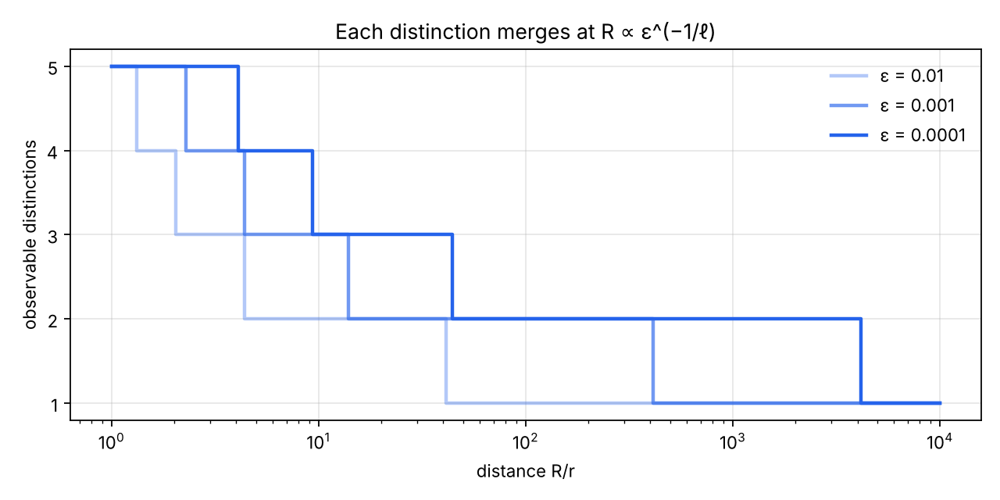

# The economy of computation from relations between references

Endless Monkey Project · Relational Geometry Program · November 8, 2026 · Le Matt Ansatz Di Ego

*English version of `informe.md`. If the two differ, the Spanish text is the reference.*

## Summary

This report looks for where the economy of computation lies and whether the relational reading points to it. It competes with no one: it observes what coincides and what differs with the October 2026 work on 3-SAT. The short answer is that it points to the right place, and that gathering distinctions is not enough to get there.

1. **The economy exists and has an exact measure.** The distinctions that must stay active are the rank of the relation between what has been decided and what is pending. They are set by the boundary, not by the size: the same form physics found when it bounded the information of a region by its border (§3).
2. **What is shared and what is pending is the Chinese remainder theorem.** The lcm/gcd law is exact when the two references permute, that is, when there is reflection x − y + z. Outside that case it fails, with a four-element counterexample (§2).
3. **Gathering configurations has a proven limit.** A reference valid for every future cannot gather anything. On expander graphs, no order goes below 2^Ω(n) distinctions (§4, §6).
4. **There are families with exact economy.** Small separators, relations closed under reflection, and large symmetries. In the hypercube, 2^n states reduce to n + 1 classes; in the three-colour grid of width 10, 1536 states → 136 orbits → 51, the exact minimum for counting (§5).
5. **Optics has the same structure.** The ℓ-th distinction merges at a distance R ∝ ε^(−1/ℓ), with measured slopes 0.998 · 0.499 · 0.333 · 0.253. For a distant galaxy, the angular reference collapses into one point and what is pending arrives as frequency (§7).
6. **The October works coincide on where the economy is and differ on how.** OpenAI changes the reference until almost nothing crosses between the parts and returns exactly through the Chinese remainder theorem. Anthropic saves through a signed reflection, SWAP = I − 2·singlet. Neither gathers configurations (§8).
7. **The coincidence is not a proof.** It shows that the questions of the ontology point to where the real economy is. That advantage, moreover, only appears at scales far beyond the \~10^80 atoms of the observable universe (§8).

The most promising open route is to formalize the “±1” as a signed decomposition that lowers the rank of an operation (§10).

Two independent investigations of the same brief reach the same core. The comparison and its corrections are in §12.

## 1. The ontology as mathematical objects

Almost all of the program’s language already has a precise object. One was missing: the query. An equivalence is useful or not only with respect to what is asked and what will come next.

| Term of the program | Mathematical object | Status |
| --- | --- | --- |
| Configuration | An element x of a set X: assignment, colouring, distribution of sources | Defined |
| Reference | A map ρ: X → O. It induces the partition “x and x′ look the same from ρ” | Defined |
| Relation between radii | A family ρ\_d depending on distance; the partition coarsens as d grows | Defined (§7) |
| Inheritance | Refinement: what is inherited, H, combines with what is new, H ∧ ρ | Defined (§2) |
| Novelty | How many blocks of H ∧ ρ fit inside each block of H | Defined; uniform only in the group case (§2) |
| What is shared | The coarsest partition both determine, H ∨ ρ. For integers: the gcd | Defined (§2) |
| Relational singularity | A block with many elements: gathered, not destroyed. Seen from afar, every system is singular except for the references that survive | Defined |
| Reopening | Going back to a finer reference. Possible because ρ\_d does not alter X | Defined. Recovering from the reduced observation is something else (§7) |
| Incompatibility | Pairs that agree on what is shared and correspond to no configuration | Defined (§2, §6) |
| Reflection | The operation m(x, y, z) = x − y + z: reflecting y through the midpoint of x and z | Proposed identification (§5). Second reading: an involution I − 2P (§8) |
| Closure | Two levels. Observable closure: gathering under a common observation. Operational closure: in addition, what comes next respects that gathering; the first does not imply the second. A set closed under an operation is compact if a small frame generates it | Defined (§5) |
| Query | What one wants to know, Q: X → Y (whether, how many, which) | Added here |
| Economy | The minimum size of a reference that still answers Q and can still be composed | Defined (§3) |
| Boundary | What has been decided that still shares a relation with what is pending. It fixes how many distinctions cross | Defined (§3) |

The five magnitudes the brief asks to separate become: deciding is Q = “does one exist?”; counting is Q = “how many?”; representing is giving the minimal reference; reducing observables is coarsening ρ; reducing operations is the cost of computing. Section 6 shows a family where all five come apart.

## 2. The inheritance law is the Chinese remainder theorem

The rule lcm(H, m)/H = m/gcd(H, m) is the Chinese remainder theorem for two references. It is exact because of two properties of residue classes: they permute and they are homogeneous. Without them the rule fails.

**Setting.** P and Q are two partitions of a finite set X. P ∧ Q gathers what both gather (inheritance plus novelty). P ∨ Q is the finest partition that both coarsen (what is shared). For each block J of P ∨ Q, p\_J and q\_J count the blocks of P and of Q inside J.

**Proposition 2.1 (inheritance inequality).** The following inequality always holds, with equality if and only if P and Q permute: P∘Q = Q∘P, that is, “x P y Q z for some y” is equivalent to “x Q y′ P z for some y′”.

```math
|P \wedge Q| \;\le\; \sum_{J \in P \vee Q} p_J\, q_J
```

*Proof.* Each block of P ∧ Q is the non-empty intersection of a block of P and a block of Q, both inside the same J. There are at most p\_J·q\_J for each J. Equality says that every block of P meets every block of Q inside its J. That means that if x and z are in the same J, there is y with x P y Q z: P∘Q contains P ∨ Q. Since P∘Q is always contained in P ∨ Q, they are equal; the same holds for Q∘P. Conversely, if they permute, P∘Q is an equivalence, it coincides with P ∨ Q and every pair of blocks meets. ∎

**Corollary 2.2 (product law).** If P and Q permute and are homogeneous (p\_J and q\_J equal for all J), then |P ∧ Q|·|P ∨ Q| = |P|·|Q|. The novelty inside each inherited block is constant and equal to |Q|/|P ∨ Q|.

For residues modulo H and m: P ∧ Q is the residue modulo the lcm and P ∨ Q the residue modulo the gcd. They permute because they are cosets of subgroups, and they are homogeneous by translation. The corollary gives lcm·gcd = H·m and novelty m/gcd. In the language of groups it is the second isomorphism theorem, \[K : K∩K′\] = \[K+K′ : K′\].

**Corollary 2.3 (Chinese form).** Each class of P ∧ Q is always determined by its class in P and its class in Q. P and Q permute if and only if, in addition, every pair of classes that agrees on what is shared exists. In symbols, the natural map is a bijection:

```math
X/(P\wedge Q) \;\longrightarrow\; X/P \times_{X/(P\vee Q)} X/Q
```

In the program’s words: what is shared is not paid twice, and what is pending is exactly what is missing. When they do not permute, pairs appear that agree on what is shared and correspond to no configuration. That is the mathematical form of incompatibility.

**Counterexample.** On X = {1, 2, 3, 4}, let P = {123 | 4} and Q = {1 | 234}. Then |P ∧ Q| = 3 and |P ∨ Q| = 1, but |P|·|Q| = 4. The pair (block {4} of P, block {1} of Q) agrees on what is shared and its intersection is empty.

**An example that fits.** A distant galaxy is distinguished with two independent references: its position in the sky and the frequency of its light. Distance coarsens only the first, until everything is gathered into one point; the second does not depend on distance. What stays distinguishable is what frequency separates. It is an example of the structure of Corollary 2.3, not a proof; the version with numbers is in §7.

**Lab (E1).** The product law and uniform novelty hold for all H, m < 60. In 3000 random pairs of partitions of 7 elements, the inequality never fails and equality coincides with permutability in all 3000 cases (334 pairs permuted). In GF(2)^10, a new XOR equation always removes 0, 1/2 or all of the inherited solutions. A new clause removes fractions ranging from 0.035 to 0.146 depending on what was inherited: the novelty of a clause is not homogeneous.

**Where reflection comes in.** A theorem of Mal’tsev (1954) says that all congruences of a structure permute if and only if the structure has an operation m with m(x, x, z) = z and m(x, z, z) = x. In a group it is m = x − y + z. The program’s reflection, read this way, is the condition that makes the inheritance law exact (§5).

## 3. How many distinctions the past shows to the future

The distinctions that must stay active at a step are the rank of the matrix relating what has been decided to what is missing. It is the exact minimum: no representation that reads the problem in that order uses fewer, and it is always achieved.

**Setting.** Let f: Σ^n → K be a function of configurations, with K a field (the rationals for counting; GF(p) for modular ranks). Once an order is fixed, step i splits past α = (x\_1 … x\_i) from future β = (x\_{i+1} … x\_n). The cut matrix is M\_i\[α, β\] = f(αβ). A sequential linear representation writes f(x) = A\_1(x\_1)·A\_2(x\_2)·…·A\_n(x\_n) with matrices of widths d\_i.

**Theorem 3.1 (minimal representation).** The smallest possible width at step i is exactly rank\_K(M\_i), and the n minima are achieved simultaneously. It is the theorem of Fliess (1974) and Carlyle–Paz (1971) for weighted automata; for tensors it is the TT-rank theorem (Oseledets, 2011).

*Proof.* Lower bound: the representation factors M\_i = L\_i·R\_i with inner dimension d\_i, so rank(M\_i) ≤ d\_i. Upper bound: take a basis of the row space of M\_i as the states of step i; each new row is a combination of the basis, and those coefficients are the matrices A\_i. ∎

**Corollary 3.2 (counting).** With the representation in hand, summing f over all configurations costs Σ\_i |Σ|·d\_{i−1}·d\_i operations. The cost of counting is set by the rank profile, not by 2^n.

**Boolean version 3.3 (Myhill–Nerode).** Two pasts α and α′ are equivalent if they have exactly the same future: f(α·) = f(α′·). The number of classes at step i is the number of distinct rows of M\_i, which is the width of the minimal decision diagram at that level. This equivalence is the coarsest one that (a) does not lose the query and (b) can keep being composed with any extension. It is the exact answer to the first question of the brief.

The hierarchy is always: rank ≤ Nerode classes ≤ configurations of the past. Counting can use the rank; deciding deterministically needs the classes.

**Observable closure and operational closure.** In the program’s language, gathering under a common observation is an observable closure. Continuing to compute on what was gathered requires an operational closure: every later operation must respect the gathering. The Nerode equivalence is the coarsest operational closure. Observable closure does not imply operational closure, and that is where reopening lives: a gathered class must be split as soon as an operation or a query appears that distinguishes its members.

**Proposition 3.4 (boundary bound).** Let ∂A be the set of past variables that share a constraint with the future. Then rank(M\_i) ≤ 2^|∂A| + 1. *Proof:* the row of α depends only on α on ∂A and on whether α satisfies the internal constraints of the past. ∎

**The boundary, not the volume.** Proposition 3.4 says that the logarithm of the active distinctions does not exceed the size of the boundary, however many variables lie behind it. Physics reached a similar form by another path. The Bekenstein bound and the holographic principle bound the information of a region by the area of its border. In one-dimensional gapped quantum systems, entanglement entropy obeys an “area law” (Hastings, 2007).

With the latter the connection is exact: the cut rank is the Schmidt rank of a state, and the tensor networks that describe those states are the same ones Anthropic’s algorithm uses (§8). With holography it is a coincidence of form, not a proven equivalence.

**Proposition 3.5 (novelty is bounded by the new relation).** Adding a constraint C multiplies the cut matrix entrywise: M → M ∘ M\_C. Since rank(M ∘ N) ≤ rank(M)·rank(N), the novelty that C introduces is at most rank(M\_C). A constraint that does not cross the cut has rank 1 and adds nothing; a clause that crosses it has rank ≤ 2 and at most doubles. It is the analogue of m/gcd(H, m) ≤ m: novelty never exceeds the relation that brings it.

**Proposition 3.6 (lower bound by induced matching).** Let φ\_G be the monotone 2-CNF of a graph G: one clause (x\_u ∨ x\_v) per edge. If an induced matching of size μ crosses the cut, then rank\_K(M) ≥ 2^μ over every field K, and every cover of the ones of M by rectangles needs at least 2^μ pieces.

*Proof.* Let a\_1b\_1, …, a\_μb\_μ be the edges of the matching, with a\_j in the past. For S ⊆ {1..μ}, take α\_S with a\_j = 0 if j ∈ S and the rest of the past set to 1; likewise β\_T in the future. Since the matching is induced, the only clause that can fail is that of an edge a\_jb\_j with j ∈ S ∩ T. The submatrix is M\[S, T\] = \[S ∩ T = ∅\], the tensor product of μ copies of \[\[1,1\],\[1,0\]\], whose determinant is −1 over every field. For rectangles, the pairs (S, complement of S) form a fooling set of size 2^μ. ∎

**Lab.** E2b checks 2^μ ≤ rank ≤ 2^boundary + 1 on the 126 balanced cuts with n = 10 and on the 462 with n = 12. E9 takes a single structure, F(s, t) = ∏(¬s\_i ∨ ¬t\_i) with k = 8, and changes only the order. With s\_1…s\_8 | t\_1…t\_8 the maximum rank is 256 = 2^8; interleaving s\_1 t\_1 s\_2 t\_2 … it is 2. The count is 6561 = 3^8 in both cases. The structure did not change; the reference changed, and with it the cost.

**Proposition 3.7 (symmetries).** A symmetry of the past that fixes the boundary only gathers pasts with the same future: its merges are already inside Nerode. No symmetry goes below the rank. A global group G saves at most a factor |G|, because each orbit has at most |G| elements. In E10, the 30 random 3-CNF formulas with n = 16 and m = 68 have a trivial automorphism group: the saving from global symmetry is a factor of 1. Local symmetries help find merges; they do not beat the rank.

## 4. Limits of the reference

A reference that serves every future cannot gather anything: it can only forget. And finding the minimal reference of an instance can cost as much as solving it.

**Theorem 4.1 (no-go).** Let X be a finite set of configurations and K^X the functions on X. Combining constraints with “and” is multiplying their indicators pointwise. Let L: K^X → K^r be linear, and say f \~ g if L(f) = L(g). If this equivalence is compatible with every conjunction (f \~ g implies f·h \~ g·h for all h), then there is S ⊆ X such that L(f) depends exactly on f restricted to S, and r ≥ |S|. If, moreover, the count Σ f(x) can be read from L(f), then S = X and r ≥ |X| = 2^n.

*Proof.* Compatibility says that the kernel of L is an ideal of the algebra K^X. That algebra is a product of |X| copies of K, and its ideals are exactly the sets {f : f = 0 on S}. Then L(f) determines f on S and nothing more, which requires r ≥ |S|. If S ≠ X, the indicator of a point outside S has L = 0, just like the zero function, but its count is 1: the count cannot be read. ∎

Reading: gathering configurations (relational singularity) is incompatible with an unrestricted class of futures. The economy always exists relative to a family of futures, and three families are useful. The futures of an instance give the cut rank (§3). Those of a type of constraint give the polymorphisms (§5). Those of a class of structures give the separators (§5).

Optics does not clash with this theorem because light composes by addition. The kernel of a linear operator is closed under superposition, so gathering sources is consistent. Constraints compose by product, and there Theorem 4.1 forbids gathering without losing exactness.

**Proposition 4.2 (deciding equivalence is coNP-complete).** Deciding whether two pasts α and α′ of a 3-CNF have the same future is coNP-complete. *Proof:* given a 3-CNF G(y), let F(x, y) = (x) ∧ G(y). The past x = 0 has an empty future and x = 1 has future G. They are equivalent if and only if G is unsatisfiable. ∎

**Proposition 4.3 (detecting novelty is coNP-complete).** “Clause C adds no distinction to the inheritance F” means that F implies C, and that is coNP-complete. In a cyclic group the same question is divisibility (9 divides 315, so lcm(315, 9) = 315). In GF(2) it is a rank test. The modular rule is cheap because in a group inheritance is decided by divisibility.

This answers the second question. In general the equivalence cannot be read from the inheritance without solving a problem as hard as the original. There are cheap sufficient conditions: the same values on the boundary (Prop. 3.4), the same orbit under a symmetry that fixes the boundary (Prop. 3.7), or the same coset in the affine case (§5).

## 5. Families with exact economy

There are four proven mechanisms by which many relations are expressed through few references without losing exactness. Each has its condition and its limit.

**5.1 Separators (distance between relations).** If along an order the boundary never exceeds w variables, counting costs on the order of n·2^w operations (Prop. 3.4 and Cor. 3.2). For classes of structures this is exactly the frontier of tractability: with bounded arity, counting is polynomial if and only if treewidth is bounded (Dalmau–Jonsson, 2004), and the analogue holds for deciding modulo cores (Grohe, 2007), both under standard assumptions of parameterized complexity. In E2, the cycle has minimum rank 4 at the best balanced cut for every n between 8 and 16.

**5.2 Reflection (Mal’tsev operation).** Let Sol be the set of solutions and suppose it is closed under m(x, y, z) = x − y + z; for Booleans, x ⊕ y ⊕ z.

- *Every cut is rectangular.* If (a, c), (a, d) and (b, c) are solutions, m((b, c), (a, c), (a, d)) = (b, d) is one as well. The rows of the cut matrix are equal or disjoint.
- *The Chinese remainder theorem holds at every cut.* The references “same past” and “same future” permute, and |Sol| = Σ\_J p\_J·q\_J exactly (§2).
- *There is a compact frame.* The whole set is generated by reflections from a few points (Bulatov–Dalmau, 2006). In the Boolean affine case, d + 1 points generate the 2^d solutions.

Lab (E3/E4): an XOR system with n = 16 and 10 equations has 64 solutions by brute force and 64 = 2^(16−10) by Gaussian elimination. It is closed under reflection on 20,000 triples, its 400 tested cuts are rectangular, and 7 points generate the 64 solutions. In a monotone 2-CNF on a 3-regular graph, 91.3% of the triples break reflection and the cut is not rectangular.

**Theorem 5.3 (known: Creignou–Hermann, 1996).** For a type of Boolean constraints Γ, counting the solutions of all its instances is polynomial if every relation of Γ is affine, that is, closed under reflection. Otherwise it is #P-complete. Over general domains reflection is still necessary and a balance condition is also required (Bulatov, 2013; Dyer–Richerby, 2013). For deciding, the frontier is the existence of a weak near-unanimity polymorphism on the core of the structure (Schaefer, 1978, for Booleans; Bulatov, 2017, and Zhuk, 2020, in general).

This is the statement with necessary and sufficient conditions that the brief asks for, in the Boolean case. The counting economy that arises from the relations alone, for every instance of a type, exists exactly when the relations are closed under reflection. The clauses of 3-SAT are not.

An important precision: reflection gives a global economy, not a local one. Tseitin formulas are closed under reflection, and yet fixed-size local closures fail on them. That local closures suffice is a different property, bounded width (Barto–Kozik, 2014). 3-colouring has neither: the failure observed with the Mycielski families is the signature the theory predicts.

**5.4 Symmetry.** If the transfer operator and the query are invariant under a group G, the computation can be carried out in the invariant subspace, whose dimension equals the number of orbits. It is exact, and the saving is at most |G|.

**Example: the hypercube.** There are n binary positions and at each step exactly one changes. The reference does not record which positions are active, only how many: the weight. Thus 2^n states fall into n + 1 classes. The reduction is exact because every state of weight w has n − w changes that go up and w that go down, the same for its whole class. The count of walks by weight satisfies:

```math
A_{t+1}(w) = (n-w+1)\,A_t(w-1) + (w+1)\,A_t(w+1)
```

With n = 6 and t = 6 it gives (2256, 0, 25,680, 0, 18,000, 0, 720), which sums to 6^6 = 46,656. It matches the full dynamics for n = 2…8 (E11). The recurrence costs on the order of n·t operations; the full dynamics, t·n·2^n. The group that explains it is the n! permutations of positions (Prop. 3.7).

If the positions change at different rates, the economy disappears. With rates 1 and 2, the states 01 and 10 have the same weight but pass to weight 0 with rates 1 and 2. The reference is still an observable closure, but it stops being operational, and the class must be reopened (E11). The example comes from one of the independent investigations in §12.

**5.5 The three-colour grid, reconstructed (E5).** The 3-colourings of a column of 10 cells number 3·2^9 = 1536. The group is S3 (permuting colours) × Z2 (reversing the column), of order 12. Burnside gives 136 orbits, above the bound 1536/12 = 128. That is result B of the program, and it now has its exact explanation.

But 136 is not the minimum for counting. The Krylov dimension of the space spanned by T^k·1, computed exactly over the rationals, is 51. It coincides with the rank modulo two primes and with the Hankel rank of the sequence. Since T is symmetric, the Hankel rank is exactly that dimension.

By the minimal realization theorem (Kronecker), no linear representation of the sequence a\_m = 1ᵀ·T^(m−1)·1 has fewer than 51 states, and the sequence satisfies a linear recurrence of order 51. The counts from the quotient match the full ones: 1536 · 118,098 · 10,107,954 · 896,895,828 · 80,796,885,414 for m = 1…5.

The hierarchy is 1536 (the structure) → 136 (what symmetry gathers) → 51 (what the query needs). The natural economy is set by the query, not by the symmetry. Whether 51 already appears in the transfer-matrix literature remains to be checked.

## 6. Families where the reduction is impossible

On expander graphs no order and no algebra of weights reduces the cut distinctions below 2^Ω(n). Even so, deciding can be trivial and counting can be cheap by another route: the magnitudes come apart.

**Theorem 6.1.** Let G\_n be a family of graphs of degree ≤ d in which every partition with both sides of at least n/3 vertices is crossed by at least h·n edges (expanders). Let φ\_n be its monotone 2-CNF.

1. *Deciding* costs O(1): setting everything to 1 satisfies it.
2. *Counting* is #P-complete for monotone 2-CNF of degree ≤ 3, because it is equivalent to counting independent sets (Greenhill, 2000). Whether it stays so when restricted to expanders remains open.
3. *Representing* costs 2^Ω(n) for every variable order and every field K. The same holds for covers by rectangles (the nondeterministic version) and for representations with a variable tree.

*Proof of 3.* The middle cut of any order is a partition with both sides of size n/2, so at least h·n edges cross it. Each chosen edge excludes at most 2d² neighbouring edges, so an induced matching of size μ ≥ h·n/(2d²) can be extracted. By Proposition 3.6, the rank is at least 2^μ. In a variable tree there is always a node separating between n/3 and 2n/3 variables, and the same argument applies there. ∎ The rectangle technique is the known one from knowledge compilation (Bova, Capelli, Mengel and Slivovsky, 2016).

For small n, random 3-regular graphs are not yet good expanders, and that teaches something too. With n = 14, the E2 graph has a balanced cut crossed by only 3 edges, and its minimum rank is 4, the same as the cycle. With n = 16 the minimum rank rises to 10. What decides is not how many relations there are, but how many independent relations cross the best cut.

**Theorem 6.2 (Tseitin: expensive representation, cheap counting).** A Tseitin formula puts a variable on each edge of a graph G and requires at each vertex that the parity of its edges equal a given charge. For the homogeneous case on a connected G and an edge cut (A, B), an exact formula holds for the cut rank:

```math
\log_2 \operatorname{rank} M_{A,B} \;=\; \beta + 1 - c_A - c_B
```

Here β counts the vertices touching edges on both sides, and c\_A, c\_B the connected components of each side. *Proof:* the solutions form the cycle space, of dimension |E| − |V| + 1; the distinct rows number 2^(dim − dim(cycles inside A) − dim(cycles inside B)), and each term is Euler’s formula for its subgraph. ∎ It was checked on the 3003 balanced cuts of a graph with 10 vertices (E3b).

On expanders, every ordered decision diagram for a satisfiable Tseitin formula has size 2^Ω(n) (Itsykson and coauthors, 2017), and so does every nondeterministic read-once branching program (Glinskih–Itsykson, 2017). Yet Gaussian elimination counts its solutions in polynomial time. Changing the reference, from the sequential cut to linear algebra over GF(2), collapses the cost. Reducing operations does not require reducing distinctions.

| Family | Decide | Count | Representation by order |
| --- | --- | --- | --- |
| Monotone 2-CNF, expander | O(1) | #P-complete at degree ≤ 3; 2^o(n) according to the October works | 2^Ω(n) for every order and field |
| Tseitin, expander | Polynomial | Polynomial (Gauss) | 2^Ω(n) for every order |
| Cycle | Linear | Linear | 4 states |
| 3-colour grid, 10 × m | — | Linear in m | 51 states |
| General 3-colouring | NP-complete | #P-complete | No bounded local closure (Mycielski) |

## 7. Optics and computation

The rigorous correspondence exists: the distinctions visible from a distance are the singular values of the source → observation operator that exceed the noise level ε. It is the same object as the cut rank of §3. There are two decisive differences: in optics an approximate rank is enough, and light composes by addition.

**Proposition 7.1 (fusion law).** Five sources within a radius r are observed at distance R. In the multipole expansion, the moment of order ℓ enters with weight (r/R)^ℓ, so σ\_{ℓ+1}/σ\_1 ≈ c\_ℓ·(r/R)^ℓ. Distinction ℓ + 1 merges when that ratio crosses ε:

```math
R_\ell \;\approx\; r\,\left(\frac{c_\ell}{\varepsilon}\right)^{1/\ell}
```

Three testable predictions follow. The order of fusion is fixed: 5 → 4 → 3 → 2 → 1. The slope of log R\_ℓ against log(1/ε) is 1/ℓ. And the last fusion, from 2 to 1, requires a disproportionate distance.



*Lab E6 · kernel 1/|y − x|, 600 observation points on the sphere of radius R, 300 distances between 1.05 r and 10⁴ r*

The lab confirms all three. With ε = 10^−3 the fusions occur at R/r = 2.26 · 4.30 · 13.4 · 401. In the wave case (Fraunhofer, aperture of 20 wavelengths) the same staircase 5 → 1 appears.

**The last bit before singularity.** The last distinction to merge, from two to one, is the dipole: the pattern that weighs each source by its position: those on one side with a plus sign, those on the other with a minus sign, and the central one with zero. The sources and the observation sphere are symmetric about the centre, so every combination is even or odd; the first, the total, is even, and the second is odd: a ±. It is the one that needs the most distance to merge (R/r ≈ 401 versus 13 at ε = 10^−3), and when it merges only the total remains: the structure becomes singular. In the program's language, the ± is the last bit before singularity. It follows from the symmetry and the multipole expansion, and E6 checks it: for R between 20 r and 400 r, the second singular vector is (−0.63 · −0.32 · 0 · 0.32 · 0.63), odd up to 10^−6 and proportional to position. That this bit is a sign is what links it to the route of §10.

**Proposition 7.2 (reopening is not recovering).** For every finite R the operator keeps exact rank 5: the structure is not lost. Its smallest singular value falls as (r/R)^4, and at R = 10^4 r it is 1.3×10^−16 of the largest, at the level of machine precision. Two distributions differing in that direction give relative differences of 7.4×10^−13 at R = 300 r and 1.3×10^−3 at R = 1.5 r. Reopening is exact because the structure did not change; recovering from the reduced observation requires a signal-to-noise ratio better than (r/R)^ℓ.

**Where the correspondence with counting breaks.**

- *Approximate versus exact.* The optical economy comes from the smoothness of the kernel: singular values fall as powers. Exact counting needs exact rank, and Boolean matrices are not smooth; the disjointness matrix has full rank.
- *Sum versus product.* Light superposes and constraints combine with “and”. Theorem 4.1 allows gathering in the first case and forbids it in the second.

**Where it does transfer.** The criterion “radius/distance below a threshold” is exactly the admissibility criterion of the fast multipole method (Greengard–Rokhlin, 1987) and of hierarchical matrices. There the relation between radii produces a real economy: from n² to n operations for smooth kernels, with controlled error. It is the most faithful computational counterpart of the optical lab, but it is approximate and works for sums, not for exact counting with constraints.

**The galaxy: what merges and what arrives.** Let A\_d be the angular reference at distance d and F the spectral reference. What is distinguished is their combination A\_d ∧ F. By the fusion law, A\_d coarsens as d grows until everything is gathered into a single block; F does not depend on d. In that limit A\_d ∧ F = F: what arrives is exactly what frequency separates.

In the language of §2, the angular reference collapses into a singularity and what is pending between the two systems arrives as a spectrum. Brightness and its variation in time are further references that also survive. The example adds nothing to optics; it shows that the same structure of references appears in observation and in computation.

## 8. What coincides and what differs with the October 2026 works

Both works claim to count exactly the solutions of k-CNF in time 2^o(n), which would refute ETH. They coincide with the relational reading on where the economy is: what crosses between references, what is shared and what is pending, the sign of a reflection. They differ in that neither gathers configurations. Status as of November 8: Lean proofs reproduced, expert verdict pending.

|  | OpenAI | Anthropic |
| --- | --- | --- |
| Work | [The Exponential Time Hypothesis is False](https://www.alphaxiv.org/abs/2610.exponential-time-hypothesis-refutation), 67 pp., dated October 17, revised October 25 | [A 2^o(n) Time Algorithm for 3-SAT](https://github.com/anthropics/formal-math/blob/main/eth/README.md), 49 pp., October 26, signed “Claude (Anthropic)” |
| What it computes | Exact count of solutions of k-CNF, fixed k ≥ 2, deterministic | Exact count (#3-SAT and k-CNF), deterministic |
| Bound | (n+m)^O\_k(1) · 2^O\_k(n·log log n/√log n); polynomial space | 2^O(n·log log n/√log n) |
| Mechanism | Deformation with a parameter T, separation into groups, Hermite interpolation | Contraction of tensor networks on the complete graph; SWAP = I − 2·singlet per bit |
| Verification | Lean proves a somewhat weaker bound than the paper’s, enough against ETH | Lean 4 with Mathlib and a second independent kernel (nanoda) |

According to a [November 7 report](https://shiftdelete.net/en/exponential-time-hypothesis), volunteers reproduced both proofs in Lean, and between November 2 and 5 outside researchers closed in Lean the step from each lab’s machine model to a standard one. The review by Impagliazzo, Paturi and Williams is still open, with no errors reported. The reading of the mechanisms is based on the [summary page of OpenAI’s paper](https://www.alphaxiv.org/abs/2610.exponential-time-hypothesis-refutation) and on Anthropic’s README; the full papers and the Lean code were not reviewed here.

**Where they coincide.**

- *Changing the reference and returning exactly (OpenAI).* Each clause becomes a polynomial and each variable is replaced by a linear form depending on a parameter T. At T = 0 the original formula is recovered; at other values, the groups of variables communicate only through a few shared integer “measurements”, and the sum splits by groups. The result is a polynomial H(T) whose value at 0 is the count. It is evaluated at several non-zero points, with some Taylor coefficients, and Hermite interpolation returns H(0) exactly. That interpolation is the Chinese remainder theorem in the polynomial ring: rebuilding H from its residues modulo (T − a\_i)^k, moduli with nothing in common. It is the shared-and-pending of §2, used to return exactly after changing the reference.
- *Signed reflection (Anthropic).* Counting is written as contracting a network of tensors on a complete graph. According to the README, each SWAP is decomposed bit by bit as I − 2·singlet; the terms are grouped by number of singlets and each group has (row rank)·(column rank) ≤ 12^λ. SWAP is an involution, SWAP² = I, with eigenvalues ±1, and I − 2P is a reflection in the space of operators. It is the program’s “±1” read as a sign that allows cancellation. A later paper formalizes these algorithms as signed network sums and proves that, with three tables, their cost is at least the tensor rank of the operation; with four or more tables they can go below the floor of rank-one methods ([arXiv 2610.41622](https://arxiv.org/html/2610.41622)).
- *The boundary sets the cost (both).* In OpenAI the sum splits because the parts communicate only through a few measurements. In Anthropic the cost is given by the row and column ranks of each operator. It is the magnitude of §3: what crosses the cut.

**Where they differ.** Neither gathers configurations of the formula. According to the works, the result also holds for k = 2, and by Theorem 6.1 every representation by order, or by variable tree, of the monotone 2-CNF on expanders costs 2^Ω(n). If they counted by building such a representation, they would take 2^Ω(n).

OpenAI deforms the function outside the Boolean space, and that is why Theorem 4.1 does not reach it: the cut rank of the original function stays high, and what is low is that of the deformed one. Anthropic saves in the operation and not in the formula, like Strassen (7 products instead of 8) or Karatsuba ((a+b)(c+d) − ac − bd). The symmetries it uses are those of the operation; those of random 3-CNF are trivial (E10).

**What the coincidence shows.** That the mechanism looks alike does not prove the ontology. It shows that its questions point to where the real economy is: what crosses between references, what is shared, what is pending, what sign a reflection has. What is missing is what §10 leaves open: writing the “±1” as a concrete signed identity.

**Scale.** The advantage of these algorithms is asymptotic. Anthropic computes that, with 5 clauses per variable, its bound does not improve on exhaustive search below about 10^10000 variables. The later paper lowers some thresholds; for #3-SAT with one clause per variable, to about 2^420 ≈ 10^126 clauses.

All of them lie above the \~10^80 atoms of the observable universe. Lloyd (2002) estimated that the universe could have performed at most about 10^120 operations on about 10^90 bits. No physical structure realizes that regime. That does not make another method better at physical scale: claiming so would require measuring it against the best practical solvers.

## 9. Answers to the eight questions

1. **When are two configurations equivalent without losing the query?** If and only if the equivalence (a) does not mix different answers and (b) is compatible with every extension that may come. The coarsest one is Nerode’s for deciding and the Hankel row space for counting (§3).
2. **Can it be determined from the inheritance without enumerating?** In general no: it is coNP-complete (Prop. 4.2). Yes under cheap sufficient conditions: same boundary, same orbit under a symmetry that fixes the boundary, same coset in the affine case (§4).
3. **When is a new relation novelty and not redundancy?** In a group, when the inherited subgroup is not contained in the new one; the novelty is the index \[K : K ∩ K′\], which for integers is m/gcd. In general, when the inheritance does not imply the new relation, which is coNP-complete. Quantitatively, novelty never exceeds the cut rank of the new relation (Prop. 3.5).
4. **How does the cost change with size, distance between relations and singularities?** The cost is set by the best cut, not by the size: 2^μ ≤ rank ≤ 2^boundary + 1, with μ the induced matching that crosses. Singularities (merges) lower the cost only if they are compatible with what comes next (Theorem 4.1).
5. **Are there families where many relations fit into few references without losing exactness?** Yes: small separators, relations closed under reflection (a frame of d + 1 points for 2^d solutions), large symmetries. A concrete example: 1536 → 136 → 51 in the grid (§5).
6. **Are there families where it is impossible, and why?** Yes: monotone 2-CNF and Tseitin on expanders, for every order and every field, because many independent relations cross every cut. And no universal reference can gather anything (§4, §6).
7. **Is there a rigorous correspondence between optical reduction and an exact computational reduction?** There is a correspondence by rank (§7), and it is exact as theory. The optical reduction is approximate and holds for sums; its real computational counterpart is the multipole method. It does not transfer to exact counting with conjunctions. The distant galaxy shows the same pattern: the angular reference merges and the spectral one remains.
8. **What complexity consequences follow?** For a family with rank profile r(n): counting costs O(n·r(n)²) with the representation in hand. Building it costs O(n·2^w) by boundary. Without structure, the quotient route is bounded by the cut rank, and the October results show that subexponential economy, if it exists, is of another kind: deformation with interpolation, or signed sums (§8).

## 10. ROSI-style assessment

Ten relations are resolved, four are open, five are superposed, and three had been closed prematurely. The most promising open route is the one of the sign.

| Relation | Status | Basis |
| --- | --- | --- |
| The lcm/gcd law is the Chinese remainder theorem for references that permute and are homogeneous | Resolved | Prop. 2.1, Cor. 2.2–2.3, E1 |
| Active distinctions = cut rank; it is the exact minimum | Resolved (already in the literature) | Theorem 3.1 |
| No universal reference can gather configurations under conjunction | Resolved | Theorem 4.1 |
| Deciding equivalence and novelty is coNP-complete | Resolved | Prop. 4.2–4.3 |
| On expanders every representation by order costs 2^Ω(n) | Resolved (known technique) | Theorem 6.1, E2, E2b |
| Gathering configurations does not reach the economy of the October algorithms on those families | Resolved, conditional on those works being correct | §8 |
| Optical distinctions merge at R ∝ ε^(−1/ℓ) | Resolved in the static case | Prop. 7.1, E6 |
| Grid of width 10: 1536 → 136 → 51 | Resolved (exact computation) | E5 |
| Hypercube: 2^n states → n + 1 exact classes; with different rates the closure stops being operational | Resolved | §5.4, E11 |
| The last distinction before singularity is the dipole, a ± | Resolved in the symmetric case | §7, E6 |
| Formalizing the “unresolved ±1” as a signed decomposition that lowers the rank of an operation | Open: the most promising route | §8 |
| Does optical lab v5.1, with its angular criterion, follow the ε^(−1/ℓ) law? | Open, narrowed: if it counts maxima, it follows the scale-space law and not ε^(−1/ℓ) (§12) | §7 |
| Is the grid’s 51 already published? | Open | §5 |
| Validity of the October works | Open: Lean reproduced, expert review pending | §8 |
| The October works coincide with the ontology | Superposed: the mechanism coincides (change of reference and Chinese remainder theorem; signed reflection), it does not prove the ontology | §8 |
| The boundary sets the distinctions, as the border sets information in physics | Superposed: exact with the Schmidt rank; with holography it is a coincidence of form | §3 |
| The galaxy: the angular merges and the frequency remains | Superposed: an example that fits with two references, not a proof | §2, §7 |
| Reflection as x − y + z (permutability, compact frames) or as the involution I − 2P (signed cancellation) | Superposed: both formalize reflection and give different economies | §5, §8 |
| Inheritance as refinement of partitions or as entrywise product of cut matrices | Superposed: the same fact at two levels | §2, Prop. 3.5 |
| “Reducing observables reduces operations” | Prematurely closed: fails in both directions | Tseitin (§6), October (§8) |
| “The economy arises from the relation without external decision” | Half prematurely closed: the minimum is canonical, but finding it is coNP-hard and the choice of reference decides the cost (256 versus 2 in E9) | §3, §4 |
| “The local symmetries of 3-SAT are the information that remains” | Prematurely closed: what remains is the cut rank; no symmetry goes below it | Prop. 3.7, E10 |

The route of the sign, concretely: look for an identity of the type X = Σ\_j (−1)^j·c\_j·O\_j where each O\_j has a smaller cut rank than X, like SWAP = I − 2·singlet. The tetrahedron, the mirror cube and the program’s “±1” could supply candidates for those identities. Their value is measured by a number: the tensor rank of the resulting operation.

## 11. Reproducible lab

A single script, `laboratorio_economia_relacional.py`, reproduces every figure of the report in about 4 minutes with numpy and networkx. Run it with `python3 -I laboratorio_economia_relacional.py`; it writes `resultados_laboratorio.json`. For a single experiment: `python3 -I laboratorio_economia_relacional.py E5`. Output keys are in Spanish.

| Experiment | What it checks | Result |
| --- | --- | --- |
| E1 | lcm/gcd law and inheritance inequality | Exact for H, m < 60; equality ⇔ permutation in 3000/3000 pairs; counterexample 3·1 ≠ 2·2 |
| E2 | Minimum rank over all balanced cuts, monotone 2-CNF | 3-regular graph: 5, 4, 7, 4, 10 for n = 8…16; cycle: always 4 |
| E2b | 2^μ ≤ rank ≤ 2^boundary + 1 | Holds on 126 + 462 cuts |
| E3/E4 | XOR system: reflection, rectangles, frame | 64 solutions by brute force and by Gauss; 7 points generate 64 |
| E3b | Tseitin formula β + 1 − c\_A − c\_B | Exact on 3003 cuts |
| E5 | 3-colour grid, width 10 | 1536 → 136 orbits → Krylov 51 (exact over Q and modulo 2 primes) |
| E6 | Optics as ε-rank | Staircase 5 → 1; slopes 0.998 · 0.499 · 0.333 · 0.253; the last distinction is the dipole, odd |
| E9 | Same structure, another order | Rank 256 versus 2; count 6561 in both |
| E10 | Symmetries of random 3-CNF | 30 of 30 with trivial group |
| E11 | Hypercube with the weight reference; counterexample with different rates | Recurrence = full dynamics for n = 2…8; rates (1, 2): 01 and 10 leave with 1 and 2 |
| E12 | Cross-check of §12 | Threshold 199,140; Grötzsch with C5 and girth 4; optical maxima monotone, 2 at σ = 1.45 |

With matplotlib installed, the lab also draws the figure of the fusion law, in Spanish (`fusion_optica.png`) and in English (`optical_fusion.png`).

Ranks modulo p are lower bounds of the rational rank. Where equality matters (E5) the exact rank over the rationals was also computed.

## 12. Comparison with two independent investigations

Two other investigations answered the same brief separately (A and B). All three reach the same core, none obtains a new complexity bound, and the cross-check found seven points to correct, almost all in B.

| Result | This report | A | B |
| --- | --- | --- | --- |
| Reference = partition; exactness = the query factors through the reference | §1, §3 | Prop. 1 | T1 |
| Continuing to compute requires compatibility with what comes next (Nerode, congruence) | §3 | Prop. 2 | Only in definition D6 |
| The lcm/gcd law is the second isomorphism theorem | §2, with the permutability condition | Yes | T2 |
| Random 3-CNF formulas have no symmetry | 30 of 30 (n = 16) | — | 8 of 8 (n = 7) |
| Separators and treewidth set the cost | §5.1 | §7 | T3 |
| Mycielski as the limit of local closures | §5.2 | §7 | T6 |
| Reducing observables does not reduce computation without a condition on the query | §4, §7 | §6 | T7 |

**What they contribute.** A gives a clean example of economy through large symmetry, now included in §5.4: in the hypercube with the “weight” reference, 2^n states drop to n + 1 classes without losing the count of walks. Its lab runs here without errors, including the distribution (2256, 0, 25680, 0, 18000, 0, 720) for n = 6 and t = 6, which sums to 6^6. It fits Proposition 3.7: the group has n! elements. Its contrast between parity and equality (2 versus 2^n classes, both easy to count) is the same lesson as E9 and Tseitin.

B proposes a concrete, open generalization of inheritance to vector phases in ℤ^d, with indices computed by the Smith normal form. It also reads optics as channel degradation (Blackwell order). Its threshold formula (199,140 assignments with 19 classes) and the properties of the Grötzsch graph were verified here.

**Verified corrections.**

1. *B, T8, overstated.* Disjointness is not expensive to describe: it is written as a formula of size O(n) and decided in linear time. The 2^Ω(n) bound holds only for representations that respect the cut between x and y. With the interleaved order the rank drops to 2 (E9).
2. *B, T6.* Point (iii) as written is vacuous: every subgraph of a (χ+1)-colourable graph is (χ+1)-colourable. What B verifies is something else, and correct: deleting any vertex leaves a 3-colourable graph. Moreover, the Grötzsch graph does not share every local pattern with bipartite graphs: it contains cycles of length 5 (girth 4). The right witness that bounded local observation does not decide colouring is Erdős (1959): graphs of arbitrarily large girth and chromatic number, where every ball of bounded radius is a tree.
3. *B, T1.* “The information that must stay active is ker Q” holds for a query read all at once. To keep computing, compatibility with what comes next is also required, which is A’s Prop. 2 and §3 of this report.
4. *B, T7.* “Total reopening is impossible” holds for recovering from the degraded observation, not for changing the reference: moving closer always reopens (Prop. 7.2).
5. *B, §4.* The threshold “\~10^108 variables” is a misreading. Anthropic reports 10^10000 variables with 5 clauses per variable and 10^(10^8) with no limit on clauses, according to [coverage of the paper](https://lilting.ch/en/articles/eth-exponential-time-hypothesis-refuted-openai-anthropic). Calling these algorithms “approximate factorization” is also inaccurate: they are exact. The preprint arXiv:2611.00517 that B cites could not be located, and it is not used here.
6. *B, optical figure.* With the parameters read from the figure (sources at −4.2 · −1.6 · 0.7 · 2.5 · 4.4 with heights 1.0 · 0.7 · 1.2 · 0.5 · 0.9), a robust count gives fusions at σ ≈ 0.67 · 0.92 · 1.25 · 1.53. The count is monotone, as one-dimensional Gaussian scale-space requires. At σ = 1.45 the curve still has a local minimum near x ≈ −2.5, visible in the panel: there are two maxima, not one. The parameters are estimates; the prominence threshold should be declared.
7. *A, lab.* The weighted hypercube counterexample is written by hand (it asserts that 1 ≠ 2) instead of being computed. The mathematics is correct, and E11 computes it.

**What the comparison clarifies: two different optical laws.** B’s criterion counts maxima under blur and is local: the weak or close sources disappear first (here 2.5, then −1.6, then 4.4 and finally −4.2), with thresholds proportional to the separations. This report’s criterion counts independent combinations above noise and is global: it removes multipole orders, with thresholds R ∝ ε^(−1/ℓ). Both give 5 → 1, but they measure different things: which sources remain visible and how many combinations remain measurable. If lab v5.1 uses angular resolution, its law is the scale-space one, not ε^(−1/ℓ).

## Sources

**The October 2026 works and their status (pages consulted on November 8, 2026)**

- OpenAI, *The Exponential Time Hypothesis is False*: [summary on alphaXiv](https://www.alphaxiv.org/abs/2610.exponential-time-hypothesis-refutation)
- Claude (Anthropic), *A 2^o(n) Time Algorithm for 3-SAT*: [README of anthropics/formal-math](https://github.com/anthropics/formal-math/blob/main/eth/README.md)
- R. Majdoddin, *Lowered crossover points of Anthropic’s subexponential 3-SAT algorithm*, October 30, 2026: [arXiv 2610.41622](https://arxiv.org/html/2610.41622)
- Verification status as of November 7: [ShiftDelete](https://shiftdelete.net/en/exponential-time-hypothesis)
- Bounds for Tseitin formulas in read-once programs: [Glinskih–Itsykson, MFCS 2017](https://drops.dagstuhl.de/opus/volltexte/2017/8076/) and [ECCC TR19-020](https://eccc.weizmann.ac.il/report/2019/020/download), which summarizes the result of Itsykson and coauthors (STACS 2017) for ordered diagrams

**Classical literature cited (standard references, no link)**

- Mal’tsev (1954): permutability of congruences and the term x − y + z.
- Carlyle–Paz (1971) and Fliess (1974): Hankel rank and minimal weighted automata. Oseledets (2011): ranks of the tensor-train decomposition.
- Schaefer (1978); Creignou–Hermann (1996), *Information and Computation*; Bulatov (2013), *J. ACM*; Dyer–Richerby (2013), *SIAM J. Comput.*; Bulatov (2017, FOCS) and Zhuk (2020, *J. ACM*): dichotomies for decision and counting.
- Bulatov–Dalmau (2006), *SIAM J. Comput.*: algorithm for Mal’tsev constraints and compact frames.
- Barto–Kozik (2014), *J. ACM*: problems solvable by local consistency.
- Dalmau–Jonsson (2004), *Theor. Comput. Sci.*; Grohe (2007), *J. ACM*: treewidth as the frontier.
- Greenhill (2000), *Computational Complexity*: counting independent sets at degree ≤ 3.
- Bova, Capelli, Mengel and Slivovsky (2016, IJCAI): knowledge compilation and communication complexity.
- Greengard–Rokhlin (1987), *J. Comput. Phys.*: fast multipole method.

**Physics cited as a bridge (standard references, no link)**

- Bekenstein (1981), *Phys. Rev. D*: universal entropy bound for bounded systems.
- ’t Hooft (1993) and Susskind (1995), *J. Math. Phys.*: holographic principle.
- Hastings (2007), *J. Stat. Mech.*: area law for one-dimensional gapped quantum systems.
- Lloyd (2002), *Phys. Rev. Lett.*: computational capacity of the universe, about 10^120 operations on about 10^90 bits.
- Number of atoms in the observable universe, about 10^80: usual order-of-magnitude estimate.

**Cited in the comparison (§12)**

- Erdős (1959), *Canad. J. Math.*: graphs of arbitrarily large girth and chromatic number.
- Babaud, Witkin, Baudin and Duda (1986), *IEEE PAMI*: the Gaussian kernel creates no new extrema in one dimension.
- Blackwell (1953), *Ann. Math. Statist.*: comparison of experiments and degradation order.
