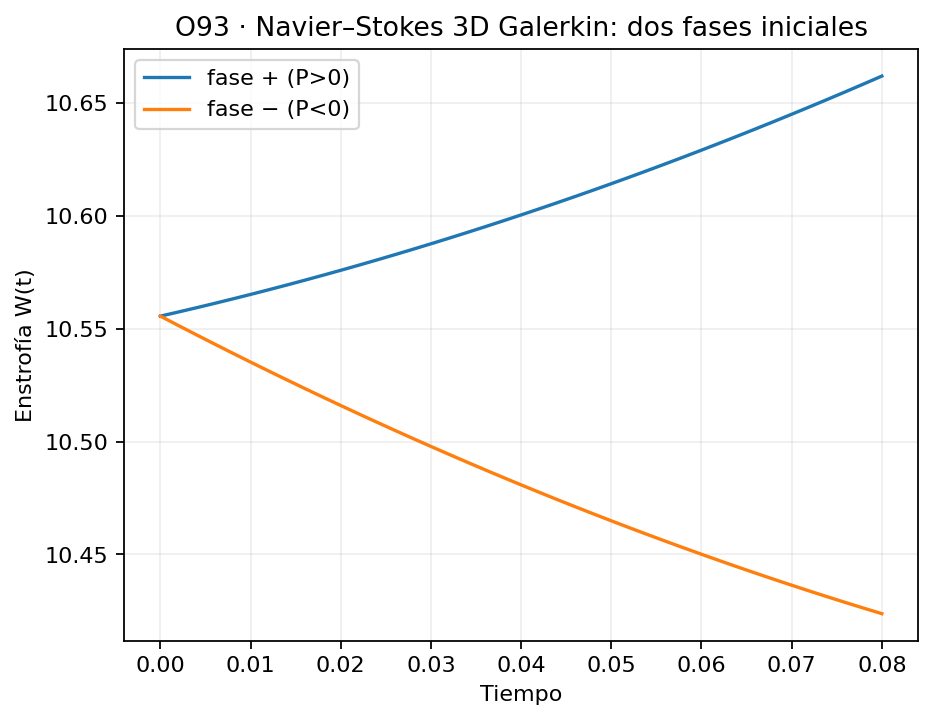
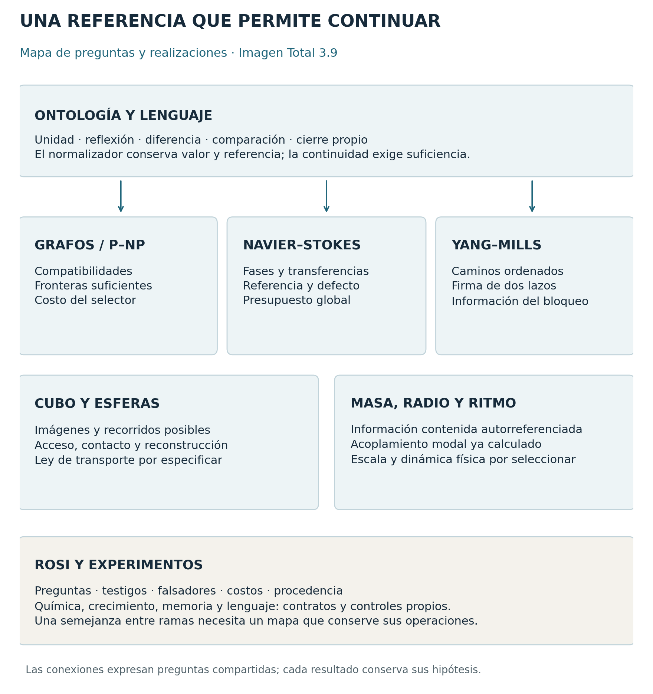

**Ontología, lenguaje, formalización y laboratorios**

> Lo real es lo que puede describirse. Este texto sigue un solo hilo, del lenguaje a las ramas, y en cada paso dice qué está demostrado, qué es lectura y qué sigue abierto.

## Cómo leer

**Qué es.** La imagen del programa al 10 de noviembre de 2026, en un solo texto. Reúne:

- el desarrollo completo de la Imagen Total 3.9, del 23 de octubre;
- el hilo ontológico integrado y el esquema acordado del 24 de octubre;
- las entregas posteriores: *Más allá de Yang–Mills* (27 de octubre), la solicitud T-EXT-01 (30 de octubre), *G–01 · El mecanismo de la gravedad* (1 y 2 de noviembre), *El cruce como reflejo central* (3 y 4 de noviembre), el laboratorio óptico v5.1 (7 de noviembre), *La economía del cálculo* (8 de noviembre) y *¿Qué cálculo deja de hacerse?* (10 de noviembre);
- tres notas del 10 de noviembre: las cuatro cápsulas en Navier–Stokes, el mecanismo de economía frente a P y NP, y el contraste de esa economía con Yang–Mills.

**Orden.** Primero el hilo en sus propios términos; los enlaces con lo que otros encontraron van al final, en una capa aparte (parte XI). Cada tema sigue el mismo orden: narrativa, ontología, lenguaje, matemática y predicción. Dentro de una misma inferencia, cada palabra conserva un solo significado; la parte III los fija.

**Estados.**

| Marca | Qué afirma |
|---|---|
| [O] | Ontología: lectura del autor que orienta las preguntas |
| [D] | Definición o regla adoptada |
| [T] | Demostrado bajo hipótesis declaradas |
| [C] | Condicional: vale si se cumple una obligación identificada |
| [E] | Ensayo reproducible: el código y los datos están publicados |
| [F] | Falsador: un testigo refuta la afirmación delimitada |
| [H] | Hipótesis física: el puente con los observables está por derivar |
| [I] | Lectura: correspondencia interpretativa entre dos contratos |
| [A] | Abierto: obligación que espera prueba |

En «El hilo del dos», POSTULADO equivale a [O], DEFINICIÓN a [D] y DERIVADO a [T]; CONTRASTE pasa a [H] o a [F] según su resultado, y ABIERTO a [A]. En G–01, [P] equivale a [A]. Los estados ROSI (RESOLVED, OPEN, SUPERPOSED, PREMATURELY COLLAPSED) describen el estado de una afirmación.

**Enlaces.** Cuando un resultado ya existe fuera del programa se marca ‹n›, y la parte XI dice dónde está.

**Rutas.** Son relativas a esta carpeta del repositorio. `../2026-10-24/` es la edición ordenada del 24 de octubre: ahí viven la 3.9 completa, las fuentes del hilo, las realizaciones y las ramas vigentes a esa fecha. Cada entrega posterior tiene su carpeta fechada. Los controles nuevos de esta edición están en `verificadores/`.

# I. El lenguaje

## 1. Lo real es lo que puede describirse [O]

La naturaleza del hombre está escrita en el código genético y también en una parte inmaterial, que es el lenguaje. Por selección, el lenguaje desarrolla una estructura que busca la máxima eficiencia al describir la realidad, y real es lo que puede describirse.

Esa estructura se hereda, crece y se completa como parte de una entidad colectiva. Somos las flores y los frutos de un organismo cuya materialidad se proyecta más allá de la biología y de lo que contiene la información genética. Cada uno es como una fruta del árbol, o como un hongo cuya espora es la estructura madre: una proyección individual de un conocimiento colectivo. La diferencia que nos da identidad es la que mantiene la novedad, para crecer más allá del presente.

## 2. El hilo [O]

Existe un hilo. Lo sostenemos aunque lo veamos por partes. Es la continuidad entre lo que ayer distinguíamos y lo que distinguimos hoy, y eso es nuestra construcción de la realidad. Las relaciones de esa construcción necesitan una representación ontológica.

## 3. Reflexionar [O]

Reflexionar es notarse a uno mismo dentro de una circunstancia mayor: la propiocepción de un sistema dentro de algo que lo contiene. La reflexión es anterior al lenguaje; el lenguaje la nombra y la conserva. Por eso es la capa más fundamental del programa.

La intuición es una forma legítima de entender, porque la reflexión se ve primero en uno mismo.

## 4. La regla R: una relación existe si puede nombrarse [D]

En el programa, una relación existe cuando puede nombrarse dentro del lenguaje.

Un lenguaje reúne las realizaciones en clases, y su realidad es el cociente $\Omega/{\sim}$. Una relación $\rho$ es representable en ese lenguaje si respeta las clases: si $x\sim x'$ e $y\sim y'$, entonces $\rho(x,y)\Leftrightarrow\rho(x',y')$. Cuando una relación separa elementos de una misma clase, decidirla exige refinar el lenguaje: eso es una **novedad**.

La misma regla reaparece en las tres ramas (parte VI): una pregunta que la firma anterior deja sin respuesta, una diferencia de fase que las magnitudes reúnen, un conmutador que el producto borra. Allí es consecuencia del hilo.

## 5. Contar es el caso más simple del lenguaje [O · T]

El caso más simple del lenguaje es contar: saber qué números puede nombrar una referencia que dispone solo de su primera distinción, el dos, y cómo crece ese vocabulario.

Cada primo es una palabra nueva. Entra en el paso $n$ en que, contando con ese primo, duplicar $n$ veces vuelve a uno por primera vez. Después del primero, todos los pasos traen palabra nueva menos uno: el 6 ‹3›. Es «El hilo del dos», recuperado completo en `../2026-10-24/01_HILO/fuentes/06_hilo_del_dos/`.

## 6. La economía de una palabra [D]

Una palabra nueva hace un trabajo identificable: conserva una respuesta, distingue casos, reduce un costo declarado o produce una predicción contrastable. Un nombre que deja todas las operaciones como estaban queda como nombre.

El lenguaje también puede borrar. Una formulación que reúne como iguales casos que una operación admitida distingue pierde información; R‑02 tiene un testigo exacto de eso (parte VI, Yang–Mills).

**Lo resuelto se conserva resuelto.** Una pregunta nueva puede separar lo que una respuesta anterior reunía, y esa respuesta sigue siendo correcta para su propia pregunta. Una operación que borra la información necesaria para una pregunta ya admitida rompe la continuidad de ese contrato.

Cada propuesta del programa se escribe en cinco voces:

1. una narrativa fiel;
2. una definición tipada;
3. una proposición verificable;
4. una implementación;
5. un falsador.

## 7. Qué significa «solución»

La palabra aparece en varios niveles, y cada uno tiene su alcance verificable: una pregunta resuelta, una interfaz suficiente, un algoritmo que decide una familia, un campo que satisface una ecuación, un teorema que cubre una clase de datos.

| Estado | Qué afirma | Evidencia que corresponde |
|---|---|---|
| Ontología | Compromiso generativo o significado del programa | Formulación y continuidad conceptual |
| Definición | Objeto y reglas de una realización | Dominio, operaciones y notación |
| Teorema | Consecuencia general bajo hipótesis explícitas | Demostración y condiciones |
| Condicional | Conclusión que depende de una obligación identificada | Hipótesis adicional nombrada |
| Experimento | Resultado de una ejecución o medición concreta | Datos, código, parámetros y protocolo |
| Falsador | Caso que refuta una afirmación delimitada | Testigo y proposición exacta refutada |
| Puente propuesto | Correspondencia entre objetos de contratos distintos | Mapa y observable por justificar |

Las tres ramas tienen resultados exactos dentro de sus contratos. Los problemas del milenio que las nombran siguen abiertos: P frente a NP, la regularidad de Navier–Stokes tridimensional sin fuerza externa y la brecha de masa de Yang–Mills en cuatro dimensiones. La diferencia entre estos estados pertenece al lenguaje del programa: permite proponer tesis audaces con un blanco de crítica preciso, conservar lo demostrado y reconocer cuándo un contraejemplo obliga a reformular.

# II. El hilo [O]

Orden acordado: la totalidad, cuya propiedad es la indeterminación; la reflexión; cierre o apertura según los ángulos; las ramas. Las precisiones posteriores al 24 de octubre se incorporan en el paso que les corresponde.

**1. La totalidad.** Al principio hay uno: homogéneo, sin distinción, sin un exterior desde el cual observarlo. El uno inicial expresa integridad antes de funcionar como cantidad de una colección; tamaño, posición, masa y duración llegan después. Su propiedad es la indeterminación, una diferencia abierta sin magnitud ni dirección. La forma mínima de esa indeterminación es un bit: más o menos uno, sin poder decir cuál.

La incertidumbre del programa nombra esa apertura respecto de lo que las relaciones todavía no determinan. Forma parte de las relaciones que el propio sistema aún no fija. Para convertirla en probabilidad hace falta una medida adicional.

**2. La reflexión.** La primera operación es un espejo: notarse a uno mismo dentro de algo mayor. En esta lectura el foco pertenece al espacio relacional que hace posible la comparación; el espejo material es un laboratorio posterior. En cuanto la unidad deja de ser una sola hay dos cosas a la vez: lo que se distingue y aquello respecto de lo cual se distingue.

**3. La cascada.** La reflexión se repite en todos los reflejos, y en cada paso sus soluciones emergen juntas, al mismo tiempo. Cada nodo vuelve a reflejar la unidad como un $\pm1$, y alrededor de cada centro $N$ aparecen sus imágenes $N-1$ y $N+1$: alrededor del 4, el 3 y el 5; alrededor del 8, el 7 y el 9.

Duplicar da profundidad: 2, 4, 8, 16. Elevar al cuadrado da recierre: 2, 4, 16, 256; en cada recierre todo lo anterior vuelve a caber como una unidad. El 3 aparece con el 4, como las comparaciones que admiten dos distinciones.

**4. La pared que se corre y la normalización.** La pared genera la comparación dentro de la totalidad; lo que surge al correrla son múltiplos nuevos, que son soluciones del sistema. Desde adentro, la celda mide siempre uno. Desde afuera, cada celda queda normalizada a la totalidad como una fracción $1/k$. Cuando aparece un múltiplo nuevo, una relación que antes no tenía con qué compararse, lo demás se construye sobre ella. Dos números sin divisor común son perpendiculares: ejes independientes, porque siempre queda un sobrante.

La secuencia de esa construcción es: novedad, múltiplo independiente, normalización interna, referencia común, autorreflexión, cierre propio y continuidad. En la aritmética, un primo nuevo respecto de la referencia es el caso exacto de independencia multiplicativa. La convergencia de caminos se reconoce sobre la distinción ya constituida.

**5. Abrir o cerrar.** Cerrar es tener información autorreferente: volver sobre sí después de un número finito de pasos conservando la estructura relacional. Lo que decide si una configuración cierra es la normalización:

- si las fracciones sobran, cierra;
- si llenan justo la totalidad, se repite;
- si no alcanzan, se abre.

Ángulo e identidad son lo mismo: que dos espejos formen un ángulo $\pi/k$ equivale a que aplicarlos $k$ veces seguidas devuelva todo a su lugar.

**6. Par e impar.** Lo par se cierra con su opuesto; lo impar queda abierto.

**7. El 6.** El 6 es la multiplicidad del 2 y del 3 que se repite. Un medio y un tercio dejan exactamente un sexto: el 6 llena la totalidad con lo que ya había, y por eso ahí la configuración se repite. En él conviven una parte cerrada, la del 2, y una abierta, la del 3. Es el mismo mecanismo que hace del 6 el único paso de la genealogía sin palabra nueva.

**8. El 5 y el uno indefinido.** Cuando el uno se indefine aparece la proporción áurea: el número que es uno más su propio inverso, la fracción hecha solo de unos que sigue sin fin. Es el rectángulo al que, si se le quita un cuadrado, le queda otro con la forma del todo: lo que queda después de distinguir se reconoce en el todo. La áurea pertenece a la misma familia que la reflexión, la del cuadrado menos la unidad. El 5 es una esfera alrededor del 4: cierra envolviendo, en la esfera, y en lo plano se abre.

**9. El fondo y las islas.** La estructura sobre la que todo crece es la de las octavas, la de la incertidumbre del tetraedro. El tetraedro es el fondo abierto: cada reflexión trae algo nuevo. El espacio es en 8 y se va corriendo; las partículas son en 4. Sobre ese fondo aparecen proyecciones que cierran, como el cubo, y cada proyección es una configuración que se puede dar.

**10. La singularidad.** Una configuración que se define en sí misma es una singularidad: se sostiene en sí misma en ese espacio. Su indefinición es su identidad, su información propia, y cada singularidad tiene la suya. Su identidad puede sobrevivir a cambios de forma o de portadores, como una ola que se reconoce con otras moléculas; esa persistencia depende de una dinámica concreta. Visto de lejos, todo sistema es una singularidad salvo por las referencias que sobreviven a la distancia: muchas configuraciones quedan reunidas en un bloque, conservadas y no destruidas.

**11. La semilla.** En cada cierre queda una semilla de la multiplicidad, con la forma del todo, como referencia para volver a emerger. La escala queda como normalizador.

**12. El horizonte.** La comparación tiene un límite: C, donde las diferencias internas y los ritmos relativos quedan resueltos. «Sintonizado a la eternidad» es la imagen de ese horizonte. C orienta las comparaciones como horizonte; los múltiplos comunes operan entre sistemas que sí pueden compararse (G–01, parte VII).

**13. Las ramas.** Navier–Stokes, P frente a NP y Yang–Mills son tres lugares donde reaparece esta misma pareja de abrir y cerrar (parte VI).

### El lenguaje a lo largo del hilo [O · lectura de edición]

| Paso | Lo que gana el lenguaje |
|---|---|
| 1–2 | Hay algo que nombrar, porque la unidad dejó de ser una sola |
| 3 | El vocabulario crece contando. Cada centro trae sus imágenes, y cada recierre convierte lo anterior en una sola palabra |
| 4 | Cambiar de referencia conserva la relación: $h/N=hL/(NL)$. La palabra cambia de escala y conserva su sentido |
| 5 | Lo que cierra puede volver a usarse como unidad: una identidad que se nombra |
| 7 | El 6 reúne palabras que ya estaban |
| 10 | Cada singularidad tiene un nombre propio, y su indefinición es su información |
| 11 | La semilla es lo que se hereda, como el lenguaje se hereda a cada fruto |
| 12 | El horizonte es el límite de lo que una comparación puede nombrar |

# III. Palabras: diccionario y fronteras

Este diccionario coordina los usos del programa. Reúne el diccionario de tipos (`../2026-10-24/01_HILO/fuentes/03_lenguaje/DICCIONARIO_Y_TIPOS.es.md`), el cristal semántico, las precisiones del 24 de octubre y los objetos que fijaron *La economía del cálculo* y *¿Qué cálculo deja de hacerse?*. La última columna dice qué nombra la misma palabra en otro contrato.

| Palabra | En el hilo | Uso formal | En otro contrato |
|---|---|---|---|
| Totalidad, unidad | Uno homogéneo, sin distinción; referencia desde la que se distingue | `1_ref` | Partícula, vértice o bit físico |
| Indeterminación | Propiedad de la totalidad: diferencia abierta sin magnitud ni dirección | $K_Q>1$; Ind | Azar, cuando se añade una medida de probabilidad |
| Bit | Forma mínima de la indeterminación: $\pm1$ sin poder decir cuál | Una reflexión de orden dos | Un bit de memoria física |
| Reflexión, espejo | Notarse dentro de algo mayor; la primera operación | Involución $s$, $s^2=1$; también $x-y+z$ y $I-2P$ | Espejo material, un laboratorio posterior |
| Diferencia | Distinción que una regla puede acreditar | Clase de $\sim_Q$ | Distancia euclídea, cuando se añade un mapa |
| Relación | Lo que puede nombrarse (regla R) | Relación que respeta $\sim$ | Arista binaria |
| Consulta | Lo que se quiere saber: si existe, cuántas, cuál | $Q:X\to Y$ | — |
| Referencia | Desde dónde se mira | $\rho:X\to O$, que induce una partición | Sistema de coordenadas físico |
| Herencia | Lo que ya está fijado y se conserva al refinar | $H\wedge\rho$; relación implicada por lo fijado | Procedencia temporal declarada |
| Novedad | Relación que obliga a refinar el lenguaje; múltiplo nuevo sin con qué compararse | Pregunta que no factoriza por la firma; primo nuevo con $\mathrm{ord}_p(2)=n$; restricción que excluye estados que lo fijado admitía | Un nombre nuevo |
| Lo común | Lo que dos referencias comparten | $H\vee\rho$; en enteros, el mcd | — |
| Normalización | Desde adentro la celda mide uno; desde afuera, $1/k$ | $h/N=hL/(NL)$ | Período físico o cociente geométrico |
| Perpendicular | Dos números sin divisor común: ejes independientes | Coprimos; contar módulo 6 es contar módulo 2 y módulo 3 ‹2› | Independencia dinámica de fases |
| Pared que se corre | El espejo que se desplaza dentro de la totalidad y deja múltiplos | CME‑002 | Movimiento de un muro bajo una ley física |
| Cerrar | Tener información autorreferente que se puede normalizar | Cinco sentidos tipados (parte IX) | Terminación de toda incertidumbre |
| Repetirse | Las fracciones llenan justo la totalidad | $1/p+1/q+1/r=1$ | — |
| Abrirse | Las fracciones se quedan cortas; cada reflexión trae algo nuevo | $1/p+1/q+1/r<1$; grupo libre | Fracaso o error |
| Reconocer | Saber qué parte de la incertidumbre ya estaba resuelta | $C_{\mathrm{rec}}$: extraer, comprobar y mantener la referencia | — |
| Estado pendiente | Incertidumbre que sigue abierta cuando un cierre ya se reconoce | Residuo de una raíz afín | — |
| Identidad | Lo que una interfaz suficiente reconoce como unidad | Ángulo $\pi/k\Leftrightarrow(s_is_j)^k=1$ | Igualdad de historias interiores |
| Singularidad | Configuración que se define en sí misma; su indefinición es su identidad | Cierre tipado bajo $Q$: $\Omega\ne\emptyset$ y $\lvert Q(\Omega)\rvert=1$; bloque reunido de una referencia | En una ecuación: la explosión de una solución; en física: agujero negro |
| Semilla | Lo que queda de la multiplicidad en cada cierre, para volver a emerger | — | Una partícula nueva |
| Fondo | La estructura de octavas: el tetraedro, abierto | Producto libre de cuatro $\mathbb Z_2$ ‹6› | Espacio absoluto preexistente |
| Isla, proyección | Configuración que cierra sobre el fondo, como el cubo | Grupo finito de reflexiones | Forma física fija |
| Residuo | Lo que una firma todavía no incorpora | `1_res`; Ind | Información almacenada |
| Firma, cápsula | Unidad con frontera y con lo necesario para las continuaciones admitidas | $\Gamma_G(B)=\exists I R_G(I,B)$ | Tabla pequeña |
| Recierre | Integrar un enlace compartido da un peso nuevo sobre el contorno | $K_{\rm ef}=\tfrac12\log\cosh 2\beta$ (parte VI.3) | Acción local antigua con costo cero |
| Radio | Escala de la reflexión, declarada | $R_i=1/\sqrt{\beta\lambda_i}$ | Radio de carga del protón, mediante un puente |
| Ritmo, tiempo | Comparación de los ritmos de los sistemas | $\sigma=\ell/\Lambda$, adimensional | Segundos de un reloj operacional |
| Horizonte C | Límite de la comparación, donde no quedan diferencias internas | Cono nulo $a^2+b^2=N^2$ en G–01 | Velocidad de la luz, mediante un puente físico |
| Masa | Lo que no se proyecta; información contenida y autorreferenciada | $\lVert V\rVert^2+\lVert m\rVert^2=1$ | Kilogramos, con una calibración |
| Resolución | Lo que el lenguaje ya distingue; la dirección del cambio: todo vuelve a uno | Res | Entropía importada |
| Signo relacional | Multiplicar o dividir respecto de otra escala | Exponente $\pm1$ | Signo como coeficiente de una suma (parte VI.2) |
| Tetraedro | Cuatro registros (uno global y tres locales), o $K_4$, según el contrato | $K_4$; tetraedro par $\lbrace 000,011,101,110\rbrace$ | C4 de cuatro fases, $\varepsilon=4$ |
| Cubo, caja | Representación de reflexiones, ejes y accesos | $(\mathbb Z_2)^3$ | Espacio absoluto |
| Esfera | Nodo con perímetro de indefinición | — | Partícula elemental identificada |

**Tipos distintos.** Cada uno de estos objetos tiene su propio tipo; usar uno en lugar de otro exige un mapa demostrado:

- $\varepsilon=4$, $q=4$, $2^2=4$, cuatro registros, cuatro fases (C4) y $K_4$;
- las seis aristas de $K_4$ y los tres bits que las sostienen (parte VI.2);
- la singularidad del hilo y la explosión de una solución de Navier–Stokes;
- el normalizador aritmético y la viscosidad; el espejo óptico y la transformación gauge; la incertidumbre semántica y la medida cuántica;
- el conmutador, la brecha espectral y el defecto $\nu$;
- el número de imágenes y el número de fuentes; una forma recuperable y la historia que la produjo;
- reconocer un patrón y generarlo;
- el radio geométrico de un circuito material, el radio relacional y la escala espectral $\ell_\omega$.

# IV. Núcleo formal

Lo mínimo que sostiene el hilo, con su estado. El núcleo responde tres preguntas: qué nueva comparación añade información, qué descripción conserva las respuestas y qué permite actualizarla. Las pruebas están en los archivos que cita la parte X.

## 1. Lo que se distingue y lo que queda sin distinguir

Sea $C$ un conjunto de realizaciones compatibles y $Q$ una familia de preguntas. Las realizaciones se reparten en clases $F_k$ de peso $\mu_k=\lvert F_k\rvert/\lvert C\rvert$:

- $\mathrm{Res}=\sum\mu_k\log_2(1/\mu_k)$ es lo que el lenguaje ya distingue;
- $\mathrm{Ind}=\sum\mu_k\log_2\lvert F_k\rvert$ es lo que queda sin distinguir dentro de cada clase;
- $\mathrm{Res}+\mathrm{Ind}=\log_2\lvert C\rvert$ [T ‹1›]: la totalidad se conserva y cambia su reparto.

$K_Q=\lvert C/{\sim_Q}\rvert$ cuenta las clases: 0 es inconsistencia, 1 es resolución y más de 1 es indeterminación sostenida [D]. La capacidad de distinción de una consulta es $D_Q=\log_2 K_Q$: cuenta clases, sin distribución de probabilidad.

## 2. La novedad se reconoce por una diferencia operativa

Sean un conjunto de estados $X$, una firma $\Phi:X\to A$, que representa lo que el lenguaje actual distingue, y una nueva consulta $d:X\to B$. La consulta es recuperable desde la firma exactamente cuando existe $g$ con

$$
d=g\circ\Phi .
$$

Si $d$ es constante en cada fibra de $\Phi$, se define $g(\Phi(x))=d(x)$; si dos estados con la misma firma responden distinto a $d$, esa $g$ no existe [T]. Un **testigo de novedad** es una pareja con

$$
\Phi(x)=\Phi(y),\qquad d(x)\ne d(y).
$$

La firma ampliada $(\Phi,d)$ conserva las preguntas anteriores y subdivide al menos una clase. Para subdividir todas las clases, la nueva consulta debe variar en cada fibra; YM‑02 conserva un ejemplo donde se divide una sola. El alcance universal de una nueva reflexión tiene que estar escrito en las reglas de la realización.

Este criterio mide contenido. Encontrar $g$, decidir si existe o construir la firma ampliada tiene su propia contabilidad (§7).

## 3. Reflexión en un centro y genealogía

**Reflexión en un centro.** $M_N(d)=(N-d,N+d)$ cumple $N^2-(N-d)(N+d)=d^2$ [T]. Con $d=1$ las dos imágenes recomponen el centro salvo una unidad: $3\cdot5=16-1$ y $7\cdot9=64-1$.

**Genealogía.** El primo $p$ entra en el paso $n$ en que duplicar $n$ veces vuelve a uno módulo $p$ por primera vez: $\mathrm{ord}_p(2)=n$. Todo $n$ trae un primo propio, menos $n=1$ y $n=6$ ‹3›. Por eso el centro 8 es el único sin palabra nueva arriba: $7\cdot9=63=2^6-1$, y $9=3^2$ es heredado [T].

**Recierre.** La cadena 2, 4, 16, 256, 65536 eleva al cuadrado en cada paso. Cada paso cierra el anterior y trae una novedad coprima con todo lo que había ‹4› [T]. La identidad

$$
2^{2^r}-1=\prod_{j=0}^{r-1}\left(2^{2^j}+1\right)
$$

muestra cómo un centro posterior reúne los factores de las etapas anteriores.

## 4. El normalizador transporta valor y referencia

La continuidad está en el múltiplo que normalizó, y por eso se conserva la pareja valor/referencia. Si $N$ divide a $L$,

$$
\frac{h}{N}=\frac{h(L/N)}{L}.
$$

El numerador cambia y la razón permanece. Para dos módulos $N$ y $m$, la referencia común mínima es

$$
L=\operatorname{mcm}(N,m),\qquad b=\frac{L}{N}=\frac{m}{\operatorname{mcd}(N,m)},
$$

y la firma conjunta $(x\bmod N,x\bmod m)$ equivale a la clase $x\bmod L$: cada clase anterior se divide en exactamente $b$ clases nuevas [T ‹2›]. Cuando $m=p$ es primo y $p\nmid N$, aparece una coordenada independiente de $p$ estados y $L=Np$. Está en R‑01 (`../2026-10-24/03_RAMAS/yang_mills/R01/`), T1–T4:

- si la firma anterior es $x\bmod N$ y aparece un primo $p$ que no divide a $N$, la firma anterior deja sin respuesta la pregunta módulo $p$ (T1) [T];
- la referencia común $L=Np$ recupera las dos firmas (T2) [T];
- la relación se conserva: $j/N=pj/L$ (T3) [T];
- con continuaciones afines, cada parte se actualiza desde su propio residuo, sin conocer el todo: es un cierre operativo (T4) [T].

Tres ejemplos separan operaciones distintas: de módulo 2 a módulo 3 se llega a módulo 6; incorporar módulo 9 a módulo 6 da módulo 18, nueva resolución con el mismo primo 3; incorporar módulo 3 a módulo 6 deja las distinciones como estaban. Nuevo impar, nuevo factor primo y nueva profundidad de una potencia son tres operaciones [T].

La dinámica afín $F(x)=ax+b$ conmuta con la reducción de módulo $L$ a módulo $N$. Si $a$ es invertible módulo $L$, la actualización permuta las clases y las conserva todas; si $a=0$, la compatibilidad se mantiene y las clases colapsan [F]. Seguir calculando la referencia antigua y conservar cada diferencia durante una evolución son dos exigencias distintas, y el mínimo común múltiplo da la primera.

## 5. La ley de herencia es el teorema chino del resto

Sean $P$ y $Q$ dos particiones de un conjunto finito $X$. $P\wedge Q$ reúne lo que ambas reúnen (herencia más novedad); $P\vee Q$ es lo común. Para cada bloque $J$ de $P\vee Q$, $p_J$ y $q_J$ cuentan los bloques de $P$ y de $Q$ dentro de $J$.

**Desigualdad de herencia [T].** Siempre

$$
\lvert P\wedge Q\rvert\le\sum_{J\in P\vee Q}p_J q_J ,
$$

con igualdad exactamente cuando $P$ y $Q$ permutan. Con permutación y bloques homogéneos se obtiene la ley $\operatorname{mcm}(H,m)/H=m/\operatorname{mcd}(H,m)$, que es el teorema chino del resto para dos referencias; con permutación, la desviación respecto de la ley es exactamente $k^2\operatorname{Cov}(p_J,q_J)$; sin permutación, la ley falla ya con cuatro elementos (*La economía del cálculo*, §2).

## 6. Identidad, continuación y suficiencia

**La identidad depende de sus continuaciones.** Dos estados son equivalentes para una familia de preguntas $Q$ y continuaciones admitidas $c$ cuando

$$
x\equiv_Q y\iff Q(c\cdot x)=Q(c\cdot y)\ \text{para toda continuación admitida }c.
$$

Si las continuaciones son cerradas bajo composición, la equivalencia se conserva al continuar, y el cociente puede representar una unidad reutilizable [T ‹P5›]. Una interfaz suficiente conserva las respuestas declaradas: para contar hay que conservar multiplicidades; para decidir existencia basta un soporte de factibilidad; para predecir una evolución hay que retener lo que influye en sus continuaciones.

**Interfaz.** $\Gamma_G(B)=\exists I R_G(I,B)$ reemplaza el interior por su relación con la frontera $B$ [D]. Acumular restricciones reduce lo compatible: $\Omega_{n+1}=\Omega_n\cap R_{n+1}$ [T]. Singularidad contextual: $\Omega\ne\emptyset$ y $\lvert Q(\Omega)\rvert=1$, con $\Omega$ de cualquier tamaño [D].

**Suficiencia dinámica.** Sean una actualización $F:X\to X$ y una firma $Q:X\to Y$. Existe una actualización autónoma de firmas $\widehat F$ con

$$
Q\circ F=\widehat F\circ Q
$$

si y solo si firmas iguales producen firmas futuras iguales: $Q(a)=Q(b)\Rightarrow Q(F(a))=Q(F(b))$ [T]. Al cambiar de escala mediante $J:X\to X'$, la firma se preserva cuando $Q=P\circ Q'\circ J$, y ese recuperador $P$ existe exactamente cuando la firma posterior separa todo lo que la pregunta anterior distinguía [T, R‑02]. Un mapa geométricamente natural o gauge-equivariante puede perder respuestas; la conservación se comprueba aparte.

**Ángulo e identidad.** Dos espejos forman el ángulo $\pi/k$ si y solo si $(s_is_j)^k=1$ [T ‹5›]. Con tres espejos de ángulos $\pi/p$, $\pi/q$ y $\pi/r$: si $1/p+1/q+1/r>1$ el recinto cierra; si es igual a 1, se repite; si es menor, se abre. CME‑002 lo comprueba en 22 recintos [T · E].

**Complemento.** $\lVert V\rVert^2+\lVert m\rVert^2=1$ [D]. Con $E=\hbar\omega_U$, $pc=\hbar\omega_V$ y $mc^2=\hbar\omega_m$, es exactamente la relación relativista entre energía, momento y masa [T].

## 7. Economía y costo completo

La economía incluye descubrir una interfaz, construirla, guardarla, componerla, actualizarla, consultarla y acreditar su respuesta. Guardar poco y calcular poco son dos cosas distintas: una representación compacta puede esconder una tabla grande, una precisión creciente o un selector caro. La capacidad $\log_2k$ de distinguir $k$ clases y el número de consultas permitidas también se separan: con cuatro estados y preguntas del tipo «¿es este estado?», el peor caso pide tres preguntas.

*La economía del cálculo* (8 de noviembre) da la medida exacta: las distinciones que deben quedar activas son el rango de la relación entre lo decidido y lo pendiente, y las fija la frontera [T]. *¿Qué cálculo deja de hacerse?* (10 de noviembre) separa dos magnitudes de estructura y tres de trabajo:

1. $D_{\mathrm{obs}}$: lo que la consulta necesita distinguir;
2. $D_{\mathrm{rep}}$: lo mínimo que hay que guardar para reconstruirlo, en una clase de representaciones declarada;
3. $C_{\mathrm{rec}}$: reconocer, comprobar y mantener la referencia;
4. $C_{\mathrm{calc}}$: contar sobre esa referencia y llevar lo pendiente;
5. $C_{\mathrm{recon}}$: reconstruir la respuesta.

Las dos primeras se miden en bits; las otras tres, en operaciones. Frente a una ruta de comparación $B$, con el mismo problema, la misma respuesta y el mismo modelo de costo, hay economía neta cuando

$$
C_{\mathrm{rec}}(F)+C_{\mathrm{calc}}(F)+C_{\mathrm{recon}}(F)<C_B(F).
$$

**Límites demostrados [T].** Una referencia válida para cualquier futuro deja cada configuración en su propia clase. Decidir si dos estados son equivalentes, o si una relación es novedad, es coNP-completo. En grafos expansores, todo orden de eliminación tiene algún corte con $2^{\Omega(n)}$ distinciones (*La economía del cálculo*, §4 y §6).

# V. Realizaciones

Son los lugares donde el hilo se vuelve exacto. En ellos, «cerrar» significa ante todo que las orientaciones se agotan, el primero de los sentidos de la parte IX.

## 1. Del hilo del dos a las referencias geométricas

**Cuatro estados y tres comparaciones [T].** Con dos distinciones binarias hay cuatro estados. Sus tres comparaciones no triviales los representan como

$$
000,\quad 011,\quad 101,\quad 110,
$$

los vértices de paridad par del cubo binario. Están a la misma distancia entre sí y forman un tetraedro regular. Cualquier trío determina la cuarta palabra mediante el XOR conjunto. Al elegir un origen aparece la lectura «tres y uno», y la estructura deja abierta cuál es el uno. La construcción análoga con más bits también existe; elegir dos distinciones como unidad física pide una regla adicional de economía, acceso o dinámica (L3).

**El origen del tetraedro [T · E].** El tetraedro nace del bit y de la cápsula del programa: la cápsula $\lbrace A,JA,-A,-JA\rbrace$ con $J^2=-I$, y la resolución de una indefinición binaria con $\sigma=\pm1$, públicas desde el 29 de septiembre. Desde el origen 000, cambiar bits de a dos da 011, 101 y 110; las cuatro palabras están a dos bits unas de otras, y cuatro es el máximo de palabras de 3 bits equidistantes. Cambiar un solo bit lleva al tetraedro impar, y los dos juntos forman el cubo: la paridad conserva el cierre y un cambio impar lo abre hacia el complementario. Con los signos de la duplicación, los tres vértices distintos del origen se comportan como la $J$ de la cápsula: su cuadrado es $-1$, dos distintos anticonmutan, y juntos generan los cuaterniones (*Notas del 3 de noviembre*, §2).

**El cristal [T ‹C1›].** Los enteros cuya paridad cae en el tetraedro par forman la red cúbica de caras centradas. El diamante es esa red más una copia corrida medio paso; desde cada átomo, los cuatro vecinos apuntan al tetraedro par, y desde la copia, al impar. La misma construcción en $n$ dimensiones cierra en una red solo si $n$ es par, y la copia queda a la distancia de los vecinos solo si $n=8$: es la red $E_8$, la de los octoniones enteros. Leer cápsula, tetraedro, cristal y una escala donde la incertidumbre se sostiene como un solo camino hacia el 8 es [I].

**La quinta referencia [T].** Tres centros no colineales fijan un plano; un cuarto punto a distancias dadas de los tres admite dos soluciones reflejadas, y una referencia fuera del plano las distingue. O19 inscribe un tetraedro regular en un cubo: las reflexiones centrales generan los ocho vértices, y el tetraedro y su reflejo se interpenetran con el cubo como envolvente. O20 refleja a través de las caras: para vértices centrados $v_i$, las nuevas referencias son $w_i=-5v_i/3$, a radio $5R/3$ del centro global, y al repetir la regla $R_j=R_0(5/3)^j$. El factor está derivado para esa regla; la longitud $R_0$ y su lectura física son preguntas aparte. Reflejar y rellenar son operaciones distintas (O22).

**Qué cuenta cada secuencia [D].** Las secuencias 3–4–5–7–8–16 conservan su función exploratoria. En cada realización se declara si cuentan nodos, comparaciones, estados, orientaciones, clases o niveles: ocho operadores de un grupo, ocho imágenes accesibles y ocho canales físicos son tres objetos con la misma cardinalidad.

## 2. Cubo de espejos

`../2026-10-24/02_REALIZACIONES/01_cubo_de_espejos/`

El cubo es el ejemplo mínimo para estudiar cómo una unidad se reconoce entre muchas imágenes: una marca interior se refleja, unas rutas quedan visibles y otras ocultas, y un desplazamiento cambia las comparaciones disponibles. La pregunta central es qué puede reconstruir un foco interno a partir de lo que ve.

**Una fuente y muchas imágenes [T].** En un eje con espejos ideales en $0$ y $L$, las reflexiones generan la órbita $\mathcal O_L(p)=\lbrace 2nL\pm p:n\in\mathbb Z\rbrace$. La firma plegada de O59,

$$
\rho_L(x)=\operatorname{dist}(x,2L\mathbb Z),\qquad I_L(q)=\big(\rho_L(q_1)/L,\ \rho_L(q_2)/L,\ \rho_L(q_3)/L\big),
$$

coincide para dos puntos exactamente cuando pertenecen a la misma órbita. El número de imágenes cuenta apariciones de una sola fuente. La órbita completa, las imágenes que llegan a una cámara y las posiciones fuera de la órbita son tres conjuntos distintos: una unidad puede cerrar bajo sus operaciones ocupando solo parte del espacio de representación.

**Mover el espejo [T].** La reflexión en el plano $x=s$ es $x'=2s-x$; desplazar ese plano en $\delta$ traslada su imagen $2\delta$, y en una familia de recorridos aparecen términos $2n\delta$ que dependen de la profundidad. Reescalar toda la escena, $(L,p)\to(kL,kp)$, conserva la firma normalizada; mover una pared con la fuente fija cambia la firma, las rutas y el acceso. Ampliar el grupo de reflexiones **une órbitas**; ampliar la familia de preguntas **divide clases**: son dos operaciones sobre equivalencias distintas (YM‑02). Al correr la pared de $L=1$ a $L=2$ se pierde la paridad de uso del espejo movido y se conserva el signo (*El cruce como reflejo central*, §3) [T].

| Resultado | Estado | Dónde |
|---|---|---|
| El tetraedro regular reflejado en sus caras queda abierto: con a lo sumo $L$ reflexiones alcanza $2\cdot3^L-1$ orientaciones, y sus cuatro espejos generan un grupo libre ‹6› | [T · E], hasta $L=12$ | `CME-001_cierre_por_reflexion/` |
| El cubo cierra en 8 orientaciones y el ortoesquema, en 48 | [T · E] | ídem |
| Los tres espejos internos del tetraedro generan los ocho vértices del cubo; la paridad los separa en dos tetraedros de cuatro | [T] | `geometria_O19_O22/` |
| 22 recintos de tres espejos: cierra si las fracciones sobran, se repite si llenan justo y se abre si se quedan cortas; ángulos e identidades coinciden paso por paso | [T · E] | `CME-002_pared_que_se_corre/` |
| La regla del bit ($\pm1$ en cada nodo e intercambio de nodos) da los ángulos $\pi/2$, $\pi/3$ y $\pi/4$ y siempre cierra: 48 orientaciones con tres nodos y 384 con cuatro; el 5 pide la áurea | [T · E] | `comprobacion_regla_del_bit.py` |
| Intercambiar dos de las cuatro referencias es reflejar: sin referencia común, $\pi/2$; con una común, $\pi/3$; en total, 24 orientaciones. Con el bit aparece $\pi/4$ y el cubo: 48. Cada ángulo sale de la estructura ‹8› | [T · E] | `CME-003_de_las_cuatro_referencias_a_los_angulos/` |
| Las imágenes forman una órbita infinita; la firma plegada devuelve cada imagen al recinto | [T] | `O59_orbita_y_firma_plegada/` |
| Copia ideal, sensor finito, identidad observacional, coincidencia de retornos y resonancia óptica | [E] | `../2026-10-24/04_LABORATORIOS/espejos_E-MIRROR_v1_v8/` |

**Precisión.** El criterio por ángulos $\pi/k$ es un «si y solo si» para celdas del espacio euclídeo cuyas imágenes lo llenan sin solaparse ‹5›. Contar orientaciones finitas es una condición más débil: el triángulo de ángulos $2\pi/5$, $2\pi/5$ y $\pi/5$ da 10 orientaciones, y sus traslaciones se achican por $1/\varphi$ sin fin ‹7›.

**De dónde salen $\pi/2$ y $\pi/3$ (CME‑003) [T · E].** Salen de las cuatro referencias de T8. Dos intercambios sin referencia común son independientes ($\pi/2$); dos que comparten una recorren tres ($\pi/3$), y en la cascada 1, 2, 4 eso ocurre cuando ya está el 4. Es lo que el autor había dicho [O]: el 2 aparece primero como mitad, con un solo espejo; el 3 aparece cuando se manifiesta el 4, como cantidad de nodos, que son las tres comparaciones. Que las cuatro tengan el mismo derecho a ser «la una» es lo que da las tres direcciones; con una distinguible, el recinto sería plano. El mismo tetraedro da las dos cosas: reflejado en sus caras crea referencias nuevas y queda abierto; con el intercambio de sus referencias cierra en 24.

**Llenar la totalidad con partes [T · C · E].** Si la celda mide uno y la totalidad mide $E$, cada manera de llenar la totalidad con múltiplos de la celda es una partición de $E$: hay 1, 2, 3, 5 y 7 para $E=1$ a 5. $\log p(E)$ crece de forma cóncava, como $\sqrt E$ ‹C2›. Las preguntas del autor tienen forma exacta: cuántas veces cabe en sí misma (cada partición como escalera de cuadritos), cuántas reflexiones puede hacer en sí misma (la conjugada, y reflejar dos veces devuelve la original) y cuáles se sostienen (las autoconjugadas, tantas como las particiones en partes impares distintas, verificado hasta $E=40$). La parte VI.2 usa esta concavidad.

**El laboratorio óptico v5.1 [E].** `../laboratorios/laboratorio_optica_radios_v5_1/` mide cómo cambia lo que un observador distingue al mover su referencia: espejos paralelos con composición igual a la traslación $2L$; una escalera de resolución 5 → 4 → 3 → 2 → 1 con cuatro transiciones exactas $D_i=g_i/\theta_i$; fases con un período nuevo que agregan un referente exactamente cuando $m$ no divide a $H$; la base mínima $\lbrace5,7,9\rbrace$ en $[0,630)$; y el mismo observable lejano para dos distribuciones distintas. *La economía del cálculo* mide la ley con que se funden las distinciones al alejarse: la distinción $\ell$-ésima se funde a una distancia $R\propto\varepsilon^{-1/\ell}$, con pendientes 0,998 · 0,499 · 0,333 · 0,253; la referencia angular de una galaxia se reúne en un punto y lo pendiente llega como frecuencia [T en el caso estático · E].

**Del experimento ideal al montaje [A].** La campaña material está propuesta: una marca frente a seis espejos, una pared desplazable, caras desactivadas, un vidrio entre dos cavidades, marcas de color, diferencias de fase, curvatura controlada y varios focos; la variante acústica reconstruye con ecos. El primer protocolo produce dos escenas con la misma lectura parcial y añade una sola lectura que las separa. Los datos disponibles son simulaciones y construcciones matemáticas. Pregunta rectora: **qué mínima lectura permite reconocer la procedencia de una imagen y qué referencia conserva esa respuesta después de mover el espejo**.

**La caja que calcula los comunes [T · F].** O70 proyecta campos por un grupo de ocho simetrías: $a=P_Gu=|G|^{-1}\sum_g g\cdot u$, $w=u-a$. El común $a$ es exacto como proyección, y su evolución bajo Navier–Stokes incluye el tensor residual $\tau=P_G^{(2)}(w\otimes w)$: $a_t=F(a)-\mathbb P\operatorname{div}\tau$. Dos campos con el mismo común pueden tener derivadas distintas; O71 encuentra pares con el mismo común, el mismo tensor de segundo orden y la misma primera derivada que difieren en la segunda. La memoria que pide la continuación crece con ella; un programa recursivo que incorpore las relaciones necesarias tiene que contabilizar ese crecimiento.

## 3. Esferas, tetraedro y cuatro referencias

`../2026-10-24/02_REALIZACIONES/02_esferas/` · `../2026-10-24/04_LABORATORIOS/esferas/`

- Cada esfera es un nodo con un perímetro de indefinición [O].
- Tres centros fijan un plano y dejan dos extensiones reflejadas, arriba y abajo [T · E, modelo v10].
- Cuatro esferas iguales mutuamente tangentes tienen seis contactos por parejas, y sus centros forman un tetraedro regular; las cuatro superficies se tocan de a dos [T].
- El 3 son las $2^2-1$ comparaciones de dos distinciones, y las cuatro referencias realizan las 24 permutaciones [T].
- La quinta esfera que toca a cuatro iguales tiene radio $(\sqrt6-2)/2$: la quinta cabe con otro radio [T]. Leerla como el acontecimiento de una distinción nueva es [O · H].
- Cuatro esferas en anillo coplanar realizan otra red: seleccionar los cuatro enlaces periféricos deja las dos diagonales fuera de las restricciones activas, y eso se declara en el modelo. En el cuadrilátero articulado, cuatro longitudes dejan una libertad interna después de descontar los movimientos rígidos; esa libertad es distinta de la amplitud de un modo de giro.

**Trayectorias [A].** Una trayectoria que recorre una curvatura puede continuar en la esfera vecina con el giro opuesto (diálogo del 23 de octubre). La estructura que interesa es la familia de trayectorias compatibles y su eventual circuito. Hay tres modelos con leyes propias: el grafo de contactos, el transporte tangencial ideal y la óptica del vidrio real. En el modelo cinemático se impone una regla de continuación tangencial; en óptica física, los recorridos los fijan el material, los índices y las superficies.

**Prueba discriminante [A].** Separar tres preguntas: si un contacto transmite señal, si varias continuaciones componen un circuito y si ese circuito se sostiene cuando se modifica una relación. Comparar esferas separadas, tangentes y acopladas; después un triángulo, un anillo de cuatro y una disposición tetraédrica, registrando entrada, punto de lectura, intensidad, dirección, fase y polarización. El cierre se acredita por una relación reconstruible al completar el recorrido; los muchos recorridos compatibles quedan registrados como incertidumbre pendiente.

## 4. Circuito C4

`../2026-10-24/02_REALIZACIONES/03_circuito_C4/`

- Cuatro reflexiones dan 16 estados. Al reflejar cada vértice del tetraedro en su cara opuesta aparece un tetraedro regular nuevo, a escala 5/3 [T].
- Con contactos ideales, $s_i+s_j=0$ en cada enlace. En un grafo conexo bipartito existe un modo no nulo de signos alternados; un ciclo impar lo anula. El anillo de cuatro admite $(a,-a,a,-a)$; el triángulo y $K_4$ admiten solo el modo nulo bajo esta regla escalar (O72): $\dim\ker Q_{C_4}=1$ y $\dim\ker Q_{C_3}=\dim\ker Q_{K_4}=0$ [T].
- Con brazos distintos, $a_i\omega_i+b_i\omega_{i+1}=0$, el giro vuelve sobre sí si $H=\prod_{i=1}^4a_i/b_i=1$. Con los radios como brazos, $a_i=r_i$ y $b_i=r_{i+1}$, el producto telescopa y vale 1 para cualquier colección de radios (O74) [T]. Que el giro vuelva en el tiempo pide además fases y ritmos compatibles [A].
- **Ensayo siguiente [A].** Dos configuraciones con el mismo grafo C4 y distinta ley de transmisión; comprobar cuál sostiene el retorno elegido, y repetir con $K_4$.

La versión material de este circuito, con cuatro marcas transportadas por un flujo, está en la parte VI.1, §7.

# VI. Ramas

Las tres ramas son lugares donde reaparece la pareja de abrir y cerrar. La gramática que comparten sale del hilo y tiene tres rasgos:

- la novedad es una pregunta que la firma anterior deja sin respuesta;
- el cierre es una firma suficiente;
- la pérdida ocurre por bloqueo.

Cada rama tiene resultados exactos dentro de su contrato y un límite preciso.

## 1. Navier–Stokes

`../2026-10-24/03_RAMAS/navier_stokes/` · vigente: `VIGENTE_O93/` (22 de octubre) · cuatro cápsulas: `verificadores/ns_c4/` (10 de noviembre)

La rama pregunta qué relaciones pueden sostener una organización en movimiento y qué información controla su continuación. Pasó de la geometría material de la vorticidad a radios endógenos, fases de anillos, firmas por simetría, presupuestos de interacción y normalización de todos los armónicos, y ahora a cuatro marcas materiales.

**Palabras que cruzan.**

- *Singularidad* en el hilo es un cierre que se sostiene; en la ecuación, que la solución deje de ser suave. Cada una conserva su significado.
- *Normalizar* es dividir por la escala del propio flujo.
- *Semilla* [O]: en cada cierre queda una semilla de la multiplicidad, y la escala queda como normalizador.

### 1. El contrato

Navier–Stokes viscoso e incompresible en el toro tridimensional, sin fuerza externa ‹NS1›:

$$
\partial_tu+(u\cdot\nabla)u=-\nabla p+\nu\Delta u,\qquad\nabla\cdot u=0,\qquad\nu>0.
$$

Se distinguen soluciones suaves exactas, sistemas Fourier–Galerkin truncados, diagnósticos de simulaciones y criterios condicionales de continuación. Un resultado local o una ventana numérica corta vale en su alcance. El anuncio de OpenAI del 8 de septiembre de 2026 trata la formación de una singularidad **con fuerza externa suave** (alternativas C y D del problema del milenio); la evolución sin fuerza que estudia esta rama es otra pregunta ‹NS1›.

### 2. Amplificación, giro y ritmos

Para $q=\lvert\omega\rvert>0$ y $\xi=\omega/q$, la descomposición de $D_t\omega/q$ en componente paralela y perpendicular separa amplificación y giro. Los archivos conservan balances instantáneos, Hessiano de presión, contribuciones viscosas, controles de Burgers y Euler restringido, y diagnósticos de DNS y JHTDB; sus cifras dependen del muestreo, la resolución y el método de diferenciación. Lo que atraviesa la rama: el término que estira la vorticidad y la viscosidad se comparan con sus escalas físicas, y una geometría favorable pide además su cota dinámica.

O25 y O45 construyen marcos móviles $x=X(t)+\ell(t)A(t)y$; la velocidad relativa contiene los términos del movimiento del origen, de la escala y de la rotación del marco. El programa compara tres ritmos, el del flujo, el de su referencia y el de una partícula: tres fases dan dos diferencias independientes. Para vorticidad no nula,

$$
\ell_\omega^2=\frac{\int\lvert\omega\rvert^2}{\int\lvert\nabla\omega\rvert^2},
$$

y la ecuación determina la tasa de esa escala por sus balances: el acoplamiento entre radio y dinámica ya está escrito. La dificultad posterior es controlar esa evolución para toda la clase buscada. O37–O53 conservan reorganizaciones en 2D, balances materiales, anillos, retornos y perturbaciones; O52 registra cinco de seis trazadores completando vueltas en momentos distintos. Retorno material, retorno de fase y desplazamiento del centro son tres observables.

### 3. Orientación, superficie y transferencias

Si $a,b$ son vectores materiales transportados y $S$ es la parte simétrica del gradiente,

$$
\frac{D}{Dt}(a\cdot b)=2a^TSb ,
$$

y la incompresibilidad deja ese término libre: dos preparaciones con magnitudes globales iguales deforman distinto un ángulo material (O54–O57). O57 compara la métrica de la superficie hasta un factor común de escala, y la parte que ese factor deja sin explicar cuantifica una diferencia de forma: la identidad de un anillo puede estudiarse aunque varíe el ángulo de dos marcas.

O61 distingue triadas admitidas de transferencias activas; O62 encuentra preparaciones con transferencia inicial nula entre bandas cuya segunda derivada ya distingue la reorganización; O63 separa esa lectura energética del desfase de trazadores. O64–O65 muestran que la tensión superficial aporta información propia en el modelo de fragmentación. O68 y O88 formalizan dos giros del toro: si $p,q$ son coprimos y $bq+cp=1$,

$$
\begin{pmatrix}\Phi\\\Psi\end{pmatrix}=\begin{pmatrix}b&c\\p&-q\end{pmatrix}\begin{pmatrix}\theta\\\varphi\end{pmatrix}
$$

es invertible en el toro de fases (determinante $-1$); multiplicar después las fases por un entero mayor que uno pide conservar una etiqueta de rama para reconstruir la preimagen. O69, O89 y O90 delimitan la sincronía: el acoplamiento a un mismo múltiplo puede perderse y la evolución sigue suave.

### 4. Lo que una semilla finita debe conservar

O70 y O71 muestran pérdida de suficiencia en proyecciones por simetría (parte V.2). O76 incorpora la presión como relación no local. O77 muestra que una familia toroidal de pocos parámetros genera términos que sus parámetros no reconstruyen; O78 precisa que una regla generativa que amplíe sus relaciones queda en pie. O91 compara estados con el mismo normalizador y los mismos primeros momentos y distintos pesos armónicos; O92 observa que una interfaz que ya conserva todos esos pesos los distingue. El paso siguiente conserva además fases y polarizaciones, porque los pesos solos dejan indeterminadas las interacciones.

### 5. Presupuestos de continuación

O80 controla datos pequeños en una norma crítica de Fourier, en la familia de métodos clásicos ‹NS2›. O81 admite una referencia coherente grande con un resto pequeño; O82 construye referencias desde datos y controla su defecto; O83 las actualiza incorporando interacciones. O84 corrige la contabilidad: el resto transportado se cobra una vez, con un factor integrante global ‹NS4›. O85 comprueba que el margen es invariante bajo el escalado crítico exacto.

En el ejemplo O84 reproducido en O93, con $\nu=1$ y $\delta=9/500$, la primera referencia da un presupuesto $0{,}519488712836\ldots$, por encima del umbral $1/2$; la referencia actualizada da $0{,}271724746561\ldots$, por debajo [T · E]. La mejora acredita ese intervalo y ese certificado.

### 6. La doble normalización (O92–O93)

Para un campo real, suave, solenoidal y de media cero se separan la magnitud global y los coeficientes de Fourier:

$$
M^2=\sum_{k\ne0}\lvert\widehat u_k\rvert^2,\qquad z_k=\widehat u_k/M,\qquad\sum_{k\ne0}\lvert z_k\rvert^2=1 .
$$

Con $D=\sum\lvert k\rvert^2\lvert z_k\rvert^2$, $D_2=\sum\lvert k\rvert^4\lvert z_k\rvert^2$ y $\mathcal B_k$ el término no lineal con proyección de Leray, la dinámica exacta es

$$
\dot M=-\nu MD,\qquad\dot z_k=-\nu(\lvert k\rvert^2-D)z_k+M\mathcal B_k(z,z),
$$

y con $\mathcal T=\sum\lvert k\rvert^2\operatorname{Re}(\overline{z_k}\cdot\mathcal B_k)$,

$$
\dot D=-2\nu(D_2-D^2)+2M\mathcal T .
$$

O93 conecta con enstrofía $W$, palinstrofía $B$ y estiramiento $P$:

$$
\boxed{W=M^2D,\qquad B=M^2D_2,\qquad P=M^3\mathcal T}
$$

[T]. La última es una identidad de escala, porque el estiramiento es cúbico. Es una reconstrucción exacta mientras se conservan **todos** los $z_k$. El reloj viscoso y el cociente de compensación son

$$
d\tau_\nu=\nu\frac{D_2}{D}dt,\qquad\Gamma_\nu=\frac{M\mathcal T}{\nu D_2},\qquad\frac{d\log W}{d\tau_\nu}=2(\Gamma_\nu-1).
$$

**El criterio y lo que es [T, condicional].** Para un horizonte finito de existencia suave, la condición

$$
\int_0^{T_*}\frac{[M\mathcal T-\nu D_2]_+}{D}dt<\infty
$$

acota la enstrofía y da continuación. Su integrando es $\tfrac12[(\log W)']_+$, así que la integral es finita exactamente cuando la solución sigue suave: es una reformulación exacta del obstáculo. La obligación universal es obtener esa finitud a priori, con una referencia elegida sin mirar el futuro de la solución.

### 7. Dos fases y una diferencia verificable (O86, O93)

Dos campos con iguales magnitudes de Fourier iniciales, energía, enstrofía y radio espectral, y distinta fase, dan

$$
W(0)=95/9,\qquad B(0)=266/9,\qquad P(0)=\pm3/4 ,
$$

y para $\nu=0{,}01$, $\dot W_+(0)=409/450$ y $\dot W_-(0)=-941/450$ [T · E]. La misma escala inicial admite crecimiento o disminución de enstrofía: las fases deciden el signo del estiramiento, y magnitudes y radio quedan cortos para predecir esa transferencia [F]. La reproducción con $N=24$, $\Delta t=0{,}002$ y $T=0{,}08$ da $W_+(T)=10{,}661906020726$ y $W_-(T)=10{,}423743782501$, con diferencias menores que $6{,}3\times10^{-12}$ frente al paso $0{,}004$ [E]. Es una ventana corta y vale como tal.

### 8. Cuatro cápsulas: transporte material y defecto de escala (10 de noviembre)

`verificadores/ns_c4/`

**Lo heredado.** Elegir cuatro enlaces activos en $C_4$ a partir de $K_4$ es declarar qué relaciones imponen restricciones. Bajo la regla ideal $s_i+s_{i+1}=0$, $C_4$ admite $(s,-s,s,-s)$ y $K_4$ solo $s=0$ (O72). Con brazos de contacto, el cierre no nulo pide $H=\prod a_i/b_i=1$, y con los radios como brazos telescopa (O74). Ese $H$ es un monitor de contactos ideales.

**El monitor material.** O75 introdujo otro objeto, material y derivado de un flujo suave: cuatro etiquetas iniciales $x_i$, sus trayectorias $X_i(t)=\Phi_t(x_i)$ y las deformaciones $F_i=D\Phi_t(x_i)$. Con $e_i^-=(x_i-x_{i-1})/\lvert x_i-x_{i-1}\rvert$ y $e_i^+=(x_{i+1}-x_i)/\lvert x_{i+1}-x_i\rvert$,

$$
H_F(t)=\prod_{i=1}^{4}\frac{\lvert F_i(t)e_i^-\rvert}{\lvert F_i(t)e_i^+\rvert},\qquad H_F(0)=1,
$$

y su ley, demostrada en O75, es

$$
\frac{d}{dt}\log H_F(t)=\mathcal B(t)=\sum_{i=1}^{4}\big[(t_i^-)^TS_it_i^--(t_i^+)^TS_it_i^+\big],
$$

con $S_i=\tfrac12(\nabla u+\nabla u^T)(X_i(t),t)$ y $t_i^\pm=F_ie_i^\pm/\lvert F_ie_i^\pm\rvert$. O75 construyó soluciones suaves exactas con $\mathcal B\ne0$: la incompresibilidad $\det F_i=1$ deja $H_F$ libre de variar.

**C4‑E1 · defecto del cierre y tamaño del circuito [T].** Supongamos que los cuatro nodos iniciales están unidos por segmentos contenidos en una región donde $\Phi_t$ es $C^2$ y $F=D\Phi_t$ es invertible. Sean $P_0$ el perímetro inicial, $K(t)$ una cota de $\lVert D^2\Phi_t\rVert$ en los segmentos y $m(t)>0$ una cota inferior de $\sigma_{\min}(D\Phi_t)$ en los nodos. Entonces

$$
\boxed{\lvert\log H_F(t)\rvert\le P_0\frac{K(t)}{m(t)}}
$$

*Prueba.* Con $e_i=(x_{i+1}-x_i)/\lvert x_{i+1}-x_i\rvert$ se tiene $e_i^+=e_i=e_{i+1}^-$, y reindexando

$$
H_F(t)=\prod_{i=1}^4\frac{\lvert F(x_{i+1},t)e_i\rvert}{\lvert F(x_i,t)e_i\rvert}.
$$

Para vectores unitarios, $\lvert\log\lvert Ae\rvert-\log\lvert Be\rvert\rvert\le\lVert A-B\rVert/m$ cuando $\lvert Ae\rvert,\lvert Be\rvert\ge m$, y $\lVert F(x_{i+1})-F(x_i)\rVert\le K\lvert x_{i+1}-x_i\rvert$. Sumando las cuatro diferencias se obtiene la cota. $\square$

Para circuitos semejantes de escala $h$, si $K/m$ permanece acotado en la región y el intervalo, $\lvert\log H_F\rvert=O(h)$: una estabilidad condicionada a la regularidad del mapa de flujo.

**C4‑E2 · presupuesto desde la velocidad [T].** Sea $\Lambda_1(t)=\int_0^t\lVert\nabla u(\cdot,s)\rVert_\infty ds$, con las derivadas espaciales acotadas en la región que recorren los segmentos. De $\dot F=(\nabla u)F$ se obtiene $\lVert F\rVert,\lVert F^{-1}\rVert\le e^{\Lambda_1}$, y de la ecuación de $D^2\Phi$,

$$
\boxed{\lvert\log H_F(t)\rvert\le P_0 e^{2\Lambda_1(t)}\int_0^te^{\Lambda_1(s)}\lVert\nabla^2u(\cdot,s)\rVert_\infty ds}
$$

La estimación cuantifica el presupuesto de deformación que mantiene el monitor cerca de su referencia. Las cotas de derivadas que pide son exactamente las que un teorema de regularidad tendría que obtener a priori.

**C4‑E3 · contraste exacto de escala [T · E].** Para la solución suave exacta de Taylor–Green embebida en 3D, $u=Ue^{-2\nu t}(\sin x\cos y,-\cos x\sin y,0)$, y las etiquetas $(0,0,0)$, $(h,0,0)$, $(h,h,0)$, $(0,h,0)$,

$$
\boxed{\mathcal B(0;h)=-2U(1-\cos h)^2=-\tfrac12Uh^4+O(h^6)}
$$

En $t=0$, $S$ es diagonal con entradas $\pm U\cos x\cos y$; los cuatro nodos aportan $-2U$, $2U\cos h$, $-2U\cos^2h$ y $2U\cos h$. En $h=\pi/2$ se recupera el $\mathcal B(0)=-2U$ del falsador O75. La cancelación de orden cuatro pertenece a la simetría de esta solución y estas etiquetas.

**Verificación [E].** `verificadores/ns_c4/verificar_ns_c4.py` contrasta la suma de los cuatro nodos con la forma cerrada en 18 casos, y ensaya C4‑E1 en 250 cuadriláteros bajo la cizalla $\Phi=(x+\varepsilon\sin y,y)$, con $K\le\lvert\varepsilon\rvert$ y $m\ge1/(1+\lvert\varepsilon\rvert)$: la razón mayor observada entre $\lvert\log H_F\rvert$ y la cota es 0,1195. La forma reindexada de la prueba coincide con la definición nodo por nodo hasta $1{,}7\times10^{-16}$. Con $F$ uniforme, $H_F=1$ en los 250 casos, y el control con $F$ variable da $\log H_F=0{,}0232$.

**Lectura [I].** El cierre instantáneo de un circuito ideal, el transporte de cuatro marcas materiales y la suficiencia predictiva de una referencia son tres preguntas. Una firma $H_F$ cercana a 1 se explica por regularidad espacial y perímetro pequeño. La información del campo fuera de los cuatro nodos entra por la viscosidad y la presión, y por eso un estado dinámico suficiente pide más que cuatro radios o cuatro velocidades. El radio geométrico $P_0$, el radio relacional y $\ell_\omega$ son tres escalas.

### 9. Falsadores que forman parte del estado [F]

- O56: los radios y el normalizador aritmético dejan sin decidir si una perpendicularidad material se conserva; decide la deformación cruzada $a^TSb$.
- O75: al transportar la referencia de cuatro enlaces aparece una contribución que cuatro nodos solos dejan indeterminada.
- O76: por la presión no local, las posiciones de cuatro cápsulas y sus derivadas de velocidad hasta orden dos dejan indeterminadas sus aceleraciones.
- O77: en una familia de anillos suaves, la evolución genera términos que cinco parámetros no reconstruyen; vale para esa semilla finita.
- O85: el margen de certificación de O84 es invariante bajo el escalado crítico exacto: concentrar el flujo lo deja igual.
- O86: las fases cambian el signo del estiramiento con magnitudes iguales.
- O88: cierre de fase, cierre de cuatro enlaces, retorno periódico, identidad y regularidad son cinco afirmaciones.
- O90: el bloqueo común 2:1 puede perderse con perturbaciones arbitrariamente pequeñas mientras la evolución sigue suave.

### 10. La vía propia y lo abierto

`modelo_propio_O18/` es el camino de la rama hacia un teorema sobre una ecuación propia [A]: derivar desde la regla del espejo las ganancias por octava $g_j$ y compararlas con el umbral conocido ‹NS3›. Basta con $\gamma_j\gtrsim2^{j/2}$; con margen logarítmico, la condición es $\sum(1+\gamma_j)/2^{j/2}=\infty$. Hay que controlar el producto acumulado de las ganancias, además de su límite $\sqrt2$. El resultado sería un sistema nuevo y vale como programa condicional de teorema.

**Abierto [A].**

- Acotar la suma global de defectos y saltos de referencia sin conocer de antemano el futuro del flujo.
- Elegir etiquetas o regiones de cuatro cápsulas desde el propio campo $u$ o $\omega$ antes de observar la evolución, derivar su presupuesto y compararlo con el estado espectral de O92–O93.

## 2. P frente a NP

`../2026-10-24/03_RAMAS/p_vs_np/` (vigente al 22 de octubre: `VIGENTE_LAB_CONV_V2/`) · `../review_requests/2026-10-30_mirror_cube_p_vs_np_es/` · `../2026-11-03_cruce_reflejo_central/` · `../2026-11-08_economia_del_calculo/` · `../2026-11-10_que_calculo_deja_de_hacerse/`

La rama pregunta si reconocer y reutilizar convergencias permite resolver relaciones con un costo total controlado. Trabaja con grafos, relaciones XOR, certificados, firmas de frontera y fórmulas de tres literales.

**Palabras que cruzan.**

- *Cierre*: una interfaz de frontera suficiente, $\Gamma_G(B)$; en una fórmula, un conjunto de estados que contiene el reflejo de sus combinaciones.
- *Novedad*: una pregunta que la firma deja sin respuesta; una cláusula que excluye estados que lo heredado admitía.
- *Reconocer*: saber, con un costo contado, qué estaba heredado.
- *Cantidad y radio* forman una firma incompleta [F]: $A=\lbrace a\ne b\rbrace$ y $D=\lbrace b\ne c\rbrace$ tienen las mismas 18 asignaciones y el mismo diámetro, y ante $K=\lbrace a\ne b\rbrace$ dan $\lvert A\cap K\rvert=18$ y $\lvert D\cap K\rvert=12$.

### 1. Nodos de convergencia y cierres resueltos

Cada número nuevo es un nodo de caminos que llegan a él como soluciones donde convergen estructuras [O]. LAB‑CONV distingue convergencia aritmética, contextual y estructuralmente acreditada: la igualdad de cantidades responde una pregunta de conteo, y sustituir una estructura por otra pide comprobar que conservan las respuestas pertinentes. El nodo de trabajo incluye valor, referencia normalizadora, firma de compatibilidad, frontera etiquetada y procedencia.

En relaciones XOR, una arista une componentes independientes, repite una consecuencia o revela una contradicción, con actualizaciones y certificados precisos [T]. En 3-coloración, la regla del diamante es otro certificado: si dos vértices adyacentes $a,b$ tienen dos vecinos comunes $u,v$, estos usan el tercer color y tienen el mismo color; si además son adyacentes hay contradicción, y si no, se contraen conservando las coloraciones [T]. La regla es general bajo su hipótesis local; los grafos de Mycielski libres de triángulos tienen contradicciones globales sin ese testigo [F].

**La frontera suficiente [T].** Para una subestructura $H(i,b)$ con interior $i$ y frontera $b$, decidir existencia conserva $\Gamma_H(b)=\exists i H(i,b)$; contar pide $Q_H(b)=\sum_iH(i,b)$ y una regla de composición. Renombrar los tres colores deja

$$
P_3(k)=\sum_{j=1}^{\min(3,k)}{k\brace j}
$$

patrones canónicos para una frontera de tamaño $k$: 1.094 frente a 6.561 asignaciones etiquetadas con $k=8$, y 9.842 frente a 59.049 con $k=10$. El ahorro es exacto para esa simetría, de factor cercano a seis; la dependencia exponencial en la anchura sigue.

**El costo de reconocer una igualdad [T].** Decidir si dos vértices no adyacentes tienen el mismo color en **toda** 3-coloración es coNP-completo ‹P4›, con verdad vacía para grafos sin soluciones. Hay tres estados: contradicción, convergencia forzada con al menos una solución, y convergencia libre. Un selector de todas las fusiones globales pagaría ese costo.

**Laboratorio [E].** La reejecución de la 3.9 reprodujo 64 grafos de cuatro vértices, 1.024 de cinco y 250 de seis: 1.338 instancias concordantes entre eliminación exacta, patrones de color, enumeración independiente y conservación del conteo ante fusiones certificadas, y acuerdo con un solucionador independiente en 300 grafos aleatorios.

| Instancia | Estados sin simetría | Con simetría | Resultado |
|---|---:|---:|---|
| $K_4$ | 39 | 8 | Sin 3-coloración |
| Grötzsch $M(C_5)$ | 495 | 87 | Sin 3-coloración |
| $M(C_7)$ | 1.035 | 179 | Sin 3-coloración |
| $M(C_9)$ | 1.575 | 271 | Sin 3-coloración |
| Cuadrícula de 5 por 5 | 1.507 | 264 | 3-coloreable |

### 2. La barrera del motor de tablas: N1 [T]

- *N1‑A.* Todo orden de eliminación deja al motor de tablas en $3^{\mathrm{tw}+1}$ o más, con $\mathrm{tw}$ el ancho de árbol del grafo ‹P1›.
- *N1‑B.* Con poda, toda corrida que concluye «sin coloración» es una refutación por resolución, y cuesta $2^{\Omega(n)}$ en grafos aleatorios con cualquier selector ‹P2›.

La medición lo confirma: el costo sigue al ancho [E]. En cuadrículas $k\times k$, triviales, las evaluaciones van de 22 a 107.005 entre $k=3$ y $k=9$; en grafos aleatorios 3-regulares, de 105 a 178.406 entre 16 y 56 vértices. Bajo la hipótesis SETH, la base 3 es la de cualquier refinamiento exacto de esas tablas ‹P3›. N1 es la barrera de este motor; P frente a NP es otra pregunta.

### 3. Cuánta información pide una continuación exterior: T-EXT-01 (30 de octubre) [T · E]

Sea $V=A\sqcup B$ con $\lvert A\rvert=\lfloor n/2\rfloor$ y $\lvert B\rvert=\lceil n/2\rceil$, y la familia de grafos bipartitos $H_E$ con $E\subseteq A\times B$. La interfaz exterior contiene todos los vértices. Para cada par $uv$, la continuación $D_{uv}$ añade dos vértices nuevos $a,b$ y las cinco aristas $ab,au,av,bu,bv$. Entonces

$$
H_E\cup D_{uv}\ \text{es 3-coloreable}\iff uv\notin E ,
$$

porque con $uv\in E$ los vértices $a,b,u,v$ forman un $K_4$, y con $uv\notin E$ hay una coloración explícita. Toda firma que responda todas esas consultas distingue al menos $2^{\lfloor n^2/4\rfloor}$ estados: en codificación fija, $\lfloor n^2/4\rfloor$ bits, y la matriz de adyacencia alcanza esa cota. El verificador comprueba 64 + 4.608 = 4.672 consultas en 4 y 6 vértices. Es una cota de información, cuadrática, para interfaces que exponen todos los vértices; las fronteras pequeñas y las cotas de tiempo son otras preguntas, y la prioridad bibliográfica está en revisión.

### 4. Los algoritmos de octubre

El 26 de octubre de 2026, OpenAI y Anthropic publicaron algoritmos deterministas que cuentan las soluciones de fórmulas $k$-CNF en tiempo $2^{o(n)}$; si sus demostraciones resisten la revisión, refutan la Hipótesis del Tiempo Exponencial ‹P6›. Ambos traen formalización en Lean y están en revisión experta. Las tres entregas siguientes los usan como contraste: el objetivo es ver en qué coinciden con lo que el programa plantea, en qué difieren y qué sirve de ellos [O].

### 5. El cruce como reflejo central (3 y 4 de noviembre)

`../2026-11-03_cruce_reflejo_central/` · `../review_requests/2026-11-03_intercambio_par_eth/`

La pieza que esos algoritmos descomponen es el cruce $[x=v][y=u]$. Lo establecido [T · E · C]:

- El recierre de MF‑63B es eliminación de variables; N1 acota ese motor, y los algoritmos de octubre trabajan fuera de él.
- Existencia y conteo se separan por el semianillo; cualquier partición ortogonal suma igual.
- En el cruce, $\mathrm{SWAP}=I-2P_-$ tiende a $\rho\approx0{,}896$ por rangos, mientras $P_+-P_-$ queda en 3,585 bits o más por bloque y crece: la ganancia viene de repartir el cruce entre dos cortes.
- El tetraedro como alfabeto da cuaterniones ($\rho\to0{,}948$); como geometría, los cuatro cruces ocupan el tetraedro par del cubo de correlaciones, y cada uno es el reflejo central de un estado. El SWAP está en el origen 000; corregirlo con un Pauli local da 011, 101 y 110.
- La duplicación por reflexión del programa reproduce en el nivel 8 (octoniones) la identidad del Lema 2 del algoritmo de Claude; el 8 es el único nivel de la cadena que abarata el cruce con el conteo implementable, al precio de la asociatividad.

La nota de prueba del 3 y 4 de noviembre establece, para todo tamaño, una coincidencia exacta y local: el cruce de un bit es $S=I-2P_-$; en la construcción explícita de OpenAI, el número de filas de medición cuenta los factores antisimétricos fuera de una ventana; y los rangos de cada pieza de la división de un bit son colas de las mismas multiplicidades binomiales. Qué papel cumple esa coincidencia en las cotas queda abierto (H5).

**Lo que mide la concavidad [T, condicional].** El Apéndice B del algoritmo de Claude gana porque $\log\dim V_E$ crece de forma cóncava. Si el número de configuraciones de peso $E$ crece como $E^\alpha$ en logaritmo, la cuenta da $\rho=2^{\alpha-1}$; con particiones, $\alpha=1/2$ y $\rho=1/\sqrt2$. Con cuadrados como partes, $\alpha=1/3$ y $\rho\approx0{,}630$, si existieran los operadores de subir y bajar con las propiedades de los Lemas 9 y 10. Con las reglas que el programa ya enuncia, se reproduce $1/\sqrt2$.

**El signo como coeficiente [A].** El programa tiene el signo: el bit $\sigma=\pm1$ con que se resuelve una indefinición, y lo usa para distinguir y heredar. Los algoritmos de octubre usan ese mismo signo como coeficiente, para que piezas en cortes distintos se anulen. El paso del signo como etiqueta al signo como coeficiente es la operación que falta. Las preguntas que deciden si el programa explica el mecanismo: predecir $\rho$ desde su propio lenguaje, y un mapa que lleve la paridad del espejo movido a un corte conservando rangos.

### 6. La economía del cálculo (8 de noviembre, versión 2)

`../2026-11-08_economia_del_calculo/` · DOI 10.5281/zenodo.24072932

La lectura relacional apunta al lugar donde está la economía, y reunir distinciones queda corto para llegar. Resultados [T · E]:

1. **Medida exacta.** Las distinciones activas son el rango de la relación entre lo decidido y lo pendiente; las fija la frontera.
2. **Lo común y lo pendiente es el teorema chino del resto** (parte IV, §5).
3. **Límite de la reunión.** Una referencia válida para cualquier futuro deja cada configuración en su clase; en expansores, todo orden tiene un corte con $2^{\Omega(n)}$ distinciones.
4. **Familias con economía exacta.** Separadores pequeños, relaciones cerradas bajo reflexión y simetrías grandes. En el hipercubo, $2^n$ estados se reducen a $n+1$ clases. En la rejilla de tres colores de ancho 10: 1.536 columnas → 136 órbitas bajo $S_3\times\mathbb Z_2$ → 51, la dimensión de la representación lineal mínima de la cuenta, certificada por $\det H_{51}\ne0$ y $\det H_{52}=0$ en aritmética exacta.
5. **La óptica tiene la misma estructura** (parte V.2).
6. **Los trabajos de octubre coinciden en dónde está la economía y difieren en cómo.** OpenAI cambia la referencia hasta que lo que cruza entre las partes es mínimo y vuelve exacto con el teorema chino del resto; Anthropic ahorra con una reflexión con signo, $\mathrm{SWAP}=I-2P_-$. Ambos trabajan sin reunir configuraciones. Esa ventaja aparece en escalas muy superiores a los $\sim10^{80}$ átomos del universo observable.

**Evaluación ROSI.** Once relaciones resueltas, cuatro abiertas, cinco superpuestas y tres cerradas antes de tiempo. Entre estas últimas: «reducir observables reduce operaciones» falla en ambos sentidos (Tseitin, octubre), y «las simetrías locales de 3-SAT son la información que queda» se corrige por el rango de corte. La ruta abierta con más futuro es formalizar el $\pm1$ sin resolver como una descomposición con signo que baje el rango de una operación.

### 7. ¿Qué cálculo deja de hacerse? (10 de noviembre, versión 0.3)

`../2026-11-10_que_calculo_deja_de_hacerse/`

Cuando una parte de la incertidumbre ya está resuelta por relaciones heredadas, reconocerla ahorra cálculo, y reconocerla también cuesta.

**El tetraedro, la comparación sin dirección [T].** Con estados $s_i\in\mathbb F_2$ en los vértices y $b_{ij}=s_i\oplus s_j$ en las aristas, las tres comparaciones desde un vértice reconstruyen las seis: $b_{ij}=b_{fi}\oplus b_{fj}$. Los patrones compatibles son ocho, y tres bits son el mínimo. Invertir los cuatro estados deja intactas las seis comparaciones: la comparación registra la diferencia y no el lado desde el que se comparó, y por eso 16 configuraciones dan 8 patrones.

**La incertidumbre se reduce: reconocer antes de cerrar [T · E].** Un cierre de dimensión $d$ en $\mathbb F_2^n$ es un conjunto de $2^d$ estados que contiene el reflejo de sus combinaciones: si $a,b,c\in P$, entonces $a\oplus b\oplus c\in P$. Si los estados admitidos son menos que $3\cdot2^{d-1}$, cabe a lo sumo un cierre de dimensión $d$. En $\mathbb F_2^3$, tres exclusiones dejan cinco estados; en los 56 casos, cuatro forman el único cierre que cabe y el quinto es la incertidumbre que sigue abierta. La cuarta exclusión decide: resuelve el estado pendiente y cierra (336 de 1.680 continuaciones), o quita un estado del cierre reconocido y lo retrae (1.344). Pasar de ocho estados a cuatro resuelve un bit,

$$
\log_2\frac85+\log_2\frac54=1 ,
$$

y el reconocimiento llega con 0,678 bits resueltos; la cuarta exclusión resuelve los 0,322 restantes. Una fórmula de tres cláusulas sobre tres variables produce así un cierre local con un estado pendiente: según la terna, fija una variable (24 de 56), iguala o separa dos (24) o es una paridad de las tres (8).

**Contar con los reflejos dados [T].** Para $F=(Ax=b)\land C_1\land\cdots\land C_k$ sobre $\mathbb F_2$, las ecuaciones son el cierre heredado y dejan $d=n-r$ bits libres; cada cláusula corre la pared, y las que el cierre ya cumple se retiran. Con $t$ cláusulas de novedad, el número exacto de soluciones cuesta

$$
O\big(\operatorname{poly}(L)\cdot(1+2^{\min(t,d)})\big):
$$

se paga en la menor de dos incertidumbres, recorrer lo que el cierre dejó libre o desplegar la novedad que queda (inclusión–exclusión ‹P7›).

**Reconocer los reflejos escondidos [T · E].** Cuando las paridades llegan construidas con compuertas de dos entradas, el reconocedor las identifica, las sustituye por sus ecuaciones y conserva el número de soluciones bajo un contrato declarado, con costo $O(\operatorname{poly}(\lvert F\rvert)(1+2^{u+k}))$. Medido contra un DPLL que enumera y contra la eliminación de variables sobre la fórmula tal como llega:

- en el ciclo de ternas, de ancho constante, las dos rutas exactas crecen de forma polinómica y se separan por un factor de 3,5 a 5; el DPLL recorre dos nodos por solución;
- con conexiones largas, la tabla mayor de la eliminación crece de $2^6$ (12 primarias) a $2^{21}$ (96) y $2^{58}$ (256), y el reconocimiento cuenta las 256 primarias y 4.076 cláusulas en 58 ms. Ahí reconocer lo heredado paga.

La prueba del contrato con 5.889 fórmulas mutadas da 4.444 rechazos y 1.445 aceptaciones, todas con el mismo conteo que la eliminación genérica. La conservación del conteo al sustituir compuertas tiene antecedente directo en la detección de compuertas y la definibilidad ‹P8›. Las fórmulas se exportan en DIMACS para contadores dedicados ‹P9›.

### 8. El mecanismo, formulado como pregunta (10 de noviembre)

El número de configuraciones de un sistema y el número de distinciones que una consulta necesita conservar son dos números. El cubo de espejos propone una referencia que reúne manifestaciones conservando las relaciones de origen; la pared que se corre cambia qué diferencias se observan; las esferas y los radios dan una lectura de resolución, simultaneidad y desfase. En computación, la imagen se somete a esta prueba: **¿se puede descubrir, verificar, actualizar y usar esa referencia con un costo neto menor que resolver directamente?**

| Imagen | Objeto matemático | Qué se comprueba |
|---|---|---|
| Espejo y reflejo | Transformación de estados, equivalencia o involución que preserva una consulta declarada | Que dos imágenes parecidas sean equivalentes en costo |
| Pared que se corre | Cambio de la referencia o de la partición, con las soluciones fijas | Que la reducción conserve las distinciones que piden las continuaciones |
| Esferas y radios | Familia de observaciones con distinta resolución y sus particiones | Que lo reunido por la resolución se recupere con un costo contado |
| Tetraedro | En $K_4$, seis vínculos $b_{ij}=s_i\oplus s_j$ sostenidos por tres bits | El contrato de vínculos de paridad |
| Herencia | Restricción implicada por la referencia | El trabajo de reconocer la implicación |
| Singularidad observable | Muchas configuraciones reunidas en una clase para la consulta | Equivalencia observacional frente a identidad interna |
| Cierre y recierre | Referencia que compone correctamente con restricciones futuras | El estado pendiente, antes de declarar el cierre |
| Reapertura | Refinamiento cuando una restricción nueva separa estados reunidos | La información que habría que reconstruir |
| Economía | Menor costo **total** para la misma respuesta y el mismo modelo | Compresión frente a tiempo de ejecución |

Un cierre observable se vuelve operativo cuando las continuaciones respetan la reunión; por eso el estado pendiente y el costo de reapertura son parte del mecanismo.

**Proposición condicional [C].** Si existe un procedimiento determinista que, para *toda* fórmula 3-CNF de longitud $L$, (1) construye y verifica en tiempo polinómico una transformación exacta a una instancia XOR+OR de tamaño polinómico, (2) preserva la satisfacibilidad, (3) deja $\min(t,d)=O(\log L)$ y (4) permite decidir la instancia transformada con el procedimiento del §7, entonces 3-SAT está en P y, por NP-completitud, P = NP. Si además la transformación conserva el número de modelos, el conteo #3SAT queda en tiempo polinómico. Es una implicación lógica; la existencia de ese procedimiento es la pregunta abierta.

La ruta complementaria es igual de valiosa: encontrar una familia explícita donde reconocer y certificar la referencia cueste más que el ahorro de representación. Una barrera así delimita el mecanismo, y eso es un resultado.

### 9. Abierto [A]

- Una operación expresivamente distinta de las tablas, que escape de la simulación por resolución.
- El paso del signo como etiqueta al signo como coeficiente; predecir $\rho$ desde el lenguaje del programa.
- Hacer crecer $u+k$ en la familia de compuertas y comparar con contadores dedicados y con preprocesado por definibilidad.
- Cotas inferiores para el costo de reconocer.
- **Pregunta central.** ¿Existe una familia no trivial de fórmulas de tres literales, sin plantillas locales reconocibles, en la que un cambio de referencia verificable recupere una representación exacta más barata que las rutas comparadas?

## 3. Yang–Mills

`../2026-10-24/03_RAMAS/yang_mills/` (vigente al 23 de octubre: `VIGENTE_R02/`; precedente: `R01/`) · `../2026-10-27_mas_alla_de_yang_mills/` · `verificadores/ym_z2/` (10 de noviembre)

La rama examina una realización donde importa el orden de composición de las relaciones: qué conserva una referencia al transportar y combinar caminos, y qué diferencia aparece cuando consultas individuales iguales dejan abierta la composición.

**Palabras que cruzan.**

- *Lazo*: lo que queda de la referencia después de dar la vuelta.
- *Firma*: $(x,y,z)=(\tfrac12\operatorname{tr}U,\tfrac12\operatorname{tr}V,\tfrac12\operatorname{tr}UV)$.
- *Bloqueo*: $(U,V)\mapsto UV$.
- *Recierre*: integrar un enlace compartido y obtener un peso nuevo sobre el contorno.
- *Brecha*, conmutador y $\nu$ son tres objetos.

### 1. La referencia local se cancela en el camino [T]

En una red dirigida, un transporte $T_{ab}\in SU(2)$ cambia de representación local como $T'_{ab}=g_bT_{ab}g_a^{-1}$. Al componer un camino, las referencias intermedias se cancelan y quedan los cambios de base de los extremos; en un lazo la transformación es una conjugación y la traza es invariante. Subdividir una arista puede conservar todo: si $T_1=A$ y $T_2=TA^{-1}$, el producto es $T$, y un nodo de grado dos mantiene las mismas respuestas con más resolución de representación (R‑02).

### 2. Dos lazos necesitan una relación conjunta [T · E]

Para dos lazos $U,V$ con la misma base, la firma $(x,y,z)$ determina el par hasta conjugación simultánea ‹Y1›: $x,y,z$ fijan las normas y el producto escalar de dos vectores reales en la representación por cuaterniones, y su matriz de Gram fija el par hasta una rotación realizable en $SU(2)$. La dirección recíproca se comprobó en 2.000 pares, en ambas orientaciones, con error menor o igual que $1{,}5\times10^{-13}$. La suficiencia vale para **dos** lazos; un tercero pide reevaluar la firma ‹Y2›.

El defecto de orden es

$$
\nu(U,V)=1-\tfrac12\operatorname{tr}(UVU^{-1}V^{-1})=2(1-x^2-y^2-z^2+2xyz)=\tfrac14\lVert UV-VU\rVert_F^2 .
$$

**El triángulo [T].** $1-x^2-y^2-z^2+2xyz$ es el determinante de Gram de tres vectores unitarios: la trigonometría de un triángulo esférico. Su signo es la desigualdad del triángulo, y $\nu$ se anula cuando el triángulo se aplana, exactamente cuando los dos lazos conmutan: el mismo sector que el de los espejos ortogonales del cubo. Concuerda con la lectura del autor [O]: la base del equilibrio es una ecuación trigonométrica, en el fondo un teorema de triángulos.

### 3. Un bloqueo puede borrar una diferencia [F]

El mapa $B(U,V)=UV$ es gauge-equivariante, y los pares $(i\sigma_x,i\sigma_y)$ e $(I,-i\sigma_z)$ dan la misma matriz bloqueada $-i\sigma_z$ con $\nu=2$ y $\nu=0$. El transporte exterior común reúne composiciones interiores distintas. Es el testigo exacto de la parte I, §6: para preservar una respuesta hay que conservar una firma desde la cual se recupere, y la invariancia de base y la suficiencia de un bloqueo son dos propiedades.

**Del defecto a la brecha.** Para $U_t=e^{it\sigma_x}$ y $V_t=e^{it\sigma_y}$, $\nu(U_t,V_t)=2\sin^4t\to0$: la diferencia existe para cada $t\ne0$ pequeño y su peso baja sin cota uniforme. Del mismo modo, una brecha positiva en cada regulador puede tender a cero al retirar la escala. Una brecha cuántica pide una dinámica y un operador con un sector excitado separado del vacío; las rutas MF‑103, MF‑104, YM‑R3A y YM‑R3B conservan las equivalencias condicionales de contracción y aislamiento y sus falsadores.

### 4. Más allá de Yang–Mills: un marco de su emergencia (27 de octubre)

El problema del milenio da la teoría por supuesta y pide la brecha. Esta entrega pregunta antes: ¿por qué esa teoría? Cuatro principios relacionales [D]:

1. las relaciones son transportes entre nodos, elementos de un grupo en los enlaces;
2. toda referencia local tiene el mismo peso: el peso depende solo de lazos cerrados, con la medida de Haar;
3. lo independiente se multiplica: el peso total es la exponencial de una suma de términos locales;
4. pesa el cierre mínimo según su defecto: $d(U)\ge0$, invariante bajo conjugación, nulo en la identidad.

**La familia de acciones [T · E].** Los principios dan $d\mu=\prod d\mathrm{Haar}\cdot\exp(-\beta\sum d(U_{\rm plaqueta}))$, una por cada defecto admisible. Con una hipótesis adicional, que el defecto tenga cerca de la identidad un término cuadrático positivo y no degenerado, el límite clásico para campos suaves tiene la forma de Yang–Mills; en $SU(2)$ la invariancia obliga a que ese término sea igual en las tres direcciones. Wilson, $d_W=1-\tfrac12\operatorname{Re}\operatorname{tr}U$ con $\kappa=1/8$, es la elección estándar (cocientes 0,988; 0,997; 0,9993; 0,9998 en redes de 16 a 128); Manton, $d=\theta^2/8$, da el mismo límite. El contraejemplo $[1-\tfrac12\operatorname{Re}\operatorname{tr}U]^2$ empieza en orden cuatro y su cociente tiende a cero como $a^4$ [F]: la hipótesis cuadrática hace falta.

**$\nu$ es el defecto del cierre mínimo [T · E].** Con transportes constantes, la plaqueta es el conmutador $UVU^{-1}V^{-1}$ y su defecto de Wilson es exactamente $\nu(U,V)$ (2.000 pares, error nulo).

**Tres referencias y una fase común [T · E].** Si los transportes son unitarios $2\times2$ generales, el grupo es $U(2)$ y $\mathfrak u(2)=\mathfrak{su}(2)\oplus\mathfrak u(1)$, la descomposición del sector electrodébil. $\nu$ es insensible a la fase común, y para transportes pequeños $\nu(e^{i\varepsilon X},e^{i\varepsilon Y})=\varepsilon^4\lvert x\times y\rvert^2/8+O(\varepsilon^6)$. Una dirección es invisible frente a toda la familia de comparaciones exactamente cuando es central. En el lenguaje del programa: una partícula tiene tres referencias para orientarse, que al despejarse quedan a 90 grados (las $i,j,k$ del cuaternión), y la cuarta componente es la fase común que comparten [I]. El autor lee esa fase como el tiempo: el espejo que se desplaza, la relación cambiante entre el tamaño del universo y el de la partícula [O]. La fase de $\mathfrak u(1)$ es interna; enlazarla con el tiempo del espacio es [H]. Contar cuatro referencias en un grafo da un 3+1 trivial; este 3+1 está en el álgebra de los generadores.

**El ángulo de mezcla como comparación [H].** $\sin^2\theta_W=g'^2/(g^2+g'^2)$ es una comparación entre la parte de un acoplamiento y la totalidad de los dos; en SU(5) vale 3/8 en la unificación y corre con la escala. En el marco, depende del cociente entre las dos constantes cuadráticas del defecto en $U(2)$. El autor propone que la fracción se hereda de escala en escala y que, al normalizar, la escala queda en el denominador como relación. Falsador: si esa regla de herencia, desde una fracción inicial que el marco fije, deja de reproducir sin ajustes $\sin^2\theta_W\approx0{,}231$ en la escala del Z, la lectura queda refutada.

**Paquetes PR‑01 a PR‑07.**

| Paquete | Qué establece | Estado |
|---|---|---|
| PR‑01 | El resto de la unidad se conserva si la proyección respeta la duplicación | [T] elemental |
| PR‑02 | Dónde vive la brecha al duplicar: modos heredados frente a nuevos | [T] lema exacto; controles en grafos |
| PR‑03 | Cadena de Ising que crece por volumen: la brecha sobrevive a la interacción | [E]; su argumento de sumabilidad se corrige en PR‑04 |
| PR‑04 | La brecha es uniforme si y solo si la pérdida logarítmica acumulada entre escalas, $\ell_n=\log(\gamma_n/\gamma_{n+1})$, está acotada | [T] identidad exacta |
| PR‑05 | Brecha uniforme de Ising 2D a alta temperatura, $\beta<0{,}3322$ | [T] conocido, reproducido |
| PR‑06 | Si el flujo de correlación que sale por el borde de una ventana es menor que uno, las correlaciones decaen exponencialmente; $\beta<0{,}4067$ | [T] en Ising, con el lema de Simon–Lieb ‹Y4› |
| PR‑07 | De los principios a la familia de acciones; separación 3+1 por $\nu$; controles | [T · E] |

**Los eslabones hacia la brecha.** Criterio (PR‑04) [T]; cierre por el borde (PR‑06) [T en Ising]; del decaimiento a la brecha (YM‑R3B), bajo positividad de reflexión [T]; desigualdad de borde para lazos gauge, cuyo primer caso natural es $\mathbb Z_2$, con las desigualdades de Griffiths [A]; control uniforme en unidades físicas al retirar la red [A].

### 5. Recierre y economía (10 de noviembre)

`verificadores/ym_z2/`

El punto de encuentro entre la economía del programa y la renormalización gauge es el **cambio controlado de representación entre escalas**: en ambos casos se conserva, exactamente o con error certificado, lo que determina las consultas futuras, y se cuenta el costo de construir la nueva representación [I]. La consulta se fija antes de comprimir: una plaqueta, todos los lazos de Wilson, una familia de correladores, las identidades de Osterwalder–Schrader o una estimación que fuerce una brecha autorizan cocientes distintos.

**Dos plaquetas $\mathbb Z_2$ con un enlace compartido [T · E].** Dos plaquetas vecinas comparten un enlace $t\in\lbrace\pm1\rbrace$; sean $a$ y $b$ los productos de los otros tres enlaces de cada una. Las holonomías son $at$ y $bt$, y con peso local $e^{\beta p}$, integrar el enlace compartido da

$$
\sum_{t=\pm1}e^{\beta(at+bt)}=2\cosh(\beta(a+b))=2\sqrt{\cosh2\beta}\cdot e^{K_{\rm ef}ab},\qquad K_{\rm ef}=\tfrac12\log\cosh2\beta .
$$

Se conserva el peso exacto de cada configuración de los seis enlaces exteriores, y las 64 configuraciones se reúnen en dos clases para esta función, $ab=+1$ y $ab=-1$, de 32 cada una. Lo nuevo es el recierre: el peso original era la suma de dos defectos de plaqueta, y el efectivo depende de un lazo de seis enlaces con acoplamiento $K_{\rm ef}$. La marginal de lo heredado cambia al integrar una relación, como dice PR‑04. En $\beta=0{,}5$, $K_{\rm ef}=0{,}2168904152415$; el verificador recorre las 64 configuraciones en cuatro acoplamientos con error máximo $4{,}4\times10^{-16}$. El cociente de dos clases resume el peso interno de este bloque; al conectarlo con otras plaquetas, la consulta total puede pedir más datos del borde. Es el primer paso concreto de R‑03.

**El mismo recierre en $SU(2)$: la base de caracteres [T].** Sea $w(U)=\sum_jc_j\chi_j(U)$ un peso central de clase, con $d_j=2j+1$. Al integrar un enlace compartido con la medida de Haar normalizada,

$$
\boxed{\int_{SU(2)}dh\ w(Ah)\ w(h^{-1}B)=\sum_j\frac{c_j^2}{d_j}\chi_j(AB)}
$$

por la ortogonalidad de los elementos matriciales. Integrar un enlace es una actualización diagonal de los coeficientes, $c_j\mapsto c_j^2/d_j$: una referencia donde una composición costosa se vuelve una operación simple, que es lo que busca la economía. El peso de Wilson tiene infinitos caracteres, y en una red 4D aparecen ramificaciones y lazos con acoplamientos nuevos.

| Pieza del programa | Papel establecido | Correspondencia con la renormalización gauge | Lo que falta |
|---|---|---|---|
| Economía, 8 y 10 de noviembre | Referencia dependiente de la consulta; costo de reconocer, calcular y reconstruir | Elegir observables efectivos, estimar su error y el costo de derivar su evolución | Un ahorro demostrado para teorías gauge |
| PR‑04 | Pérdida logarítmica de brecha entre escalas | La marginal y los términos efectivos cambian al integrar | Una cota uniforme para $SU(2)$ |
| PR‑06 | Flujo escalar de frontera $\phi<1$ y Simon–Lieb dan decaimiento en Ising | Una estimación local de influencia en datos de frontera gauge-invariantes | La desigualdad análoga en 4D |
| YM‑R3B | Del decaimiento uniforme a la brecha, bajo positividad de reflexión | Brecha bajo hipótesis precisas, si se prueba el decaimiento | La premisa gauge |
| PR‑07 | Familia de acciones y límite clásico suave; observable $\nu$ | Lenguaje de lazos, plaquetas y transporte de Wilson | La teoría cuántica y el grupo electrodébil |

PR‑04 controla la pérdida acumulada de una brecha; PR‑06, el producto de factores menores que uno que hace decaer las correlaciones. Los dos usan logaritmos de productos entre niveles y son desigualdades distintas.

**Contrato de verificación [A].**

1. **Consulta:** correladores conectados gauge-invariantes de lazos de Wilson separados, con normalización y distancia física fijadas.
2. **Referencia:** qué información de borde de un bloque se conserva, con el costo de calcular la transformación y los términos efectivos inducidos.
3. **Certificado local:** una desigualdad de composición de influencias, en una norma que prescinda de positividad tipo Griffiths. Si un operador de transferencia de frontera cumpliera $\lVert K_R\rVert\le q<1$ en cada bloque, con la factorización adecuada, se tendría $\lvert C(r)\rvert\le Mq^{\lfloor r/R\rfloor}$. La premisa se prueba desde la medida gauge.
4. **Escala física:** control uniforme de $-\log q(a)/(aR(a))$, con límite inferior positivo al bajar el espaciado $a$, más positividad de reflexión.
5. **Economía neta:** en un modelo y una consulta fijados, comparar el costo de construir y verificar los datos de frontera más el cálculo efectivo con el método directo, con controles negativos.

### 6. El contexto externo

El 26 de octubre de 2026, OpenAI anunció una prueba de existencia de Yang–Mills cuántico puro, formalizada en Lean, junto con resultados para teorías con fermiones ‹Y5›. Un comité presidido por David Gross acompaña su evaluación. Su primera declaración (octubre) identifica las herramientas de la propuesta: la regularización en red de Wilson y el grupo de renormalización riguroso de Bałaban, con integración reiterada de grados de libertad hasta el límite continuo; también registra que confinamiento y brecha de masa siguen abiertos. Su tercera declaración (9 de noviembre) dice que su comprobación de la formalización respalda la existencia de Yang–Mills puro según los enunciados habituales, y anuncia para el 10 de noviembre dos repositorios: el código Lean entregado el 28 de octubre y el informe de validación ‹Y6›. A la fecha de esta edición esos dos repositorios están por publicarse.

Encuentro de herramientas: redes de Wilson, cambio de escala, integración de grados de libertad y contabilidad de interacciones efectivas. Preguntas distintas: la propuesta de OpenAI trata la existencia cuántica; PR‑04 → PR‑06 estudia un mecanismo condicional de decaimiento y brecha, demostrado en Ising; PR‑07 llega al límite clásico del peso. Identidad de algoritmos, precedencia o un teorema compartido quedan por auditar cuando el código sea público.

### 7. Abierto [A]

- Formular el flujo por el borde para la teoría gauge $\mathbb Z_2$, comprobar si cierra, e identificar qué sobrevive al pasar a $SU(2)$.
- R‑03 completo: dos plaquetas, la acción, el bloqueo $a\to2a$ y el control $SU(2)$ frente a $U(1)$, situado frente a la renormalización por bloques ‹Y3›.
- La obligación de fondo: Yang–Mills en cuatro dimensiones con una brecha positiva uniforme.

# VII. Masa, tiempo y gravedad

`../2026-10-24/01_HILO/SUPLEMENTOS/` · `../2026-10-24/02_REALIZACIONES/01_cubo_de_espejos/Revision_Radio_Dinamico_Cubo_2026-10-23.md` · `../2026-11-01_G01_mecanismo_de_la_gravedad/` · `../review_requests/2026-11-02_G01_gravedad_es/`

## 1. La lectura [O]

La masa es la parte complementaria de la proyección: lo que la imagen sostiene frente a las demás, lo que no se proyecta. Es información contenida y autorreferenciada, el mecanismo de almacenamiento de la información; la razón entre dos radios es el punto.

El tiempo es la comparación de los ritmos a los que suceden los sistemas, como un compás que cada instrumento subdivide y satura. Los átomos y las partículas dan el ritmo original, y los demás ritmos son múltiplos o armónicos de esa proyección.

La comparación no tiene dirección; la dirección está en la resolución. A medida que se resuelve la coherencia del espacio, entendido como almacenamiento de información, todo vuelve a uno. Solo existe el presente, como almacenamiento geométrico de la información; el pasado es información heredada. Nuestro tiempo es finito en uno, como un solo ciclo; lo demás del tiempo es comparativo.

## 2. Autorreferencia y grado de definición

Todas las estructuras consideradas tienen autorreferencia estructural, por los múltiplos recurrentes que permiten compararlas consigo mismas; lo que las distingue es su grado de definición respecto del espacio de incertidumbre pertinente (precisión del 23 de octubre) [O]. Esta precisión gobierna la lectura actual de los pasajes históricos sobre electrón, protón y cierre, que se conservan íntegros.

Un contenido normalizado vale uno en muchos estados físicamente distintos [T], así que la norma total queda corta para distinguir masas. La propuesta tiene que identificar qué fracción, relación interna, modo de respuesta o costo dinámico cambia entre ellos, y cómo esa cantidad da unidades de masa.

## 3. El radio ya tiene realizaciones dinámicas [T]

Para un comparador $C$ con $G=C^\dagger C\ge0$, maximizar la entropía bajo un presupuesto cuadrático fijo, en el subespacio distinguible, da

$$
\Sigma=\beta^{-1}G^+,\qquad R_i=\frac{1}{\sqrt{\beta\lambda_i}},\quad\lambda_i>0 .
$$

Si la dinámica oscilatoria declarada cumple $\omega_i^2=\Gamma\lambda_i$, entonces $R_i\omega_i=\sqrt{\Gamma/\beta}$: radio y ritmo quedan acoplados. Con la convención espectral $R_i=\lambda_i^{-1/2}$ el producto es $\sqrt\Gamma$; presupuesto y convención acompañan siempre a la fórmula. Para cuatro referencias conectadas como $K_4$ con enlaces de longitud $a$, el espectro es $\lbrace 0,4/a^2,4/a^2,4/a^2\rbrace$ y los tres modos distinguibles dan

$$
R_i=\frac{a}{2\sqrt\beta},\qquad\omega_i=\frac{2\sqrt\Gamma}{a}.
$$

Cambiar $a$ por $sa$ conserva el cierre y el producto radio–ritmo y escala el radio: la conectividad sola deja libre la longitud absoluta. Queda por determinar qué regla del programa fija el comparador métrico, el presupuesto y su correspondencia física.

## 4. Lo exacto y la ley que falta

| Idea | Lo exacto | La ley que falta | Contraste | Estado |
|---|---|---|---|---|
| Masa como complemento de la proyección | $\lVert V\rVert^2+\lVert m\rVert^2=1$ es la relación relativista entre energía, momento y masa [T] | La regla que fija la escala de cada imagen | Con una sola escala para todas las partículas, las profundidades del electrón (23,53) y del muón (8,14) salen fraccionarias [F] | Complemento [T]; escala única [F]; regla [A] |
| Masa como información contenida | Un contenido normalizado vale uno en muchos estados [T] | Una cantidad que cambie entre estados y dé unidades de masa | — | [O · H] |
| Radio y ritmo | $R_i\omega_i=\sqrt{\Gamma/\beta}$; con $K_4$, $R=a/(2\sqrt\beta)$ y $\omega=2\sqrt\Gamma/a$ [T] | La regla que fija $a$, $\beta$ y $\Gamma$ | Cambiar $a$ por $sa$ escala el radio [T] | [T] en el modelo; [A] la regla |
| Protón | Anclaje A, frecuencia total: $4\hbar/(m_pc)\simeq0{,}841235640$ fm; anclaje B, frecuencia de confinamiento: $\sqrt{15}\hbar/(m_pc)\simeq0{,}814522906$ fm [E del modelo] | Una densidad de carga y su factor de forma | Contrastar con un dato que no haya fijado las elecciones; el anclaje se elige antes de mirar el valor medido | [H] |
| Volante | $C_\delta=4J\sin^2(\delta/2)$, y $C_\delta\simeq J\delta^2$ para giros pequeños [T · E] | Una acción, o una respuesta al impulso, que haga de $J$ una inercia | — | [H] |
| Tiempo | Marco móvil $x=X(t)+\ell(t)A(t)y$; tres fases dan dos diferencias; $\Gamma=\kappa_i/\kappa_0$ es invariante al mover el cero de la fase (O45). Reloj discreto sin reloj exterior: $\Omega=2\arcsin(\sqrt{\eta\lambda}/2)$, y la propagación sin dispersión fija $\eta=1$ (MF‑43) [T, condicional] | Una ley de sincronización con una referencia compartida; un paso es una unidad interna | Los relojes de los fluidos son una realización [E] | [O · H] |
| Gravedad | La descomposición pitagórica en el espacio definido [T]. Cierre global con etiquetas distintas: 8 estados coherentes de 64 en $K_4$ (GR3) [T]. El hiperboloide de O58 (§5) [T] | Ley dinámica, métrica o campo, y límites newtoniano y relativista | Un potencial solo de desfase, $K(r)(1-\cos\delta)$, queda sin atracción en sincronía (8 de octubre) [F]. La repulsión gravitatoria de la antimateria quedó falsada y se retiró ‹F1› | [H] |
| Neutrón | — | Propuesta del autor: su duración mediante un radio equivalente referido a un radio atómico, estimando el colapso desde las mismas posiciones | — | [A] |

**El volante.** Para un eje fijo, un radio de normalización $R_0>0$ y pesos $\alpha_i\ge0$, $J=\sum_i\alpha_i(r_{i\perp}/R_0)^2$, con $r_{i\perp}$ la distancia al eje. Si $\mathcal R_\delta$ es la rotación de ángulo $\delta$, $C_\delta=\sum_i\alpha_i\lVert\mathcal R_\delta r_i-r_i\rVert^2/R_0^2=4J\sin^2(\delta/2)$. Es una medida geométrica de sensibilidad; los pesos se identifican con masas mediante una acción.

**Perpendicularidad y proyección [T].** Si $\mathbf U=\mathbf V+\mathbf m$ y $\lVert\mathbf m\rVert^2=\lVert\mathbf U\rVert^2-\lVert\mathbf V\rVert^2$, se deduce $\mathbf V\cdot\mathbf m=0$. En la construcción $x_\pm=F\pm D$ con $F\perp D$, $R^2=\lVert F\rVert^2+\lVert D\rVert^2$ y $\lVert D\rVert^2/R^2=\sin^2(\delta/2)$: la fracción transversal distingue configuraciones que la normalización total reúne.

**Imágenes y fuentes.** La suma $8\sum_{k=1}^Kk^2=4K(K+1)(2K+1)/3$ crece con la profundidad aunque las imágenes pertenezcan a una misma órbita: la firma de la órbita y la multiplicidad de sus apariciones cumplen funciones distintas.

**Fuera del núcleo.** La materia oscura como fracción complementaria $1-R$ fue exploratoria y queda fuera del programa.

## 5. G–01 · El mecanismo de la gravedad (1 y 2 de noviembre)

**La tesis [O · H].** La gravedad podría ser la manifestación geométrica de la resolución de diferencias de escala entre cierres que construyen una referencia común conservando su identidad. El programa parte de la comparación, de la normalización común y del resto que una referencia nueva deja pendiente; la aceleración, el potencial y la fuerza vienen después, como controles.

**C como horizonte [O].** C es el límite de comparación de la proyección: ahí las diferencias internas y los ritmos relativos quedan resueltos. Los múltiplos comunes operan entre sistemas con comparaciones posibles. Usar C como límite de propagación física es una hipótesis de puente.

**O58 es un hiperboloide [T].** El contrato de O58, $a^2+b^2+1=N^2$, equivale a $N^2-a^2-b^2=1$: sus soluciones son los puntos enteros del hiperboloide unidad del espacio de Minkowski en 2+1. Normalizado,

$$
\lvert u\rvert^2+s^2=1,\qquad u=(a/N,b/N),\quad s=1/N .
$$

La unidad pendiente $1/N^2$ es el cuadrado de $s$, y el cono $a^2+b^2=N^2$, el de las ternas pitagóricas, es el borde al que se acercan las direcciones normalizadas cuando $N\to\infty$; leerlo como C es [O]. Con la asignación $E=Nmc^2$ y $p=mc(a,b)$ se obtiene la relación relativista usual, $u=v/c$ y $s=1/\gamma=d\tau/dt$ [C].

**El árbol [T].** Las tres matrices de Berggren ‹G1›, que cumplen $M^TJM=J$ con $J=\operatorname{diag}(1,1,-1)$, generan desde $(2,2,3)$ un árbol donde cada terna positiva ordenada distinta de la raíz tiene un único padre de menor $N$ (B19): $(2,2,3)\to(4,8,9),(12,12,17),(8,4,9)$. El control finito cubre las 754 ternas con $1<N\le3000$. Las dos ramas de O58 que el programa había encontrado son un paso $M_1$ y dos pasos $M_2$. Esto da a G–02 un operador de continuación definido y una distancia entre cierres, la rapidez. En la rama $a=b$, $\operatorname{arccosh}N=k\ln(3+2\sqrt2)$, y la cadena $N'=N(4N^2-3)$ triplica ese parámetro (B20).

**Falsadores y obstrucciones [F · T].** La regla de continuación de O58, $M=qN$, sigue otra noción de continuación: de 15 soluciones con $3<N\le120$ y $a\le b$, 2 tienen $N$ múltiplo del de su padre. La lectura literal con relojes estáticos de Schwarzschild, $1/N^2=1-r_s/r$, da $r_s/r\ge8/9$ para $N\ge3$: el salto desde el reposo al primer nodo va de 0 a $8/9$, y el régimen de campo débil pide una construcción adicional.

**Controles físicos [T].** Si $W(r)=V(r,0)$ es diferenciable, $F_r(r,0)=-W'(r)$. Para $\Phi=-kR^{-p}$, la estabilidad radial estricta de una órbita circular pide $0<p<2$. Con $M$ constante, simétrica y definida positiva, y $\ddot q=-M\nabla W$, se conserva $E=\tfrac12\dot q^TM^{-1}\dot q+W$.

**Estado.** ROSI OPEN. Normalización común exacta [T]; realización hiperbólica de O58 [T]; la coincidencia de forma con la dilatación gravitatoria es [H]. La solicitud del 2 de noviembre pide revisar la prueba por descenso de B19, sus precedentes y el verificador.

**Abierto [A].** Un operador intrínseco que seleccione y actualice físicamente la organización; una métrica y un reloj; la extensión a tres canales, $a^2+b^2+c^2+1=N^2$ en 3+1; el régimen de campo débil.

# VIII. El lenguaje en operación

Una teoría relacional explica también cómo formula sus preguntas, cómo reconoce una respuesta y cómo conserva la evidencia. El lenguaje y ROSI hacen ese trabajo; química, crecimiento, memoria y controles cuánticos son pruebas donde una descripción se compara con resultados concretos.

**El cristal semántico.** Organiza términos, relaciones, historia, etimología, usos sociales, símbolos, colores y correspondencias formales, en español e inglés. Su función es seguir un significado a través de distintas representaciones, dejando cada asociación como asociación. El par *casa* y *hogar* es la prueba mínima: dos palabras comparten el edificio y distinguen la pertenencia; una traducción que conserve solo el edificio pierde la pregunta pertinente. Para evaluar un diccionario relacional se fijan usos y continuaciones que deben seguir distinguibles y se comprueban en ejemplos reservados, distintos de los que lo definieron. Es el soporte de la parte III. Está en `../2026-10-24/01_HILO/fuentes/05_sintesis_y_lenguaje_2026-10-20/fuentes_cristal_semantico/`.

**ROSI.** Registra preguntas, obligaciones, testigos, fuentes, costos, falsadores y cobertura. Las rutas que se comparan responden al mismo contrato, y una ruta que omite una obligación queda incompleta aunque parezca más rápida. La implementación aritmética tiene consultas canónicas independientes del orden y separa el valor consultado de la memoria del recorrido; el evaluador transversal añade relaciones finitas de compatibilidad, interfaces, composición y costos parciales. El ejecutor técnico conecta cuatro verificadores (manifiesto, auditoría documental, reproducción numérica y suite de pruebas) y cierra su contrato cuando todas las obligaciones se cubren, las comprobaciones pasan y las entradas permanecen iguales; una ejecución parcial queda abierta. Las huellas SHA‑256 identifican archivos; la identidad de un revisor se acredita por otra vía.

**Química [E · F].** El ensayo conserva 47 energías medias de enlaces simples entre diez elementos de los grupos 14 a 17. El descriptor $r_V=2/(g-10)$ baja el RMSE agregado por enlace de 53,520874 a 50,797514, cerca de un 5,09 %; las 85 predicciones corresponden a 47 enlaces únicos. Una transformación equivalente del grupo reproduce la misma información: el descriptor es útil en ese ensayo y su información coincide con la del grupo. En los 30 metales de transición, una referencia cuadrática del grupo puede superar al descriptor.

**Crecimiento [E, parcial].** 80 trayectorias en 40 pares, 3.200 sitios y 560 filas en siete tamaños de observación. La vecindad de ocho direcciones y la distancia de Chebyshev favorecen formas de la retícula, y esa geometría acompaña cualquier lectura de los cuadrados que aparecen. Un promedio con signo puede cancelar sesgos opuestos mientras cada trayectoria conserva su información. El valor de Jaccard 0,976287 figura como reportado; los microestados disponibles alcanzan para las medidas por trayectoria y el bootstrap de 4.000 repeticiones, y quedan cortos para reconstruir ese valor.

**Memoria, composición y controles cuánticos [T].** Los laboratorios de memoria amortiguada, refinamiento de estados y agregación de cadenas de Markov dan ejemplos donde un estado visible necesita una variable adicional para predecir su actualización: el criterio de fibras de la parte IV lo formula exactamente. Para dos qubits independientes con vectores de Bloch $n,m$, la probabilidad de proyectar en el triplete es $(3+n\cdot m)/4$; la independencia importa, porque dos marginales dejan abiertas las correlaciones de un estado conjunto. La resolución formal $r_{\rm ref}=1/(NC^2)=2^{-\mathcal R}$ pertenece a su contrato de referencia y proyección; su valor dimensional pide una correspondencia física.

**Comunicación.** El mono infinito y el ensayo «Aún no soy un robot, tengo derecho a un berrinche» ensayan qué relaciones logra reconstruir un lector. Acompañan al programa como comunicación.

**Una misma disciplina de evidencia.** Los experimentos históricos y las ejecuciones nuevas se identifican por separado, y los datos adversariales, las hipótesis revisadas y los controles que favorecen modelos de referencia se conservan. El programa gana precisión cuando una palabra obtiene una operación, la operación obtiene una predicción y esa predicción se confronta con un resultado fijado de antemano.

# IX. Matriz

## 1. Qué sostiene cada paso del hilo

| Paso | Qué se comprueba | Estado | Dónde |
|---|---|---|---|
| 1 · totalidad y bit | Definición | [O] | `../2026-10-24/01_HILO/fuentes/06_hilo_del_dos/v2_8/docs/EL_BIT_ABIERTO_v2_3.md` |
| 2–3 · reflexión $\pm1$ | $N^2-(N-1)(N+1)=1$ | [T] | `HILO_DEL_DOS_FORMALIZACION_v2.md`, §5 |
| 3 · genealogía y recierre | 3 y 5 nuevos en el 4; 7 nuevo y 9 heredado en el 8 ‹3›; cadena 2, 4, 16, 256 ‹4› | [T] | misma, §7–§9 |
| 3 · el 3 con el 4 | El 3 son las $2^2-1$ comparaciones de dos distinciones; las cuatro referencias realizan las 24 permutaciones | [T] | `DEL_CUATRO_A_LA_DISTANCIA_Y_EL_TIEMPO_v2_7.md`, T8 |
| 3 · el origen del tetraedro | Desde 000, cambiar bits de a dos da el tetraedro par; cuatro es el máximo de palabras equidistantes; los tres vértices no nulos generan los cuaterniones | [T · E] | *Notas del 3 de noviembre*, §2 |
| 3–5 · los ángulos $\pi/2$ y $\pi/3$ | Intercambiar referencias es reflejar: sin referencia común, $\pi/2$; con una común, $\pi/3$; con el bit, $\pi/4$ | [T · E]; el mapa desde la pared es [A] | CME‑003 |
| 4 · coprimo y perpendicular | Contar módulo 6 es contar módulo 2 y módulo 3 a la vez ‹2› | [T]; la lectura «perpendicular» es [O] | O28, R‑01 |
| 4 · la ley de herencia | $\lvert P\wedge Q\rvert\le\sum p_Jq_J$, con igualdad cuando las referencias permutan: teorema chino del resto | [T · E] | *La economía del cálculo*, §2 |
| 5 · sobra, llena, se queda corta | 22 recintos de tres espejos; ángulos e identidades coinciden paso por paso | [T · E] | CME‑002 |
| 5 · la regla del bit | Solo $\pi/2$, $\pi/3$ y $\pi/4$; siempre cierra (48 con tres nodos, 384 con cuatro) | [T · E] | `comprobacion_regla_del_bit.py` |
| 5 · reconocer antes de cerrar | Con cinco de ocho estados cabe un solo cierre; 336 continuaciones cierran y 1.344 retraen; $\log_2(8/5)+\log_2(5/4)=1$ | [T · E] | *¿Qué cálculo deja de hacerse?*, §4 |
| 6 · par e impar | Dos espejos a $\pi/k$ contienen la media vuelta, que lleva cada cosa a su opuesto, si y solo si $k$ es par | [T] | — |
| 7 · el 6 | $1/2+1/3+1/6=1$; el recinto del 6 es el del 3 por el del 2 ($12=6\cdot2$); en la genealogía, el 6 trae solo primos que ya estaban, porque su parte propia de $2^6-1$ vale 3 | [O] el mismo mecanismo; [T] los dos hechos, cada uno en su dominio; [A] un mapa que preserve las operaciones de ambos | CME‑002; `HILO_DEL_DOS_FORMALIZACION_v2.md`, §8 |
| 8 · el 5 | $\varphi^2-1=\varphi$ y su fracción continua es de puros unos; el ángulo $\pi/5$ usa $\varphi$; en el plano sus traslaciones se achican por $1/\varphi$ ‹7›, y cierra en la esfera (icosaedro, 120 orientaciones) | Respaldos [T]; «uno indefinido» [O]; el paso de la cascada donde aparece [A] | CME‑002 |
| 8 · la quinta esfera | Radio $(\sqrt6-2)/2$, y $\sqrt6=\sqrt{5^2-1}/2$ | [H]: la familia del cuadrado menos uno, sin derivación | T8 (c) |
| 9 · fondo e islas | El tetraedro regular reflejado en sus caras queda abierto ‹6›; el cubo cierra | [T · E] | CME‑001 |
| 10 · singularidad | Todo recinto que cierra tiene un punto que todos sus espejos dejan quieto; la indefinición propia es la Ind de $\mathrm{Res}+\mathrm{Ind}=\log_2\lvert C\rvert$; un bloque reunido de una referencia | [T] el punto fijo y la medida; [O] identidad = indefinición | `HILO_DEL_DOS_FORMALIZACION_v2.md`, §4; *La economía del cálculo*, §1 |
| 11 · semilla | — | [O · H] | — |
| 12 · horizonte | El cono $a^2+b^2=N^2$ es el borde de las direcciones de O58 | [T] el cono; [O] su lectura como C | G–01, §2D |

## 2. Cinco sentidos de «cerrar»

Cada sentido tiene su tipo; una inferencia usa uno.

1. **Orientaciones:** el número de giros y reflejos distintos se agota (CME‑001, CME‑002).
2. **Observación:** una firma basta para las preguntas declaradas. Es el «cierre observable» de *La economía del cálculo*.
3. **Dinámica:** la firma se actualiza sola bajo la evolución, $Q\circ F=\widehat F\circ Q$. Es el «cierre operativo»: el observable se vuelve operativo cuando las continuaciones respetan la reunión.
4. **Posiciones:** las imágenes de un punto forman en el cubo una órbita infinita, que la firma plegada de O59 devuelve al recinto.
5. **Conjunto:** un conjunto de estados contiene el reflejo de sus combinaciones, $a\oplus b\oplus c$ (*¿Qué cálculo deja de hacerse?*). Reconocerlo puede ocurrir antes de que se cierre.

## 3. Correspondencias que ya pueden ponerse a prueba

El vínculo más preciso entre las ramas es la pregunta por la información que necesita una continuación. En aritmética, la pareja valor/referencia conserva la razón. En grafos, la frontera conserva compatibilidades. En fórmulas, el cierre heredado deja una incertidumbre libre y la novedad se despliega aparte. En fluidos, la transferencia pide fases y polarizaciones. En dos lazos gauge, la relación conjunta distingue composiciones que las trazas reúnen, y al integrar un enlace aparece un lazo nuevo. En el lenguaje, un contexto distingue usos que una palabra aislada reúne.

Tesis común: **una organización puede convertirse en unidad de nuevas relaciones cuando conserva una referencia suficiente para sus continuaciones**. El programa investiga si esa capacidad selecciona una economía y una dinámica física; cada realización conserva para eso su objeto, sus operaciones y sus unidades.

| Pregunta común | Realización y resultado | Prueba siguiente |
|---|---|---|
| ¿Qué añade una diferencia? | Una consulta que no factoriza por la firma; testigos modulares, $SU(2)$ y de cláusulas | Qué consulta física exige ampliar la referencia |
| ¿Qué conserva continuidad? | Valor/referencia, recuperador entre escalas, equivalencia contextual | El portador dinámico de esa conservación |
| ¿Qué permite cerrar una descripción? | Preservación de fibras bajo actualización; reconocer antes de cerrar | Firmas suficientes con costo controlado |
| ¿Cuánto cuesta reconocer lo heredado? | $C_{\mathrm{rec}}$ medido en la familia de compuertas; ventaja creciente con conexiones largas | Cotas inferiores y familias sin plantillas |
| ¿Qué mantiene un flujo? | Balances exactos, presupuestos de continuación y el monitor de cuatro cápsulas | Acotar el presupuesto a priori para toda la clase |
| ¿Qué hace económica una solución? | Rango de corte, simetría, teorema chino del resto, signo como coeficiente | Un selector uniforme con costo total polinómico, o una barrera |
| ¿Qué cambia al integrar una escala? | Recierre $\mathbb Z_2$ exacto; caracteres $c_j\mapsto c_j^2/d_j$ en $SU(2)$ | Composición de influencias con control uniforme |
| ¿Qué hace física una escala? | Acoplamiento radio–ritmo; hiperboloide de O58 | Seleccionar escala y observable sin calibración circular |

Cada puente explica cómo se traducen estados, operaciones y preguntas, y qué afirmación permite transportar.

## 4. Lo abierto, en orden

**En el hilo**

1. La regla de la pared que se corre que da cuatro referencias intercambiables; CME‑003 ya deriva $\pi/2$ y $\pi/3$ de esas referencias.
2. El puente formal del 6 entre la genealogía y los espejos.
3. El paso de la cascada donde el uno se indefine y aparece el 5.
4. Cómo se relacionan la genealogía (nuevo o heredado) y la normalización (cierra, se repite o se abre): el 4 es heredado y cierra; el 9 es heredado y se abre; el 7 es nuevo y se abre.

**En las realizaciones**

5. La ley de trayectoria tangencial entre esferas, y el ensayo C4 con dos leyes de transmisión.
6. La campaña material del cubo.

**En las ramas**

7. Navier–Stokes: las ganancias por octava derivadas desde el espejo (O18); la suma global de defectos sin conocer el futuro; etiquetas de cuatro cápsulas elegidas desde el campo.
8. P frente a NP: una operación fuera de las tablas; el signo como coeficiente y la predicción de $\rho$; el crecimiento en $u+k$ frente a contadores dedicados; cotas inferiores para reconocer; la pregunta central sobre fórmulas sin plantillas.
9. Yang–Mills: el flujo por el borde para $\mathbb Z_2$ gauge y su paso a $SU(2)$; R‑03 completo; el continuo.

**En la física**

10. La regla de escala de la masa.
11. La ley de sincronización de ritmos.
12. G–02: el operador intrínseco, la métrica, el reloj, el campo débil y el árbol en 3+1.
13. El neutrón.

**En la edición**

14. Los pendientes de las revisiones del 24 de octubre: llevar a O93 sus citas y lo que su criterio es; que LAB‑CONV v2 cite N1; que R‑02 nombre el teorema clásico ‹Y1›.
15. La versión inglesa de esta edición.

## 5. Orden de trabajo

El cubo es el banco de reconstrucción: fijar imágenes accesibles, referencia interna, desplazamientos y firma, y buscar dos preparaciones con la misma firma que respondan distinto a un movimiento de pared. El laboratorio de esferas fija la ley de trayectoria y el transporte tangencial, y compara un anillo de cuatro con una disposición tetraédrica; O72 y O74 son sus controles.

En P frente a NP, la prioridad es la familia de compuertas con $u+k$ creciente y los contadores dedicados, y en paralelo la búsqueda de una barrera para el costo de reconocer. En Navier–Stokes, controlar la suma global de defectos y saltos de referencia. En Yang–Mills, el flujo por el borde en $\mathbb Z_2$ gauge sobre el recierre de dos plaquetas. En masa, el volante se vuelve prueba dinámica al especificar una acción y una respuesta al impulso. En gravedad, G–02 sobre el árbol de Berggren.

Estas pruebas continúan resultados concretos: la identidad de normalización, el acoplamiento radio–ritmo, la suficiencia de la firma de dos lazos y el reconocimiento antes del cierre ya están demostrados, y ahora trabajan bajo preguntas nuevas.

**Criterio de control.** Si el hilo va por el buen camino, se cierra solo. Donde haya que forzar un cierre, ahí está la señal de revisión.

# X. Procedencia y verificación

## 1. Qué reúne esta edición

Este documento es la lectura continua del programa al 10 de noviembre. Los originales viven en sus carpetas, con sus demostraciones completas, código, datos, versiones y manifiestos SHA‑256:

- `../2026-10-24/`: la edición ordenada, con 1.047 archivos verificados por `verificar_integridad.py`. Contiene la Imagen Total 3.9 íntegra (`01_HILO/imagen_total_3_9/`), el hilo ontológico integrado, las fuentes del hilo («El hilo del dos» completo, 37 documentos recuperados byte a byte), las realizaciones CME‑001 a CME‑003, las ramas vigentes y el archivo histórico. La 3.8.1, la 3.7.0 y las fuentes originales 3.4.1 se conservan dentro de esa cadena.
- Cada entrega posterior en su carpeta fechada, con su propio manifiesto y su verificador.
- `verificadores/` de esta carpeta: los controles de las dos notas del 10 de noviembre que traen código.

Las precisiones conversacionales que gobiernan la lectura se integran con fecha y entrega; los documentos que las recogen están citados en cada sección.

## 2. Prioridad de las correcciones

Las precisiones del autor sobre significado gobiernan la narrativa vigente. Las afirmaciones matemáticas se leen bajo sus hipótesis y demostraciones. Una corrección posterior cambia la lectura actual, y el documento anterior queda como antecedente. En esta edición:

- el orden del hilo es el del esquema acordado del 24 de octubre;
- la autorreferencia es estructural en todas las estructuras, y lo que distingue es el grado de definición (23 de octubre);
- O92 precisa el alcance del falsador O91; R‑02 desarrolla y delimita el puente R‑01; la revisión del radio recupera cálculos que ya estaban hechos;
- PR‑04 corrige el argumento de sumabilidad de PR‑03;
- *¿Qué cálculo deja de hacerse?* rige en su versión 0.3, con la comparación del §9 medida sobre la eliminación genérica y la familia de conexiones largas.

## 3. Verificación de esta edición

| Expediente | Ejecución | Resultado |
|---|---|---|
| Cuatro cápsulas NS (`verificadores/ns_c4/`) | Taylor–Green: 18 casos; cizalla: 250 cuadriláteros; $F$ uniforme: 250; control con $F$ variable | Forma cerrada reproducida; razón máxima frente a C4‑E1 de 0,1195; reindexación igual a la definición hasta $1{,}7\times10^{-16}$; $H_F=1$ con $F$ uniforme; $\log H_F=0{,}0232$ en el control |
| Recierre $\mathbb Z_2$ (`verificadores/ym_z2/`) | 64 configuraciones en $\beta=0$; 0,25; 0,5; 1 | Error máximo $4{,}4\times10^{-16}$; dos clases de 32 |
| *¿Qué cálculo deja de hacerse?* v0.3 | Verificador autónomo; laboratorio C1–C8 completo; laboratorio de compuertas; línea base genérica; prueba de contrato | Coincidencia con los archivos de resultados en todos los campos no temporales; 23 fórmulas con conteos concordantes; 5.889 fórmulas en la prueba de contrato |

Las verificaciones de ediciones anteriores siguen registradas en sus carpetas: en la 3.9, LAB‑CONV v2 con 1.338 grafos, YM‑02 con 129.371 aserciones auxiliares, R‑02 con 1.200 casos aleatorios (error menor que $1{,}45\times10^{-15}$), O93 exacto y Galerkin, y el volante; en la edición del 24 de octubre, 151 pruebas de laboratorio y la integridad de 1.047 archivos; en cada entrega posterior, su script `reproducir_todo.sh` o su verificador.

## 4. Claves de las fuentes

| Clave | Documento o ubicación |
|---|---|
| IT39 | `../2026-10-24/01_HILO/imagen_total_3_9/`: Imagen Total 3.9, informe general, índice, atlas y PDF |
| HILO24 | `../2026-10-24/01_HILO/HILO_ONTOLOGICO_INTEGRADO_2026-10-24.md` y `ESQUEMA_ACORDADO_2026-10-24.md` |
| HILO‑DOS | `../2026-10-24/01_HILO/fuentes/06_hilo_del_dos/` |
| SUPL24 | `../2026-10-24/01_HILO/SUPLEMENTOS/Suplemento_Ritmo_Ciclo_Base_Tiempo_y_Gravedad_2026-10-24.md` y `fuentes/07_ritmo_y_gravedad_recuperados/` (GR3 y el falsador del 8 de octubre) |
| MANUSCRITO24 | `../2026-10-24/00_PUBLICACION/Programa_Geometria_Relacional_Manuscrito_Publico_2026-10-24.md` |
| CME | `../2026-10-24/02_REALIZACIONES/01_cubo_de_espejos/CME-001…CME-003` |
| CUBO23, RADIO23 | Acta del laboratorio del cubo y revisión del radio dinámico, en `../2026-10-24/02_REALIZACIONES/01_cubo_de_espejos/` |
| O19–O22, O59 | `../2026-10-24/02_REALIZACIONES/01_cubo_de_espejos/geometria_O19_O22/` y `O59_orbita_y_firma_plegada/` |
| ESF20 | `../2026-10-24/02_REALIZACIONES/02_esferas/` |
| C4 | `../2026-10-24/02_REALIZACIONES/03_circuito_C4/C4_v3_8_1/` |
| NS | `../2026-10-24/03_RAMAS/navier_stokes/` (`VIGENTE_O93/`, `modelo_propio_O18/`) y `../2026-10-24/05_ARCHIVO/navier_stokes_*` (O23–O92) |
| LC2 | `../2026-10-24/03_RAMAS/p_vs_np/VIGENTE_LAB_CONV_V2/` |
| R01 / R02 | `../2026-10-24/03_RAMAS/yang_mills/R01/` y `VIGENTE_R02/` |
| E‑MIRROR | `../2026-10-24/04_LABORATORIOS/espejos_E-MIRROR_v1_v8/` |
| YM27 | `../2026-10-27_mas_alla_de_yang_mills/`: artículo y paquetes PR‑01 a PR‑07 |
| TEXT01 | `../review_requests/2026-10-30_mirror_cube_p_vs_np_es/` |
| G01 | `../2026-11-01_G01_mecanismo_de_la_gravedad/` y `../review_requests/2026-11-02_G01_gravedad_es/` |
| CRUCE | `../2026-11-03_cruce_reflejo_central/` (artículo, «La caja de espejos» v0.3, notas) y `../review_requests/2026-11-03_intercambio_par_eth/` |
| OPT51 | `../laboratorios/laboratorio_optica_radios_v5_1/` |
| ECO08 | `../2026-11-08_economia_del_calculo/` |
| QCD10 | `../2026-11-10_que_calculo_deja_de_hacerse/` |
| NSC4 | Suplemento de cuatro cápsulas del 10 de noviembre; su texto es la sección VI.1, §8, y su verificador está en `verificadores/ns_c4/` |
| PNP10 | Nota «¿Qué diferencias deben sobrevivir?», 10 de noviembre; su texto es la sección VI.2, §8 |
| YMZ2 | Nota «Economía de información, recierre y Yang–Mills», 10 de noviembre; su texto es la sección VI.3, §5–§6, y su verificador está en `verificadores/ym_z2/` |
| ROSI, CRISTAL, QUIM, CREC | Capítulo 10 de IT39 y sus fuentes en `../2026-10-24/` |

# XI. Capa de enlaces

Lo que otros ya encontraron y con lo que el hilo se encuentra. Sirve para situar cada resultado y comprobar su alcance; el fundamento del programa es el hilo.

**Hilo y núcleo**

- ‹1› C. E. Shannon, «A Mathematical Theory of Communication», *Bell System Technical Journal* 27 (1948). $\mathrm{Res}+\mathrm{Ind}=\log_2\lvert C\rvert$ es la regla de la cadena.
- ‹2› Teorema chino del resto (clásico).
- ‹3› K. Zsigmondy, «Zur Theorie der Potenzreste», *Monatshefte für Mathematik und Physik* 3 (1892). Las excepciones son $n=1$ y $n=6$.
- ‹4› Los números de Fermat son coprimos dos a dos (Ch. Goldbach, carta a L. Euler, 1730).
- ‹5› H. S. M. Coxeter, «Discrete groups generated by reflections», *Annals of Mathematics* 35 (1934); «The complete enumeration of finite groups of the form $R_i^2=(R_iR_j)^{k_{ij}}=1$», *Journal of the London Mathematical Society* 10 (1935).
- ‹6› S. Świerczkowski, «On chains of regular tetrahedra», *Colloquium Mathematicum* 7 (1959). M. Elgersma y S. Wagon, «The Quadrahelix: A Nearly Perfect Loop of Tetrahedra», arXiv:1610.00280.
- ‹7› Restricción cristalográfica: en el plano, las simetrías de traslación tienen órdenes 1, 2, 3, 4 y 6 (clásico).
- ‹8› E. H. Moore, «Concerning the abstract groups of order $k!$ and $\tfrac12k!$ holohedrically and hemihedrically isomorphic with the symmetric and the alternating substitution-groups on $k$ letters», *Proceedings of the London Mathematical Society* 28 (1897).
- CME‑002 usa además la serie de crecimiento de R. Steinberg, *Endomorphisms of Linear Algebraic Groups*, Memoirs AMS 80 (1968), y el número de D. H. Lehmer para (2, 3, 7), *Annals of Mathematics* 34 (1933).

**Realizaciones**

- ‹C1› J. H. Conway y N. J. A. Sloane, *Sphere Packings, Lattices and Groups*, cap. 4: red cúbica de caras centradas, diamante y $E_8$. H. S. M. Coxeter (1946), los octoniones enteros. M. Viazovska (2017), el empaquetamiento más denso en 8 dimensiones.
- ‹C2› G. H. Hardy y S. Ramanujan (1918), crecimiento de las particiones; S. DeSalvo e I. Pak (2015), log-concavidad de $p(E)$ para $E>25$.

**Navier–Stokes**

- ‹NS1› Clay Mathematics Institute, enunciado oficial: https://www.claymath.org/millennium/navier-stokes-equation/. OpenAI, «On the Navier–Stokes Millennium Prize Problem», 8 de septiembre de 2026: https://openai.com/index/navier-stokes-solution/. Clay, declaración del 11 de septiembre: https://www.claymath.org/news/navier-stokes-announcement/.
- ‹NS2› Z. Lei y F. Lin, «Global mild solutions of Navier–Stokes equations», *Communications on Pure and Applied Mathematics* 64 (2011); citado en O80 y O81 junto con Pizzocchero y Chemin–Gallagher–Paicu.
- ‹NS3› J.-L. Lions, *Quelques méthodes de résolution des problèmes aux limites non linéaires* (1969). T. Tao, «Global regularity for a logarithmically supercritical hyperdissipative Navier–Stokes equation», *Analysis & PDE* 2 (2009). D. Barbato, F. Morandin y M. Romito, *Analysis & PDE* 7 (2014).
- ‹NS4› S. Chernyshenko, P. Constantin, J. Robinson y E. Titi, «A posteriori regularity of the three-dimensional Navier–Stokes equations from numerical computations», *Journal of Mathematical Physics* 48 (2007): precedente directo de los certificados de O82–O84.

**P frente a NP**

- ‹P1› R. Dechter, «Bucket elimination: a unifying framework for reasoning», *Artificial Intelligence* 113 (1999). M. Samer y S. Szeider, «Algorithms for propositional model counting», *Journal of Discrete Algorithms* 8 (2010): conteo exponencial en el ancho de árbol.
- ‹P2› P. Beame, J. Culberson, D. Mitchell y C. Moore, «The resolution complexity of random graph $k$-colorability», *Discrete Applied Mathematics* 153 (2005).
- ‹P3› D. Lokshtanov, D. Marx y S. Saurabh, «Known algorithms on graphs of bounded treewidth are probably optimal», SODA 2011; la cota depende de SETH.
- ‹P4› P. Kilby, J. Slaney, S. Thiébaux y T. Walsh, «Backbones and backdoors in satisfiability», AAAI 2005.
- ‹P5› A. Nerode, «Linear automaton transformations», *Proceedings of the AMS* 9 (1958): congruencia de Myhill–Nerode.
- ‹P6› OpenAI, «The Exponential Time Hypothesis is False», preprint, 25 de octubre de 2026: https://github.com/openai/math/tree/main/preprints/The-Exponential-Time-Hypothesis-is-False-October-25-2026. Anthropic, «A $2^{o(n)}$ Time Algorithm for 3-SAT», Hexagon 2610.00577, 27 de octubre de 2026: https://hexagonmath.org/2610.00577.
- ‹P7› K. Iwama, «CNF-satisfiability test by counting and polynomial average time», *SIAM Journal on Computing* 18 (1989). M. Soos, K. Nohl y C. Castelluccia, «Extending SAT Solvers to Cryptographic Problems», SAT 2009: XOR con eliminación gaussiana.
- ‹P8› J.-M. Lagniez y P. Marquis, «Preprocessing for Propositional Model Counting», AAAI 2014. J.-M. Lagniez, E. Lonca y P. Marquis, «Improving Model Counting by Leveraging Definability», IJCAI 2016, y «Definability for model counting», *Artificial Intelligence* 281 (2020).
- ‹P9› S. Sharma, S. Roy, M. Soos y K. S. Meel, «GANAK: A Scalable Probabilistic Exact Model Counter», IJCAI 2019. T. Korhonen y M. Järvisalo, «Integrating Tree Decompositions into Decision Heuristics of Propositional Model Counters», CP 2021.
- Clay Mathematics Institute: https://www.claymath.org/millennium/p-vs-np/.

**Yang–Mills**

- ‹Y1› H. Vogt, *Annales scientifiques de l'École Normale Supérieure* 6 (1889), y R. Fricke (1896): la firma de dos lazos y la fórmula de $\nu$ son ese teorema; la lectura ontológica y el ensamblaje de falsadores son del programa.
- ‹Y2› C. Procesi, «The invariant theory of $n\times n$ matrices», *Advances in Mathematics* 19 (1976). R. Giles, «Reconstruction of gauge potentials from Wilson loops», *Physical Review D* 24 (1981).
- ‹Y3› K. G. Wilson, «Confinement of quarks», *Physical Review D* 10 (1974). T. Bałaban, serie sobre el grupo de renormalización en teorías gauge en red, *Communications in Mathematical Physics* (1985–1989).
- ‹Y4› B. Simon (1980) y E. H. Lieb (1980), desigualdad de Simon–Lieb; H. Duminil-Copin y V. Tassion (2016). K. Osterwalder y E. Seiler (1978).
- ‹Y5› OpenAI, anuncio de colaboración académica, 26 de octubre de 2026: https://openai.com/index/building-scientific-understanding-with-academic-communities/.
- ‹Y6› Comité de acompañamiento (M. R. Douglas, D. J. Gross, A. Jaffe, I. R. Klebanov, N. Nekrasov), primera declaración, octubre de 2026: https://www.kitp.ucsb.edu/sites/default/files/YM_working_group.pdf; tercera declaración, 9 de noviembre de 2026: https://www.kitp.ucsb.edu/sites/default/files/3rd-Statement-About-Quantum-YangMills-Theory_Nov-9.pdf.
- Clay Mathematics Institute, enunciado de Jaffe y Witten: https://www.claymath.org/millennium/yang-mills-the-maths-gap/.

**Física y gravedad**

- ‹F1› ALPHA Collaboration, «Observation of the effect of gravity on the motion of antimatter», *Nature* 621 (2023).
- ‹G1› B. Berggren, «Pytagoreiska trianglar», *Tidskrift för elementär matematik, fysik och kemi* 17 (1934). F. J. M. Barning, «On Pythagorean and quasi-Pythagorean triangles and a generation process with the help of unimodular matrices», Math. Centrum Amsterdam ZW‑011 (1963). B. Cha, E. Nguyen y B. Tauber, «Quadratic forms and their Berggren trees», *Journal of Number Theory* 185 (2018). Si el árbol de $a^2+b^2+1=N^2$ con raíz $(2,2,3)$ ya está escrito en estas fuentes es la pregunta Q2 de la solicitud del 2 de noviembre.

**Posicionamiento ontológico (en construcción por el autor)**

- C. Rovelli, «Relational quantum mechanics», *International Journal of Theoretical Physics* 35 (1996).
- J. A. Wheeler, «Information, physics, quantum: the search for links» (1989).
- J. Barbour, *The End of Time* (1999).

