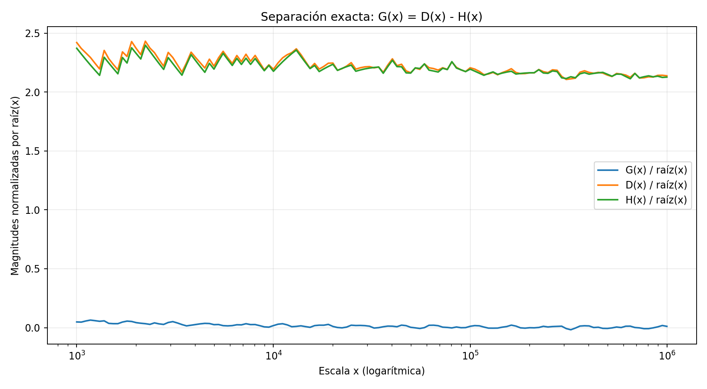

# LAB–HC–01 · De la generación heredada a una cota sobre sumas de primos

**Fecha:** 21 de noviembre de 2026  
**Tipo:** laboratorio matemático reproducible  
**Continuidad:** R–01 / R–02 → R–03 → comparación técnica con el anuncio formal de Alpöge (20–21 de noviembre de 2026)  
**Estado:** identidades y estimación de corrección **demostradas**; controles computacionales **superados**; cota uniforme sobre la fluctuación restante **no derivada de la criba**.

## Resultado principal

La distinción entre referencias heredadas y referencias nuevas da una **separación exacta** de la suma ponderada de von Mangoldt. Al cortar en los primos `p ≤ √x`, la corrección conocida de la parte heredada satisface

\[
\boxed{G(x)=D(x)-H(x),\qquad H(x)=2\vartheta(\sqrt x)+O(x^{1/3})=(2+o(1))\sqrt x.}\tag{HC.1}
\]

Se usa \(\vartheta(u)=\sum_{p\le u}\log p\); la última equivalencia emplea el **teorema clásico de los números primos** y no emplea RH. La identidad y la cota separan una corrección estructural de escala \(\sqrt x\) de una discrepancia de distribución aún por controlar. **Esta proposición es una consecuencia de identidades clásicas; no se reivindica novedad de prioridad ni una nueva demostración de RH.**

## 1. Definiciones y contrato

Para \(x\ge4\), sea \(z=\sqrt x\), \(S_x=\{p\text{ primo}:p\le z\}\), \(\gamma\) la constante de Euler y \(\Lambda(n)\) la función de von Mangoldt. Defínanse

\[
T(x)=\sum_{n\le x}\Lambda(n)\left(\frac{x}{n}-1\right),\qquad
G(x)=T(x)-x(\log x-1-\gamma),\tag{HC.2}
\]

\[
a(x)=\sum_{p\le z}\frac{\log p}{p-1},\qquad
K_p(x)=\max\{j\ge0:p^j\le x\},\tag{HC.3}
\]

\[
R(x)=\sum_{\sqrt x<p\le x}\log p\left(\frac{x}{p}-1\right),\qquad
D(x)=R(x)-x\bigl(\log x-1-\gamma-a(x)\bigr).\tag{HC.4}
\]

\(R\) solo contiene **primos nuevos** más allá de \(\sqrt x\): sus potencias superiores no caben bajo \(x\). Por tanto, la separación heredado/nuevo no descarta términos.

## 2. Proposición A — partición exacta y corrección positiva

Sea

\[
H(x)=\sum_{p\le\sqrt x}\log p
\left[K_p(x)+\frac{x}{p^{K_p(x)}(p-1)}\right].\tag{HC.5}
\]

Entonces \(H(x)\ge0\), \(T(x)=xa(x)-H(x)+R(x)\), y se verifica (HC.1) en su parte exacta: \(G=D-H\).

**Prueba.** Para cada primo heredado \(p\), con \(K=K_p(x)\), la suma de sus potencias es

\[
\begin{aligned}
\sum_{1\le j\le K}\log p\Bigl(\frac{x}{p^j}-1\Bigr)
&=\log p\left(\frac{x}{p-1}(1-p^{-K})-K\right)\\
&=\frac{x\log p}{p-1}
-\log p\left(K+\frac{x}{p^K(p-1)}\right).
\end{aligned}
\]

Sumar en \(p\le\sqrt x\), agregar los primos \(p>\sqrt x\) y restar el centrado de (HC.2) prueba la identidad. Todos los términos de (HC.5) son positivos. □

**Transferencia unilateral inmediata:** si se construye sin circularidad una estimación \(D(x)\le C\sqrt x\) uniforme para todo \(x\) suficientemente grande, entonces \(G(x)\le C\sqrt x\), porque \(H\ge0\). Esta implicación **es condicional**: el laboratorio no establece su hipótesis.

## 3. Proposición B — la corrección heredada tiene escala \(2\sqrt x\)

Para \(x\ge4\),

\[
\boxed{H(x)=2\vartheta(\sqrt x)+O(x^{1/3}).}\tag{HC.6}
\]

En particular, de \(\vartheta(u)\sim u\), se sigue \(H(x)/\sqrt x\to2\). Basta la cota elemental de Chebyshev \(\vartheta(u)=O(u)\) para demostrar el error en (HC.6).

**Prueba.** Se separan los dos sumandos de (HC.5):

\[
H(x)=\underbrace{\sum_{p\le z}K_p(x)\log p}_{H_1(x)}+
\underbrace{x\sum_{p\le z}\frac{\log p}{p^{K_p(x)}(p-1)}}_{H_2(x)}.
\]

Como todo \(p\le\sqrt x\) cumple \(p^2\le x\), se cuentan las potencias de orden 1 y 2, y luego las de orden al menos 3:

\[
H_1(x)=2\vartheta(z)+\sum_{j\ge3}\vartheta(x^{1/j}).
\]

La última suma está acotada por \(O(x^{1/3})\): con Chebyshev, el término \(j=3\) vale \(O(x^{1/3})\), y los \(O(\log x)\) términos siguientes están acotados individualmente por \(O(x^{1/4})\); su suma también es \(O(x^{1/3})\).

Para \(H_2\), separar en \(p\le x^{1/3}\) y \(x^{1/3}<p\le z\). En la primera parte, la maximalidad de \(K\) da \(x/p^K<p\), luego cada término es menor que \(2\log p\), y su suma es \(O(x^{1/3})\). En la segunda parte \(K=2\); por \(p/(p-1)\le2\),

\[
0\le H_2^{\mathrm{alto}}(x)\le 2x\sum_{p>x^{1/3}}\frac{\log p}{p^3}=O(x^{1/3}),
\]

utilizando sumación por partes y \(\vartheta(t)=O(t)\). Por tanto, \(H_2=O(x^{1/3})\), que junto con la expresión de \(H_1\) demuestra (HC.6). □

**Corolario de escala:** con las definiciones (HC.2)–(HC.5),

\[
D(x)=G(x)+2\vartheta(\sqrt x)+O(x^{1/3})
     =G(x)+(2+o(1))\sqrt x.
\tag{HC.7}
\]

En consecuencia, \(D(x)=O(\sqrt x)\) **si y solo si** \(G(x)=O(\sqrt x)\). La equivalencia es entre **dos funciones de discrepancia especificadas**; no se atribuye por sí sola a ninguna de ellas una estimación uniforme ni se confunde con una demostración de RH/GRH. La construcción sobre caracteres requeriría además controlar cancelaciones y positividad específicas de los caracteres.

## 4. Puente exacto hacia la discrepancia de criba R–01/R–03

Para \(S_x\), defínanse \(M=\prod_{p\le z}p\), \(\delta=\prod_{p\le z}(1-p^{-1})\),
\(A(t)=\#\{1\le n\le t:\gcd(n,M)=1\}\), y \(E(t)=A(t)-\delta t\).

Al completar la criba hasta \(z=\sqrt x\), se cumple la identidad de Legendre:

\[
\boxed{A(t)=1+\pi(t)-\pi(z)\quad(z\le t\le x).}\tag{HC.8}
\]

Se tiene también la identidad de herencia R–01, \(E_{S\cup\{p\}}(t)=E_S(t)-E_S(t/p)\). Para \(w_x(t)=\log t(x/t-1)\), decreciente en \([z,x]\) para \(z\ge3\), la suma de referencias nuevas admite la forma de Stieltjes:

\[
R(x)=\int_{(z,x]}w_x(t)\,dA(t),\tag{HC.9}
\]

\[
R(x)=\delta\int_z^x w_x(t)\,dt
\; - w_x(z)E(z) -\int_z^x E(t)w'_x(t)\,dt.\tag{HC.10}
\]

La integral elemental del primer término es

\[
\int_z^x w_x(t)\,dt=
\frac{x}{2}(\log^2x-\log^2z)-x\log x+x+z\log z-z.
\]

Por tanto, si se denota

\[
\begin{aligned}
K(x)&=\delta\int_z^xw_x(t)dt-x(\log x-1-\gamma-a(x)),\\
W(x)&=-w_x(z)E(z)-\int_z^xE(t)w'_x(t)dt,
\end{aligned}
\tag{HC.11}
\]

entonces **exactamente** \(D(x)=K(x)+W(x)\).

**Condición cuantitativa pendiente.** Un certificado \(W(x)\le -K(x)+C\sqrt x\), uniforme en \(x\), sería suficiente para obtener \(G(x)\le C\sqrt x\) sin un análisis separado de la parte heredada. Si se busca control bilateral, la condición es \(|K(x)+W(x)|\le C\sqrt x\).

La cota trivial de inclusión–exclusión \(|E(t)|<2^{\pi(z)-1}\) da, usando la monotonía de \(w_x\),

\[
\left|R(x)-\delta\int_z^xw_x(t)dt\right|
\le 2\sup_{z\le t\le x}|E(t)|\,w_x(z)
<2^{\pi(z)}w_x(z).
\tag{HC.12}
\]

Al crecer \(z=\sqrt x\), este límite resulta demasiado grande. También la energía exacta de R–01, \(\frac1M\int_0^M E(t)^2dt=2^{\pi(z)}\delta/12\), se refiere a períodos completos muy extensos. Por sí sola no aporta la compensación en las ventanas parciales \([z,x]\) requerida por (HC.11).

## 5. Controles reproducibles

`laboratorio.py` (solo biblioteca estándar) realiza:

- **1.340 comprobaciones racionales exactas** de la identidad por potencia prima de la Proposición A.
- Verificación de la energía por período con `fractions.Fraction`, para \(S=\{2\},\{2,3\},\{2,3,5\},\{2,3,5,7\}\): respectivamente \(1/12,1/9,8/45,32/105\).
- Generación de los primos hasta \(10^6\) (\(\pi(10^6)=78.498\)) y recuento **independiente** de sobrevivientes por criba de múltiplos para verificar (HC.8).
- Suma directa de potencias primas y verificación numérica de \(G=D-H\), el signo \(H\ge0\) y la cota inferior \(H\ge2\vartheta(\sqrt x)\) en cuatro escalas y cuatro umbrales.

| x | \(\pi(x)\) | \(H(x)/\sqrt x\) | \(G(x)/\sqrt x\) | \(D(x)/\sqrt x\) | \(E_{S_x}(x)\) |
|---:|---:|---:|---:|---:|---:|
| 1.000 | 168 | 2,371725 | 0,048408 | 2,420137 | 5,147849 |
| 10.000 | 1.229 | 2,176077 | 0,017493 | 2,193570 | 1,827095 |
| 100.000 | 9.592 | 2,194374 | 0,011610 | 2,205984 | −123,938697 |
| 1.000.000 | 78.498 | 2,126806 | 0,011040 | 2,137846 | −2.634,263507 |

`graficos.py` genera otros **130 puntos** en \([10^3,10^6]\) y la figura `comparacion_escalas.png`.



En estos 130 puntos \(\max |G(x)|/\sqrt x\approx0,064203\). Es una descripción de esta muestra finita. No se extrapola a todos los enteros ni a todos los valores reales.

## 6. Interpretación y dictamen

1. **Demostrado:** partición exacta de la suma ponderada, fórmula positiva de la herencia, identificación de su término principal \(2\vartheta(\sqrt x)\) y puente de Stieltjes desde la discrepancia de criba a la variable de la suma ponderada.
2. **Reproducido:** Ley de energía finita, generación de primos hasta \(10^6\), separación y compensación numérica de las dos componentes.
3. **Pendiente:** una estimación de cancelación entre \(K(x)\) y \(W(x)\) obtenida directamente de las relaciones de herencia con constantes uniformes. El cálculo exacto de la criba, incluso con un costo algorítmico documentado, no implica esa cota.
4. **Comparación externa:** el argumento de Alpöge obtiene resultados sobre ceros mediante una maquinaria aritmética y automórfica formalizada en Lean. El laboratorio presente **no reproduce esa prueba** ni identifica la corrección de \(2\sqrt x\) con los levantamientos theta; el exponente semejante tiene aquí una procedencia distinta.

### Siguiente obligación técnica falsable

Proponer una desigualdad de ventana que controle \(W(x)+K(x)\) sin introducir como hipótesis RH o una condición equivalente. Someterla al menos a: (i) escalas fuera del rango de calibración, (ii) versiones con caracteres de Dirichlet, (iii) variantes del corte \(z=x^{\alpha}\), y (iv) controles que preserven identidades de herencia pero rompan hipótesis de cancelación. La prueba o un contraejemplo determinarían si esta representación aporta capacidad nueva de estimación.

## Ejecución

```bash
python laboratorio.py
python graficos.py  # opcional: requiere matplotlib
```

Archivos: `laboratorio.py`, `graficos.py`, `resultados.csv`, `resumen.csv`, `serie_normalizada.csv`, `comparacion_escalas.png`.

## Fuentes y procedencia

- [R–01/R–02, texto público](https://github.com/EndlessMonkeyProyect/programa-geometria-relacional/blob/main/2026-11-17_escalas_relacionales_riemann/FORMALIZACION_R01_R02_ES.md), §§2, 5 y 6.
- [R–03, herencia espectral](https://github.com/EndlessMonkeyProyect/programa-geometria-relacional/blob/main/2026-11-17_escalas_relacionales_riemann/2026-11-18_r03_herencia_espectral/R03_HERENCIA_Y_LOCALIZACION_ES.md).
- [L. Alpöge, anuncio y esquema](https://alpo.ge/remark.pdf), 20-XI-2026.
- [Lean/Mathlib, certificación del teorema](https://leanprover-community.github.io/blog/posts/riemann-hypothesis/), 21-XI-2026.
- Legendre, Chebyshev y el teorema clásico de los números primos, para los hechos señalados como conocidos.

**Endless Monkey Project / Relational Geometry Program**
