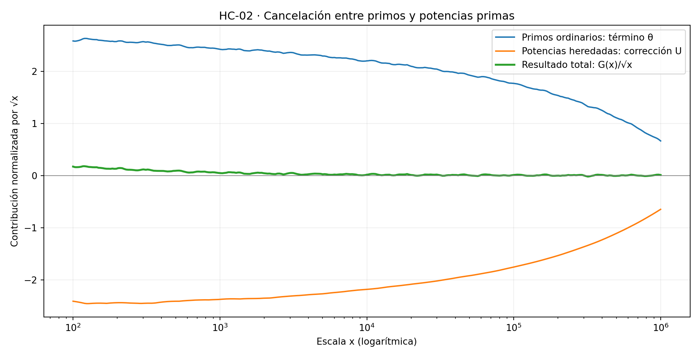
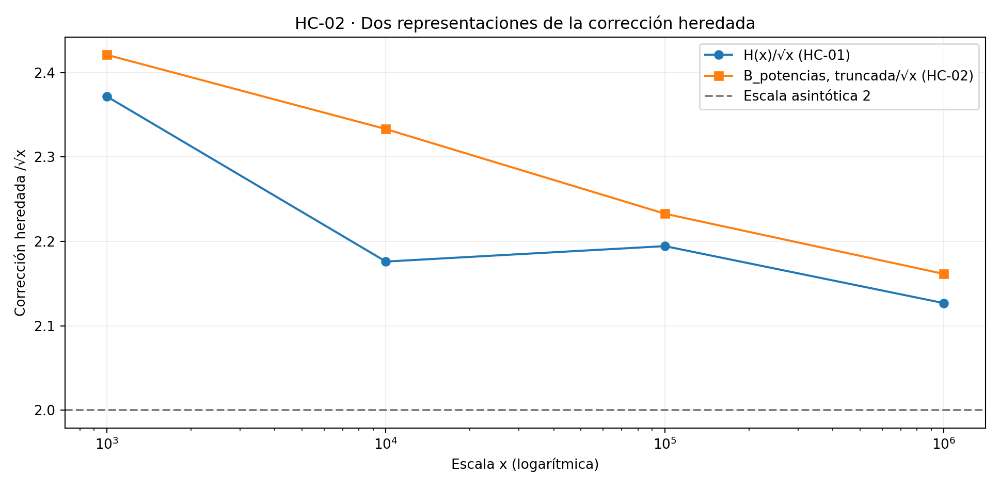

# LAB–HC–02 · Herencia de potencias primas y certificado de transferencia entre escalas

**Fecha:** 21 de noviembre de 2026  
**Versión:** 1.0 · expediente para revisión matemática  
**Continuidad:** R–01/R–02 → R–03 → LAB–HC–01 → LAB–HC–02  
**Estado:** desigualdad uniforme para la componente heredada **demostrada**; identidad de transferencia **demostrada**; resultados numéricos **reproducidos**; cota de orden raíz cuadrada para toda la discrepancia **pendiente**.

## Resumen y resultado central

La suma ponderada de von Mangoldt de HC–01 puede descomponerse exactamente entre primos ordinarios y potencias primas heredadas. La segunda contribución es positiva antes de cambiar de signo y queda acotada uniformemente por una constante explícita multiplicada por \(\sqrt{x}\), sin suponer la hipótesis de Riemann. Para todas las escalas reales \(4\le x\le Y\) resulta una desigualdad unilateral que separa la parte ya certificada del término que exige una estimación aritmética adicional:

\[
\boxed{
\frac{x}{Y}G(Y)-x\int_x^Y\frac{\vartheta(t)-t}{t^2}\,dt-C\sqrt{x}
\;\le\;G(x)\;\le\;
\frac{x}{Y}G(Y)-x\int_x^Y\frac{\vartheta(t)-t}{t^2}\,dt,
\quad C=8\log 2+\frac{48}{e}<24.
}\tag{HC02.1}
\]

Esta desigualdad **sí es incondicional**. Su anchura es menor que \(24\sqrt{x}\), pero su centro contiene todavía la desviación acumulada de los **primos ordinarios**, que no está acotada aquí por \(O(\sqrt{x})\). Este resultado permite precisar exactamente qué cuantificador y qué estimación quedan pendientes para trasladar el mecanismo generativo hacia una cota sobre todos los primos.

La construcción es una presentación y especialización del repertorio clásico de sumación de Abel, funciones de Chebyshev y cota elemental de Chebyshev, en el lenguaje de herencia del laboratorio; **no se reivindica originalidad de esos instrumentos ni una nueva prueba de RH**.

## 1. Definiciones y contrato

Para \(x\ge1\), sean

\[
\Lambda(n)=\begin{cases}\log p,&n=p^k,\quad k\ge1,\\0,&\text{en otro caso},\end{cases}
\quad
\vartheta(t)=\sum_{p\le t}\log p,
\quad
\psi(t)=\sum_{n\le t}\Lambda(n),
\quad
U(t)=\psi(t)-\vartheta(t)=\sum_{k\ge2}\vartheta(t^{1/k}).
\]

En cada \(t\) la suma en \(k\) es finita. La descomposición \(\psi=\vartheta+U\) distingue las referencias primas ordinarias de las potencias derivadas de una referencia previamente constituida.

Se recupera el observable de HC–01:

\[
T(x)=\sum_{n\le x}\Lambda(n)\left(\frac{x}{n}-1\right),\qquad
G(x)=T(x)-x(\log x-1-\gamma), \tag{HC02.2}
\]

con \(\gamma\) constante de Euler.

## 2. Proposición A · Identidad exacta de transferencia finita

**Enunciado.** Para todo \(1\le x\le Y\),

\[
\boxed{G(x)=\frac{x}{Y}G(Y)-x\int_x^Y\frac{\vartheta(t)-t}{t^2}\,dt
-x\int_x^Y\frac{U(t)}{t^2}\,dt.}\tag{HC02.3}
\]

**Demostración.** La integración de Stieltjes, con \(\psi\) como función escalonada acumulada, da

\[
T(x)=\int_{1^-}^{x}\left(\frac{x}{t}-1\right)d\psi(t)
=x\int_1^x\frac{\psi(t)}{t^2}\,dt.
\]

En consecuencia,

\[
\frac{G(x)}x=\int_1^x\frac{\psi(t)-t}{t^2}\,dt+1+\gamma.
\]

Restar los valores de la última igualdad en \(x\) y \(Y\), y utilizar \(\psi=\vartheta+U\), produce (HC02.3). \(\square\)

**Signo exacto:** \(U(t)\ge0\), por lo que el último término de (HC02.3) es siempre no positivo. La herencia de potencias contribuye una corrección unilateral, no un término de signo desconocido.

## 3. Proposición B · Desigualdad uniforme con constante explícita

**Enunciado.** Para \(t\ge4\),

\[
0\le U(t)\le\left(4\log2+\frac{24}{e}\right)\sqrt{t}.\tag{HC02.4}
\]

Por tanto, para todo \(4\le x\le Y\),

\[
0\le x\int_x^Y\frac{U(t)}{t^2}\,dt
\le\left(8\log2+\frac{48}{e}\right)\sqrt{x}<24\sqrt{x}.\tag{HC02.5}
\]

La combinación de (HC02.3) y (HC02.5) demuestra (HC02.1).

**Demostración.** La desigualdad elemental de Chebyshev

\[
\vartheta(u)\le4(\log2)\,u\qquad(u\ge1)\tag{HC02.6}
\]

se obtiene separando los primos en intervalos diádicos \((2^j,2^{j+1}]\): el producto de los primos de cada intervalo divide el coeficiente binomial \(\binom{2^{j+1}}{2^j}\le2^{2^{j+1}}\), y la suma de las cotas por intervalos domina \(\vartheta(u)\).

Por (HC02.6), para \(t\ge4\),

\[
U(t)\le4(\log2)\left(\sqrt t+t^{1/3}\log_2t\right).
\]

La función \(t^{-1/6}\log_2t\) alcanza su máximo global en \(t=e^6\), donde vale \(6/(e\log2)\). Así se obtiene (HC02.4). Finalmente, integrar \(t^{-3/2}\) sobre \([x,Y]\) y extender la cota hasta infinito da (HC02.5). \(\square\)

**Alcance matemático.** La cota depende únicamente de la desigualdad clásica de Chebyshev y del hecho de que \(U\) enumera potencias de exponentes \(k\ge2\). Se mantiene para todo \(x\) real \(\ge4\), sin calibración empírica, sin hipótesis de Riemann y sin conocimiento previo de las posiciones de los ceros.

## 4. Corolario · Referencia global y estimación todavía necesaria

La versión efectiva clásica del teorema de los números primos garantiza la convergencia absoluta de

\[
\int_1^\infty\frac{\psi(t)-t}{t^2}\,dt=-1-\gamma.
\]

Pasando al límite \(Y\to\infty\) en (HC02.3), se obtiene

\[
\boxed{G(x)=-x\int_x^\infty\frac{\vartheta(t)-t}{t^2}\,dt-B(x),\qquad
B(x)=x\int_x^\infty\frac{U(t)}{t^2}\,dt.}\tag{HC02.7}
\]

La Proposición B prueba, **incondicionalmente**, que

\[
\boxed{0\le B(x)\le C\sqrt{x},\quad C<24.}\tag{HC02.8}
\]

El teorema clásico de los números primos también implica \(U(t)=\sqrt t+o(\sqrt t)\): el término \(k=2\) es \(\vartheta(\sqrt t)\sim\sqrt t\), mientras que los demás son \(O(t^{1/3}\log t)\). Usando (HC02.4) como mayorante integrable en el cambio de variable \(t=xu\), se concluye

\[
\boxed{B(x)=(2+o(1))\sqrt{x}.}\tag{HC02.9}
\]

El **término que resta controlar** es la integral firmada de \(\vartheta(t)-t\). Una condición suficiente, de carácter todavía abierto al nivel de precisión exigido, es

\[
\left|x\int_x^\infty\frac{\vartheta(t)-t}{t^2}\,dt\right|
\le C_{\varepsilon}x^{1/2+\varepsilon}
\quad\text{para todo }x\ge x_0(\varepsilon).
\tag{HC02.10}
\]

De (HC02.7)–(HC02.8), (HC02.10) implicaría inmediatamente \(G(x)=O_\varepsilon(x^{1/2+\varepsilon})\). El laboratorio demuestra la **implicación**, no su hipótesis. La estimación (HC02.10) es una condición fuerte sobre la distribución global de los primos; no se desprende de la mera generación por criba.

## 5. Proposición C · Conexión exacta con la herencia de HC–01

Para \(x\ge4\), sea \(z=\sqrt x\), \(K_p(x)=\lfloor\log_p x\rfloor\) definido por \(p^{K_p}\le x<p^{K_p+1}\), y

\[
H(x)=\sum_{p\le z}\log p\left[K_p(x)+\frac{x}{p^{K_p(x)}(p-1)}\right].
\]

Por Tonelli, la contribución no negativa \(B(x)\) de (HC02.7) tiene forma de suma explícita:

\[
B(x)=\sum_{p}\log p\sum_{k\ge2}\min\left(1,\frac{x}{p^k}\right).\tag{HC02.11}
\]

Separar los casos \(p\le z\) y \(p>z\), completando las series geométricas, produce

\[
\boxed{B(x)=H(x)-\vartheta(z)+x\sum_{p>z}\frac{\log p}{p(p-1)}.}\tag{HC02.12}
\]

Esta es una correspondencia exacta entre la corrección positiva de HC–01 y la corrección integral de HC–02. El segundo sumando representa la frontera de promoción: primos que todavía son referencias nuevas para la criba hasta \(\sqrt x\), cuyas potencias cuadráticas superan \(x\).

Definiendo \(D(x)=G(x)+H(x)\), resulta otra forma exacta:

\[
\boxed{D(x)=-x\int_x^\infty\frac{\vartheta(t)-t}{t^2}\,dt
+\vartheta(\sqrt{x})-x\sum_{p>\sqrt x}\frac{\log p}{p(p-1)}.}\tag{HC02.13}
\]

La corrección heredada \(H(x)=(2+o(1))\sqrt x\) ya estaba demostrada en HC–01; (HC02.9) y (HC02.12) indican que las dos representaciones tienen el mismo término asintótico dominante. **Su diferencia es \(o(\sqrt x)\)**, sin que de ello se obtenga una cota raíz cuadrada para toda la discrepancia \(G\).

**Test de promoción exacta.** Al cruzar \(x=p^2\), el primo \(p\) pasa de la parte nueva a la heredada. Los saltos de \(D\) y \(H\) coinciden:

\[
\Delta D=\Delta H=\log p\left(2+\frac{1}{p-1}\right),\qquad\Delta G=0.
\tag{HC02.14}
\]

En esa transición \(G\) es continuo: un cambio de referencia redistribuye contribuciones sin crear diferencia global.

## 6. Laboratorio reproducible y controles

**Ejecución:** `python laboratorio_hc02.py` desde esta carpeta; `python graficos_hc02.py` crea las dos figuras opcionales (requiere `matplotlib`). Bibliotecas necesarias para los cálculos: solamente estándar de Python.

El código genera los primos hasta \(Y=2\,000\,000\), calcula las sumas de von Mangoldt para los 148.933 primos en ese intervalo, registra 302 potencias primas con exponente \(\ge2\), y prueba la identidad (HC02.3) en 307 puntos de \([100,10^6]\). Los 1.352 controles de coeficientes racionales y promoción de referencias se ejecutan con `fractions.Fraction`, independientemente de redondeos logarítmicos.

| Componente | Resultado | Alcance |
|---|---:|---|
| Identidades racionales y promociones | **1.352** | Igualdades exactas en casos finitos |
| Escalas numéricas | **307** | Rango \(100\) a \(10^6\) |
| Mayor error absoluto de reconstrucción (HC02.3) | **3,07·10⁻⁹** | Doble precisión, no cota rigurosa de máquina |
| Máximo observado de \(x\int_x^Y U(t)t^{-2}dt/\sqrt x\) | **2,4545** | Solo muestra; cota teórica universal \(<24\) |
| Máximo observado de \(|G(x)|/\sqrt x\) | **0,1796** | Solo muestra; no extrapolable |
| Controles de frontera (HC02.12) | **4** | Separación por primos hasta \(\sqrt x\) |

La comparación entre las dos correcciones heredadas produce:

| \(x\) | \(H(x)/\sqrt{x}\) | \(B_{\le Y}(x)/\sqrt{x}\) | \(G(x)/\sqrt{x}\) |
|---:|---:|---:|---:|
| 1.000 | 2,3717 | 2,4211 | 0,0484 |
| 10.000 | 2,1761 | 2,3331 | 0,0175 |
| 100.000 | 2,1944 | 2,2328 | 0,0116 |
| 1.000.000 | 2,1268 | 2,1614 | 0,0110 |

Aquí \(B_{\le Y}\) suma exactamente las contribuciones de las **referencias primas** \(p\le Y\), incluyendo todas sus potencias mediante progresiones geométricas. La diferencia positiva \(B-B_{\le Y}\) es la cola de primos mayores que \(Y\) y satisface la cota elemental explícita

\[
0\le B(x)-B_{\le Y}(x)
\le x\left(\frac{\log Y}{Y-1}+\log\frac{Y}{Y-1}\right)\qquad (Y\ge2,\;Y\ge\sqrt x).\tag{HC02.15}
\]

La cota (HC02.15) procede de comparar la cola prima con la cola sobre todos los enteros y acotarla mediante una integral decreciente. No es una estimación de RH.

## 7. Control adversarial · Por qué la cota de herencia no basta por sí sola

Considérese **solo como modelo analítico de control**, y no como una función de conteo de primos, la perturbación \(\vartheta_*(t)=t+t^{3/4}\), manteniendo \(U_*(t)=U(t)\). Se define el residuo correspondiente mediante el mismo operador integral que aparece en (HC02.7):

\[
G_*(x)=-x\int_x^\infty\frac{\vartheta_*(t)-t}{t^2}\,dt-B(x)
=-4x^{3/4}-B(x).
\tag{HC02.16}
\]

La corrección heredada sigue cumpliendo \(0\le B(x)<24\sqrt x\), mientras que \(|G_*(x)|/\sqrt x\to\infty\). Este control confirma una distinción lógica: la cota de las potencias heredadas es estable aunque el término de distribución de referencias nuevas sea excesivo. El modelo no pretende conservar la aritmética de los primos verdaderos y no constituye un contraejemplo a RH; se utiliza exclusivamente para probar la necesidad de controlar el término de \(\vartheta\).

## 8. Dictamen técnico y próximo objetivo

**Demostrado:** (HC02.1), (HC02.3)–(HC02.5), (HC02.7)–(HC02.9), (HC02.11)–(HC02.15), con dependencia explícita de teoremas clásicos cuando corresponde.

**Reproducido:** igualdad finita entre la discrepancia total y sus componentes, promociones de referencias, aproximación de dos representaciones del término heredado y signo de la corrección.

**Pivote pendiente:** establecer una cota de cancelación para la integral firmada de \(\vartheta(t)-t\), o para un observable alternativo efectivamente equivalente, empleando una propiedad adicional de la aritmética de los primos que no sea simplemente la identidad de herencia. La cota de la componente heredada no proporciona, por sí sola, una cota para esa integral.

La descomposición precisa una distinción útil: **la estructura generativa controla exactamente el costo espectral de las potencias heredadas; la localización de los ceros exige todavía un control global sobre la distribución de las referencias primas nuevas.** Esa es la diferencia cuantitativa que debería examinar el siguiente laboratorio o un revisor externo.

### Procedencia

- R–01/R–02, identidades de herencia y energía periódica (17-XI-2026).
- R–03, Mellin de discrepancia de criba y conservación de ceros (18-XI-2026).
- LAB–HC–01, separación \(G=D-H\), cota \(H=2\vartheta(\sqrt x)+O(x^{1/3})\) (21-XI-2026).
- Identidades clásicas: sumación de Abel/Stieltjes, desigualdad elemental de Chebyshev, teorema clásico de los números primos y expansión de Laurent de \(\zeta\) en \(s=1\).

**Endless Monkey Project / Relational Geometry Program**
