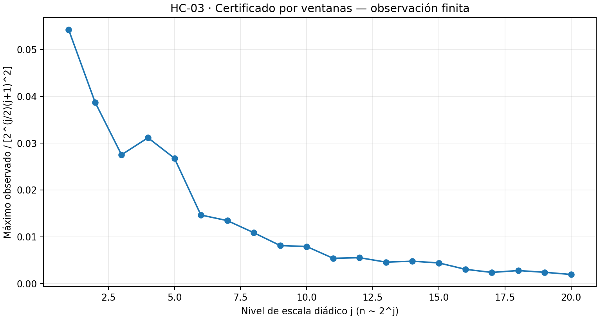
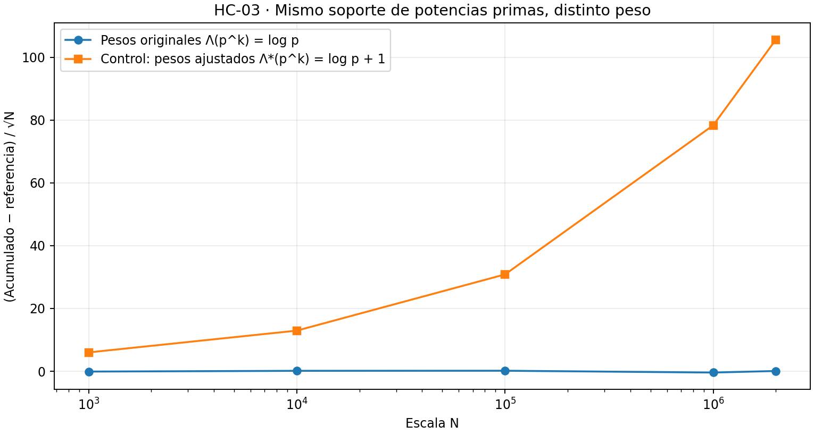

# HC–03 · Diferencia mínima, aparición de referencias y acumulación aritmética

**Informe técnico de laboratorio — 21 de noviembre de 2026 · versión 1.0 para revisión**  
**Continuidad:** R–01/R–02 → R–03 → HC–01 → HC–02 → HC–03  
**Estado:** identidades de herencia y reconstrucción **demostradas**; corrección uniforme **demostrada**; ensayos finitos **reproducidos**; desigualdad global para los primos nuevos **abierta**.  
**Firma:** Endless Monkey Project / Relational Geometry Program

## Resumen

El paso de una escala entera a la siguiente permite localizar exactamente una nueva contribución a una suma ponderada de primos. El peso de rampa \((x/n-1)\) incorpora cada contribución desde valor cero cuando la referencia entra en la escala. La segunda diferencia del observable recupera \(\Lambda(n)/n\); una suma ponderada de esas diferencias reconstruye \(\psi(N)-N\) con una **corrección universal entre cero y \(1/8\)**. Esta formulación es consecuencia de identidades elementales de diferencias finitas y convexidad; identifica la brecha cuantitativa sin establecer una nueva prueba de la hipótesis de Riemann (RH).

El laboratorio comprueba también la generación por cribado, la herencia en tres caracteres de Dirichlet, un certificado por bloques diádicos equivalente (en el orden asintótico) al criterio clásico de RH y un control de pesos que distingue genealogía de amplitud aritmética. Las verificaciones se realizaron hasta \(N=2\,000\,000\).

## 1. Contrato conceptual y objeto matemático

La conceptualización incorpora únicamente estados y operaciones afirmativas:

- **Referencia nueva:** un primo \(p\) se reconoce al no estar cubierto por divisibilidad de las referencias primas precedentes pertinentes.
- **Herencia:** sus potencias \(p^2,p^3,\ldots\) conservan una etiqueta de procedencia \(p\).
- **Acumulación:** cada entrada aporta \(\log p\) a la suma aritmética de su escala.
- **Comparación:** una regla de medición contrasta la suma acumulada con una referencia \(N\). El signo de esa comparación es un dato matemático, no una clase de entidad o mecanismo de producción.

Sea la función de von Mangoldt

\[
\Lambda(n)=\begin{cases}
\log p,& n=p^k,\quad p\text{ primo},\ k\geq1,\\
0,&\text{en otro caso},
\end{cases}
\qquad
\psi(x)=\sum_{n\leq x}\Lambda(n),\qquad
\vartheta(x)=\sum_{p\leq x}\log p.
\]

La descomposición de HC–02 es \(\psi=\vartheta+U\), donde \(U(x)=\sum_{k\ge2}\vartheta(x^{1/k})\) contiene las contribuciones heredadas de las potencias.

Defínanse, para \(x\geq1\),

\[
T(x)=\sum_{n\le x}\Lambda(n)\left(\frac xn-1\right),\qquad
G(x)=T(x)-x(\log x-1-\gamma).
\tag{HC03.1}
\]

La extensión por continuidad \(T(0)=0\) es admisible, y \(T(1)=0\). Para una función \(f\) sobre los enteros se define \(\Delta^2 f(n)=f(n+1)-2f(n)+f(n-1)\).

## 2. Proposición A — Recuperación local exacta

**Enunciado.** Para cada entero \(n\ge2\),

\[
\boxed{\Delta^2T(n)=\frac{\Lambda(n)}n.}\tag{HC03.2}
\]

**Demostración.** Cada sumando \(\Lambda(m)(x/m-1)\) es nulo para \(x=m\), lineal para \(x\ge m\) y ausente para \(x<m\). Su cambio de pendiente en \(n=m\) tiene magnitud \(\Lambda(m)/m\). Al aplicar \(\Delta^2\) sobre la suma completa, todos los términos lineales anteriores se cancelan algebraicamente y sólo aparece el que ingresa en \(n\). \(\square\)

La identidad permite recuperar \(\Lambda(n)\) mediante \(n\Delta^2T(n)\). Como \(T(0)=T(1)=0\), también se obtiene la reconstrucción finita exacta:

\[
\boxed{T(N)=\sum_{n=2}^{N-1}(N-n)\Delta^2T(n),\quad N\ge2.}\tag{HC03.3}
\]

**Demostración.** Sustituir (HC03.2) en el miembro derecho: \(\sum_{n<N}(N-n)\Lambda(n)/n\) coincide término a término con (HC03.1). \(\square\)

Para un primo nuevo \(p\), el valor recuperado es \(\log p/p\); para la potencia heredada \(p^k\), es \(\log p/p^k\). La interpretación separa la aparición de un generador de las sucesivas contribuciones de ese mismo generador.

## 3. Proposición B — Reconstrucción global con corrección universal menor que 1/8

La parte de referencia del observable centrado es \(x\log x-(1+\gamma)x\). Al tener segunda diferencia nula la parte lineal, (HC03.2) da

\[
\Delta^2G(n)=\frac{\Lambda(n)}n-c_n,\quad
c_n=(n+1)\log(n+1)-2n\log n+(n-1)\log(n-1).
\tag{HC03.4}
\]

Escribamos \(\rho_n=c_n-1/n\). **Se demuestra el límite explícito**

\[
\boxed{0<\rho_n\le\frac{1}{6n(n^2-1)}\quad(n\ge2).}\tag{HC03.5}
\]

**Demostración.** Aplicando dos veces el teorema fundamental del cálculo a \(f(x)=x\log x\), cuya derivada segunda es \(f''(x)=1/x\),

\[
c_n=\int_{-1}^{1}\frac{1-|t|}{n+t}\,dt.
\]

Usando la simetría del peso y \(\int_{-1}^1(1-|t|)\,dt=1\),

\[
\rho_n=\frac2n\int_0^1(1-t)\frac{t^2}{n^2-t^2}\,dt.
\]

El integrando es positivo. Además \(n^2-t^2\ge n^2-1\), y \(\int_0^1(1-t)t^2\,dt=1/12\); por tanto \(\rho_n\le 1/[6n(n^2-1)]\). \(\square\)

Defínanse

\[
J_N=\sum_{n=2}^N n\Delta^2G(n),\qquad
R_N=\sum_{n=2}^N n\rho_n.
\]

La igualdad \(n\Delta^2G(n)=\Lambda(n)-1-n\rho_n\) produce

\[
\boxed{\psi(N)-N=J_N-1+R_N.}\tag{HC03.6}
\]

Y por (HC03.5),

\[
0<R_N\le\frac16\sum_{n=2}^{\infty}\frac{1}{n^2-1}
=\frac16\cdot\frac34=\boxed{\frac18}.
\tag{HC03.7}
\]

La desigualdad estricta vale para cada \(N\) finito. **Resultado:** el acumulado de la diferencia mínima centrada contiene exactamente el error global de Chebyshev, hasta una corrección uniforme inferior a \(1/8\) y una unidad fija de condición inicial. En otras palabras, el tratamiento local de la referencia introduce un costo **acotado de forma universal** al reconstruir el error global. Esta es una identidad elemental demostrada, no una cota superior para el tamaño de \(\psi(N)-N\).

## 4. Proposición C — Reconocimiento constructivo por herencia

Para \(X\ge4\), sea \(z=\lfloor\sqrt X\rfloor\) y \(S_z=\{p\text{ primo}:p\le z\}\). El conjunto de enteros \(n\) con \(2\le n\le X\) que no son divisibles por ningún elemento de \(S_z\) coincide exactamente con los primos \(z<p\le X\).

**Demostración.** Un número compuesto \(n\le X\) tiene un factor primo \(p\le\sqrt n\le\sqrt X\) y, en consecuencia, queda cubierto por una referencia de \(S_z\). Cada primo mayor que \(z\) permanece descubierto. \(\square\)

Esta prueba afirma un mecanismo generativo clásico y exacto, y además da la identidad ponderada

\[
\boxed{\vartheta(X)=\vartheta(z)+
\sum_{\substack{2\le n\le X\\ (n,\prod_{p\le z}p)=1}}\log n.}
\tag{HC03.8}
\]

Es la interfaz explícita de la criba con \(\vartheta\), cuya discrepancia de distribución constituye el elemento aún no controlado por la mera herencia. El producto se usa sólo como notación matemática; el programa no necesita construirlo como entero en la implementación.

## 5. Proposición D — Extensión algebraica a caracteres

Para un carácter de Dirichlet \(\chi\), defínanse

\[
T_\chi(x)=\sum_{n\le x}\Lambda(n)\chi(n)\left(\frac xn-1\right),\quad
A_{S,\chi}(x)=\sum_{\substack{1\le n\le x\\ (n,M_S)=1}}\chi(n).
\]

Por linealidad y multiplicatividad completa,

\[
\boxed{\Delta^2T_\chi(n)=\Lambda(n)\chi(n)/n,}\tag{HC03.9}
\]

\[
\boxed{A_{S\cup\{p\},\chi}(x)
=A_{S,\chi}(x)-\chi(p)A_{S,\chi}(x/p),\quad p\notin S.}\tag{HC03.10}
\]

La segunda identidad se demuestra separando los enteros coprimos de \(M_S\) según su divisibilidad por \(p\); al escribir \(n=pm\), se obtiene \(\chi(n)=\chi(p)\chi(m)\). En la ecuación aparece un signo de sustracción porque se trata de inclusión-exclusión, una operación comparativa. No introduce una categoría ontológica de referencias negativas.

Además, \(U_\chi(x)=\sum_{k\ge2}\sum_{p^k\le x}\log(p)\chi(p)^k\) satisface \(|U_\chi(x)|\le U(x)\), de donde el resultado clásico de HC–02 asegura, para \(x\ge4\),

\[
\left|x\int_x^\infty\frac{U_\chi(t)}{t^2}\,dt\right|\le B(x)<24\sqrt{x}.
\tag{HC03.11}
\]

Esto identifica una transferencia válida de las identidades de herencia hacia los observables con caracteres utilizados en teoría analítica de números. La estimación para la contribución de primos ordinarios con caracteres queda pendiente.

## 6. Proposición E — Certificado por bloques y vínculo exacto con RH

Para cada \(j\ge1\) y \(2^j\le m<2^{j+1}\), defínase el acumulado local **como diferencia de dos mediciones positivas**:

\[
C_j(m)=\sum_{n=2^j}^{m}\Lambda(n)-(m-2^j+1),
\qquad B_j=\max_{2^j\le m<2^{j+1}}|C_j(m)|.
\tag{HC03.12}
\]

**Proposición.** El criterio clásico de RH \(\psi(x)-x=O(\sqrt{x}\log^2 x)\) equivale a la existencia de una constante \(K\) tal que

\[
\boxed{B_j\le K\,2^{j/2}(j+1)^2\quad\text{para todo }j\ge1.}
\tag{HC03.13}
\]

**Demostración.** Bajo el criterio clásico, \(C_j(m)=[\psi(m)-m]-[\psi(2^j-1)-(2^j-1)]\). Cada término satisface la cota crítica; sus dos tamaños son \(O(2^{j/2}(j+1)^2)\). Recíprocamente, para cualquier \(N\) se dividen los enteros \(2,\ldots,N\) en bloques diádicos completos y un último bloque parcial. La desigualdad triangular da

\[
|\psi(N)-N|\le1+\sum_{j=1}^{\lfloor\log_2N\rfloor}B_j
\le1+K\sum_{j=1}^{\lfloor\log_2N\rfloor}2^{j/2}(j+1)^2.
\]

La última suma es \(O(\sqrt N\log^2N)\) por comparación con una serie geométrica de razón \(2^{-1/2}\) tras factorizar el mayor término. \(\square\)

**Alcance:** (HC03.13) es un criterio equivalente escrito por ventanas de herencia, no una demostración independiente. Se convierte en resultado nuevo sobre RH únicamente al obtener una cota uniforme \(K\) mediante propiedades aritméticas demostradas, no por haberla observado en un intervalo finito.

## 7. Ensayos reproducibles

Se ejecutó `python laboratorio_hc03.py` con biblioteca estándar de Python. Se generaron **148.933 primos** hasta \(2\,000\,000\) y **302 potencias** con exponente al menos dos dentro de ese rango.

| Control | Resultado | Naturaleza |
|---|---:|---|
| Igualdades simbólicas por etiquetas \(\log p\) | 5.270 | Fracciones racionales exactas |
| Herencia con caracteres (módulos 3, 4 y 5) | 4.782 | Igualdades de enteros y fracciones exactas |
| Comprobaciones de pertenencia de la criba | 111.096 | Comparación exacta de conjuntos |
| Mayor error de \(\Delta^2T=\Lambda/n\) para \(2\le n\le10.000\) | \(4,51\cdot10^{-11}\) | Doble precisión |
| Mayor error de reconstrucción de \(\psi(N)-N\) en el barrido acumulado | \(1,18\cdot10^{-8}\) | Doble precisión |
| Corrección acumulada \(R_{2\,000\,000}\) | \(0,113705556\) | Cálculo aproximado, límite teórico \(<0,125\) |

| Escala \(N\) | \(\psi(N)-N\) | \((\psi(N)-N)/\sqrt N\) | \(R_N\) |
|---:|---:|---:|---:|
| 1.000 | −3,3191 | −0,1050 | 0,1135391 |
| 10.000 | 13,3967 | 0,1340 | 0,1136890 |
| 100.000 | 51,5640 | 0,1631 | 0,1137040 |
| 1.000.000 | −413,4025 | −0,4134 | 0,1137055 |
| 2.000.000 | 115,0462 | 0,08135 | 0,1137056 |

Las 20 escalas diádicas disponibles ofrecen un máximo observado de \(B_j/[2^{j/2}(j+1)^2]\) de aproximadamente **0,05425**. Este valor es un resumen experimental de 20 niveles; su extensión uniforme para todo \(j\) es exactamente la cuestión abierta del apartado 6.

## 8. Control de dependencia — la genealogía no fija por sí sola la amplitud

Se construyó una familia de control que **conserva los mismos generadores primos y las mismas potencias heredadas**, modificando sólo el peso asignado a cada evento:

\[
\widetilde\Lambda(p^k)=\log p+1,\qquad
\widetilde\Lambda(n)=0\quad\text{si }n\text{ no es potencia prima}.
\tag{HC03.14}
\]

Se conserva la ley de entrada con el factor \(x/n-1\), la identidad de segunda diferencia y la genealogía \(p\mapsto p^2\mapsto p^3\). Pero

\[
\widetilde\psi(N)-N=(\psi(N)-N)+P(N),\qquad
P(N)=\#\{p^k\le N:k\ge1\}.
\tag{HC03.15}
\]

El teorema de los números primos da \(P(N)\sim N/\log N\). Junto con la estimación clásica del error del teorema de los números primos, \(\psi(N)-N=o(N/\log N)\), se obtiene \(\widetilde\psi(N)-N\sim N/\log N\), muy por encima de \(O(\sqrt N\log^2N)\).

Esta construcción es **un control de dependencia**, no la función de von Mangoldt real y no un contraejemplo a RH. Demuestra que conservar posiciones, genealogía y operación de diferencias no determina los pesos exactos ni impone por sí solo la cota crítica. Para los primos reales, \(\log p\) es precisamente el peso establecido que debe analizarse.

## 9. Dictamen técnico y siguiente pregunta

**Queda demostrado:**

1. La criba de referencias hasta \(\sqrt X\) identifica exactamente las nuevas referencias en \([2,X]\) (HC03.8).
2. La diferencia mínima detecta de forma exacta cada evento \(\Lambda(n)/n\) y reconstruye \(T(N)\) (HC03.2–3).
3. El acumulado de la segunda diferencia centrada reconstruye \(\psi(N)-N\) con una corrección universal estrictamente menor que \(1/8\) (HC03.4–7).
4. Las identidades de entrada y herencia son compatibles con caracteres de Dirichlet (HC03.9–11).
5. La formulación de bloques (HC03.13) es equivalente al criterio clásico de RH.

**Queda abierto:** deducir la cota crítica de los bloques \(B_j\) a partir de una propiedad aritmética adicional de la criba y de los pesos \(\log p\), con constantes uniformes para todos los niveles. El laboratorio consigue una reconstrucción más directa del observable en términos de la unidad de escala; no resuelve el control cuantitativo de su tamaño.

**Propuesta para HC–04:** examinar la discrepancia de las referencias nuevas dentro de ventanas diádicas mediante la identidad constructiva (HC03.8), buscando una estimación de correlación o dispersión que garantice la cota (HC03.13). Registrar explícitamente el supuesto aritmético nuevo y comprobar que sea demostrable sin presuponer RH. Comparar en paralelo las versiones torcidas por caracteres para conocer qué partes dependen de multiplicatividad y cuáles de propiedades aritméticas más fuertes.

## Referencias

- [R–01/R–02 — escalas relacionales de la criba](https://github.com/EndlessMonkeyProyect/programa-geometria-relacional/blob/main/2026-11-17_escalas_relacionales_riemann/FORMALIZACION_R01_R02_ES.md), 17-XI-2026.
- [R–03 — herencia espectral y ubicación de los ceros](https://github.com/EndlessMonkeyProyect/programa-geometria-relacional/blob/main/2026-11-17_escalas_relacionales_riemann/2026-11-18_r03_herencia_espectral/R03_HERENCIA_Y_LOCALIZACION_ES.md), 18-XI-2026.
- HC–02, *Herencia de potencias primas y certificado de transferencia entre escalas*, informe del 21-XI-2026, `INFORME_LAB_HC02.md`.
- Identidades clásicas: sumación parcial, teorema de los números primos con resto efectivo y criterio \(\psi(x)=x+O(\sqrt x\log^2 x)\) equivalente a RH. Véanse E. C. Titchmarsh, *The Theory of the Riemann Zeta-Function*, y H. Montgomery y R. Vaughan, *Multiplicative Number Theory I*.

**Endless Monkey Project / Relational Geometry Program**
