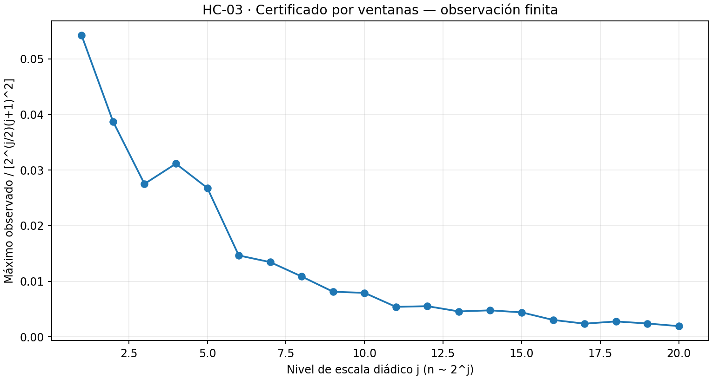
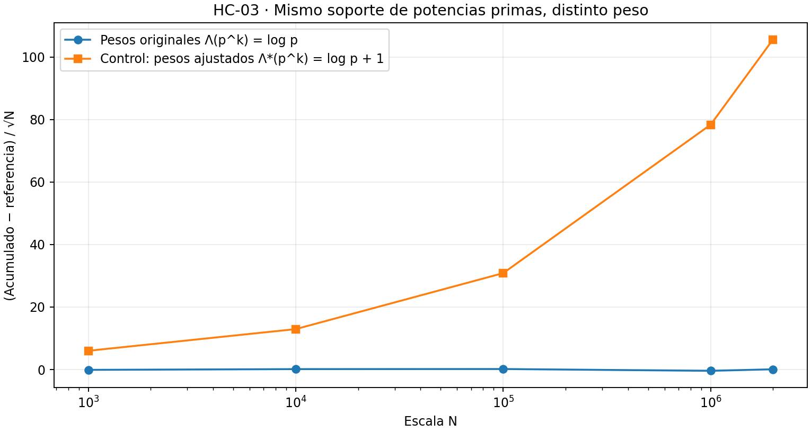

# HC–03 · La diferencia mínima como operador de aparición, herencia y reconstrucción

**Nota de laboratorio verificable — 21 de noviembre de 2026**  
**Continuidad:** R–01/R–02 → R–03 → HC–01 → HC–02 → HC–03  
**Firma:** Endless Monkey Project / Relational Geometry Program  
**Dictamen:** identidades exactas **demostradas**; reconstrucción aritmética y caracteres **verificados**; criterios de ventanas **equivalentes a una cota clásica**; estimación uniforme sobre todas las escalas **pendiente**.

## Resumen

La ampliación de una escala entera de `n−1` a `n` incorpora información aritmética mediante referencias primas y sus potencias. El peso `x/n−1` ancla cada contribución en el instante en que aparece; la segunda diferencia discreta recupera el peso de von Mangoldt correspondiente sin pérdida. Esta propiedad permite reconstruir la suma ponderada de HC–02 y separar con precisión el acto local de incorporación del control global de la distribución.

Se demuestra además que la comparación discreta con la referencia `x log x` introduce una corrección **positiva** y **absolutamente sumable** de masa menor que `1/8` al multiplicar cada segunda diferencia por la escala. Así, el término restante para el criterio de Riemann queda identificado sin ambigüedad como una condición de control uniforme de las sumas acumuladas de von Mangoldt. Se formula un certificado por bloques diádicos equivalente a la cota clásica `ψ(x)−x = O(√x log²x)`; comprobarlo finitamente no demuestra esa cota para todos los bloques.

**Criterio conceptual:** «aparición», «herencia», «cobertura» y «referencia» se definen de forma afirmativa. Los signos de las diferencias se usan exclusivamente como lectura de la comparación entre dos cantidades positivas, no como categorías ontológicas.

## 1. Aparición y herencia: objetos positivos

Sean `p` primo, `k≥1` entero, `Λ(p^k)=log p` y `Λ(n)=0` para los demás enteros. Para `x≥1`:

\[
T(x)=\sum_{m\le x}\Lambda(m)\left(\frac{x}{m}-1\right),\qquad
G(x)=T(x)-x(\log x-1-\gamma).
\tag{HC03.1}
\]

`T(x)` es una suma de contribuciones **no negativas**. Cuando `x=m`, el peso `x/m−1` vale cero; al ampliar la escala, pasa a ser positivo. Se distingue entre **referencia nueva** (`m=p`) y **potencia heredada** (`m=p^k`, `k≥2`). La aparición en `m` puede describirse localmente; la acumulación de todas las apariciones requiere una lectura global.

En la criba con todos los primos `p≤√x`, para `2≤n≤x` las referencias no cubiertas son exactamente los primos `n>√x`. Es la propiedad elemental de que un compuesto `≤x` posee un factor primo `≤√x`; no es un método nuevo de generación de primos.

## 2. Proposición 1: el paso mínimo recupera exactamente cada aparición

Para todo entero `n≥2`, definiendo `Δ²f(n)=f(n+1)−2f(n)+f(n−1)`, se cumple

\[
\boxed{\Delta^2T(n)=\frac{\Lambda(n)}{n}.}\tag{HC03.2}
\]

**Demostración.** En cada sumando individual `t_m(x)=Λ(m)(x/m−1)_+`, con la convención de valor cero hasta `x=m`, la dependencia respecto de `x` es lineal una vez incorporada la referencia `m`. La segunda diferencia en `n` se anula salvo cuando `m=n`; para ese sumando vale `Λ(n)/n`. La suma es finita en los puntos utilizados. `□`

En particular, `Δ²T(n)` vale `log p/p^k` cuando `n=p^k` y vale cero si `n` no es una potencia prima. La identidad **identifica** una aparición, pero no supone todavía una cota de cancelación del acumulado.

Una reconstrucción exacta a partir de las apariciones es

\[
\boxed{T(N)=\sum_{n=2}^{N-1}(N-n)\Delta^2 T(n)
=\sum_{n=2}^{N-1}\frac{N-n}{n}\Lambda(n)}.
\tag{HC03.3}
\]

Se usan `T(1)=T(2)=0`; la fórmula se obtiene al sumar dos veces las diferencias discretas.

## 3. Proposición 2: corrección de curvatura positiva y universal

La comparación con la referencia analítica `f(x)=x\log x` da

\[
\Delta^2G(n)=\frac{\Lambda(n)}n-c_n,\qquad
c_n=(n+1)\log(n+1)-2n\log n+(n-1)\log(n-1).
\tag{HC03.4}
\]

Defínase `r_n=n c_n−1`. Se demuestra la expansión convergente

\[
\boxed{r_n=2\sum_{m=1}^{\infty}\frac{1}{(2m+1)(2m+2)n^{2m}}>0,\quad n\ge2.}
\tag{HC03.5}
\]

**Demostración.** La identidad de diferencias centrales

\[
c_n=\int_{-1}^{1}\frac{1-|u|}{n+u}\,du
\]

permite desarrollar `1/(n+u)` como serie geométrica uniformemente convergente en `u∈[−1,1]`, ya que `n≥2`. Los momentos impares se anulan por simetría y el momento `2m` de la función triangular es `2/((2m+1)(2m+2))`. El término `m=0` da `1/n`, y los restantes son estrictamente positivos. `□`

Como `2/((2m+1)(2m+2))≤1/6` para `m≥1`,

\[
0<r_n\le\frac1{6(n^2-1)},\quad
0<R_N:=\sum_{n=2}^{N}r_n<\frac18.
\tag{HC03.6}
\]

La última desigualdad proviene de `∑_{n=2}^∞ 1/(n²−1)=3/4`. Es una **cota incondicional para la curvatura de la referencia**, no una cota de Riemann.

Multiplicando (HC03.4) por `n` y sumando de `2` a `N`, se obtiene una identidad exacta:

\[
\boxed{\psi(N)-N=-1+R_N+\sum_{n=2}^{N}n\,\Delta^2G(n),
\qquad 0<R_N<\tfrac18.}
\tag{HC03.7}
\]

Aquí `ψ(N)=∑_{n≤N}Λ(n)` es la función de Chebyshev. En (HC03.7) el «menos uno» es la corrección de origen asociada a iniciar la suma en `n=2`: `∑_{n=2}^{N}1=N−1`. La cantidad `R_N` es una corrección positiva, acotada y determinada por la función de referencia.

## 4. Proposición 3: certificado por bloques diádicos

Para `j≥1` y `2^j≤N<2^{j+1}` defínase la lectura de acumulación local

\[
B_j(N)=\sum_{n=2^j}^{N}\bigl(\Lambda(n)-1\bigr).
\tag{HC03.8}
\]

El símbolo con signo es la **diferencia de medición** entre la masa nueva registrada y la referencia unitaria, no una «parte negativa» dentro de la construcción. Se obtiene la equivalencia clásica, expresada aquí por ventanas:

**Criterio de bloques.** La hipótesis de Riemann equivale a que exista una constante `C>0` tal que, para todo `j≥1` y `2^j≤N<2^{j+1}`,

\[
\boxed{|B_j(N)|\le C\,2^{j/2}(j+1)^2.}
\tag{HC03.9}
\]

**Demostración.** La caracterización clásica de RH es `ψ(x)=x+O(√x log²x)`. Bajo esa cota, `B_j(N)=[ψ(N)−N]−[ψ(2^j−1)−(2^j−1)]`, y (HC03.9) se sigue de que todos los números del bloque son comparables a `2^j`. Recíprocamente, la telescopía de bloques da

\[
\psi(N)-N=-1+\sum_{k=1}^{j-1}B_k(2^{k+1}-1)+B_j(N).
\]

Usando (HC03.9), `\sum_{k=1}^{j}2^{k/2}(k+1)^2 \le (j+1)^2 2^{j/2}/(1-2^{-1/2})`. Por tanto `|ψ(N)−N|=O(√N log²N)` para enteros, y la extensión a reales cuesta a lo sumo una unidad en la referencia lineal. Esta cota es equivalente a RH por el teorema clásico. `□`

La equivalencia **no demuestra (HC03.9)**: especifica el contrato cuantitativo que habría que obtener de una regla adicional de la aritmética de las referencias nuevas. Una cota para la corrección `R_N` de (HC03.7) tampoco entrega la cota para el término acumulativo.

## 5. Extensión algebraica comprobada a caracteres

Sea `χ` un carácter de Dirichlet, completamente multiplicativo, y sea `S` un conjunto finito de primos que no contiene `p`. Defínase

\[
A_{S,\chi}(x)=\sum_{\substack{1\le n\le x\\ (n,\prod_{r\in S}r)=1}}\chi(n).
\]

La herencia responde exactamente a

\[
\boxed{A_{S\cup\{p\},\chi}(x)=A_{S,\chi}(x)-\chi(p)A_{S,\chi}(x/p),}
\tag{HC03.10}
\]

interpretando el último recuento con `\lfloor x/p\rfloor`. Esta identidad se obtiene al separar los enteros divisibles por `p` y sustituir `n=pm`; usa solo multiplicatividad de `χ`.

Análogamente, para

\[
T_\chi(x)=\sum_{m\le x}\Lambda(m)\chi(m)\left(\frac{x}{m}-1\right),
\]

se tiene la recuperación local

\[
\boxed{\Delta^2T_\chi(n)=\frac{\Lambda(n)\chi(n)}n.}\tag{HC03.11}
\]

Estas identidades son **exactas y clásicas**. La extensión no transfiere automáticamente las estimaciones de sumas torcidas ni sus condiciones de positividad; tampoco equivale a demostrar GRH.

## 6. Ejecución computacional y resultados

Ejecución con Python 3 y bibliotecas estándar: `python laboratorio_hc03.py` (el mismo script sobrescribe sus CSV y `resumen.json` con una nueva ejecución). La gráfica se regenera con `python graficos_hc03.py` y requiere `matplotlib`.

- **Primos generados hasta:** `2.000.000` (`148.933` primos).
- **Potencias adicionales `p^k`, `k≥2`:** `302` eventos dentro del rango.
- **Igualdades racionales exactas:** `5.270`, para la segunda diferencia y la reconstrucción.
- **Igualdades racionales con caracteres:** `4.782`, para la herencia y la segunda diferencia torcida.
- **Comprobaciones de clasificación por criba:** `111.096` enteros examinados en las cuatro escalas de control.
- **Máximo error numérico de (HC03.2) en 2≤n≤10.000:** `4,51×10⁻¹¹` en doble precisión.
- **Máximo error numérico en la reconstrucción (HC03.7):** `1,18×10⁻⁸` en doble precisión.
- **Corrección positiva `R_N` a los dos millones:** `0,11370556`, inferior a `1/8` como predice la demostración.

| Escala `N` | `ψ(N)−N` | `(ψ(N)−N)/√N` |
|---:|---:|---:|
| 1.000 | −3,3191 | −0,10496 |
| 10.000 | +13,3967 | +0,13397 |
| 100.000 | +51,5640 | +0,16306 |
| 1.000.000 | −413,4025 | −0,41340 |
| 2.000.000 | +115,0462 | +0,08135 |

Los signos en la tabla son una visualización del estado de una comparación, no una ontología de contribuciones negativas. En todos los casos la fuente de eventos `Λ(n)` y la masa acumulada `ψ(N)` son no negativas.

### Bloques de escala

El script calcula en cada bloque `2^j≤n<2^{j+1}` el máximo parcial `\max_N |B_j(N)|` y lo normaliza por `2^{j/2}(j+1)^2`. En los bloques medidos `j=1,…,20`, el mayor cociente observado fue `0,054245` (en el bloque inicial); el último bloque es parcial (`2^20≤n≤2.000.000`) y su cociente observado fue `0,001939`. **El gráfico certifica solo esos bloques finitos.** La condición (HC03.9) tiene cuantificador sobre todos los bloques futuros y permanece abierta.

## 7. Control adversarial: genealogía y peso son contratos diferentes

Se conservaron exactamente **los mismos enteros de aparición** (`p^k`, `k≥1`), pero se asignó un peso alternativo `\Lambda_*(p^k)=\log p+1`. La masa acumulada cambia en `\#\{p^k≤N\}`. Esta prueba no modela los pesos aritméticos genuinos de von Mangoldt ni preserva las identidades de la función zeta; su objetivo es evaluar qué garantiza únicamente conocer las posiciones de aparición.

| `N` | Cambio del acumulado | Cambio dividido por `√N` |
|---:|---:|---:|
| 1.000 | 193 | 6,10 |
| 10.000 | 1.280 | 12,80 |
| 100.000 | 9.700 | 30,67 |
| 1.000.000 | 78.734 | 78,73 |
| 2.000.000 | 149.235 | 105,53 |

El control muestra que **la genealogía de apariciones no fija, por sí sola, la magnitud del acumulado**. Los pesos exactos `\log p`, la estructura del producto de Euler y cualquier condición analítica adicional son parte esencial del problema, no detalles intercambiables.

## 8. Dictamen de investigación

| Afirmación | Procedencia | Estado |
|---|---|---|
| Criba de supervivientes en el corte `√x` | Aritmética elemental clásica | Demostrado y verificado |
| Identidad de aparición `Δ²T(n)=Λ(n)/n` | Diferencias finitas | Demostrado y verificado |
| Reconstrucción de `T(N)` desde impulsos | Telescopía discreta | Demostrado y verificado |
| Corrección `0<R_N<1/8` | Serie de curvatura de `x log x` | Demostrado |
| Identidad de acumulación (HC03.7) | Combinación de las anteriores | Demostrado y verificado |
| Herencia y diferencias con caracteres (HC03.10–11) | Multiplicatividad y diferencias finitas | Demostrado y verificado |
| Criterio de bloques (HC03.9) ⇔ RH | Criterio clásico de Chebyshev, reescritura diádica | Equivalencia demostrada; cota pendiente |
| Control de todos los bloques y caracteres relevantes | Requiere estimaciones nuevas | Abierto |

**Próxima obligación concreta:** identificar una condición aritmética demostrable, distinta de la identidad de aparición, que obligue a la cota uniforme de (HC03.9). Se recomienda empezar por una desigualdad de bloques que use efectivamente los pesos `log p` y la relación de divisibilidad, y contrastar con modelos que conserven los eventos pero alteren el peso. Una identidad reconstruye; una desigualdad uniforme controla.

## 9. Procedencia y referencias

- R–01 / R–02 — *Escalas relacionales de la criba*, 17-XI-2026; identidades de herencia, inclusión-exclusión y Mellin. [Documento](https://github.com/EndlessMonkeyProyect/programa-geometria-relacional/blob/main/2026-11-17_escalas_relacionales_riemann/FORMALIZACION_R01_R02_ES.md).
- R–03 — *Herencia espectral, normalización y ubicación de los ceros*, 18-XI-2026. [Documento](https://github.com/EndlessMonkeyProyect/programa-geometria-relacional/blob/main/2026-11-17_escalas_relacionales_riemann/2026-11-18_r03_herencia_espectral/R03_HERENCIA_Y_LOCALIZACION_ES.md).
- HC–01 / HC–02 — paquetes y cálculos fechados el 21-XI-2026. En HC–02, `U(t)=ψ(t)−ϑ(t)` identifica las potencias heredadas y la cota uniforme de la corrección de potencias es `O(√t)`.
- Criterio clásico: `RH ⇔ ψ(x)=x+O(√x log²x)`, consecuencia estándar de la fórmula explícita; véanse textos clásicos sobre la función zeta y teoría analítica de números.
- El esquema de comparación con Alpöge utiliza la misma suma ponderada `T(x)` como observable, pero las condiciones de positividad y las estimaciones en ventanas son externas a este laboratorio. La identidad del observable no representa una integración de pruebas.

*Endless Monkey Project / Relational Geometry Program*
