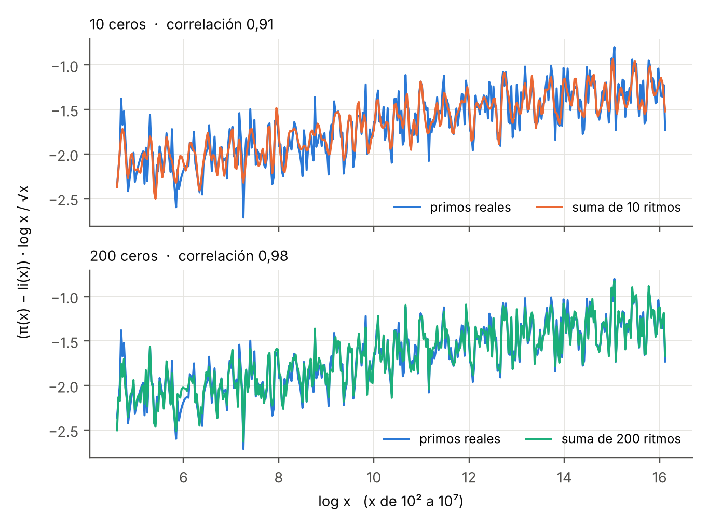

# Las escalas relacionales de la criba

*Herencia, cierre y la escala √x de la hipótesis de Riemann*

**Le Matt Ansatz Di Ego** 
Endless Monkey Project 
Relational Geometry Program

Formalización R–01 / R–02  ·  Versión 1.0  ·  17 de noviembre de 2026

## Resumen

Los enteros que sobreviven a las restricciones de los primeros k primos se comparan con una referencia de densidad. La discrepancia entre ambos se hereda de una escala a otra con una ley exacta. El documento separa esa discrepancia en tres capas: la referencia independiente, válida mientras las restricciones son pocas frente a la escala; la referencia corregida, que sale de iterar la herencia y absorbe la parte estructural en el cierre; y la fluctuación π(x) − li(x), cuya cota O(√x·log x) equivale a la hipótesis de Riemann.

Se dan además la forma de Mellin de la herencia (un producto de Euler parcial sobre ζ), una ley exacta de energía por período, la lectura de la fluctuación como suma de ritmos —uno por cada cero de ζ, conservados por la herencia— y una firma de escala cerrada bajo la herencia, que convierte la recursión en un conteo exacto de primos. Las identidades son consecuencias de la criba clásica y de la fórmula explícita; la ley que pondría todos los ritmos en la escala √x es la parte abierta.

## Abstract

The integers that survive the restrictions imposed by the first k primes are compared with a density reference. The discrepancy between the two is inherited from one scale to the next by an exact law. The paper separates this discrepancy into three layers: the independent reference, valid while the restrictions are few relative to the scale; the corrected reference, obtained by iterating the inheritance law, which absorbs the structural part at the closing scale; and the fluctuation π(x) − li(x), whose bound O(√x·log x) is equivalent to the Riemann hypothesis.

The paper also gives the Mellin form of the inheritance law (a partial Euler product acting on ζ), an exact energy law over complete periods, a reading of the fluctuation as a sum of rhythms —one for each zero of ζ, each preserved by the inheritance law— and a scale signature closed under inheritance, which turns the recursion into an exact prime count. The identities are consequences of the classical sieve and of the explicit formula; the law that would place every rhythm on the √x scale is the open part.

**Palabras clave:** criba de Legendre; función de Buchstab; producto de Euler parcial; fórmula explícita; ceros de ζ; hipótesis de Riemann; conteo de primos.

**Keywords:** Legendre sieve; Buchstab function; partial Euler product; explicit formula; zeros of ζ; Riemann hypothesis; prime counting.

**MSC 2020:** 11N05, 11N35, 11M26, 11Y16.

## 1. Definiciones

Sean p₁ &lt; p₂ &lt; … los primos. Para un conjunto finito S de primos, MS = ∏p∈S p y δS = ∏p∈S (1 − 1/p). Para x ≥ 0 se definen:

aS(n) = 1 si gcd(n, MS) = 1;  0 en otro caso

AS(x) = ∑1≤n≤x aS(n)        ES(x) = AS(x) − xδS

Con S = {p₁, …, pₖ} se escribe Mₖ, δₖ, aₖ, Aₖ, Eₖ. Para S vacío, M₀ = 1, δ₀ = 1 y A₀(x) = ⌊x⌋.

La firma modular Φₖ(n) = (n mod p₁, …, n mod pₖ) decide si n sobrevive: aₖ(n) depende solo de Φₖ(n), y por el teorema chino del resto Φₖ(n) equivale a n mod Mₖ.

La escala relativa de la última restricción es u = log x / log pₖ, es decir, x = pₖu. El cierre es la escala a = π(√x): ahí pₐ ≤ √x &lt; pₐ₊₁, y los sobrevivientes mayores que 1 son exactamente los primos de (√x, x].

Las escalas relacionales son las escalas ⌊x/n⌋ que la herencia conecta. En t = log x, cada novedad p las corre una distancia fija, log p; el conjunto completo es D(x) (§8).

li(x) es la integral logarítmica ∫₀x dt / log t (valor principal), θ(y) = ∑p≤y log p, y γ es la constante de Euler–Mascheroni. Los ceros no triviales de ζ se escriben ρ = β + iτ.

## 2. Herencia

**Teorema 1 (herencia).** Sea S un conjunto finito de primos y p un primo fuera de S. Para todo x ≥ 0:

AS∪{p}(x) = AS(x) − AS(x/p)

ES∪{p}(x) = ES(x) − ES(x/p)

*Demostración.* Los múltiplos de p que sobreviven a S son exactamente los pm con gcd(m, MS) = 1, porque p es coprimo con MS. Hasta x hay AS(x/p) de ellos; al quitarlos queda la primera igualdad. Como δS∪{p} = δS(1 − 1/p), la segunda sale de restar x·δS∪{p} = xδS − (x/p)δS. □

Con S = {p₁, …, pₖ} y p = pₖ₊₁ queda Eₖ₊₁(x) = Eₖ(x) − Eₖ(x/p). Cada primo nuevo es una novedad: quita a los sobrevivientes su propia copia dilatada por p.

**Corolario 1 (forma cerrada).**

Eₖ(x) = ∑d|Mₖ μ(d) (⌊x/d⌋ − x/d)

Eₖ tiene período Mₖ (con M₀ = 1) y, para k ≥ 1, cumple |Eₖ(x)| &lt; 2k−1 (Legendre): ∑d|Mₖ μ(d) = 0, así que la mitad de los divisores de Mₖ tiene μ = +1 y la otra mitad μ = −1, y cada término ⌊x/d⌋ − x/d está en (−1, 0].

**Corolario 2 (herencia acumulada).** Iterando el Teorema 1 desde k hasta k′ &gt; k:

Ak′(x) = Aₖ(x) − ∑j=k+1k′ Aj−1(x/pⱼ)

Es la identidad de Buchstab: el conteo a cualquier escala es el de una escala anterior menos lo que quitó cada novedad intermedia.

## 3. Novedades como operadores y forma de Mellin

Sea (Tₚf)(x) = f(x) − f(x/p). Entonces Eₖ = Tpₖ ⋯ Tp₁ E₀. Las dilataciones x ↦ x/p y x ↦ x/q conmutan, así que TₚTq = TqTₚ. Con el Teorema 1 para conjuntos arbitrarios, la discrepancia depende solo del conjunto de novedades incorporadas.

**Proposición 1 (forma de Mellin).** Para 0 &lt; Re s &lt; 1:

∫₀∞ Eₖ(x) x−s−1 dx = (ζ(s)/s) · ∏j=1k (1 − pⱼ−s)

*Demostración.* Para 0 &lt; Re s &lt; 1, ∫₀∞ (⌊x⌋ − x) x−s−1 dx = ζ(s)/s (Titchmarsh, §2.1). Si F es la transformada de f, la de f(x/p) es p−sF(s); por tanto Tₚ multiplica la transformada por 1 − p−s. La integral converge absolutamente: Eₖ es acotada y vale −xδₖ en [0, 1). □

Verificación numérica para k = 1, 2 en s = 0,7 y s = 0,6 + 4i: error relativo menor que 10−9. Para k ≥ 1, Eₖ tiene media cero en cada período, su primitiva es acotada y la cola de la integral más allá de N decae como N−Re s−1; eso justifica truncar la integral numérica.

La cadena de novedades es un producto de Euler parcial finito que actúa sobre ζ(s)/s dentro de la franja crítica, y la Proposición 1 vale para cada k. Cuando k crece junto con x, el comportamiento se relaciona con el estudio de los productos de Euler parciales en la franja crítica. Conrad (2005) estudia asintóticas para funciones L enteras en la línea crítica; Akatsuka (2017) analiza el producto parcial de ζ en la mitad derecha de la franja.

## 4. Criterio puntual

Con α = Eₖ(x) y β = Eₖ(x/p), como (α − β)² − α² = β(β − 2α):

|Eₖ₊₁(x)| ≤ |Eₖ(x)|   ⇔   β(β − 2α) ≤ 0

*Ejemplo.* Con k = 3 (primos 2, 3, 5), p = 7 y x = 10: E₃(10) = −2/3, E₃(10/7) = 13/21, E₄(10) = −9/7, y β(β − 2α) = 533/441 &gt; 0. Es el caso común: con x = 10⁶, |Eₖ(x)| crece en 98 de los 168 pasos entre k = 0 y el cierre, y E₁₀₀(10⁶) ≈ −4 671.

## 5. Ley de energía por período

Para f de período L, ⟨f⟩ = L−1 ∫₀L f(x) dx. En cualquier ventana vale la identidad cuadrática

⟨Eₖ₊₁²⟩ = ⟨Eₖ²⟩ + ⟨Eₖ(·/p)²⟩ − 2⟨Eₖ(·) Eₖ(·/p)⟩

y en períodos completos sus tres términos tienen valor exacto.

**Proposición 2.** Para k ≥ 1 y p = pₖ₊₁, con promedios sobre [0, pMₖ):

⟨Eₖ²⟩ = (1/12) ∏j=1k 2(1 − 1/pⱼ) = 2k δₖ / 12

⟨Eₖ(x) Eₖ(x/p)⟩ = ⟨Eₖ²⟩ / p

⟨Eₖ₊₁²⟩ = 2(1 − 1/p) ⟨Eₖ²⟩

*Demostración.* Con B(y) = {y} − 1/2 y ∑d|Mₖ μ(d) = 0, se tiene Eₖ(x) = −∑d|Mₖ μ(d) B(x/d). La integral de Franel da, para enteros d, e ≥ 1,

(1/lcm(d, e)) ∫₀lcm(d,e) B(x/d) B(x/e) dx = gcd(d, e)² / (12de)

así que ⟨Eₖ²⟩ = (1/12) ∑d,e|Mₖ μ(d)μ(e) gcd(d, e)²/(de). La suma es multiplicativa. Para cada primo q de Mₖ, las partes de d y e en q dan cuatro casos: (1, 1) aporta 1; (q, 1) aporta −1/q; (1, q) aporta −1/q; (q, q) aporta q²/q² = 1. Su suma es 2(1 − 1/q). En la correlación aparece gcd(d, pe) = gcd(d, e), porque p es coprimo con d, y eso da el factor 1/p. La tercera igualdad sale de la identidad cuadrática, con ⟨Eₖ(·/p)²⟩ = ⟨Eₖ²⟩ por periodicidad. □

Verificación exacta con fracciones para k = 1, …, 4: ⟨Eₖ²⟩ = 1/12, 1/9, 8/45, 32/105, y razones de correlación 1/3, 1/5, 1/7, 1/11.

En un período completo, cada novedad multiplica la energía por 2(1 − 1/p): 4/3 con p = 3, y cada vez más cerca de 2 a medida que p crece. La correlación entre una escala y su dilatación por p es exactamente 1/p, y la energía por período crece como 2kδₖ. La compensación que pide el conteo de primos vive entonces en ventanas incompletas: en el cierre, x es diminuto frente al período Mₐ = eθ(√x) ≈ e√x.

## 6. Cierre: referencia, corrección y fluctuación

Sea x ≥ 4 y a = π(√x). La identidad de Legendre da

π(x) = Aₐ(x) + a − 1 = xδₐ + Eₐ(x) + a − 1

y la discrepancia en el cierre se ordena en tres capas.

**Referencia independiente.** xδₖ supone que cada primo restringe por su cuenta. Es la referencia correcta mientras u es grande: con k fijo, Eₖ es acotada (Corolario 1).

**Referencia corregida.** La herencia acumulada (Corolario 2), junto con el teorema de los números primos, da para u &gt; 1 fijo y x → ∞ (con k creciendo junto con x):

Aₖ(x) ∼ xδₖ · eγ ω(u)

donde ω es la función de Buchstab: ω(u) = 1/u en [1, 2] y (uω(u))′ = ω(u − 1) para u &gt; 2, con ω(u) → e−γ. Es la forma de Buchstab y de Bruijn, Aₖ(x) ∼ xω(u) / log pₖ, escrita con la fórmula de Mertens δₖ ∼ e−γ / log pₖ. Para u grande el factor vale 1 y se recupera la referencia independiente.

En el cierre, u = 2 y ω(2) = 1/2, así que el factor es eγ/2 ≈ 0,8905: la referencia independiente se pasa por 2e−γ ≈ 1,1229.

En x = 10⁸ los valores siguen la forma (factor 1 para u grande, caída hacia el cierre), con una corrección relativa del orden de 1/log pₖ: mínima para u grande y máxima en el cierre, donde 1/log pₖ ≈ 0,11.

| k | pₖ | u | Aₖ(x) / xδₖ | eγ ω(u) |
|:-:|:-:|:-:|:-:|:-:|
| 10 | 29 | 5,47 | 1,0000 | 1,0000 |
| 50 | 229 | 3,39 | 1,0009 | 0,9990 |
| 100 | 541 | 2,93 | 1,0065 | 1,0077 |
| 200 | 1 223 | 2,59 | 0,9933 | 1,0066 |
| 446 | 3 137 | 2,29 | 0,9540 | 0,9755 |
| 1 229 | 9 973 | 2,00 | 0,9461 | 0,8908 |

**Proposición 3 (tres capas del cierre).** Para x ≥ 4 y a = π(√x):

Eₐ(x) = [ li(x) − xδₐ − a + 1 ] + [ π(x) − li(x) ]

El primer corchete es la parte estructural: por Mertens y el teorema de los números primos vale (1 − 2e−γ + o(1))·x / log x, con 1 − 2e−γ ≈ −0,123. El segundo es la fluctuación.

*Demostración.* Es la identidad de Legendre, sumando y restando li(x). □

La parte estructural se conoce por su forma asintótica; la fluctuación es lo que queda abierto. La hipótesis de Riemann equivale a π(x) − li(x) = O(√x·log x) (von Koch, 1901).

| x | xδₐ | Eₐ(x) | estructural | π(x) − li(x) | √x·log x |
|:-:|:-:|:-:|:-:|:-:|:-:|
| 10⁵ | 9 652 | −124 | −86,1 | −37,8 | 3 641 |
| 10⁶ | 80 965 | −2 634 | −2 504,7 | −129,5 | 13 816 |
| 10⁷ | 696 014 | −31 880 | −31 540,6 | −339,4 | 50 970 |

En x = 10⁷ la parte estructural es unas 93 veces la fluctuación y ya supera la mitad de √x·log x; crece como x / log x. Su cociente con x / log x pasa de −0,010 a −0,035 y a −0,051 entre 10⁵ y 10⁷, en camino lento hacia −0,123. Casi toda la discrepancia del cierre es estructura.

## 7. Ritmos: la fluctuación como suma sobre los ceros

Con t = log x, la dilatación x ↦ x/p es el corrimiento t ↦ t − log p. Las potencias xρ son las funciones que la herencia conserva:

Tₚ xρ = xρ − (x/p)ρ = (1 − p−ρ) xρ

Cada novedad multiplica cada ritmo por un número fijo, 1 − p−ρ, y lo deja separado de los demás. Es la misma propiedad que en el plano de Mellin hace de Tₚ una multiplicación (Proposición 1).

**Fórmula explícita.** Sea J₀(x) = ∑p^{m}≤x 1/m, la suma sobre potencias de primos, y π₀(x) el conteo de primos; ambos toman el valor medio en cada salto. Para x &gt; 1 (Riemann; von Mangoldt):

J₀(x) = li(x) − ∑ρ li(xρ) − log 2 + ∫x∞ dt / ( t(t² − 1) log t )

π₀(x) = ∑1≤m≤log₂ x μ(m) J₀(x1/m) / m

La suma sobre ρ recorre los ceros no triviales ρ = β + iτ de ζ en pares conjugados, por |τ| creciente, y converge condicionalmente. La suma sobre m es finita porque J₀(y) = 0 para y &lt; 2. Reagrupando con R(x) = ∑n≥1 μ(n) li(x1/n) / n se llega a la forma de Riesel y Göhl,

π₀(x) = R(x) − ∑ρ R(xρ) − 1/log x + (1/π) arctan(π / log x),

que pide intercambiar la suma sobre m con la suma sobre ρ. Es la forma que usa la reconstrucción truncada de más abajo.

El término n = 2 de R(x), −½ li(√x), viene de los cuadrados de primos y es la razón principal de que π(x) quede por debajo de li(x): así ocurre para todo 2 ≤ x ≤ 10¹⁹ (Büthe, 2018). El orden se invierte infinitas veces (Littlewood, 1914), pero rara vez: bajo la hipótesis de Riemann y LI, el conjunto donde π(x) &gt; li(x) tiene densidad logarítmica de unos 2,6·10−7 (Rubinstein y Sarnak, 1994). Es el mismo mecanismo del sesgo de Chebyshev, que en su forma original (1853) compara los primos ≡ 3 y ≡ 1 (mod 4).

Con β = ½, el término principal de cada par conjugado es 2 Re li(xρ) ≈ (2√x / log x)·Re(eiτt/ρ). Dividida entre √x / log x, la fluctuación queda

(π(x) − li(x))·log x / √x  ≈  −1 − 2 ∑τ&gt;0 Re( eiτt / ρ )

Cada cero es un ritmo de frecuencia τ en t = log x, con amplitud fija 2/|ρ|: 0,1414; 0,0951; 0,0799 para τ = 14,1347; 21,0220; 25,0109. El nivel −1 se alcanza lentamente, con corrección del orden de 1/log x.

**Reconstrucción truncada.** Con los primeros K ceros, π(x) ≈ R(x) − ∑k≤K 2 Re li(xρₖ), en 400 puntos entre x = 10² y 10⁷ (diferencias en unidades de √x / log x):

| Ceros K | Correlación con los primos reales | Diferencia cuadrática media |
|:-:|:-:|:-:|
| 0 (solo R(x)) | 0,793 | 0,219 |
| 10 | 0,912 | 0,147 |
| 50 | 0,959 | 0,102 |
| 200 | 0,977 | 0,076 |

La reconstrucción conserva de cada R(xρ) su término principal li(xρ) y omite los dos últimos términos de la fórmula explícita. Agregar el término n = 2 de cada R(xρ) y esos dos términos sube la correlación con 200 ceros de 0,977 a 0,982.

<i>Figura 1.</i> Reconstrucción truncada: fluctuación normalizada de los primos reales (azul) frente a la suma de 10 ritmos (arriba) y de 200 ritmos (abajo), de x = 10² a 10⁷.

En todo ese rango la fluctuación normalizada se mantiene entre −2,71 y −0,80: es lo que se ve cuando todos los ritmos están en la escala √x.

**Techo.** Un cero con β &gt; ½ aportaría un ritmo que crece como xβ−½ respecto de los demás; con β = 0,6, en x = 10⁷ ya sería 5 veces mayor. La hipótesis de Riemann dice que todos los ceros tienen β = ½, y equivale a π(x) − li(x) = O(√x·log x). Está verificada para todos los ceros con 0 &lt; τ ≤ 3·10¹² (Platt y Trudgian, 2021).

**Piso.** Hay infinitos ceros con β = ½ (Hardy, 1914), y π(x) − li(x) cambia de signo infinitas veces con oscilaciones de tamaño Ω±(√x·log log log x / log x) (Littlewood, 1914). El exponente ½ es un piso demostrado.

La hipótesis de Riemann dice entonces que el techo tiene el mismo exponente que el piso: la fluctuación queda en la escala mínima posible en exponente. Entre ambas cotas queda un factor del orden de log² x / log log log x, que sigue abierto aun suponiendo la hipótesis.

**Compás.** Se conjetura que las frecuencias τ son linealmente independientes sobre los racionales (hipótesis LI). Si vale LI, las fases de cualquier colección finita recorren densamente su toro y vuelven arbitrariamente cerca de cada configuración de esa colección (Kronecker–Weyl). Bajo la hipótesis de Riemann y LI, Rubinstein y Sarnak calculan la distribución límite de la fluctuación normalizada en escala logarítmica, de la que sale la densidad citada arriba.

## 8. Firma de escala cerrada bajo la herencia

Una firma Φ es suficiente para una consulta d si d = g∘Φ para alguna g. La actualización bajo una transformación F se hace sobre la firma exactamente cuando Φ(y) = Φ(y′) implica Φ(F(y)) = Φ(F(y′)).

En la criba, la firma de escala Φ(y) = ⌊y⌋ cumple las dos condiciones para la consulta Aₖ y la transformación F(y) = y/p: Aₖ(y) depende solo de ⌊y⌋, y ⌊y/p⌋ = ⌊⌊y⌋/p⌋. Partiendo de x, las escalas que alcanzan las dilataciones forman

D(x) = { ⌊x/n⌋ : n ≥ 1 },     ⌊⌊x/m⌋/p⌋ = ⌊x/(mp)⌋

La segunda identidad es la que hace a D(x) cerrado bajo todas las dilataciones. D(x) incluye el 0 (n &gt; x), con Aₖ(0) = 0, y unos 2√x valores positivos.

**Proposición 4.** La tabla (Aₖ(v))v∈D(x) pasa a la tabla k + 1 con Aₖ₊₁(v) = Aₖ(v) − Aₖ(⌊v/pₖ₊₁⌋), sin salir de D(x). Partiendo de A₀(v) = v e iterando hasta el cierre, la identidad de Legendre da π(x).

*Demostración.* Es el Teorema 1 evaluado en cada v ∈ D(x), con la clausura de D(x) bajo ⌊·/p⌋. □

**Lema (tabla del cálculo).** El cálculo de §9 lleva, en lugar de Aₖ, la tabla Sₖ(v) = número de enteros 2 ≤ n ≤ v que son primos o coprimos con Mₖ. Para k ≥ 1, v ∈ D(x) y p = pₖ₊₁:

Sₖ(v) = π(v) si v &lt; pₖ;      Sₖ(v) = Aₖ(v) + k − 1 si v ≥ pₖ

Sₖ₊₁(v) = Sₖ(v) − [ Sₖ(⌊v/p⌋) − Sₖ(p − 1) ] si v ≥ p²;      Sₖ₊₁(v) = Sₖ(v) si v &lt; p²

*Demostración.* Al incorporar p dejan de contarse los pm con m ≥ p y gcd(m, Mₖ) = 1; p sigue contado como primo. Si 1 &lt; m &lt; p, algún primo anterior divide a m, así que debajo de p² no hay exclusiones. Para v ≥ p², los m válidos son los de [p, ⌊v/p⌋] coprimos con Mₖ, y Sₖ(⌊v/p⌋) − Sₖ(p − 1) los cuenta exactamente, porque Sₖ(p − 1) = k cuenta los primos anteriores. Al terminar los primos p ≤ √x, todo compuesto n ≤ x tiene un factor procesado, y la tabla da π(x). □

El costo se cuenta tomando cada operación aritmética y cada acceso a la tabla como un paso: para cada primo p ≤ √x se actualizan los v ∈ D(x) con v ≥ p², que son unos 2√x si p ≤ x1/4 y unos x/p² si p &gt; x1/4. La suma de los dos tramos es del orden de x3/4 / log x pasos. Una implementación directa da π(10⁹) = 50 847 534 con 63 244 valores, igual al valor conocido.

El tamaño de la firma (unos 2√x valores) y el costo de actualizarla (del orden de x3/4 / log x) son magnitudes distintas. La marca vigente para el conteo es Õ(√x) con un método elemental (Hirsch, Kessler y Mendlovic, 2022); Meissel–Lehmer y sus refinamientos se apoyan en la misma recursión del Teorema 1.

## 9. Verificación

El script verificacion\_R01\_R02.py, que acompaña este documento (Python con numpy y mpmath; matplotlib para la figura), reproduce cada número del texto:

- Teorema 1 en 400 casos exactos con conjuntos arbitrarios de primos; Corolario 1 contra el conteo directo y cota de Legendre para k ≤ 5; Corolario 2 en 60 casos.
- Forma de Mellin para k = 1, 2 en dos puntos de la franja crítica.
- Ejemplo de §4 y conteo de los pasos con crecimiento en x = 10⁶.
- Ley de energía por período con fracciones exactas para k ≤ 4.
- Función de Buchstab y referencia corregida en x = 10⁸; Proposición 3 y su tabla para x = 10⁵, 10⁶, 10⁷.
- Ritmos: la identidad Tₚxρ = (1 − p−ρ)xρ, los primeros 200 ceros, la reconstrucción, el efecto de los términos omitidos y la Figura 1.
- Lema de la tabla Sₖ, comprobado etapa por etapa en x = 10⁴; conteo exacto de π(x) sobre D(x) para x = 10⁷ y 10⁹, comparado con los valores conocidos.

Corre en menos de un minuto; la mayor parte es el cálculo de los ceros. Los bloques de §2, §3, §5, §6 (Proposición 3) y §8 comprueban con aserciones y detienen la ejecución si algo falla; los de §4, §6 y §7 miden y reportan. Las identidades reformulan el conteo; la medición que habla de la fluctuación es π(x) − li(x) frente a √x·log x.

## 10. Estado de resultados

| § | Afirmación | Estado |
|:-:|:--|:--|
| 2 | Herencia exacta (Teorema 1) y herencia acumulada (Buchstab) | Demostrado; clásico |
| 2 | Forma cerrada, período Mₖ y cota 2k−1 | Demostrado; clásico (Legendre) |
| 3 | Conmutatividad de las novedades | Demostrado |
| 3 | Forma de Mellin: producto de Euler parcial sobre ζ(s)/s | Demostrado; verificado numéricamente |
| 4 | Criterio puntual | Demostrado |
| 5 | Ley de energía por período: 2kδₖ/12 y correlación 1/p | Demostrado; verificado exacto para k ≤ 4 |
| 6 | Referencia corregida xδₖ·eγω(u) | Conocido (Buchstab, de Bruijn); medido en x = 10⁸ |
| 6 | Tres capas del cierre (Proposición 3) | Demostrado |
| 7 | Ritmos xρ conservados por la herencia | Demostrado |
| 7 | Fluctuación como suma de ritmos (fórmula explícita, forma J₀) | Conocido (Riemann, von Mangoldt); reconstrucción truncada con 200 ceros |
| 7 | Piso de exponente ½ de la fluctuación | Conocido (Hardy, Littlewood) |
| 7 | Todos los ritmos en la escala √x: π(x) − li(x) = O(√x·log x) | Abierto: es la hipótesis de Riemann; verificada para τ ≤ 3·10¹² |
| 7 | Frecuencias sin período común (LI) | Conjetura |
| 8 | Firma de escala D(x) y conteo exacto de π(x) (Proposición 4) | Demostrado; costo del orden de x3/4 / log x |
| 8 | Lema de la tabla Sₖ del cálculo | Demostrado; comprobado etapa por etapa en x = 10⁴ |
| 8 | Firma heredable con costo por debajo de Õ(√x) | Abierto |

## Pregunta de investigación

En el cierre, la referencia corregida absorbe la parte estructural de la discrepancia, y lo que queda es una suma de ritmos, uno por cada cero de ζ. ¿Qué ley de la herencia entre escalas pone a todos los ritmos en la misma escala √x, la mínima en exponente? Esa es la hipótesis de Riemann. En el plano de Mellin es la pregunta por los productos de Euler parciales dentro de la franja crítica; en el cálculo, por una firma heredable con costo por debajo de Õ(√x).

## Lectura en el programa

Cada primo nuevo es una novedad: un módulo coprimo con todos los anteriores. La herencia dice que la novedad quita a los sobrevivientes su propia copia dilatada, y el resultado depende solo del conjunto de novedades. En un período completo, cada novedad multiplica la energía por 2(1 − 1/p) y guarda con su escala dilatada una correlación exacta de 1/p. En el cierre, cuando la escala de las restricciones llega a √x, los sobrevivientes son los primos; ahí la referencia de restricciones independientes se corrige por eγ/2, y lo que queda es la fluctuación.

La fluctuación es una superposición de ritmos, uno por cada cero de ζ, y la herencia multiplica cada ritmo sin mezclarlo con los otros. Los ritmos que se conocen comparten la escala √x, la mínima en exponente. Se conjetura que sus frecuencias no comparten compás: entonces su configuración nunca se repite exacta, aunque vuelve tan cerca como se quiera, y la fluctuación no cierra. La hipótesis de Riemann dice que ningún ritmo sale de esa escala.

## Referencias

- Akatsuka, H. (2017). *The Euler product for the Riemann zeta-function in the critical strip.* Kodai Math. J. 40, 79–101.
- Buchstab, A. A. (1937). *Asymptotic estimates of a general number-theoretic function.* Mat. Sbornik 2(44).
- Büthe, J. (2018). *An analytic method for bounding ψ(x).* Math. Comp. 87, 1991–2009.
- Chebyshev, P. L. (1853). *Lettre à M. Fuss sur un nouveau théorème relatif aux nombres premiers contenus dans les formes 4n + 1 et 4n + 3.* Bull. Classe Phys.-Math. Acad. Imp. Sci. St.-Pétersbourg 11.
- Conrad, K. (2005). *Partial Euler products on the critical line.* Canad. J. Math. 57.
- de Bruijn, N. G. (1950). *On the number of uncancelled elements in the sieve of Eratosthenes.* Proc. Kon. Ned. Akad. Wetensch. 53.
- Franel, J. (1924). *Les suites de Farey et le problème des nombres premiers.* Nachr. Ges. Wiss. Göttingen, Math.-Phys. Kl., 198–201.
- Hardy, G. H. (1914). *Sur les zéros de la fonction ζ(s) de Riemann.* C. R. Acad. Sci. Paris 158.
- Hirsch, D., Kessler, I., Mendlovic, U. (2022). *Computing π(N): an elementary approach in Õ(√N) time.* Math. Comp., doi:10.1090/mcom/4039; arXiv:2212.09857.
- Legendre, A.-M. (1808). *Essai sur la théorie des nombres*, 2.ª ed. París.
- Lehmer, D. H. (1959). *On the exact number of primes less than a given limit.* Illinois J. Math. 3.
- Littlewood, J. E. (1914). *Sur la distribution des nombres premiers.* C. R. Acad. Sci. Paris 158.
- Meissel, E. (1870). *Über die Bestimmung der Primzahlenmenge innerhalb gegebener Grenzen.* Math. Ann. 2.
- Mertens, F. (1874). *Ein Beitrag zur analytischen Zahlentheorie.* J. reine angew. Math. 78.
- Platt, D., Trudgian, T. (2021). *The Riemann hypothesis is true up to 3·10¹².* Bull. London Math. Soc. 53, 792–797.
- Riemann, B. (1859). *Ueber die Anzahl der Primzahlen unter einer gegebenen Grösse.* Monatsber. Königl. Preuss. Akad. Wiss. Berlin.
- Riesel, H., Göhl, G. (1970). *Some calculations related to Riemann's prime number formula.* Math. Comp. 24.
- Rubinstein, M., Sarnak, P. (1994). *Chebyshev's bias.* Experiment. Math. 3.
- Titchmarsh, E. C. (1986). *The Theory of the Riemann Zeta-Function*, 2.ª ed., revisada por D. R. Heath-Brown. Oxford University Press.
- von Koch, H. (1901). *Sur la distribution des nombres premiers.* Acta Math. 24.
- von Mangoldt, H. (1895). *Zu Riemanns Abhandlung „Ueber die Anzahl der Primzahlen unter einer gegebenen Grösse“.* J. reine angew. Math. 114.
