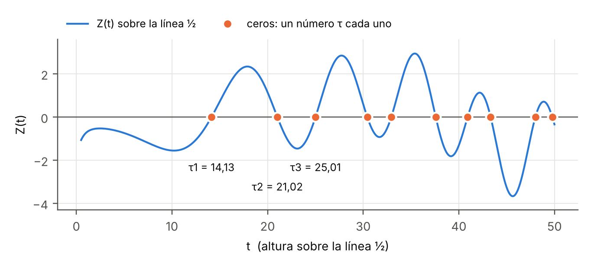
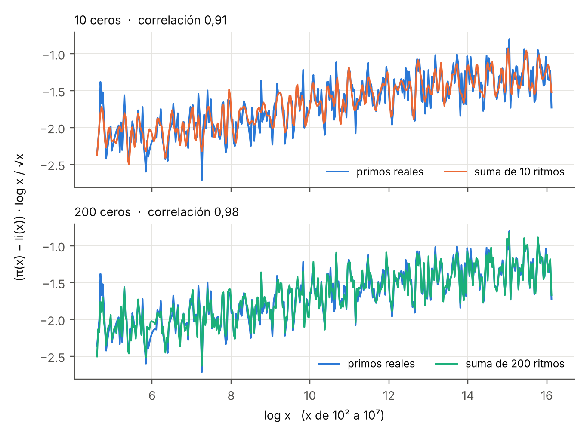

# Un número por cero

*Novedad, espejo y el pivote ½ de la hipótesis de Riemann*

**Le Matt Ansatz Di Ego** 
Endless Monkey Project 
Relational Geometry Program

Reflexión sobre la Formalización R–01 / R–02 · Versión 1.0 · 17 de noviembre de 2026

<!-- fin-encabezado -->

## Resumen

Esta reflexión sigue un solo hilo, desde la criba de los primos hasta los ceros de la función $\zeta$. Cada primo es una novedad que se hereda. La discrepancia del conteo tiene una parte estructural y una fluctuación. La fluctuación es una suma de ritmos, uno por cada cero. Cada ritmo tiene un radio frente a cada pared y un reflejo en el pivote $\tfrac12$. Leída así, la hipótesis de Riemann dice que cada cero queda fijado por un solo número.

El texto separa lo demostrado, lo comprobado con números y lo que queda abierto, y cierra con un puente al vocabulario estándar. La misma forma —herencia, novedad y un pivote con su par $\pm$— aparece demostrada en las octavas de Mersenne.

## 1. Qué es este documento

Es una lectura, en el vocabulario del programa, de dónde queda la hipótesis de Riemann después de la Formalización R–01 / R–02. Reúne tres fuentes: esa formalización, la nota del programa sobre el espectro de Mersenne y las lecturas que surgieron al conectarlas. Las piezas matemáticas son clásicas y están nombradas en el puente final (§13). Los números salen de dos scripts que acompañan al texto.

Cada afirmación lleva su estado:

- **Demostrado**: tiene prueba completa, clásica o en R–01 / R–02.
- **Verificado**: comprobado con números por los scripts.
- **Lectura**: interpretación en el vocabulario del programa.
- **Abierto**: lo que queda por mostrar.

## 2. La herencia y la pared que se corre

Cada primo nuevo es una **novedad**: un módulo coprimo con todos los anteriores. Al incorporarlo, quita a los sobrevivientes su propia copia dilatada:

$$A_{k+1}(x) = A_k(x) - A_k(x/p_{k+1}),$$

donde $A_k(x)$ cuenta los enteros hasta $x$ que sobreviven a los primeros $k$ primos. Todo lo anterior se conserva; la novedad solo agrega su corte. *Demostrado; verificado en 400 casos exactos.*

En escala logarítmica, $t = \log x$, dividir por $p$ es correr la **pared** una distancia fija, $\log p$. Las escalas que la herencia conecta, $\lfloor x/n \rfloor$, son las **escalas relacionales**. Forman un conjunto cerrado, $D(x)$, de unos $2\sqrt{x}$ valores, y con esa sola tabla la herencia cuenta primos exactos: $\pi(10^9) = 50\,847\,534$ con $63\,244$ valores. *Demostrado; verificado.*

En un período completo, cada novedad multiplica la energía de la discrepancia por $2(1 - 1/p)$, y su correlación con la escala dilatada es exactamente $1/p$. *Demostrado; verificado exacto para $k \le 4$.*

## 3. Referencia, cierre y fluctuación

La **referencia independiente**, $x\delta_k$ con $\delta_k = \prod_{j \le k}(1 - 1/p_j)$, supone que cada primo restringe por su cuenta.

En el **cierre**, cuando las restricciones llegan a $\sqrt{x}$, los sobrevivientes son exactamente los primos. Ahí la referencia independiente se pasa por un factor $2e^{-\gamma} \approx 1{,}123$. La herencia acumulada la corrige (función de Buchstab, factor $e^{\gamma}/2$ en el cierre), y lo que queda es la **fluctuación** $\pi(x) - \mathrm{li}(x)$.

En $x = 10^7$, la parte estructural vale $-31\,540{,}6$ y la fluctuación $-339{,}4$: unas 93 veces menor. *Demostrado (Proposición 3 de R–01 / R–02); verificado.*

## 4. Los ritmos

La fluctuación es una suma de **ritmos**, uno por cada cero $\rho = \beta + i\tau$ de $\zeta$ (fórmula explícita). En $t = \log x$, cada ritmo oscila con frecuencia $\tau$.

La herencia conserva cada ritmo:

$$T_p\, x^{\rho} = x^{\rho} - (x/p)^{\rho} = (1 - p^{-\rho})\, x^{\rho}.$$

Cada novedad multiplica el ritmo por un número fijo y lo deja separado de los demás. *Demostrado; verificado.*

Con 200 ceros, la suma de ritmos sigue a los primos reales con correlación $0{,}977$ entre $x = 10^2$ y $10^7$ (Figura 2). *Verificado.*

## 5. El radio de cada ritmo frente a la pared

En el factor $1 - p^{-\rho}$, la parte que depende del cero tiene tamaño

$$|p^{-\rho}| = p^{-\beta}.$$

Ese es el **radio** del ritmo frente a la pared $p$; la frecuencia $\tau$ solo lo hace girar. Para los primeros ceros, $|2^{-\rho}| = 0{,}707107 = 1/\sqrt{2}$, $|3^{-\rho}| = 0{,}577350 = 1/\sqrt{3}$, y así con cada primo. *Verificado.*

La hipótesis de Riemann, en este lenguaje: el radio de cada ritmo frente a cada pared es $1/\sqrt{p}$. *Equivalencia directa.*

## 6. El pivote y el espejo

La $\zeta$ completada, $\xi(s) = \tfrac12 s(s-1)\pi^{-s/2}\Gamma(s/2)\zeta(s)$, tiene un **espejo**: $\xi(s) = \xi(1-s)$. Escribiendo $s = \tfrac12 + z$, vale lo mismo en $z$ y en $-z$. La línea $\tfrac12$ es el **pivote**. *Demostrado (Riemann, 1859); verificado con diferencia relativa menor que $10^{-20}$.*

Por el espejo, los ceros vienen en pares $\pm z$ alrededor del pivote. Además, $\zeta$ es real sobre el eje real, así que cada cero trae su conjugado. Un cero fuera de la línea forma un grupo de cuatro: $\rho$, $\bar\rho$, $1 - \rho$, $1 - \bar\rho$. Un cero sobre la línea forma un grupo de dos, $\tfrac12 \pm i\tau$, y ese $\pm$ sale gratis: el cero queda fijado por **un solo número**, $\tau$.

Fuera de la línea harían falta dos números: $\tau$ y la distancia al pivote, $\beta - \tfrac12$. Ese segundo número es el **dato extra**.

**Un número por cero.** La hipótesis de Riemann dice que ningún cero lleva el dato extra. *Equivalencia directa.*

La función real $Z(t)$ se anula en cada cero sobre la línea; si el cero es simple, hay un cruce (Figura 1). *Verificado en el tramo calculado.*

**Comprobación con números.** El principio del argumento cuenta $649$ ceros en la franja con altura hasta $1000$, y $Z(t)$ cruza el cero exactamente $649$ veces en ese tramo. Los $649$ ceros están sobre la línea, y cada uno queda fijado por su $\tau$: $14{,}134725$; $21{,}022040$; $25{,}010858$; … *Verificado.* Platt y Trudgian (2021) verificaron lo mismo para todos los ceros con $0 < \tau \le 3 \cdot 10^{12}$.

*Figura 1. $Z(t)$ sobre la línea $\tfrac12$, de $t = 0$ a $50$: cada cero es un cruce, fijado por un solo número $\tau$.*

## 7. Novedad sin duplicar

En la lectura del programa, cada cero es una novedad: un espacio nuevo que se genera cuando las descripciones anteriores no alcanzan, y que después sirve de nodo de referencia para las comparaciones.

Un cero fuera de la línea vendría con su reflejo: la misma frecuencia y otro radio. Serían dos identidades. Un cero sobre la línea es su propio reflejo: una sola identidad, sostenida por los dos valores $\pm\tau$, que en el fondo son un solo número.

En esta lectura, la hipótesis de Riemann dice que lo que surge como novedad llega una sola vez. *Lectura.*

## 8. Frecuencias perpendiculares

Las frecuencias $\tau$ se leen como **perpendiculares**: entre ellas se conjetura que no hay ninguna relación racional (hipótesis LI). Si vale LI, las fases de cualquier colección finita recorren densamente su toro y se aproximan arbitrariamente a cada configuración de esa colección (Kronecker–Weyl). *Conjetura.*

La perpendicularidad y el radio son datos distintos. La perpendicularidad habla de las frecuencias $\tau$; el radio lo fija $\beta$. La hipótesis de Riemann es una afirmación sobre el radio.

Ilustración: con los cuatro primeros $\tau$ y coeficientes enteros de tamaño hasta $10$, la combinación más pequeña vale $0{,}0100$, con coeficientes $(-8, 3, 2, 0)$. Ninguna combinación pequeña se anula. *Verificado, como ilustración.*

## 9. Las octavas de Mersenne: la misma forma en los enteros

La nota del programa sobre el espectro de Mersenne estudia $M_n = 2^n - 1$. Ahí la misma forma está demostrada.

**Pivote.** Cada octava se parte en dos alrededor de un pivote:

$$M_{2k} = (2^k - 1)(2^k + 1),$$

los dos vecinos $\pm 1$ de $2^k$, coprimos entre sí. *Demostrado; verificado para $k \le 64$.*

**Herencia.** $M_k$ divide a $M_{nk}$: cada nivel queda guardado en todos sus múltiplos, una repetición posterior que mantiene la secuencia. *Demostrado; verificado para $k \cdot n \le 120$.*

**Novedad.** Para cada $n > 1$, $M_n$ tiene un primo nuevo, que no aparece en ningún nivel anterior y cuyo período es exactamente $n$ (Bang, 1886; Zsigmondy, 1892). Cuando las descripciones anteriores no alcanzan, aparece una referencia nueva. La única excepción es $n = 6$: $63 = 3^2 \cdot 7$, todo heredado. El programa ya leía el $6$ como el nivel sin orden nuevo; el teorema de Bang lo vuelve definitivo para toda la sucesión. *Demostrado; verificado para $n \le 64$: el único nivel sin primo nuevo es el $6$.*

**El factor nuevo de cada octava**, $2^k + 1$:

- si $k$ es potencia de $2$, es un número de Fermat, coprimo con todos los anteriores, y la octava recibe solo material nuevo;
- si $k$ tiene un factor impar $r$, repite el material de $2^{k/r} + 1$.

*Demostrado; verificado para $k \le 64$, con $F_0, \dots, F_6$ coprimos dos a dos y $F_5 = 641 \cdot 6\,700\,417$.*

**Lectura.** En los enteros y en $\zeta$ aparece la misma forma: una herencia que conserva, una novedad que agrega y un pivote con su par $\pm$. En las octavas de Mersenne la forma está demostrada. En $\zeta$, que cada par $\pm$ quede sobre el pivote es la hipótesis de Riemann.

## 10. Lo que se pudo hilar y comprobar con números

| Afirmación | Estado | Número |
|:--|:--|:--|
| Herencia exacta de la criba | Demostrado | 400 casos exactos |
| Energía por período y correlación $1/p$ | Demostrado | exacto: $1/12$, $1/9$, $8/45$, $32/105$ |
| Tres capas del cierre | Demostrado | $x = 10^7$: estructura $-31\,540{,}6$, fluctuación $-339{,}4$ |
| Escalas relacionales $D(x)$ y conteo exacto | Demostrado | $\pi(10^9) = 50\,847\,534$ |
| Ritmos conservados por la herencia | Demostrado | $T_p x^{\rho} = (1 - p^{-\rho})x^{\rho}$ |
| Fluctuación como suma de ritmos | Conocido | correlación $0{,}977$ con 200 ceros |
| Pivote: $\xi(\tfrac12 + z) = \xi(\tfrac12 - z)$ | Demostrado | diferencia menor que $10^{-20}$ |
| Un número por cero hasta altura 1000 | Verificado | $649$ ceros en la franja, $649$ cruces en la línea |
| Radio $1/\sqrt{p}$ de cada ritmo | Equivalente a la hipótesis | exacto en los ceros calculados |
| Octavas de Mersenne: pivote, herencia, novedad | Demostrado | $n \le 64$; único nivel sin novedad: $6$ |
| Factores de Fermat coprimos | Demostrado | $F_0, \dots, F_6$ |
| Frecuencias perpendiculares (LI) | Conjetura | combinación mínima $0{,}0100$ |
| Un número por cero para todo cero | Abierto: es la hipótesis | verificado hasta $\tau \le 3 \cdot 10^{12}$ |

## 11. Lo que queda por mostrar

**La razón.** Falta mostrar, desde los primos y la definición de $\zeta$, por qué cada cero tiene que ser su propio reflejo. Esa razón es la hipótesis misma.

**El límite de la criba.** La criba cuenta bien todo lo que se describe con restos, pero queda ciega a si un número tiene una cantidad par o impar de factores primos (barrera de paridad de Selberg). El control fino de la fluctuación pide justo esa distinción.

**La ruta del operador.** Una ruta estudiada busca un operador autoadjunto cuyos valores propios sean las frecuencias $\tau$ (idea de Hilbert y Pólya). Esa simetría haría de los ritmos vectores propios ortogonales y dejaría los ceros sobre el pivote. En R–01 / R–02 los ritmos $x^{\rho}$ ya son funciones propias de la herencia $T_p$, pero $T_p$ es una dilatación: sus valores propios $1 - p^{-\rho}$ son complejos y dejan $\beta$ libre.

**Entre el piso y el techo.** El exponente $\tfrac12$ es un piso demostrado (Littlewood, 1914). La hipótesis lo vuelve también techo. Entre ambos queda un factor logarítmico, del orden de $\log^2 x / \log\log\log x$, que sigue abierto aun suponiendo la hipótesis.

## 12. Qué aporta esta lectura

Las piezas matemáticas son clásicas: la herencia de Legendre y Buchstab, la fórmula explícita, el espejo de Riemann, el teorema de Bang y Zsigmondy. El aporte es de lectura: un solo hilo —novedad, pared que se corre, espejo, pivote— que llega a la hipótesis de Riemann sin cambiar de vocabulario, y que encuentra la misma forma, ya demostrada, en las octavas de Mersenne.

Un argumento nuevo sería uno que, desde ese hilo, obligue a cada cero a llevar un solo número.

## 13. Puente al vocabulario estándar

| Programa | Estándar | Sección |
|:--|:--|:-:|
| Novedad | primo nuevo $p_{k+1}$; en Mersenne, divisor primitivo | 2, 9 |
| Herencia | recursión de Legendre y Buchstab; $M_k \mid M_{nk}$ | 2, 9 |
| Pared que se corre | dilatación $x \mapsto x/p$; corrimiento $\log p$ en $t = \log x$ | 2 |
| Escalas relacionales | $D(x) = \lbrace \lfloor x/n \rfloor \rbrace$ | 2 |
| Referencia independiente / corregida | densidad $x\delta_k$; función de Buchstab $\omega$; fórmula de Mertens | 3 |
| Cierre | escala $\sqrt{x}$; identidad de Legendre | 3 |
| Fluctuación | $\pi(x) - \mathrm{li}(x)$ | 3 |
| Ritmos | términos $x^{\rho}$ de la fórmula explícita | 4 |
| Radio frente a la pared | $\lvert p^{-\rho} \rvert = p^{-\beta}$ | 5 |
| Espejo | ecuación funcional $\xi(s) = \xi(1-s)$ | 6 |
| Pivote | línea crítica $\mathrm{Re}\, s = \tfrac12$; $\Xi$ par | 6 |
| Un número por cero | $\beta = \tfrac12$: hipótesis de Riemann | 6 |
| Dato extra | $\beta - \tfrac12$ | 6 |
| Frecuencias perpendiculares | independencia lineal de las $\tau$ (LI) | 8 |
| Vuelve cerca sin cerrar | teorema de Kronecker y Weyl; casi periodicidad | 8 |
| Octava | $M_{2k} = (2^k - 1)(2^k + 1)$ | 9 |
| Nivel 6 sin orden nuevo | excepción $n = 6$ del teorema de Bang y Zsigmondy | 9 |
| Octava con solo material nuevo | números de Fermat | 9 |
| Límite de la criba | barrera de paridad de Selberg | 11 |
| Operador simétrico | conjetura de Hilbert y Pólya | 11 |

## Archivos y reproducción

- `verificacion_un_numero_por_cero.py` (Python con numpy, mpmath y sympy; matplotlib para la Figura 1) reproduce §5, §6, §8 y §9 en unos 30 segundos. Los bloques con aserciones detienen la ejecución si algo falla.
- `verificacion_R01_R02.py` reproduce los números de §2, §3 y §4, y genera la Figura 2.
- `FORMALIZACION_R01_R02_ES.md` contiene las demostraciones de §2 a §4.

*Figura 2. Reconstrucción truncada: fluctuación normalizada $(\pi(x) - \mathrm{li}(x))\log x/\sqrt{x}$ de los primos reales frente a la suma de 10 ritmos (arriba) y de 200 ritmos (abajo).*

## Referencias

- Bang, A. S. (1886). *Taltheoretiske Undersøgelser.* Tidsskrift for Mathematik (5) 4.
- Hardy, G. H. (1914). *Sur les zéros de la fonction $\zeta(s)$ de Riemann.* C. R. Acad. Sci. Paris 158.
- Le Matt Ansatz Di Ego (2026). *Las escalas relacionales de la criba: herencia, cierre y la escala √x de la hipótesis de Riemann.* Formalización R–01 / R–02, Endless Monkey Project.
- Littlewood, J. E. (1914). *Sur la distribution des nombres premiers.* C. R. Acad. Sci. Paris 158.
- Platt, D., Trudgian, T. (2021). *The Riemann hypothesis is true up to 3·10¹².* Bull. London Math. Soc. 53, 792–797.
- Riemann, B. (1859). *Ueber die Anzahl der Primzahlen unter einer gegebenen Grösse.* Monatsber. Königl. Preuss. Akad. Wiss. Berlin.
- Rubinstein, M., Sarnak, P. (1994). *Chebyshev's bias.* Experiment. Math. 3.
- Selberg, A. (1949). *On elementary methods in prime number theory and their limitations.* 11.º Congreso Matemático Escandinavo, Trondheim.
- Titchmarsh, E. C. (1986). *The Theory of the Riemann Zeta-Function*, 2.ª ed., revisada por D. R. Heath-Brown. Oxford University Press.
- Zsigmondy, K. (1892). *Zur Theorie der Potenzreste.* Monatsh. Math. Phys. 3.
