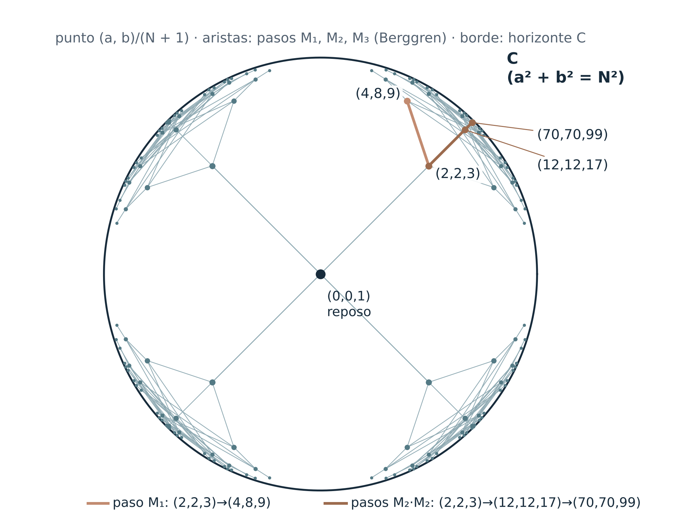

# G-01 y su interpretación gravitatoria propuesta

## Solicitud de revisión independiente

**Le Matt Ansatz Di Ego · Programa de Geometría Relacional · 2 de noviembre de 2026**

**En revisión:** el documento G–01 v1.3 y su verificador, publicados con la etiqueta `2026-11-01` (commit `00616e5c93d0af3bc485b55ed3738a3d51ed5de6`) en [`2026-11-01_G01_mecanismo_de_la_gravedad/`](../../2026-11-01_G01_mecanismo_de_la_gravedad/LEER_PRIMERO.md). El [texto español](../../2026-11-01_G01_mecanismo_de_la_gravedad/articulo/G01_Mecanismo_de_la_Gravedad_v1.3_2026-11-01.md) es la versión de referencia; la traducción inglesa está completa.

## La solicitud en breve

G–01 pregunta si la gravedad podría ser la manifestación geométrica de una operación relacional: cierres que construyen una referencia común sin perder su identidad. El programa no parte de una fuerza, un potencial ni una ley de aceleración. Parte de la comparación, de la normalización común y del resto que una referencia nueva deja pendiente.

El enunciado central que se propone revisar es aritmético: en el conjunto S de ternas enteras positivas (a,b,N) que satisfacen a²+b²+1=N², con el par (a,b) ordenado, las tres matrices de Berggren generan un árbol con raíz (2,2,3). Cada elemento de S distinto de la raíz tendría un único padre de menor N. La raíz no tiene padre en S. El reposo (0,0,1) y los puntos con otros signos quedan fuera de este dominio. No se atribuye prioridad a este enunciado: se pide revisar su demostración y localizar precedentes.

La normalización da la identidad exacta |u|²+s²=1, con u=(a/N,b/N) y s=1/N. Interpretar u como velocidad/c y s como dτ/dt usa una identificación cinemática adicional. La propuesta gravitatoria requiere todavía una dinámica y un vínculo con observables físicos.

La primera revisión puede limitarse a **Q1–Q3**: comprobar la prueba por descenso de B19 en ese dominio, localizar precedentes y examinar qué comprueba el verificador. Se agradece una respuesta razonada sobre cualquiera de esos puntos. Los demás resultados (B10–B12 y B18–B21), la crítica física y las sugerencias de investigación son encargos opcionales; no se pide al revisor completar el mecanismo que falta.

**Lo que no se afirma.** G–01 no deriva la gravedad, la ley de Newton, una métrica ni una constante de acoplamiento. Su estado ROSI es **OPEN**. La coincidencia de forma con la dilatación gravitatoria se registra como hipótesis, no como resultado.

## 1. Contrato de lectura

Cada enunciado lleva una etiqueta: [O] orientación ontológica, [D] definición, [T] resultado exacto bajo hipótesis declaradas, [H] hipótesis física, [C] consecuencia condicional, [F] falsador o ejemplo discriminante, [P] problema pendiente. Los estados ROSI (RESOLVED, OPEN, SUPERPOSED, PREMATURELY COLLAPSED) describen el estado de una afirmación, no el valor de su autor. Se puede aceptar un [T] y rechazar todos los [H] construidos sobre él; queremos saber cuáles.

Las etiquetas describen lo que la fuente propone y no sustituyen una revisión independiente. La enumeración finita puede detectar errores y respaldar controles concretos; la cobertura de todas las soluciones requiere una demostración general.

## 2. Afirmaciones en revisión

| ID | Enunciado | Dónde | Estatus | Qué comprobar |
|---|---|---|---|---|
| R1 | En S, a²+b²+1=N² equivale a N²−a²−b²=1 y a la identidad normalizada \|u\|²+s²=1, u=(a/N,b/N), s=1/N | §2D, B18 | [T] algebraico; [C] cinemático | Separar la identidad de la identificación con momento, energía y ritmo propio; explicitar las unidades |
| R2 | El cono a²+b²=N² es el conjunto nulo de la forma cuadrática; las direcciones normalizadas de S se aproximan a él cuando N→∞. Identificarlo con C es una lectura del programa | §2D | [T] geométrico; [O] para C | Distinguir el borde ideal de la realización y la definición ontológica de C en §2A |
| R3 | En S, las matrices M₁, M₂, M₃ conservan N²−a²−b² y generan el árbol propuesto de raíz (2,2,3). Cada elemento salvo la raíz tiene un padre único de menor N | §2D, B19 | [T] en la fuente; por revisar | Prueba por descenso y unicidad; distinguirlas del control finito declarado: 754 de 754 ternas positivas ordenadas con 1<N≤3000, incluida la raíz |
| R4 | En la rama a=b, arccosh N = k·ln(3+2√2); la cadena anidada N′=N(4N²−3) triplica ese parámetro hiperbólico | §2D, B20 | [T]; [C] como rapidez | Revisar el cálculo de Pell y los precedentes; la lectura cinemática usa la identificación de R1 |
| R5 | La regla de continuación de O58, M=qN, no sigue el árbol: de 15 soluciones con 3<N≤120 y a≤b, sólo 2 tienen N múltiplo del de su padre | §2D | [F/T] | Si es la comparación correcta entre dos nociones de continuación |
| R6 | Para α real y ε>0, q_ε es el menor q≥1 que admite un entero p con \|α−p/q\|≤ε. B21 da q_ε≤⌈1/ε⌉ y L_ε es el MCM de esos denominadores para una familia finita. La cota permite saltos en los umbrales | §2B, B21 | [T] bajo el contrato de B21; [H/P] físico | Comprobar dominio, norma del error, redondeo y alcance simultáneo; definir por separado cualquier requisito de continuidad o estabilidad |
| R7 | Si W(r)=V(r,0) es diferenciable, F_r(r,0)=−W′(r). La fuerza es no nula donde W′(r)≠0; no es idénticamente cero si W no es constante en un intervalo conexo | §11, B10 | [T] bajo esas hipótesis | Si g(0)=0, queda F_r=−U′(r): la normalización de la fase sola no decide toda la fuerza |
| R8 | Para el potencial central Φ=−kR⁻ᵖ, k>0 y p>0, la estabilidad radial estricta de una órbita circular exige 0<p<2. p=2 es marginal; p>2 es inestable en este modelo | §13, B11 | [T/F] bajo el modelo central | Distinguir potencial R⁻ᵖ de fuerza R⁻⁽ᵖ⁺¹⁾: fuerza inversa cúbica corresponde a p=2, potencial inverso cúbico a p=3 |
| R9 | Con M constante, simétrica y definida positiva, W sin dependencia temporal y q̈=−M∇W, se conserva E=½q̇ᵀM⁻¹q̇+W. Para q̇=−M∇W, dW/dt≤0 | §12, B12 | [T] bajo esas hipótesis | Revisar el argumento energético y sus condiciones, no atribuirlo a toda dinámica de segundo o primer orden |
| R10 | Bajo la identificación relativista usual, s=1/N=1/γ=dτ/dt=mc²/E (m/E si c=1). Leerlo como persistencia complementaria es una interpretación adicional | §2D, §10 | [C] cinemático; [H] interpretación | Si la interpretación agrega una predicción u obligación distinta de la identidad conocida |
| R11 | La comparación con relojes estáticos del exterior de Schwarzschild sería 1/N²=1−r_s/r. En S, N≥3 implica r_s/r≥8/9; esta lectura literal no contiene un régimen de campo débil no trivial | §2D | [H/P] puente; [T] obstrucción algebraica | Qué construcción adicional recuperaría el campo débil; la resolución finita por sí sola no aporta ese mapa |
| R12 | Con tres canales, a²+b²+c²+1=N² vive en 3+1; su árbol y sus generadores están por construir | §2D, Prueba P | [H/P] | Estructura conocida de los puntos enteros del hiperboloide unidad en 3+1 |

## 3. El resultado central

El contrato O58 surgió en el programa de una pregunta de normalización. Para esta solicitud el dominio es S={(a,b,N)∈Z³: a>0, b>0, N>0, a²+b²+1=N²}. El orden de a y b se conserva: (4,8,9) y (8,4,9) son nodos distintos. El reposo X₀=(0,0,1) pertenece a la hoja futura del hiperboloide, pero no a S ni al árbol propuesto. Las soluciones con signos distintos requieren una extensión del dominio y no están incluidas en el enunciado de unicidad.

La identidad exacta es:

    (a/N)² + (b/N)² + (1/N)² = 1,   u=(a/N,b/N),   s=1/N.

Si se asignan E=Nmc² y p=mc(a,b), con m>0, se obtiene la relación relativista usual y u=v_física/c, s=1/γ=dτ/dt para un reloj móvil respecto de una referencia inercial. Es una identificación condicionada; la aritmética por sí sola no identifica relojes, masas ni gravedad.

Las tres matrices de Berggren

    M₁ = ((1,−2,2),(2,−1,2),(2,−2,3)),
    M₂ = ((1,2,2),(2,1,2),(2,2,3)),
    M₃ = ((−1,2,2),(−2,1,2),(−2,2,3)).

cumplen MᵀJM=J con J=diag(1,1,−1). Desde (2,2,3) dan (4,8,9), (12,12,17) y (8,4,9). Las dos ramas de O58 que el programa había encontrado, (2,2,3)→(4,8,9) y (2,2,3)→(70,70,99), son respectivamente un paso M₁ y dos pasos M₂ a través de (12,12,17).

Desde el reposo, las tres matrices dan el mismo hijo (2,2,3). El camino etiquetado único se cuenta a partir de esa raíz positiva. B19 propone demostrar por descenso la cobertura de S y la unicidad del padre para cada nodo distinto de la raíz. El verificador declara coincidencia para 754 de 754 nodos con 1<N≤3000. Ese recuento incluye la raíz y controla un rango finito; no reemplaza el paso general de la prueba.

*Figura de la edición fuente, con sus sectores reflejados por signos y el reposo. El enunciado de unicidad de esta solicitud corresponde a S en el sector positivo. Los puntos se representan por (a,b)/(N+1). El borde ideal parametriza direcciones nulas y su identificación con C es una interpretación.*

El hiperboloide, equipado con la geometría de esta realización, lleva la distancia adimensional cosh d(X,X′)=NN′−aa′−bb′. Respecto de X₀, d=arccosh N; se interpreta como rapidez bajo la identificación cinemática anterior. G–01 propone usar transformaciones de Lorentz enteras como continuación y esta distancia como variable de cierre. Siguen pendientes la regla de selección del generador y un mapa de esa distancia en el espacio de velocidades a una separación física.

## 4. Lo que esperamos que sea clásico

Declaramos nuestra propia expectativa para que quien revise la confirme o la corrija. Esta solicitud no acredita prioridad ni novedad matemática.
- El árbol de Berggren de las ternas pitagóricas primitivas (Berggren 1934; Barning 1963) y su descripción por el grupo ortogonal entero de x²+y²−z² son clásicos. El título de Barning menciona triángulos «cuasipitagóricos», que podrían contener ya el caso a²+b²=N²−1.
- Se han estudiado árboles de tipo Berggren para otras formas cuadráticas (Cha, Nguyen y Tauber 2018). El árbol de a²+b²+1=N² con raíz (2,2,3) podría ser un caso particular.
- La ecuación de Pell, el teorema de aproximación de Dirichlet, la estabilidad de órbitas con fuerzas de potencia y el argumento de energía de B12 son material de texto.

Si R1–R4 y R6–R9 son todos clásicos, la contribución en revisión es más estrecha: identificar un contrato construido dentro del programa, en un contexto de fluidos y normalización, con esta estructura, y proponer usarlo como operador de continuación del hilo gravitatorio. Preferimos que eso quede dicho con claridad a que se exagere.

## 5. Dónde la crítica es más útil

- **Selección.** El árbol ofrece tres continuaciones en cada nodo. ¿Qué regla debería elegir? Hay candidatos: una dinámica sobre el árbol (por ejemplo, el sistema dinámico de Romik sobre las ternas pitagóricas), una regla de distancia mínima, un funcional que se extremice o un paseo aleatorio con pesos físicos.
- **Del espacio de velocidades al espacio físico.** d(X,X′) es una distancia entre velocidades. ¿Qué construcción convertiría una sucesión de cierres en longitudes y relojes sin importar la métrica que se quiere derivar?
- **Fuente y equivalencia.** Nada en la realización contiene una fuente, un acoplamiento ni la igualdad de masa inercial y gravitatoria.
- **El campo débil.** Para relojes estáticos en el exterior de Schwarzschild, con t normalizado en el infinito, dτ/dt=√(1−r_s/r). Igualar literalmente esto a 1/N en S da r_s/r=1−1/N²≥8/9, mientras que el campo débil exige r_s/r≪1. Añadir X₀ sólo da el caso aislado r_s/r=0. Falta una construcción que produzca valores no triviales entre 0 y 8/9 y respete los observables; mencionar resolución finita no resuelve esta obstrucción.
- **Múltiplos frente a composición de Lorentz.** La regla de normalización del programa y el árbol componen de forma distinta. ¿Cuál, si alguna, debería corresponder a la física?

## 6. Preguntas para la revisión independiente

Se agradecen respuestas parciales y razonadas. **La primera prioridad es Q1–Q3**; se puede responder sólo una de ellas. Q4–Q12 son críticas u orientaciones adicionales opcionales y no requieren completar una teoría física.

1. **Q1. Demostración de B19.** ¿Es completa y correcta para S, con pares ordenados positivos y excepción de la raíz, en particular la exclusión de dos signos negativos y la unicidad del padre?
2. **Q2. Precedente del árbol.** ¿Está ya explícito el árbol de a²+b²+1=N² con raíz (2,2,3) en Barning (1963), en Cha–Nguyen–Tauber (2018) o en otro lugar? ¿Cuál es la referencia más antigua?
3. **Q3. Verificador.** ¿Comprueba `verificar.py` el dominio y los controles declarados, incluido el recuento de 754 nodos? ¿Distingue adecuadamente las comprobaciones finitas de la prueba general de B19?
4. **Q4. Identificación de C.** ¿Es coherente identificar el horizonte C del programa, definido en §2A como límite inalcanzable de la comparación, con el cono nulo de esta realización?
5. **Q5. Regla de selección.** ¿Qué regla con fundamento podría elegir uno de M₁, M₂, M₃ en cada paso? ¿Alguna dinámica conocida sobre el árbol de Berggren tiene aquí una interpretación física?
6. **Q6. De distancia a longitud.** ¿Hay una construcción que convierta la distancia hiperbólica entre cierres en una longitud física sin suponer de antemano una métrica?
7. **Q7. Múltiplos o Lorentz.** ¿Tiene sentido la comparación de R5? ¿Hay razones para preferir la regla M=qN del programa a la composición de Lorentz, o al revés?
8. **Q8. Resolución finita.** ¿Es correcta la cota de B21 bajo su definición exacta de error y de q_ε? ¿Qué regularidad o estabilidad tiene L_ε, y qué resultados de aproximación simultánea son pertinentes? Una cota finita no debe confundirse con continuidad.
9. **Q9. Lectura física.** ¿Agrega la interpretación de 1/N=mc²/E (R10), bajo las identificaciones declaradas, contenido contrastable más allá de la cinemática conocida?
10. **Q10. Puente gravitatorio.** ¿Confirma la lectura literal la obstrucción r_s/r≥8/9 en S? ¿Qué dato o construcción haría contrastable una extensión con campo débil? No se presupone que la resolución finita lo consiga.
11. **Q11. Tres canales.** ¿Qué se sabe de los puntos enteros de N²−a²−b²−c²=1 y del grupo de Lorentz entero en 3+1 (por ejemplo, si está generado por reflexiones, como en el enfoque de Vinberg)? ¿Hay un árbol con descenso?
12. **Q12. Contribución.** ¿Qué enunciados, si alguno, merecen examen independiente como nuevos, y cuáles están completamente contenidos en matemática o física conocidas?

## 7. Materiales y reproducción

Todo el material está en [`2026-11-01_G01_mecanismo_de_la_gravedad/`](../../2026-11-01_G01_mecanismo_de_la_gravedad/LEER_PRIMERO.md), etiqueta `2026-11-01`:
- el documento en [español](../../2026-11-01_G01_mecanismo_de_la_gravedad/articulo/G01_Mecanismo_de_la_Gravedad_v1.3_2026-11-01.md) y en [inglés](../../2026-11-01_G01_mecanismo_de_la_gravedad/articulo/G01_Mechanism_of_Gravity_v1.3_2026-11-01_EN.md), también en PDF y Word;
- el [verificador](../../2026-11-01_G01_mecanismo_de_la_gravedad/verificacion/verificar.py), que sólo usa la biblioteca estándar de Python, y sus [resultados](../../2026-11-01_G01_mecanismo_de_la_gravedad/verificacion/resultados.json);
- la [revisión de la v1.2](../../2026-11-01_G01_mecanismo_de_la_gravedad/revision/G01_revision_v1.2_a_v1.3.xlsx) que llevó a la v1.3, y las versiones 1.0 a 1.2 en `historial/`.

Para reproducir:

    git clone https://github.com/EndlessMonkeyProyect/programa-geometria-relacional.git
    cd programa-geometria-relacional
    git checkout 2026-11-01
    cd 2026-11-01_G01_mecanismo_de_la_gravedad
    bash reproducir_todo.sh

El script comprueba el manifiesto SHA-256, corre 15 secciones de aserciones, coteja las 16 ramas de O58 desde (2,2,3) con el archivo del propio O58 y compara los resultados con la copia de referencia. Tarda unos segundos.

La fuente de O58 está en la [edición del 24 de octubre](../../2026-10-24/05_ARCHIVO/navier_stokes_O54_O92/O58_Estela_Escalas_Normalizacion_Cuadratica_2026_10_21/O58_Estela_Escalas_Normalizacion_Cuadratica_2026_10_21/O58_FORMALIZACION.es.md).

## 8. Cómo responder

Abra un issue en el repositorio, o comente en el issue de la solicitud de revisión, indicando la afirmación (R1–R12) o la pregunta (Q1–Q12) que aborda. Se agradecen argumentos, contraejemplos, referencias, demostraciones corregidas e informes de reproducción. Las objeciones se registrarán en términos ROSI: una afirmación que falle quedará marcada así en la versión siguiente, con crédito.

Esta solicitud recibió aclaraciones editoriales de alcance con asistencia de IA. Cada dictamen deberá identificar a quien lo emite y el material que examinó.

## 9. Referencias

- F. J. M. Barning, «On Pythagorean and quasi-Pythagorean triangles and a generation process with the help of unimodular matrices» (en neerlandés), Math. Centrum Amsterdam Afd. Zuivere Wisk. ZW-011 (1963).
- B. Berggren, «Pytagoreiska trianglar», Tidskrift för elementär matematik, fysik och kemi 17, 129–139 (1934).
- J. Bertrand, «Théorème relatif au mouvement d’un point attiré vers un centre fixe», Comptes Rendus 77, 849–853 (1873).
- S. M. Carroll, *Spacetime and Geometry*, Addison-Wesley (2004), cap. 5.
- D. Cass y P. J. Arpaia, «Matrix generation of Pythagorean n-tuples», Proc. Amer. Math. Soc. 109, 1–7 (1990).
- B. Cha, E. Nguyen y B. Tauber, «Quadratic forms and their Berggren trees», J. Number Theory 185, 218–256 (2018).
- K. Conrad, «Pythagorean descent», nota expositiva, https://kconrad.math.uconn.edu/blurbs/linmultialg/descentPythag.pdf
- P. Ehrenfest, «In what way does it become manifest in the fundamental laws of physics that space has three dimensions?», Proc. KNAW 20, 200–209 (1917).
- G. H. Hardy y E. M. Wright, *An Introduction to the Theory of Numbers*, Oxford University Press, cap. XI.
- D. Romik, «The dynamics of Pythagorean triples», Trans. Amer. Math. Soc. 360, 6045–6064 (2008).
