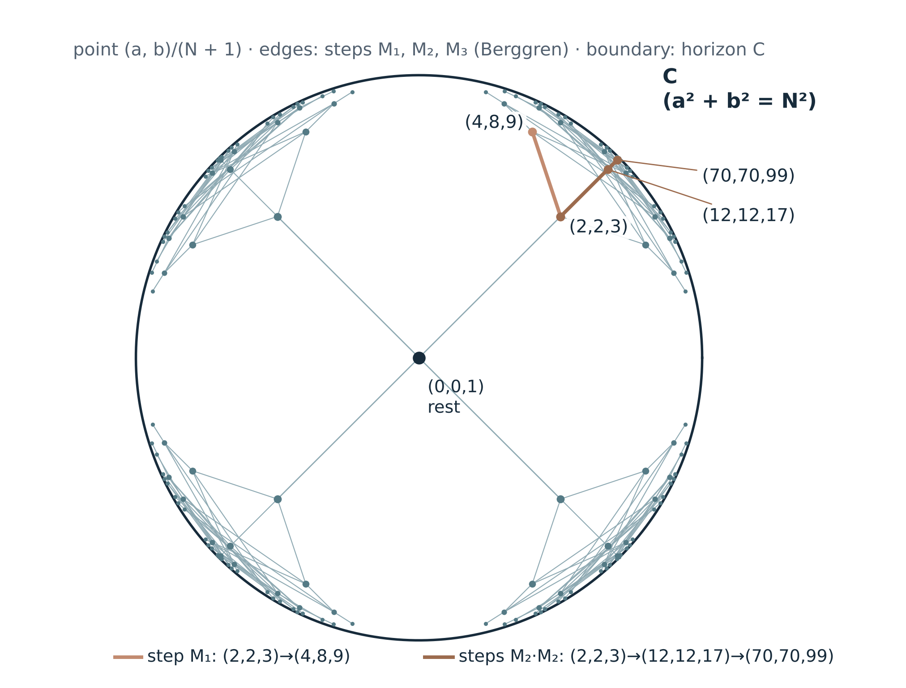

# G-01 and its proposed gravitational interpretation

**Independent review request · Le Matt Ansatz Di Ego · November 2, 2026**

**Material examined.** G-01 v1.3, source edition `2026-11-01`, commit `00616e5c93d0af3bc485b55ed3738a3d51ed5de6`. The [Spanish manuscript](../../2026-11-01_G01_mecanismo_de_la_gravedad/articulo/G01_Mecanismo_de_la_Gravedad_v1.3_2026-11-01.md) is the reference version. The [English manuscript](../../2026-11-01_G01_mecanismo_de_la_gravedad/articulo/G01_Mechanism_of_Gravity_v1.3_2026-11-01_EN.md), verifier and version history are in the [source package](../../2026-11-01_G01_mecanismo_de_la_gravedad/READ_FIRST.en.md).

## The request in brief

G-01 asks whether gravity could arise from relational closures that establish a common reference while preserving their identities. Its proposed route starts with comparison, common normalization and a pending unit, then investigates geometry, continuation rules and physical interpretation.

The first review concerns an arithmetic proposition. Let S be the set of ordered triples of positive integers (a,b,N) satisfying a²+b²+1=N². The three specified Berggren matrices are claimed to generate S from (2,2,3), with a unique parent of smaller N for every node except the root. The rest point (0,0,1) and other sign sectors lie outside S. Mathematical priority remains to be established.

The exact normalized identity is |u|²+s²=1, with u=(a/N,b/N) and s=1/N. Assigning velocity and proper-time meaning to these variables requires a kinematic identification. A gravitational interpretation additionally requires dynamics and a connection to physical observables. The program records that research route as **OPEN**.

**Please start with Q1-Q3.** A reasoned answer on the descent proof, a precedent, or the verifier is already welcome. The remaining questions offer optional mathematical and physical criticism or research directions.

## 1. Scope and reading conventions

The source labels statements as [O] ontological orientation, [D] definition, [T] exact result under hypotheses, [H] physical hypothesis, [C] conditional consequence, [F] falsifier or discriminating example, and [P] open problem. These labels record the source's proposed status. Independent review is requested for the statements marked [T] as well as for their interpretation.

The finite enumeration checks a specified range. The statement for arbitrary N depends on the general descent proof. The gravitational route remains open on the choice of dynamics, physical length, sources, coupling, equivalence of masses and the weak-field regime.

## 2. Claims under review

| ID | Statement | Where | Status | What to check |
|---|---|---|---|---|
| R1 | In S, a²+b²+1=N² is equivalent to N²−a²−b²=1 and to the normalized identity \|u\|²+s²=1, u=(a/N,b/N), s=1/N | §2D, B18 | [T] algebra; [C] kinematics | Distinguish the identity from an assignment of momentum, energy and proper time, and specify units |
| R2 | The cone a²+b²=N² is the null set of the quadratic form. Normalized directions of S approach it as N→∞. Reading this boundary as C is a program interpretation | §2D | [T] geometry; [O] for C | Relate the ideal boundary of the realization to the program's definition of C |
| R3 | In S, M₁, M₂ and M₃ preserve N²−a²−b² and are claimed to generate a tree rooted at (2,2,3). Every non-root node has one parent of smaller N | §2D, B19 | [T] in source; review requested | Descent and uniqueness, separately from the finite count of 754 ordered positive solutions through N=3000, including the root |
| R4 | On the branch a=b, arccosh N=k·ln(3+2√2). The nested continuation N′=N(4N²−3) triples that hyperbolic parameter | §2D, B20 | [T]; [C] as rapidity | The Pell calculation and precedents. The kinematic reading uses the identification in R1 |
| R5 | Of 15 solutions with 3<N≤120 and a≤b, only two have N a multiple of their parent's N. The O58 rule M=qN therefore differs from tree continuation | §2D | [F/T] | The count, ordering convention and meaning of this comparison |
| R6 | For real α and ε>0, q_ε(α) is the least q≥1 admitting an integer p with \|α−p/q\|≤ε. B21 gives q_ε≤⌈1/ε⌉. L_ε is the LCM of these denominators for a finite family | §2B, B21 | [T] for this contract; [H/P] physical | The bound and its domain. A bound allows threshold jumps and supplies no physical stability criterion |
| R7 | For differentiable W(r)=V(r,0), F_r(r,0)=−W′(r). A nonzero force at r requires W′(r)≠0. On a connected interval it is not identically zero if W is nonconstant | §11, B10 | [T] under those assumptions | With g(0)=0 in V=U+Kg, the force at alignment is −U′. Check what the phase normalization actually constrains |
| R8 | For a central potential Φ=−kR⁻ᵖ, k>0 and p>0, strict radial stability of a circular orbit holds for 0<p<2. p=2 is marginal and p>2 unstable in this model | §13, B11 | [T/F] for the central model | Distinguish potential R⁻ᵖ from force R⁻⁽ᵖ⁺¹⁾. An inverse-cube force has p=2, an inverse-cube potential p=3 |
| R9 | For constant symmetric positive M and time-independent W, q̈=−M∇W conserves E=½q̇ᵀM⁻¹q̇+W. The flow q̇=−M∇W satisfies dW/dt≤0 | §12, B12 | [T] under those assumptions | The energy argument and the assumptions needed for each dynamics |
| R10 | Under the usual relativistic identification, s=1/N=1/γ=dτ/dt=mc²/E, or m/E in units c=1. Complementary persistence is an additional interpretation | §2D, §10 | [C] kinematics; [H] interpretation | Whether that interpretation adds a testable prediction beyond known kinematics |
| R11 | Identifying s with static Schwarzschild clock dilation gives 1/N²=1−r_s/r. S has N≥3, hence r_s/r≥8/9, leaving a weak-field gap in the literal integer reading | §2D | [H/P] bridge; [T] algebraic obstruction | What additional construction recovers nontrivial weak fields. Finite resolution alone supplies no such map |
| R12 | With three channels, a²+b²+c²+1=N² defines a unit hyperboloid in 3+1. Its proposed continuation tree and generators remain to be constructed | §2D, Test P | [H/P] | Existing results on the integer Lorentz group and this level set |

## 3. The central proposition and its domain

Here S={(a,b,N)∈Z³ : a>0, b>0, N>0, a²+b²+1=N²}. In particular N>1. The order of a and b matters. Thus (4,8,9) and (8,4,9) are distinct nodes. The rest point X₀=(0,0,1) belongs to the future hyperboloid but is excluded from S. Other signs require a separately specified extension.

    (a/N)² + (b/N)² + (1/N)² = 1,   u=(a/N,b/N),   s=1/N.

Assigning E=Nmc² and p=mc(a,b), with m>0, gives the usual relativistic energy-momentum relation. Then u is physical velocity divided by c and s is dτ/dt for a moving clock relative to an inertial frame. These assignments identify how to read the arithmetic variables.

The three matrices are

    M₁ = ((1,−2,2),(2,−1,2),(2,−2,3)),
    M₂ = ((1,2,2),(2,1,2),(2,2,3)),
    M₃ = ((−1,2,2),(−2,1,2),(−2,2,3)).

They satisfy MᵀJM=J with J=diag(1,1,−1). From (2,2,3) they produce (4,8,9), (12,12,17) and (8,4,9). The previously recorded O58 branches to (4,8,9) and (70,70,99) correspond to one M₁ step and two M₂ steps through (12,12,17).

B19 proposes a descent proof of coverage and uniqueness. From the rest point, all three matrices produce the same root (2,2,3). The labelled tree and its unique-path statement start at that positive root. The finite check gives 754 of 754 nodes for 1<N≤3000, including the root.

*Figure from the source edition, including its sign-reflected sectors and rest point. The uniqueness claim in this request concerns S in the positive sector. The ideal boundary represents null directions. Its reading as the program's C is an interpretation.*

With the hyperbolic geometry of this realization, cosh d(X,X′)=NN′−aa′−bb′. The distance is dimensionless. From rest, d=arccosh N, interpreted as rapidity under the stated kinematic identification. Turning a sequence of these distances into physical separations requires an additional map and a rule selecting the generator at each step.

## 4. Precedents and contribution

The review should locate exact precedents before assessing novelty. The Berggren tree of primitive Pythagorean triples and its integer orthogonal-group description are classical. Barning's work also concerns quasi-Pythagorean triangles. Cha, Nguyen and Tauber study Berggren trees for other quadratic forms. A precise theorem or page covering this level set would clarify the contribution.

The Pell equation, Diophantine approximation, central-orbit stability and energy identities also have established literature. If the mathematical statements are all covered by prior work, the contribution to assess is the program's identification of its O58 normalization contract with this geometry and its proposal for subsequent gravitational research.

## 5. Physical hypotheses and open work

- **Generator selection.** The tree offers three continuations. A physical model needs a rule with a specified observable or dynamical justification.
- **Distance and length.** Hyperbolic distance in velocity space requires an explicit map to spatial separation and clocks.
- **Source and coupling.** A physical gravitational construction needs a source, a coupling and an account of inertial and gravitational mass.
- **Weak field.** For static clocks outside a Schwarzschild source, with coordinate time normalized at infinity, dτ/dt=√(1−r_s/r). Literal equality with 1/N gives r_s/r=1−1/N². In S the minimum N is 3, so r_s/r≥8/9. Adding X₀ supplies only the isolated value zero. The interval 0<r_s/r<8/9 is absent. Recovering weak fields therefore requires an explicit extension and a quantitative account of which integer results that extension retains.
- **Finite resolution.** B21 bounds approximate denominators. Its L_ε can change at resolution thresholds. Any use of finite resolution to address the weak-field gap requires a separate construction and validation.
- **Two continuation rules.** The multiplicative normalization M=qN and Lorentz composition act differently. Their proposed physical roles need specification.

These are optional topics for physical critique. Review of the arithmetic proposition can proceed on its own.

## 6. Questions for independent review

**Q1-Q3 are the first priority.** A response on a single question is welcome. Q4-Q12 offer optional criticism or future directions.

1. **Q1. Descent proof.** Does B19 prove coverage and parent uniqueness for S, with ordered positive pairs and the root exception? Please examine the sign cases and termination.
2. **Q2. Precedents.** Where is this particular tree for a²+b²+1=N² rooted at (2,2,3) already established? Please identify an exact theorem, page or earliest reference where possible.
3. **Q3. Verifier.** Does the verifier test the specified domain and its finite controls, including 754 nodes? Does the presentation clearly identify what depends on the general proof?
4. **Q4. C.** Is the reading of the ideal null boundary as the program's horizon C consistent with the definition in §2A?
5. **Q5. Selection.** Are there relevant known dynamics on such trees that could inform a specified physical selection rule?
6. **Q6. Physical length.** What additional data would be needed to turn these hyperbolic distances into physical lengths without assuming the metric sought?
7. **Q7. Continuation.** Is the comparison of multiplicative normalization and Lorentz composition in R5 meaningful?
8. **Q8. Resolution.** Is B21 correct for its stated approximation error? What regularity does L_ε have, and which approximation results are relevant to a finite family?
9. **Q9. Interpretation.** Does the reading of 1/N=mc²/E as complementary persistence yield a testable statement beyond the specified relativistic identification?
10. **Q10. Weak-field bridge.** Is the obstruction r_s/r≥8/9 correctly formulated? What additional construction would make an extension admitting weak fields testable?
11. **Q11. Three channels.** What is known about positive integer points of N²−a²−b²−c²=1, reflection generators of the integer Lorentz group and possible descent structures?
12. **Q12. Contribution.** Which statements, if any, require examination as additional results, and which are covered by existing mathematics or physics?

## 7. Materials and reproducibility

The [source package](../../2026-11-01_G01_mecanismo_de_la_gravedad/READ_FIRST.en.md) includes the bilingual manuscript, [verifier](../../2026-11-01_G01_mecanismo_de_la_gravedad/verificacion/verificar.py), [results](../../2026-11-01_G01_mecanismo_de_la_gravedad/verificacion/resultados.json), [v1.2 review](../../2026-11-01_G01_mecanismo_de_la_gravedad/revision/G01_revision_v1.2_a_v1.3.xlsx) and version history.

    git clone https://github.com/EndlessMonkeyProyect/programa-geometria-relacional.git
    cd programa-geometria-relacional
    git checkout 2026-11-01
    cd 2026-11-01_G01_mecanismo_de_la_gravedad
    bash reproducir_todo.sh

The script checks the source SHA-256 manifest, runs the verifier's 15 assertion sections, compares the 16 archived O58 branches and checks reference results. Python uses its standard library. The [original O58 source](../../2026-10-24/05_ARCHIVO/navier_stokes_O54_O92/O58_Estela_Escalas_Normalizacion_Cuadratica_2026_10_21/O58_Estela_Escalas_Normalizacion_Cuadratica_2026_10_21/O58_FORMALIZACION.es.md) is in Spanish.

## 8. How to respond

Open or comment on a repository issue, naming R1-R12 or Q1-Q12. Please state the version examined, conclusion, supporting argument or reference, and scope. Partial checks, counterexamples and corrected proofs are welcome. Corrections can be recorded in a subsequent version with the reviewer's chosen attribution. Permission will be requested before publishing a private report.

This request received editorial scope clarification with AI assistance. An assessment should identify the reviewer and the particular material examined.

## 9. References

- F. J. M. Barning, “On Pythagorean and quasi-Pythagorean triangles and a generation process with the help of unimodular matrices”, Math. Centrum Amsterdam, ZW-011 (1963), in Dutch.
- B. Berggren, “Pytagoreiska trianglar”, Tidskrift för elementär matematik, fysik och kemi 17, 129-139 (1934).
- J. Bertrand, “Théorème relatif au mouvement d'un point attiré vers un centre fixe”, Comptes Rendus 77, 849-853 (1873).
- S. M. Carroll, *Spacetime and Geometry*, Addison-Wesley (2004), ch. 5.
- D. Cass and P. J. Arpaia, “Matrix generation of Pythagorean n-tuples”, Proc. Amer. Math. Soc. 109, 1-7 (1990).
- B. Cha, E. Nguyen and B. Tauber, “Quadratic forms and their Berggren trees”, J. Number Theory 185, 218-256 (2018), https://doi.org/10.1016/j.jnt.2017.09.003
- K. Conrad, “Pythagorean descent”, https://kconrad.math.uconn.edu/blurbs/linmultialg/descentPythag.pdf
- P. Ehrenfest, “In what way does it become manifest in the fundamental laws of physics that space has three dimensions?”, Proc. KNAW 20, 200-209 (1917).
- G. H. Hardy and E. M. Wright, *An Introduction to the Theory of Numbers*, Oxford University Press, ch. XI.
- D. Romik, “The dynamics of Pythagorean triples”, Trans. Amer. Math. Soc. 360, 6045-6064 (2008).
